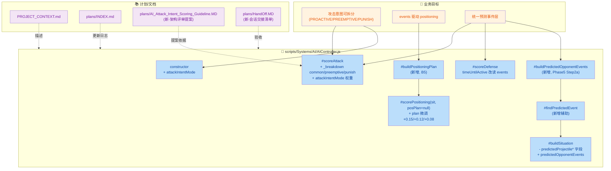
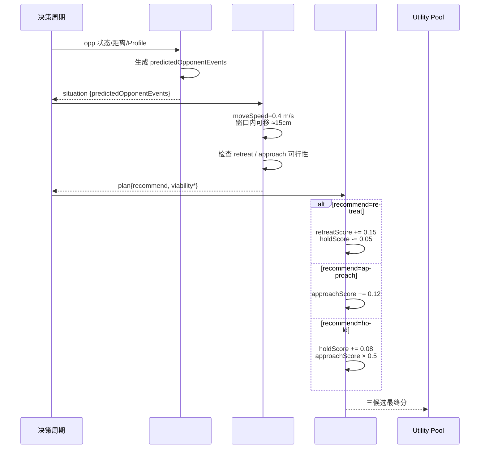
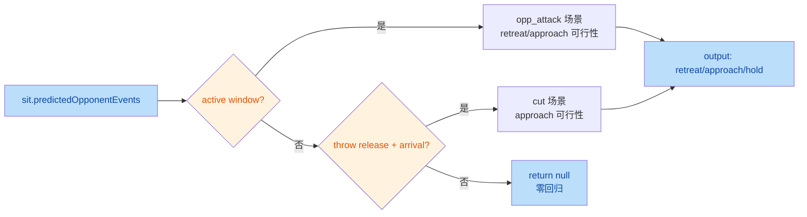

## 1. 高层摘要 (TL;DR) 🚀

*   **影响等级：** 🟡 **中**
*   **范围：** 落地 **Phase 5 统一预测层**（`predictedOpponentEvents[]`），全面重构 `AIController.js` 的预测消费方式；新增 **B5 events 驱动 positioning** 与 **攻击意图分项（PROACTIVE/PREEMPTIVE/PUNISH）隔离调试**能力；同步补齐项目文档与计划索引。
*   **关键变更：**
    * 🆕 **统一预测事件层**：新增 `#buildPredictedOpponentEvents()` / `#findPredictedEvent()`，把 throw / projectile / attack 三类预测统一为事件数组，**消除** `sit.predictedProjectileTTI` 等孤立字段。
    *   🆕 **攻击意图三路分项** (`Step B`/`Step C`)：在 `#scoreAttack` 内部按 `common` / `preemptive` / `punish` 三类贡献记账与汇总，新增 `attackIntentMode = "normal"|"proactive_only"|"preemptive_only"|"punish_only"` 调试开关。
    *   🆕 **B5 events 驱动 positioning**：新增 `#buildPositioningPlan(sit)`，结合 `moveSpeed=0.4 m/s` 物理约束判断 `retreat`/`approach`/`hold` 可行性；`#scorePositioning(sit, posPlan)` 据 plan 微调评分。
    *   🛠 **Preemptive 逻辑迁移到 events**：包含 *trajectory-aware scaling*（thrust 抑制 / slash 满分）；`timeUntilActive` 也改读 `opp_attack_active_window.startMs`。
    *   📚 **文档体系更新**：更新 `PROJECT_CONTEXT.md`、`plans/INDEX.md`；新增 `plans/AI_Attack_Intent_Scoring_Guideline.MD`（架构评审提案）与 `plans/HandOff.MD`（会话交接清单）。

---

## 2. 可视化概览 (Visual Overview) 🧭

### 2.1 业务目标 ↔ 模块 ↔ 关键方法映射



### 2.2 攻击评分分项与意图模式汇总流

```mermaid
flowchart TD
    A["#scoreAttack入口<br/>baseScore = baseWeight"] --> B["Step B: 初始化 _breakdown<br/>{common, preemptive, punish}"]
    B --> C1["common 累加<br/>cooldown/guardLeak/rangeEdge/<br/>threatPenalty/continuity/success"]
    C1 --> C2{"#findPredictedEvent<br/>opp_attack_active_window?"}
    C2 -- "存在 &距离可达" --> C3["PREEMPTIVE bonus<br/>trajectory-aware scaling<br/>(thrust×0.3, slash×1.0)"]
    C2 -- "无" --> D    C3 --> D["vulnDelta 计入 punish<br/>(recovery 主贡献)"]
    D --> E["Step C: attackIntentMode<br/>× commonW / preemptiveW / punishW"]
    E --> F["score = common + preemptive + punish"]
    F --> G["× startupFactor × rangeFactor"]

    classDef step fill:#c8e6c9,color:#1a5e20;
    classDef cond fill:#fff3e0,color:#e65100;
    class A,B,C1,D,E,F,G step;
    class C2 cond;
```

### 2.3 Positioning 决策流（含 events 驱动 plan）



---

## 3. 详细变更分析 🔍

### 3.1 📦 `scripts/Systems/AI/AIController.js`（主体改动）

#### 3.1.1 构造函数（Step C）— 新增 `attackIntentMode` 隔离开关

| 字段 | 默认值 | 说明 |
|---|---|---|
| `attackIntentMode` | `"normal"` | `"normal"` / `"proactive_only"` / `"preemptive_only"` / `"punish_only"` |

实现要点：四种 mode 通过对 `_breakdown.common / preemptive / punish` 三者施加权重系数（0 或 1），隔离整条意图路径；非 normal模式下若 `oppIsIdle` 时 `commonW=0`，避免"标称 only"模式仍主动追击。

#### 3.1.2 `#scoreAttack` — Step B 分项诊断 + Step C 权重汇总

**新增意图分项账本：**

```text
_breakdown = { common, preemptive, punish }
```

| 评分项 | 归属 | 备注 |
|---|---|---|
| `attackCooldownMs` 惩罚（startup 豁免） | `common` | **新增豁免**：`oppInStartup=true` 时不扣 cooldown |
| `guardLeakBonus` | `common` | |
| `vulnDelta` (`oppVulnerable * vulnReward`) | `punish` | recovery 主贡献 |
| `threatPenalty` | `common` | |
| `preemptiveBonus`（events 驱动 + trajectory-aware） | `preemptive` | **逻辑重写**：见 §3.1.4 |
| `rangeEdgeBonus` | `common` | |
| `feedbackFailPenalty` / `feedbackSuccessBonus` | `common` | |
| `continuityBonus` | `common` | |
| `repetitionCost` | `common` | |

**trajectory-aware scaling（新）：**

| opp trajectory | oppStartup 与 myStartup 对比 | preemptiveMult |
|---|---|---|
| `"thrust"` | `myStartup >= oppStartup` | `0`（赶不上） |
| `"thrust"` | `myStartup < oppStartup` | `0.3`（勉强） |
| `"slash"` / `null` / 其他 | — | `1.0`（full） |

汇总公式：
```text
score = commonW*common + preemptiveW*preemptive + punishW*punish
      × startupFactor × rangeFactor × postureMult
```

#### 3.1.3 `#buildPredictedOpponentEvents` — Phase 5 Step 2a 统一预测事件生成器

| 事件类型 | 触发条件 | 关键属性 |
|---|---|---|
| `opp_attack_active_window` | `oppAttackProfile && oppPhase==="startup"` | `startMs/endMs`, `properties.trajectory/weight/reach/startupMs/activeMs/recoveryMs` |
| `opp_throw_release` | `oppThrowProfile` |瞬时事件，`properties.projectileType/cuttable/speed` |
| `opp_projectile_arrival_estimate` | `oppThrowProfile.cuttable` | 瞬时事件，含 `estimatedDistance` |

约束：`MAX_EVENTS=5`、`MAX_FUTURE_MS=2000`，按 `startMs` 升序裁剪；启用 `debugVisible` 时输出 `[AI-Diag] predictedEvents=N [...] oppPhase=...`。

#### 3.1.4 Preemptive 路径迁移（Step 2b）

**变更要点（preemptive 投掷物分支）：**

| 旧逻辑（删除） | 新逻辑（events 驱动） |
|---|---|
| `sit.predictedProjectileTTI != null && sit.predictedProjectileCuttable === true` | `#findPredictedEvent(events, "opp_projectile_arrival_estimate")` ≠ null |
| `const predictedTTI = throwRemainingMs + flyMs` | `arrivalEvent.startMs`（瞬时） |
| 手动算 `predictedFlightMs = distance/speed*1000` | `flightMs = arrivalEvent.startMs - releaseEvent.startMs` |
| `overrideDistance: sit.predictedProjectileDistance` | `overrideDistance: arrivalEvent.properties.estimatedDistance` |

**变更要点（preemptive attack 评分）：**

| 维度 | 旧 | 新 |
|---|---|---|
| 时间源 | `sit.opp.remainingMs`（整个 state 剩余时间，**偏大**） | `oppAtkWindow.startMs`（**精确**到 weaponbox 激活） |
| 物理条件 | `myStartup <= sit.opp.remainingMs` | `myStartup < oppTimeUntilActive && distance <= effectiveRange` |
| Trajectory 处理 | 无 | thrust 抑制 / slash 全分（见 §3.1.2 表） |

> ⚠️ **关键 bug 修复**：旧逻辑用 `remainingMs`（含 recovery）远大于真正 `timeUntilActive`，易让 AI 误判"抢先"成功。

#### 3.1.5 `#scoreDefense` 中 `timeUntilActive` 迁移（Step 3b）

- **首选**：`#findPredictedEvent(sit.predictedOpponentEvents, "opp_attack_active_window").startMs`
- **回退**：events 缺失时手动算 `startupMs - elapsedMs`（理论不会触发）
- 诊断日志同步：`(src=events oppTrajectory=...)`

#### 3.1.6 B5 Positioning Events 驱动（新增）

**新增 `#buildPositioningPlan(sit)`**：



**物理模型：**
```text
moveLimit = moveSpeed × (startMs / 1000)
 = 0.4 × (startMs / 1000)
窗口 ~380ms → moveLimit ≈ 0.15 m
```
即在典型 opp startup 窗口内 AI 只能移动 ~15cm；因此 positioning 主要作用于**阈值跨越**而非大范围 reposition。

**`#scorePositioning(sit, posPlan)` 调整：**

| `posPlan.recommend` | retreatScore | approachScore | holdScore |
|---|---|---|---|
| `retreat` | `+0.15` | — | `-0.05`（max0 截断） |
| `approach` | — | `+0.12` | — |
| `hold` | — | `×0.5` | `+0.08` |

**新增 approach 抑制条件：** `opp.phase === "startup"` 且存在 `opp_attack_active_window` → `approachScore *= 0.1`（让 AI 原地 hold 等 preemptive window，避免冲过头）。

#### 3.1.7 移除与简化

| 移除项 | 替代 |
|---|---|
| `sit.predictedProjectileTTI` / `predictedProjectileCuttable` / `predictedProjectileDistance` / `throwRemainingMs` 字段 | `sit.predictedOpponentEvents[]` |
| `#buildSituation` 内 `throw_windup` 预测外推块（约 30 行） | `#buildPredictedOpponentEvents`统一产出 |
| 调试日志 `_predInfo` 拼接 | `[AI-Diag] predictedEvents=...` |

### 3.2 📄 文档与计划

| 文件 | 类型 | 关键变更 |
|---|---|---|
| `PROJECT_CONTEXT.md` | 修改 | 单行描述追加："Phase 5 统一预测层 `predictedOpponentEvents[]`，events 驱动 attack/defense/positioning 评分" |
| `plans/INDEX.md` | 修改 | 新增 2026-10-12 Update Log：Phase 5 核心、B1/B4/B5 完成，B6（predictionAccuracy）仍在 backlog；物理边界说明 |
| `plans/AI_Attack_Intent_Scoring_Guideline.MD` | 🆕 新增（320 行） | 架构评审提案：攻击意图评分拆分 guideline，含设计目标、核心判断、Step A-D 步骤、12 节评审问题清单 |
| `plans/HandOff.MD` | 🆕 新增（15 行） | 本会话完成清单（cooldownPenalty 修复、tuning 还原、Step B/C 完成、`}}` 语法错误修复等）+ 下一会话选项 A/B/C/D |

#### HandOff.MD 列出的完成项（确认表）

| # | 事项 | 状态 |涉及文件 |
|---|---|---|---|
| 1 | cooldownPenalty scope bug 修复 | ✅ | `AIController.js:906`（`canAttack && !oppInStartup` 守卫） |
| 2 | tuning 还原（baseWeight=0.4, preemptiveBonus=0.2） | ✅ | `AITuning.js` |
| 3 | Step B 分项诊断日志 | ✅ | `AIController.js:900-1098` |
| 4 | Step C 意图权重 + debug 开关 | ✅ | `AIController.js:98-103`, `1065-1078` |
| 5 | `}`语法错误修复 | ✅ | `AIController.js:104` |
| 6 | intentWeights 补全 common 系数 | ✅ | `AIController.js:1068-1085` |
| 7 | 计划 MD 更新（Step 3→A/B/C/D, Step 4 标记意外实现） | ✅ | `plans/26.10.9 预测能力通用化计划.MD` |

#### HandOff.MD 列出的下一会话选项

| 选项 | 内容 | 复杂度 |
|---|---|---|
| A | 验证 normal 模式（跑一轮正常 AI 看三条 intent 自然竞争） | 🟢 低（测试为主） |
| B | B5 预测驱动 positioning（让 positioning 消费 events 决定 hold） | 🟡 中 |
| C | B6 predictionAccuracy 旋钮（`aiProfile.predictionAccuracy`） | 🟡 中 |
| D | PREEMPTIVE 物理门控放宽（`distance ≤ effR` → `distance ≤ maxRange`） | 🟢 低（1 行改动） |

---

## 4. 影响与风险评估 ⚠️

### 4.1 破坏性变更 (Breaking Changes) 🛑

*   **`sit` 上 4 个字段删除**：调用方（如有外部系统读取 `sit.predictedProjectileTTI/Cuttable/Distance` / `sit.throwRemainingMs`）会拿到 `undefined`。**风险面较小**——这些字段为 `#buildSituation` 内部产出，仅 `AIController` 内部消费。
*   **`#scorePositioning` 签名变更**：从 `#scorePositioning(sit)` → `#scorePositioning(sit, posPlan = null)`。新增参数带默认值，**向后兼容**（外部如直接调用也 OK）。

### 4.2 行为风险点 🎯

| 风险 | 说明 | 缓解 |
|---|---|---|
| 🟡 Preemptive 评分口径收紧 | 旧 `remainingMs`（state 剩余）→ 新 `timeUntilActive`（仅 startup剩余）→ **preemptive 实际触发阈值更严格**，可能让 PREEMPTIVE 触发频率下降 | trajectory-aware scaling 已为 thrust 提供降级系数 |
| 🟡 Preemptive 物理门控 | `distance ≤ effectiveRange`，需近距才能触发（HandOff.MD 已标注为"已知限制"） | HandOff.MD 提供 Option D 一行放宽 |
| 🟢 Approach 抑制叠加 | `opp.phase==="startup"` 时 `approachScore *= 0.1`，再叠加 plan.approach `+0.12` → 综合效果需测 | plan bonus 顺序在静态抑制**之后**应用 |
| 🟢 Positioning 退化 | `events=[]` 时 plan=null → 完全跳过 plan bonus，"零回归"已显式声明 | 防御性 `if (posPlan)` 守卫 |

### 4.3 测试建议 🧪

| 场景 | 验证目标 | 期望日志关键字 |
|---|---|---|
| opp idle，AI 距离合适，`proactive_only` | 主动进攻可独立竞争 | `attackBreakdown` 中 `+PUNISH=0 +PREEMPTIVE=0` |
| opp 长 startup（slash），AI 有快招可达，`preemptive_only` | 预测截击独立工作 | `[AI-Diag] PREEMPTIVE: ... mult=1.0` |
| opp 短 startup（thrust），AI 赶不上 | 不应给有效截击优势 | `+PREEMPTIVE=0`，可让 Defense/Positioning 胜出 |
| opp startup + 超出自身 reach | 距离硬条件拒绝 | preemptive 分项为 0 |
| 近距 throw windup，cuttable | preemptive cut + release 后 reactive 路径正常 | `[AI-Diag] preemptive_gate: ... VIABLE` |
| 远距 cuttable projectile | 既有两路径回归 | `predictedEvents` 含 release + arrival |
| projectile 不可切 | 不产 arrival事件，preemptive 路径跳过 | `#findPredictedEvent(... arrival) == null` |
| opp recovery，AI 在 cooldown | 不应套 startup 豁免 | `cooldownPenalty` 仍扣分 |
| `attackIntentMode="punish_only"` | recovery 时正常打，idle/startup 不主动 | `_breakdown.common` 在 startup 时被 `commonW=0` 抑制 |
| events 缺失（如 opp 静止且无 throw） | positioning 完全退化 | `positioningPlan: ... ` 日志缺失，无 plan bonus |

### 4.4 文档一致性 ✅

*   `PROJECT_CONTEXT.md`、`plans/INDEX.md`、`plans/HandOff.MD` 三处描述**一致**指向：
    *   Phase 5 统一预测层 + events 驱动 attack/defense/positioning
    *   B1/B4/B5 完成，B6 backlog *   物理边界：`moveSpeed=0.4 m/s` 下 startup 窗口内只能移 ~15cm
*   `plans/AI_Attack_Intent_Scoring_Guideline.MD` 为**评审提案**（尚未批准实施），下一会话选项 A/B/C/D 已在 HandOff 中列出。

---

> 📌 **TL;DR 给 reviewer**：本批 diff 是 **Phase 5 收尾** + **攻击意图分项基础设施**双线推进。改动集中在 `AIController.js`，核心是把"各自孤立预测字段"重构为**统一 events 数组**，并提供基于 events 的 positioning 与攻击意图调试模式。**风险面可控**（默认行为通过 fallback 路径保留），但建议优先跑 §4.3 中的 "trajectory=thrust" 与 "recovery+cooldown" 两个回归用例。