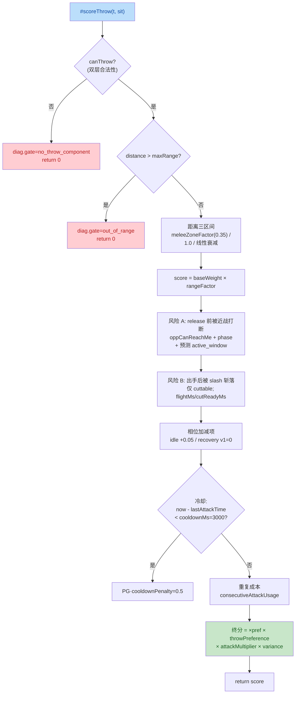

## 1. High-Level Summary (TL;DR)

*   **Impact:** 🔴 **High** - 引入全新的 AI 进攻性投掷子系统（RabbleStick 扔石头），横跨决策层、知识层、装配/弹药、资产、调试脚本五大维度，并完成 `PROJECT_CONTEXT`/`INDEX` 文档同步归档。
*   **Key Changes:**
    *   ✨ **决策层新增 `#scoreThrow`**：将 throw 作为独立 kind 接入 Utility 同池竞争，三距离区间 + 双独立风险 + idle/recovery 加分 + 独立3s 节奏冷却。
    *   🧠 **知识层 v5**：AIKnowledgeRegistry 引入含「手部释放高度」的弹道物理射程，落地方程 `t=(vy+√(vy²+2gh))/g`，×rangeConservatism=0.85。
    *   🔧 **BattleDef 配置化装配**：`combatantConfig[id].throwAmmo` 决定是否装配 ThrowComponent；`projectileType` 来自 StateGraph 首个 throwActive state（单一真相源）。
    *   🎯 **实测驱动的节奏修复**：`AITuning.throw.cooldownMs=3000` 防 throw 动画吞掉共享冷却造成的站桩连扔。
    *   📦 **完整资产接线**：StateGraph throw state + Factory clip + AssetManifest 三件套 + events + 手部锚点 + 独立 TestScript。

---

## 2. Visual Overview (Code & Logic Map)

### 🎯 业务目标 ↔ 模块 ↔ 关键方法映射

```mermaid
graph TD
    subgraph "业务目标: AI 进攻性投掷"
        Goal["RabbleStick 投掷 rock<br/>与近战交替施压"]
    end

    subgraph "Data 层 (配置)"
        AITuning["Data/AITuning.js<br/>throw.{baseWeight, cooldownMs,<br/>meleeZoneFactor, riskA/B...}"]
        ProjectileDefs["Data/ProjectileDefs.js<br/>rock{speed, launchVy, gravity}"]
        StateGraph["Data/StateGraphDef/RabbleStick.json<br/>throw state{throwActive,<br/>projectileType, throwReleaseFrame}"]
    end

    subgraph "Knowledge 层 (扫描缓存)"
        KB["scripts/Systems/AI/<br/>AIKnowledgeRegistry.js v5<br/>#scanThrowState<br/>flight.{physicalRange,<br/>effectiveRange}"]
    end

    subgraph "Decision 层 (AI)"
        AICtrl["scripts/Systems/AI/<br/>AIController.js"]
        ScoreThrow["#scoreThrow(t, sit)<br/>三距离 × 双风险 × 冷却<br/>×attackMultiplier × pref"]
        ScoreAtk["#scoreAttack /<br/>#scoreDefense /<br/>#scorePositioning"]
        MeleeReach["#getMeleeMaxEffReach()<br/>统一近战边界口径"]
    end

    subgraph "Assembly 层 (装配)"
        BattleMode["scripts/Systems/Modes/<br/>BattleMode.js"]
        BattleDef["SceneDefs.BATTLE_FIELD_*<br/>combatantConfig[id].throwAmmo"]
        ThrowComp["scripts/Components/<br/>ThrowComponent.js<br/>DEBUG_INFINITE_AMMO=false"]
    end

    subgraph "Asset 层 (资产)"
        Factory["scripts/CharacterFactory.js<br/>createRabbleStickCharacter<br/>throw clip"]
        Manifest["scripts/AssetManifest.js<br/>atlas/colliders/events/testScripts"]
        TestScript["Data/TestScripts/<br/>rabble_stick_throw_sequence.json"]
        RockJson["Art/Sprite/projectiles/<br/>proj_rock.json (12x12)"]
    end

    Goal --> AICtrl
    Goal --> BattleMode
    Goal --> KB

    AITuning --> ScoreThrow
    ProjectileDefs --> KB
    ProjectileDefs --> BattleMode
    StateGraph --> KB
    StateGraph --> BattleMode

    KB -->|throws[] 弹道数据| ScoreThrow

    AICtrl --> ScoreAtk
    AICtrl --> ScoreThrow
    AICtrl -->|统一口径调用| ScoreAtk
    ScoreThrow --> MeleeReach
    ScoreAtk --> MeleeReach

    BattleDef -->|throwAmmo| BattleMode
    BattleMode -->|装配| ThrowComp
    Factory --> Manifest
    Manifest --> TestScript
    Manifest --> RockJson
    StateGraph --> Factory

    style Goal fill:#c8e6c9,color:#1a5e20
    style ScoreThrow fill:#bbdefb,color:#0d47a1
    style MeleeReach fill:#fff3e0,color:#e65100
    style KB fill:#f3e5f5,color:#7b1fa2
    style BattleMode fill:#fff3e0,color:#e65100
    style ThrowComp fill:#ffcdd2,color:#b71c1c
```

### 🔄 `#scoreThrow` 评分流程（核心算法可视化）



---

## 3. Detailed Change Analysis

### 🧠 Decision Layer — `#scoreThrow` 评分函数 (Source: `AIController.js`)

*   **What Changed:** 在 `_decide` 主流程（add 后 8 行）的 attack/defense 同池竞争中，新增 throw kind；新增私有方法 `#scoreThrow(t, sit)`；新增 `#getMeleeMaxEffReach()` 作为唯一近战边界口径；X 键诊断新增 `throws:` 行（gate 失败也输出原因）；`#isCommitted` 列表隐含支持 throwActive（通过 `attack||throw` 同分支维护 `lastAttackTime`）。
*   **决策结构与权重（从 `AITuning` 注入）:**

| 维度 | 默认值 | 语义 |
|---|---|---|
| `baseWeight` | 0.35 | 略低于 attack.baseWeight(0.4)，量级同档可竞争 |
| `rangeConservatism` | 0.85 | 物理射程 × 此值得到 `effectiveRange` |
| `meleeZoneFactor` | 0.35 | 近战区间 throw 距离系数（非零，留弹性不硬禁） |
| `interruptRiskPenalty` (A) | 0.25 | release 前被近战打断 满额扣分 |
| `cutRiskPenalty` (B) | 0.20 | 出手后被 slash 斩落 满额扣分（仅 cuttable） |
| `idleOpportunityBonus` | 0.05 | opp idle 时弱主动机会 |
| `recoveryPunishBonus` | 0.15 | opp recovery 窗口（当前无数据恒0） |
| `cooldownMs` | **3000** | ⚠️ 关键：实测修正，独立于 500ms 共享冷却 |

### 📐 弹道射程公式（KB v5，Source: `AIKnowledgeRegistry.js`）

```javascript
// 含手部释放高度的真实落地方程
if (gravity > 0 && releaseHeight > 0) {
    // t = (vy + √(vy²+2gh)) / g    landingFlightMs = (launchVy + Math.sqrt(launchVy*launchVy + 2*gravity*releaseHeight)) / gravity * 1000;
} else if (launchVy > 0 && gravity > 0) {
    // 无锚点兜底：2·vy/g 对称弧
    landingFlightMs = (2 * launchVy / gravity) * 1000;
} else {
    landingFlightMs = def.lifetimeMs ?? 0;
}
physicalRange = speed * (landingFlightMs / 1000);
effectiveRange = physicalRange * 0.85; // rangeConservatism
```

### 📋 BattleDef 配置变更（Source: `SceneDefs.js`）

| Battle | 输入修改 | 输出影响 |
|---|---|---|
| `BATTLE_FIELD_1` | `combatantConfig.enemy_1.throwAmmo=3` | enemy_1 装配 ThrowComponent(ammo=3) |
| `BATTLE_FIELD_2` | `combatantConfig.enemy_1.throwAmmo=3` | 同上 |
| `PROLOGUE_BATTLE` | `combatantConfig.enemy_1.throwAmmo=3` | 同上 |
| `BATTLE_FIELD_EP1_TAVERN_ROOM` | `combatantConfig.enemy_1.throwAmmo=3` | 同上 |

> **注：** `PROJECT_CONTEXT.md` 与 plans文档明确说明「机制代码保留，但各战斗 `combatantConfig.throwAmmo` 暂全部移除」，但当前 diff 仍保留 `throwAmmo: 3`；下一轮清理需统一。

### 📦 ProjectileDefs.rock 物理参数变更（Source: `ProjectileDefs.js`）

| 参数 | 旧值 | 新值 | 备注 |
|---|---|---|---|
| `speed` | 5 | **16** | 提高投掷速度 |
| `launchVy` | 1.2 | **0.1** | 几乎平射 |
| `gravity` | 4 | **32** | 增大重力（缩短飞行） |
| `frame.w/h` | 20×20 | **12×12** | 缩小精灵尺寸 |
| `arcHeight` | 2.0 | 2.0 | 未变 |
| `cuttable` | false | false | 石头不可斩（仍只闪避） |

### 🎨 Asset Manifest 三件套扩展（Source: `AssetManifest.js`）

| 类型 | Key | 路径 |
|---|---|---|
| `testScripts` | `rabbleThrowSequence` | `Data/TestScripts/rabble_stick_throw_sequence.json` |
| `atlas.rabble` | `throw` | `Art/Sprite/rabble_stick/rabble_stick_throw.json` |
| `colliders.rabble` | `throw` | `Data/CollisionMask/rabble_stick/rabble_stick_throw.collider.json` |
| `animationEvents.rabble` | `throw` | `Data/AnimationEvents/rabble_stick/rabble_stick_throw.events.json` |

### 🎬 RabbleStick StateGraph throw 状态（Source: `StateGraphDef/RabbleStick.json`）

*   `commands` 列表新增 `throw`；
*   `move` 与 `swing` 节点各新增一条 `command: throw → throw` 转移；
*   新增 `throw` state：`{ clip: "throw", throwActive: true, projectileType: "rock", throwReleaseFrame: 5 }`，动画播放完毕（normalized ≥ 1.0）转移回 `idle`。

### 📜 Animation Events（Source: `rabble_stick_throw.events.json`）

| 帧 | 事件类型 |
|---|---|
| 1 | `throw_draw` |
| 4 | `throw_release` |

### 🧪 测试脚本（Source: `rabble_stick_throw_sequence.json`，新增）

```json
{
  "name": "rabble_stick_throw_loop",
  "loop": true,
  "sequenceLabel": "rabble-throw-test",
  "steps": [
    { "waitMs": 1000 },
    { "command": "throw", "waitMs": 1100 },
    { "waitMs": 1500 }
  ]
}
```

### 🛠 BattleMode 装配逻辑重构（Source: `BattleMode.js`）

*   遍历由 `this._combatants` 改为 **`this._battleDef.combatants` id** 列表，通过 `actorRegistry.get(id)` 配对，避免实体身份不一致。
*   AI 装配分支：`combatantConfig?.[id]?.throwAmmo > 0` 时才 `new ThrowComponent({ ammo })`。
*   **统一 `projectileType` 真相源**：从 `stateGraph.states`找首个 `throwActive=true` 的 state 的 `projectileType`，调 `setProjectileType`；玩家与 AI 走同一路径，无 throw state 时安全跳过（运行时默认 dagger）。
*   **持物阶段 sprite 数据驱动**：`throw_draw` 子流程从硬编码 `proj_dagger.png + 32×6` 改为 `getProjectileDef(projectileTypeId)?.{spriteUrl, frame}`，去除 dagger 硬编码；未知 projectileType 时 warn 退出而非崩溃。

### 🔄 ThrowComponent 安全开关（Source: `ThrowComponent.js`）

| 字段 | 旧值 | 新值 |
|---|---|---|
| `DEBUG_INFINITE_AMMO` | `true` | **`false`**（正式环境必须） |

### 🩺 TestController 脚本支持（Source: `Scene.js`）

*   新增 SceneDef 实体级 `testScript` 字段覆盖默认键（`rabbleBasicSequence` / `manatarmsBasicSequence`），使单次测试可灵活切换 throw 序列而无需改 archetype。

### 📚 文档同步（Source: `PROJECT_CONTEXT.md`, `plans/INDEX.md`）

*   `PROJECT_CONTEXT.md`：AI 系统、KB、ThrowComponent、装配小节均更新注释（进攻性 throw候选、`flight` 块、throwAmmo 配置、DEBUG_INFINITE_AMMO=false）。
*   `plans/INDEX.md`：新增 2026-10-16 Update Log 与「最近归档」表格，归档 `26.10.14 AI-Rabblestick投掷能力计划.MD`。

### 📖 新增 Skill 文档（Source: `.trae/skills/collider-occupancy-更新-skill/SKILL.md`）

*   新建 `Collider / Occupancy 更新` Skill：包含 A 路（战斗角色 `*.collider.json`）与 B 路（NPC `*.occupancy.json`）的脚本路径、命令模板、批量示例、颜色约定、注意事项。

---

## 4. Impact & Risk Assessment

### ⚠️ Breaking Changes / 兼容性*   **`ThrowComponent.DEBUG_INFINITE_AMMO` 翻转为 `false`**：任何依赖无限弹药做 AI 投掷行为测试的下游脚本/演示场景将立即失效；需相应调高 `combatantConfig[id].throwAmmo` 或临时翻转该 flag。
*   **`BattleDef.combatantConfig` 为新字段**：所有现有 BattleDef 若未声明该字段，`enemy_1` 默认不装配 ThrowComponent → AI 不再投掷（计划文档要求后续按需逐战斗开启）。
*   **`#isCommitted`/决策层 kind 扩展**：`{ kind: "throw" }` 是新增枚举，UI/调试器如对 kind 做白名单过滤需要补 case。
*   **`AIKnowledgeRegistry.#SCHEMA_VERSION` 从 v3 → v5**：强制 re-scan，旧缓存 profile 被覆盖，运行期短暂扫描开销可忽略。

### 🐛 风险点

*   **`SceneDefs` 当前 4 个 BattleDef 全部 `enemy_1.throwAmmo: 3`**：与 plans 中"现状修正（暂全部移除）"的描述矛盾，可能导致主流程敌人无差别投掷石头，需要 QA 验证体验。
*   **`#getMeleeMaxEffReach` 替换了原 `effectiveRange` 计算**：原 `#scoreAttack`/`#scorePositioning` 中的内联 `maxFwdBoost + rangeBuffer` 提取为统一方法；调用点仅更新了三处，需全文 grep 确认没有遗漏的「自造第二份近战边界」。
*   **`recoveryPunishBonus` 当前恒 0**：依赖预测层 recovery 精确剩余时间（计划 §12 Backlog），v1暂未生效；非回归性，但功能暂未完整。
*   **`proj_rock` frame 缩到 12×12**：可能与碰撞/视觉尺寸相关下游（CutResolver 视觉表现、特效挂点）需确认无遗留引用 20×20。
*   **新增的 `.trae/skills/collider-occupancy-更新-skill/SKILL.md`** 与既有 skill 体系如何索引/触发需确认（Trae Skills 通常由触发关键词路由）。
*   **`.ase` / `.kra` 二进制资源更新**（Tavern/arrow/floor/treeline_pine）：diff 仅显示 "Binary files differ"，未给出语义；如属美术批次更新需确认与战斗逻辑无关。

### ✅ Testing Suggestions

*   **基础流程**：
    *   进入任一 `BATTLE_FIELD_*`/`PROLOGUE_BATTLE`，观察 `enemy_1` 是否在甜点距离触发 throw，弹道与 ProjectileManager.fixedUpdate 渲染一致。
    *   验证 X 键诊断 `throws: ... R_eff=… rf=… riskA=… riskB=… → sc=…` 输出格式正确（gate 失败时也应输出）。
*   **射程边界**：
    *   站位超出 `effectiveRange × (1+smooth)` → throw 应被打 `out_of_range` 拒绝。
    *   站位 < `meleeZoneFactor` → throw 分应保留弹性但不会被 attack 完全压死。
*   **风险路径**：
    *   opp 在 active 阶段且 `oppMaxEffReach ≥ distance` → 风险 A 满额扣分 0.25。
    *   opp 在 startup 阶段且预测 `opp_attack_active_window.startMs ≤ startupMs+50ms` → 风险 A 应进入线性满分。
    *   `rock.cuttable=false` → 风险 B 应为 0（即便对手有 cuttable slash）。
*   **节奏冷却**：
    *触发 throw 后 `lastAttackTime` 应更新；3000ms 内 throw→throw 与 attack→throw 应被 `cooldownPenalty=0.5` 抑制；throw→attack 应不受影响（投完贴脸近战）。
*   **装配与 ammo**：
    *   `combatantConfig.enemy_1.throwAmmo=3` → enemy_1 装配成功，抛 3 次后 ThrowComponent.ammo=0，决策层 `canThrow()=false`。
    *   去掉 `throwAmmo` 或置 0 → ThrowComponent 不被装，AI 不出现投掷候选。
*   **持物阶段 sprite**：
    *   `proj_rock.png` 应被正确加载（不再是 dagger）；`frame = 12×12` 缩放正确；未知 projectileType 应走 warn 退出而非崩。
*   **StateGraph 接线**：
    *   throw 完成后回到 `idle`；不出现状态卡死；`throwReleaseFrame=5` 与 events `frame=4 throw_release` 配合正确释放投石。
*   **TestController**：
    *   SceneDef 实体加 `testScript: "rabbleThrowSequence"` 应覆盖 archetype 默认。
*   **回归**：
    *   近战三招式（thrust/swing/hit）评分口径未变（`#getMeleeMaxEffReach` 仅换了等价计算），跑一遍旧测试用例。
    *   `#scorePositioning` 应保持与之前同输出（`maxEffReach` 等价）。

### 📌 评审结论
本次提交体量大、跨层多、文档同步完整，符合"已完成 + 归档"状态；唯一需要立即关注的是 `SceneDefs` 中 `throwAmmo: 3` 与计划文档"暂全部移除"描述的不一致，需与产品/设计确认是否立即生效或先回滚。