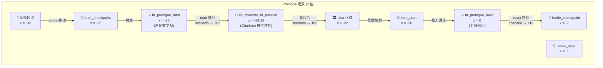
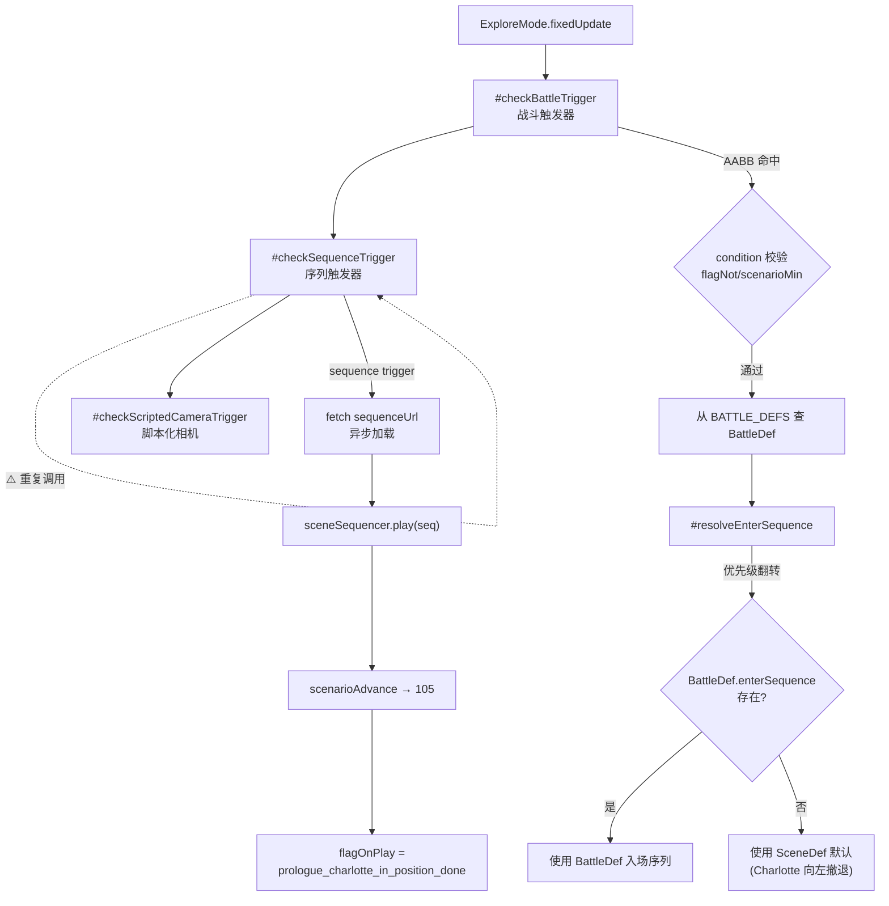
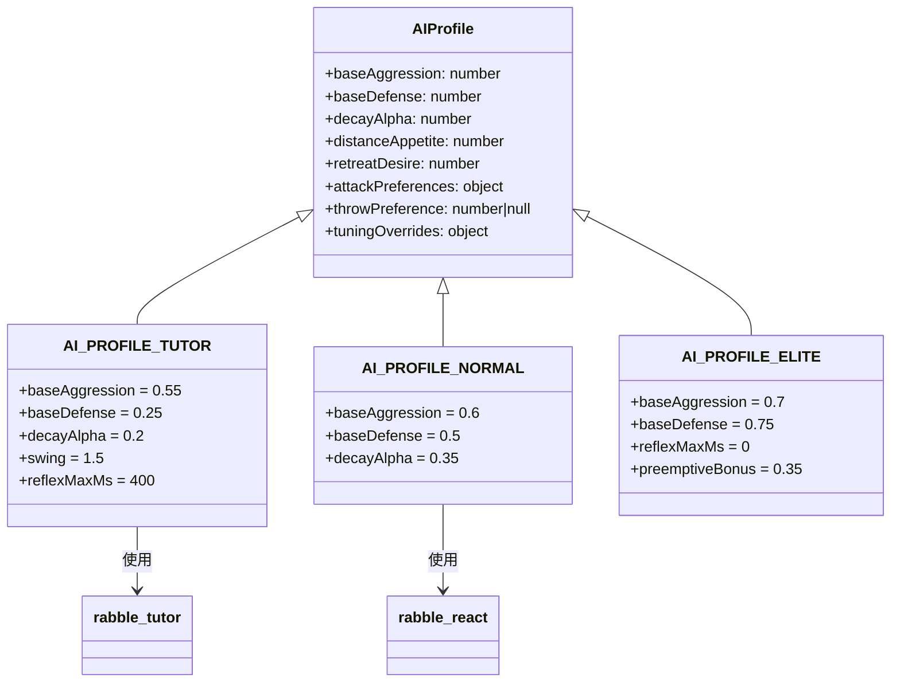

## 1. 高层摘要 (TL;DR)

* **影响等级：🔴 高** —— 这是为支持"单场景多战斗"而进行的大规模重构，涉及数据层、运行时、相机、AI 与触发器系统多模块改动。
*   **关键变更：**
    *   🎯 **加入 tutor 教学战**：在 prologue 场景 `x=-26` 处新增 `bt_prologue_tutor` 战斗触发器和 `rabble_tutor` 敌人，与原有的 `rabble_react` 主战斗并行。
    *   🏷️ **实体重命名**：`enemy_1` → `rabble_react`（语义化：reactive 敌人 → tutor 教学战后的"反应战"敌人）。
    *   🧠 **新增 AI 个性化系统**：新建 `Data/AIProfiles.js`，定义 `TUTOR / NORMAL / ELITE` 三种 AI 模板（Posture + Utility 双层）。
    *   🔧 **ExploreMode 触发器扩展**：新增 `#checkSequenceTrigger` 方法，支持条件式 sequence触发器（scenarioMin/Max、flagOnPlay、sequenceUrl 加载）。
    *   📋 **入场/退场序列优先级翻转**：从 `SceneDef → BattleDef`改为 `BattleDef → SceneDef`，便于每场战斗独立配置。
    *   🐛 **开发调试修改**：`rabble_stick` 敌人 `maxHp` 从 10 降至 2（注释 `//devModif`），便于快速测试战斗。
    *   🐛 **疑似 bug**：`#checkSequenceTrigger` 在 `fixedUpdate` 中被调用了**两次**（行 44 与行 46），可能导致序列被双重处理。

---

## 2. 可视化总览 (代码与逻辑图)

### 2.1 Prologue 场景战斗分布



### 2.2 重构后的战斗触发与解析流程



### 2.3 AI Profiles 模块关系



---

## 3. 详细变更分析

### 3.1 📦 美术资源 (Binary Files)

| 文件路径 | 类型 | 变更说明 |
|---|---|---|
| `Art/RawAssets/Env/Tavern.ase` | Aseprite 源文件 | 二进制变更（未提供具体差异） |
| `Art/RawAssets/Env/arrow.ase` | Aseprite 源文件 | 二进制变更 |
| `Art/RawAssets/Env/floor.kra` | Krita 源文件 | 二进制变更 |
| `Art/RawAssets/Env/treeline_pine.kra` | Krita 源文件 | 二进制变更 |

> ⚠️ 建议使用图像对比工具（Aseprite 的 onion-skin 或 Krita 的版本历史）确认环境贴图实际变更范围。

### 3.2 📊 Scene 数据层 `Data/SceneDefs/prologue.json`

#### 3.2.1 入场序章 companion 步移动 (line 36-39)

| 属性 | 旧值 | 新值 | 含义 |
|---|---|---|---|
| 动作类型 | `moveActorTo` (x=-9, y=0) | `moveActorByDirection` (dir=[-1, 0.1]) | 从"绝对坐标"改为"方向向量"移动 |
| durationMs | 1000 | 2000 | 移动耗时延长 |
| idle atMs | 1000 | 3000 | 进入 idle 状态延后 |

#### 3.2.2 敌人实体改造

| 实体 | 旧 | 新 |
|---|---|---|
| `enemy_1` | id, name=`rabble_stick` | ❌ 删除 |
| `rabble_react` | — | ✅ 新增（aiProfile: NORMAL, throwAmmo: 3） |
| `rabble_tutor` | — | ✅ 新增（aiProfile: TUTOR, attackPreferences: {swing:1.5, thrust:0.5, slash:0.5, dash:0.3}，reflexMaxMs: 400） |

#### 3.2.3 新增 spawn 点与触发器

| 类型 | id | pos | condition |
|---|---|---|---|
| spawn | `tutor_checkpoint` | `[-28, 0, 0]` | — |
| battle trigger | `bt_prologue_tutor` | `[-26, 0, 0]` | `flagNot: prologue_battle_tutor` |
| sequence trigger | `cs_charlotte_in_position` | `[-24.18, 0, 0]` | `scenarioMin: 102, scenarioMax: 104` |

### 3.3 🎬 序列数据 `Data/Sequences/*.json`

| 文件 | 变更 |
|---|---|
| `prologue_cs_rabble_flee.json` | `enemy_1` 引用全部改为 `rabble_react`（track id、binding actorId） |
| `prologue_intro.json` | 总体时长 `6600 → 4000`，letterbox `5500 → 3900`，相机高度/宽度回调，hero 移动至 `x=-30`，companion 移动至 `(-29.5, 0.7)`，简化入场动作序列 |
| `prologue_charlotte_in_position.json` | 🆕 新文件：让 Charlotte 从当前位置移动到 `(-22, 0)`，2500ms 完成，作为 tutor→react 之间的过渡剧情 |
| `prologue_intro copy.json` | 🆕 备份副本（建议加入 `.gitignore` 或删除，避免污染仓库） |

### 3.4 📝 文档 `plans/HandOff.MD`

完全重写为「单场景多战斗重构交接」详细设计文档：

*   **§1 结论**：不能简单加 trigger+enemy，必须引入 `BattleSession` 上下文。
*   **§2 已具备基础**：trigger 数组、BATTLE_DEFS map、actorRegistry 等已部分支持。
*   **§3 当前缺口**：详细列举 7 个仍依赖 `enemy`/`rabbleStick`/`rabbleController` 全局别名的代码位置（Scene.js、ExploreMode.js、BattleMode.js、TimelineSequencer.js 等）。
*   **§4 目标设计**：新增 `BattleSession` 数据结构、改 `Scene` 多 controller map、改相机/边界独立配置。
*   **§5 数据草案**：Prologue 左侧新战斗的具体坐标草案。
*   **§6 实施顺序**：8 步重构路线。
*   **§7 验收清单**：9 项回归测试条件。

### 3.5 ⚙️ 运行时脚本

#### 3.5.2 `scripts/CharacterFactory.js`

```diff
- maxHp: 10,
+ maxHp: 2,//devModif
```

> 🐛 **开发调试修改**：敌人血量从 10 降至 2，便于快速测试战斗。请在正式提交前确认是否需要恢复。

#### 3.5.3 `scripts/Scene.js`

仅注释微调：将 `enemy_1` 改为 "首个 enemy"，反映新的多敌人兼容设计意图。

#### 3.5.4 `scripts/SceneDefs.js`

| BattleDef | 变更 |
|---|---|
| `PROLOGUE_BATTLE` | combatants/combatantConfig 中 `enemy_1` → `rabble_react`；移除了 `enterSequence/exitSequence` 的 `BATTLE_FIELD_1` 引用（走 SceneDef 默认） |
| `PROLOGUE_BATTLE_TUTOR` | 🆕 新增：id=`prologue_battle_tutor`，combatants=[hero, rabble_tutor]，throwAmmo=0（教学战不投掷），stageBounds=`[-32, -19]`，onVictory.scenario=102（推进到 tutor→react 中间段） |
| `BATTLE_DEFS` | 注册 `PROLOGUE_BATTLE_TUTOR` |

#### 3.5.5 `scripts/Systems/Modes/ExploreMode.js`

##### 🔧 关键变更

1. **新增 sequence 触发器** `#checkSequenceTrigger`：支持 `condition` 校验、`flagOnPlay` 置位、`scenarioAdvance` 推进、异步 `sequenceUrl` 加载。

2. **入场序列优先级翻转**：

   ```diff
   + if (typeof battleDef.enterSequence === "function") return battleDef.enterSequence(battleDef);
   + if (battleDef.enterSequence) return JSON.parse(JSON.stringify(battleDef.enterSequence));
     const inlineSeq = sceneDef?.enterBattleSequence;
     if (inlineSeq) return JSON.parse(JSON.stringify(inlineSeq));
   - if (typeof battleDef.enterSequence === "function") return battleDef.enterSequence(battleDef);
   ```

3. **退场序列同样翻转**：`BattleDef.exitSequence` 现在优先于 `SceneDef.exitBattleSequence`。

##### 🐛 疑似 Bug：重复调用

```diff
+ this.#checkSequenceTrigger(character, sceneSequencer);
  this.#checkScriptedCameraTrigger(character, sceneSequencer);
+ this.#checkSequenceTrigger(character, sceneSequencer);
```

`#checkSequenceTrigger` 在 `fixedUpdate` 中被调用了**两次**（第 44 行 + 第 46 行）。由于 `#checkSequenceTrigger` 内部用 `_firedBattleTriggerIds` 做了幂等保护，不会重复触发，但代码冗余明显，建议删除一行。

### 3.6 🆕 新增文件

#### 3.6.1 `Data/AIProfiles.js` (83 行)

AI 个性化模板系统，定义 3 种 AI 档位：

| 模板 | baseAggression | baseDefense | decayAlpha | 特征 |
|---|---|---|---|---|
| `AI_PROFILE_TUTOR` | 0.55 | 0.25 | 0.2 | 慢节奏、swing 偏好 1.5x、reflexMaxMs=400、preemptiveBonus=0.05 |
| `AI_PROFILE_NORMAL` | 0.6 | 0.5 | 0.35 | 标准节奏，无 attackPreferences（走 StateGraph 默认） |
| `AI_PROFILE_ELITE` | 0.7 | 0.75 | 0.55 |强防御、reflexMaxMs=0、preemptiveBonus=0.35 |

> 📌 注意：当前 `prologue.json` 中 `rabble_tutor` 的 `aiProfile` 是**直接内联**于 JSON 中，而 `AIProfiles.js` 中的常量尚未被数据层引用。预期 `Scene._buildInstanceAiTuning` 会读取 `aiProfile` 并深合并 `tuningOverrides`，但需确认该函数实现是否存在。

#### 3.6.2 `Data/Sequences/prologue_charlotte_in_position.json`

新序列（2500ms），让 companion 走到 altar 位置 `(-22, 0)`，作为 tutor 战与 react 战之间的过渡剧情。

#### 3.6.3 `Data/Sequences/prologue_intro copy.json`

`prologue_intro.json` 的备份副本，保留了旧版（6600ms）的所有原始 clip。**建议从仓库中移除或加入 `.gitignore`**，避免后续 merge 冲突。

#### 3.6.4 `.trae/skills/collider-occupancy-更新-skill/SKILL.md`

新增 131 行 SKILL 文档，描述如何批量更新战斗角色的 collider（`extract_collision_boxes.ps1`）和 NPC 的 occupancy（`extract_rootmotion_occupancy.ps1`）。包含 PowerShell 命令模板和常见问题解答。

---

## 4. 影响与风险评估

### ⚠️ 破坏性变更 (Breaking Changes)

| 项 | 影响 | 备注 |
|---|---|---|
| `enemy_1` 实体被 `rabble_react` 替代 | 所有引用 `enemy_1` 的旧 sequence/script 将失效 | 当前已通过 `prologue_cs_rabble_flee.json` 的更新修复 |
| `prologue_battle` 的 `enterSequence/exitSequence` 不再 override | 走 SceneDef 默认 sequence | 可能影响某些依赖 `BATTLE_FIELD_1` 序列的测试场景 |
| `prologue_intro` 时长 6600 → 4000 | 所有引用此 sequence 的 timeline/触发器可能需要重新同步 | 检查所有 `enterBattleSequence` 调用链 |
| AI profile 注入逻辑未确认实现 | `aiProfile` 字段在 JSON 中但代码可能未消费 | 需检查 `Scene._buildInstanceAiTuning` 是否存在 |
| `PROLOGUE_BATTLE_TUTOR` 没有 `enterSequence` | 走代码 fallback（ExploreMode `#resolveEnterSequence`） | 可能影响 Charlotte 入场位置/表演 |

### 🐛 Bug 与遗留问题

1. **`#checkSequenceTrigger` 重复调用**（ExploreMode.js 第 44、46 行）—— 应删除一行。
2. **`CharacterFactory.createRabbleStickCharacter` maxHp=2 `//devModif`** —— 上线前必须恢复为 10 或讨论后保留新值。
3. **`prologue_intro copy.json` 备份文件** —— 应清理或忽略。
4. **未实现的 `BattleSession`** —— `plans/HandOff.MD` 详细规划但本次 diff 未真正引入，仍依赖 `Scene.rabbleController` 单例。运行时仍可能有多敌人绑 controller 失败的隐患。
5. **`Data/AIProfiles.js` 与 `prologue.json` 的 `aiProfile` 内联重复** —— 两处定义需明确单一真理源（建议统一通过 SceneDef JSON 引用常量，或把 AIProfile 常量 export 给 JSON loader）。

### ✅ 测试建议

|场景 | 验证内容 |
|---|---|
| `scenario < 102` | `bt_prologue_tutor` 与 `cs_charlotte_in_position` 都不可触发 |
| `scenario = 102~104` | 进入 tutor 区域只开启 `rabble_tutor` 战斗，胜利后 `scenario → 102` 推进到就位序列，Charlotte 移动到 (-22, 0) |
| `scenario = 105+` | `rabble_react` 主战斗可触发，`rabble_tutor` 已不出现 |
| tutor 战胜利 | 仅置 `prologue_battle_tutor` flag，**不**推进主线 scenario |
| 战败 | 恢复到 `tutor_checkpoint` (-28, 0)，不立即重入 AABB |
| `rabble_tutor` AI 行为 | 偏好 swing 攻击，反应慢（reflexMaxMs=400 窗口），preemptiveBonus 极低 |
| 双战斗并发 | 任意时刻只有一场战斗可被激活，不出现 AABB 抖动导致两场战斗同时触发 |
| 重载场景 | 已完成战斗的敌人不再 spawn；未完成战斗仍可触发 |
| `enemy_1` 引用 | 全局不应再有任何对 `enemy_1` 的硬编码引用（可全局 grep `enemy_1`验证） |

### 🎯 后续会话优先事项

按 `plans/HandOff.MD` §6 的 8 步实施顺序推进：

1. 重构 Scene：多敌人 controller map
2. 引入 BattleSession
3. 改 BattleMode 按 session 驱动
4. 改 TimelineSequencer 取参战者从 session
5. 确认 DuelCameraRig 每场战斗应用独立 config
6. 支持 per-battle enter/exit sequence
7. 添加 prologue 额外战斗数据与左侧专用入场序列
8. 全量回归