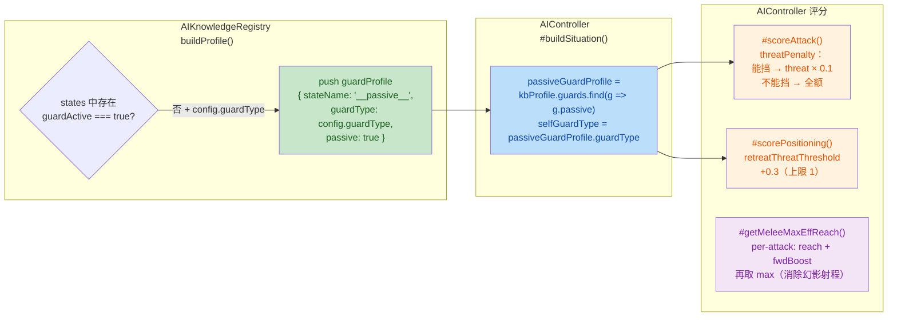
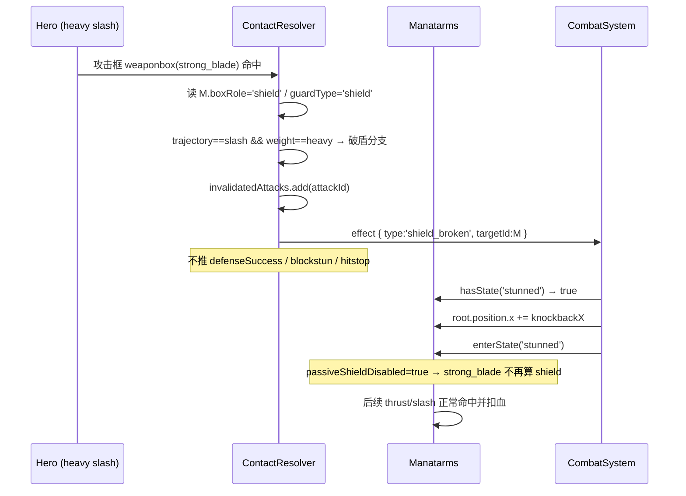

# 🗡️ BlindDuel 代码变更报告 — ManatarmsSword 接入 & 破盾机制

## 1. High-Level Summary (TL;DR)

- **Impact: High** — 本次变更围绕 **`ManatarmsSword`（常驻 shield 剑士）角色完整接入** 展开：新增 **heavy slash 破盾 → stunned硬直** 的战斗规则、让 AI 认知自身被动盾能力、修正 AI 射程与重复招式评分、补齐全部动画/碰撞资产，并把酒馆场景的敌人替换为该角色。

- **Key Changes:**
  - ✨ **新增破盾核心链路**：`ContactResolver` 在 shield 判定中识别 `slash + heavy`，不再简单 `blocked`，而是产出 `shield_broken` effect → `CombatSystem` 施加击退并切入 `stunned` 状态（本次伤害被 shield 吸收、**不扣血**）。
  - ✨ **新增被动盾开关**：`CombatCharacter.getCombatSnapshot()` 引入 `passiveShieldDisabled` / `effectiveGuardType`，使 `stunned` 期间 `strong_blade` 判定框彻底消失 → 后续攻击正常穿透命中扣血。
  - 🤖 **AI 自我认知被动盾**：`AIKnowledgeRegistry` 新增 `__passive__` 守卫 profile；`AIController` 据此把「能挡住的招」的 `threatPenalty` 降到 10%，并放宽 `retreat` 阈值。
  - 🐛 **AI 评分修正**：修复 `#getMeleeMaxEffReach()` 的「幻影射程」数学错误；并让 `positioning` 不再重置 `consecutiveAttackUsage`，使 repetition 惩罚链真正生效。
  - 📦 **资产/配置补全**：新增 `clash` / `stunned` 动画与碰撞数据、`ep1_tavern_hall_night` 场景敌人替换、`WorldState` 默认场景切换、`.trae` Collider/Occupancy 更新 Skill 文档。

---

## 2. Visual Overview (Code & Logic Map)

### 2.1 破盾（shield_break）完整链路

```mermaid
graph TD
    subgraph A["scripts/Enties/CombatCharacter.js<br/>getCombatSnapshot()"]
        A1["strong_blade box<br/>→ boxRole = 'shield'"]
        A2["passiveShieldDisabled<br/>= currentStateDef.passiveShieldDisabled"]
        A3["effectiveGuardType<br/>= stateDef.guardType<br/>|| config.guardType"]
        A1 --> A3 A2 --> A3
    end

    subgraph B["scripts/Systems/ContactResolver.js<br/>resolve() Phase 1"]
        B1{"guardType == 'shield'?"}
        B2["trajectory=thrust<br/>或 slash+light<br/>→ blocked = true"]
        B3["trajectory=slash<br/>AND weight=heavy<br/>→ 破盾"]
        B4["invalidatedAttacks.add()<br/>跳过 Phase 2 → 不扣血"]
        B5["effects.push({<br/>type: 'shield_broken',<br/>targetId, context:<br/>attackerId, knockbackX })"]
        B1 --> B2
        B1 --> B3
        B3 --> B4
        B3 --> B5
    end

    subgraph C["scripts/Systems/CombatSystem.js<br/>effect 处理链"]
        C1{"target.hasState('stunned')?"}
        C2["root.position.x += knockbackX<br/>enterState('stunned')"]
        C3["_fxShake(0.15, 120)"]
        C1 -->|是| C2
        C1 -->|否| C3
        C2 --> C3
    end

    subgraph D["Data/StateGraphDef/ManatarmsSword.json"]
        D1["state 'stunned'<br/>passiveShieldDisabled: true<br/>transitions → idle (norm>=1.0)"]
    end

    A3 --> B1
    B5 --> C1
    D1 -.定义 stunned 状态.-> C1
    D1 -.stunned 期间无 shield.-> A2

    style B3 fill:#ffcdd2,color:#b71c1c
    style B4 fill:#ffcdd2,color:#b71c1c
    style B5 fill:#ffcdd2,color:#b71c1c
    style C2 fill:#fff3e0,color:#e65100
    style D1 fill:#f3e5f5,color:#7b1fa2
    style A3 fill:#bbdefb,color:#0d47a1
```

### 2.2 AI 被动盾认知链路



### 2.3 交互时序（破盾一次完整命中）



---

## 3. Detailed Change Analysis

### 3.1 🔨 破盾核心机制（`scripts/Systems/ContactResolver.js`）

**What Changed：**原本 shield 判定只有「挡下 / 不挡」两种结果；现在把「不挡」这一路细分为 **破盾**，并让破盾成为一次**独立可观测的战斗事件**。

- Phase 1 `attack-vs-shield` 分支新增 `else` 破盾路径（源：`scripts/Systems/ContactResolver.js:91-110`）：
  - `invalidatedAttacks.add(offenseAttackId)` → 攻击被标记失效，**Phase 2 不结算命中、不扣血**（shield 吸收本次伤害）。
  - 推入 `shield_broken` effect，`context` 携带 `attackerId` / `attackInstanceId` / `knockbackX`。
  - 破盾路径 **不** 推 `defenseSuccess`，也 **不** 推 `blockstun` / `hitstop`（仅由 `CombatSystem` 做镜头震动）。
- `evaluateInteraction()` 返回值扩展（源：`scripts/Systems/ContactResolver.js:556-581`）：

| 返回字段 | 旧值 | 新值 | 说明 |
|---|---|---|---|
| `blocked` | shield 挡 thrust/light slash 为 true | 不变 | 挡下判定 |
| `shieldBroken` | ❌ 不存在 | `slash + heavy` vs shield → `true` | 新增，供 AI 区分三种结果 |
| `willMiss` | `blocked` | `blocked`（不变） | 破盾对 AI 而言算**命中**（穿透但触发对手破盾） |

> ⚠️ 破盾路径在 `if (blocked) { … }` 块之后直接 `continue;`，因此不会误触发 `guard_block` / `parry` / `clash` 分支 —— 逻辑自洽。

---

### 3.2 🎯 破盾状态落地（`scripts/Systems/CombatSystem.js`）

**What Changed：** 新增 `shield_broken` effect 的处理分支（源：`scripts/Systems/CombatSystem.js:76-86`）。

- 若目标角色**存在** `stunned` 状态 → 施加有符号击退 `root.position.x += knockbackX` 并 `enterState("stunned")`。
- 无论是否进入 stunned，都会执行 `_fxShake(0.15, 120)` 镜头震动。
- 不存在 `stunned` 状态的角色（hero / rabble_stick）→ **静默跳过**，不影响原有 guard 行为。

> 📌 注意：`#collectDefenderOutcomeFromEffect()` 未新增 `shield_broken → "guard:broken"` 映射（计划文档 §2.6提到需扩展，本次未实施）。因此**防守方的 outcome 统计目前拿不到破盾事件**。

---

### 3.3 🛡️ 被动盾开关（`scripts/Enties/CombatCharacter.js`）

**What Changed：** `getCombatSnapshot()` 中 `strong_blade` 判定框的 `shield` 归属逻辑重构（源：`scripts/Enties/CombatCharacter.js:331-354`）。

```javascript
// 旧：状态级 guardType 或 config 级 guardType 任一存在 → 就算 shield
(this.currentStateDef?.guardType || this.config?.guardType ? "shield" : null)

// 新：状态级可显式禁用被动盾
const passiveShieldDisabled = this.currentStateDef?.passiveShieldDisabled === true;
const effectiveGuardType = this.currentStateDef?.guardType
    || (this.config?.guardType && !passiveShieldDisabled ? this.config.guardType : null);
```

- **效果**：`stunned` 状态配 `passiveShieldDisabled: true` → 该状态下 `strong_blade` 不再产生 shield 判定框 → 对手任何攻击（thrust / light slash / heavy slash）都正常穿透命中并扣血。

---

### 3.4 🤖 AI 被动盾认知（`scripts/Systems/AI/AIKnowledgeRegistry.js` + `AIController.js`）

**What Changed（知识库侧）：** `buildProfile()` 在扫描完所有状态后，若角色**没有任何 `guardActive` 状态**但 **config 声明了 `guardType`**，则额外注入一条被动守卫 profile（源：`AIKnowledgeRegistry.js:192-204`）。

| 字段 | 值 |
|---|---|
| `stateName` | `"__passive__"`（哨兵名，非真实状态） |
| `guardType` | `character.config.guardType` |
| `canParry` | `false` |
| `timing` / `displacement` / `frameSpeeds` | `null` / `null` / `[]` |
| `passive` | `true`（新增标记） |

**What Changed（决策侧）：**

| 改动点 | 旧行为 | 新行为 |
|---|---|---|
| `#buildSituation()` | 无 `selfGuardType` | 新增 `selfGuardType`（取 `guards.find(g => g.passive)`） |
| `#scoreAttack()` threatPenalty | `sit.oppThreat * threatPenalty`（全额） | 能挡住的招 → `threat × 0.1`；heavy slash（破盾）→ 全额 |
| `#scorePositioning()` retreat 阈值 | `normalThreat` / `mobilityBoostThreat` | 能挡住 → 阈值 `+0.3`（上限 1）→ 不轻易后撤 |

> ✅ **无副作用保证**：`LongSwordMan` / `RabbleStick` 的 `config.guardType` 为空 → 无 passive profile → `selfGuardType = null` → 行为完全不变。

---

### 3.5 🐛 AI 评分算法修正（`scripts/Systems/AI/AIController.js`）

**(a) `#getMeleeMaxEffReach()` — 消除「幻影射程」**

```javascript
// 旧：跨 attack 分别取 max 再相加 —— max(A_i) + max(B_i) ≠ max(A_i + B_i)
const maxFwdBoost = Math.max(0, ...attacks.map(a => -displacement));
return this.#getMaxReach() + maxFwdBoost + this.rangeBuffer;

// 新：每个 attack 单独算 reach + 自身前冲，再取 max
const perAttackEffReach = attacks.map(a => (a.range?.maxReach ?? 0) + fwdBoost);
return Math.max(...perAttackEffReach) + this.rangeBuffer;
```

> 当 `maxReach` 与 `maxFwdBoost` 来自不同招式时，旧算法会算出一个**实际不存在的超远射程**，导致 AI 在够不到的距离发起攻击。

**(b) `positioning` 不再清空 `consecutiveAttackUsage`**

- 旧：`hold / approach / retreat` 会把 `#consecutiveAttackUsage = null` → repetition 计数永远归零 → 同一招可无限重复。
- 新：positioning 提前 `return`，计数保持 stale；`attack` commit 时（`AIController.js:2095-2103`）同招 `count++`、换招自然重置。
- **目的**：`smash → hold → smash` 的计数链变为 `1 → 2`，repetition 惩罚得以触发。

---

### 3.6 📋 状态图与角色配置

| 文件 | 变更 | 说明 |
|---|---|---|
| `Data/StateGraphDef/ManatarmsSword.json` | `smash.attackTrajectory`: `slash` → **`thrust`** | ⚠️ 与破盾设计冲突，见风险章节 |
| | `smash.frameSpeeds`: `[0,0.2,-3]` → `[0,0.2,-2.4,-1.2]` | 帧数增加后重排前冲节奏 |
| | 新增 `clash` 状态 | `frameSpeeds:[0,0]`，`norm>=1.0` → `idle` |
| | 新增 `stunned` 状态 | 带 `passiveShieldDisabled: true`，`norm>=1.0` → `idle` |
| | **删除** `knockdown` 状态 | 与 `defeated` 完全重复（`deathState` 只引用 `defeated`） |
| `Data/StateGraphDef/RabbleStick.json` | `postDefenseCounter.durationMs`: `500` → `1000` | 格挡/弹反后反打窗口翻倍 |
| `scripts/CharacterFactory.js` | `createManatarmsCharacter` 新增 `clash` / `stunned` clip 定义 | 含 `spriteSheetUrl` / `atlasData` / `colliderData` / `loop:false` |
| `scripts/CharacterFactory.js` | `createRabbleStickCharacter.maxHp`: `10` → **`2`** | 调试用数值，大幅削弱 |
| `scripts/AssetManifest.js` | manatarms `atlas` 与 `colliders` 各新增 `clash` / `stunned` | 资源注册 |

---

### 3.7 🗺️ 场景与关卡

| 文件 | 变更 | 说明 |
|---|---|---|
| `Data/SceneDefs/ep1_tavern_hall_night.json` | `enemy_1.archetype`: `rabble_stick` → `manatarms_sword`；`name` → `manatarms` | 酒馆场景敌人替换 |
| 同上 | 新增 `aiTuningOverrides.attack` | 见下方表 |
| `scripts/WorldState.js` | `currentSceneId`: `"prologue"` → `"ep1_tavern_hall_night"` | 默认启动场景切换 |
| `Data/Sequences/prologue_intro copy.json` | **新增文件** | 6.6s 过场序列（淡入 + 黑边 + 主角/同伴行走 + 相机 blend） |

**`aiTuningOverrides.attack` 参数**

| 参数 | 值 | 作用 |
|---|---|---|
| `baseWeight` | `0.16` | 攻击基础权重（偏低 → 更克制进攻） |
| `repetitionCostRate` | `0.32` | 重复招式惩罚增长率 |
| `repetitionCostMax` | `0.64` | 重复惩罚上限 |
| `preemptiveBonus` | `0.20` | 先手抢攻加成 |

---

### 3.8 📦 资产与碰撞数据

| 类别 | 变更 |
|---|---|
| **新增动画** | `clash`（拼刀僵持）、`stunned`（破盾长硬直，**8 帧，144×128**）——对应 atlas + collider + pushbox + rootmotion 四件套 |
| **smash 动画** | 帧数 `3 → 4`；`duration` `100→20` / `400→300` / `400→500` / 新增 `200`；图集宽度 `384 → 512` |
| **quart / reverse_quart** | 首帧 `duration: 100 → 20`（前摇收紧） |
| **smash collider** | 新增 `pushbox_0~3`；frame1 的 `weaponbox` 由 `weak_blade` **修正为 `strong_blade`**（此前误标，导致破盾判定不成立） |
| **stunned collider** | 8 帧**仅有 `hitbox`，无 `strong_blade` 像素** → 天然无盾，与 `passiveShieldDisabled` 双重保险 |
| **collider schema** | `collisionAtlasJson→atlasJson`、`collisionAtlasPng→collisionPng`、`rootAtlasPng→rootPng`、`pushboxAtlasPng→pushboxPng`，新增 `handColor: #FF00FF` |
| **rabble_stick** | 新增 `rabble_stick_CS_awake.json`（3 帧，1000/500/100ms） |
| **二进制美术** | `Tavern.ase`、`arrow.ase`、`floor.kra`、`treeline_pine.kra`、`manatarms_sword_{quart,reverse_quart,smash}.ase` |

**碰撞遮罩颜色约定**（新增 SKILL 文档中的标准）

| 颜色 | 含义 |
|---|---|
| `#FFFF00` | hitbox（受击框） |
| `#E37800` | weaponbox + `strong_blade` |
| `#FF0000` | weaponbox + `weak_blade` |
| `#7082C1` | root（根锚点） |
| `#FF00FF` | hand（手部锚点，新增） |

---

### 3.9 📝 文档与工具链

| 文件 | 变更 |
|---|---|
| `plans/26.10.20 ManAtArms人物接入计划.MD` | **新增** 272 行完整设计文档：角色特性、克制规则表、改动清单、stunned 行为验证表、AI 认知设计、12 项执行进度 |
| `.trae/skills/collider-occupancy-更新-skill/SKILL.md` | **新增** 131 行 Skill：两条更新路线（战斗角色 collider / NPC occupancy）、PowerShell 命令模板、颜色约定、5 条常见问题 |
| `plans/BACKLOG.md` | 删除「闪躲距离过长」，新增「tavern hall night 摄像机限制不生效」 |
| `plans/HandOff.MD` | ⚠️ 原「单场景多战斗重构交接」文档被 **完全替换**为 37 行 `[AI-Diag]` 运行日志 |

---

## 4. Impact & Risk Assessment

### 4.1 ⚠️ Breaking / 行为变更

| 项 | 影响面 | 严重度 |
|---|---|---|
| `smash.attackTrajectory`: `slash → thrust` | 破盾规则是 `trajectory==="slash" && weight==="heavy"`。改为 thrust 后，**Manatarms 自己的 smash 无法破任何盾**（shield 会挡 thrust），且**能被 guard 挡的招反而挡不住 thrust**（guard 规则：`trajectory!=="thrust"` 才挡） | 🔴 高 |
| `rabble_stick.maxHp: 10 → 2` | rabble_stick 几乎一碰就死（疑为调试数值） | 🟠 中 |
| `WorldState.currentSceneId` 默认值切换 | 启动即进入 `ep1_tavern_hall_night`，prologue 流程不再是默认路径 | 🟠 中 |
| `ManatarmsSword` 删除 `knockdown` 状态 | 若外部数据仍引用 `knockdown`，将走 `hasState()` 失败路径 | 🟡 低 |
| `evaluateInteraction()` 新增 `shieldBroken` | 返回对象新增字段，向后兼容；但现有调用方只读 `.blocked` | 🟢 低 |
| `AIKnowledgeRegistry` 新增 `__passive__` profile | 该 profile 同时进入 **AI 候选动作池**（`kbProfile.guards`）→ 可能出现 `guard:__passive__` 被选中并 `queueCommand("__passive__")` 的无效指令 | 🟠 中 |

### 4.2 🐛 风险点

1. **破盾事件未进入 outcome 统计** — `#collectDefenderOutcomeFromEffect()` 没有 `shield_broken → "guard:broken"` 映射（计划 §2.6 明确要求但未实施），防守方 AI 永远学不到「我被破盾了」。

2. **AI 攻击分可能变为负值** — `positioning` 不再重置 repetition 计数后，`plans/HandOff.MD` 的 AI-Diag 日志已出现 `quart sc=-0.342 / reverse_quart sc=-0.453 / smash sc=-0.176`，同时 `best=hold` —— 存在 **AI 陷入 hold 僵持、不再进攻** 的风险。

3. **`__passive__` 混入候选池** — 已在日志中出现 `top3=[hold:(pos)=0.226 | guard:__passive__=0.000 | approach:(pos)=0.000]`，说明被动盾 profile 被当作普通 guard 候选参与打分。

4. **调试日志未清理** — 计划 §6 明确要求删除，但本次仍保留：`ContactResolver.js` 3 条 `[DEBUG-SHIELD]`、`CombatSystem.js` 1 条 `[DEBUG-SHIELD-BROKEN]`、`CombatCharacter.js` 1 条 `[DEBUG-SHIELD]`。热路径逐帧 `console.log` 会显著拖慢战斗帧率。

5. **临时文件混入提交** — `Data/Sequences/prologue_intro copy.json`（文件名含 ` copy`）疑似草稿副本。

6. **`plans/HandOff.MD` 被日志覆盖** — 原本的「单场景多战斗重构交接」设计文档（171 行）内容不可恢复，建议回滚或另存。

7. **`.collider.json` schema 变更** — `collisionAtlasJson` 等旧字段被删除，若读取方（运行时或工具）仍依赖旧字段名会取到 `undefined`。

### 4.3 ✅ 建议测试场景

| # | 场景 | 预期 |
|---|---|---|
| 1 | Hero heavy slash 命中 Manatarms 主动盾 | Manatarms → `stunned`，**本次不扣血**，有击退 + 镜头震动 |
| 2 | Hero thrust / light slash 命中 Manatarms | 正常被挡（`blocked`），走 `guard_block` 流程 |
| 3 | `stunned` 期间对手任意攻击 | 穿透 →正常 hit + 扣血（`passiveShieldDisabled` 生效） |
| 4 | `stunned` 动画播放结束 | 自动回到 `idle`（`norm >= 1.0`） |
| 5 | `stunned` 期间被打到 0 HP | 进入 `defeated`（`deathState`），不卡在 stunned |
| 6 | 对 **无 `stunned` 状态** 的角色触发破盾 | 静默跳过，不影响原 guard 行为（hero / rabble_stick 回归测试） |
| 7 | Manatarms AI vs light slash 进攻 | `threatPenalty` 仅扣 10%，不后撤 |
| 8 | Manatarms AI vs heavy slash 进攻 | threat 全额扣 +正常后撤 |
| 9 | `LongSwordMan` / `RabbleStick` AI 全场景回归 | `selfGuardType = null`，行为与改动前**完全一致** |
| 10 | AI 连续 `smash → hold → smash` | repetition 计数 `1 → 2`，第二次 smash 分值下降 |
| 11 | AI 近战射程判定 | `#getMeleeMaxEffReach()` 不再超出实际可达距离 |
| 12 | `ep1_tavern_hall_night` 场景加载 | `enemy_1` 为 `manatarms_sword`，血量/AI 调参生效 |
| 13 | **Manatarms 的 smash 打带盾目标** | 🔴 确认 `thrust` 改动是否符合预期（当前会被 shield 挡下） |
| 14 | `Data/Sequences/prologue_intro copy.json` |确认该文件是否为临时副本，决定是否入库 |

---