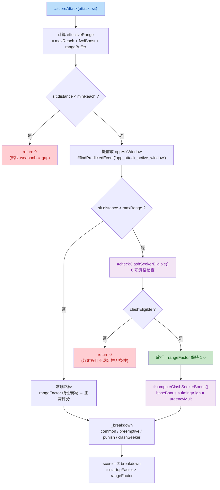
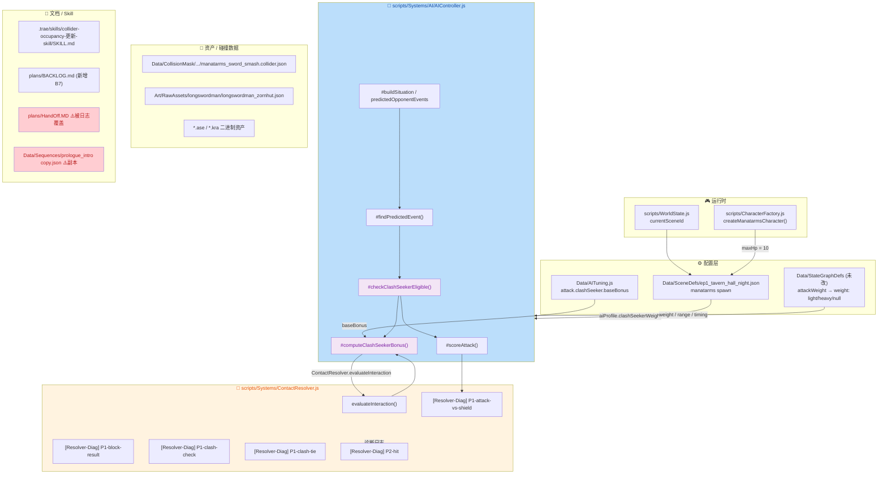
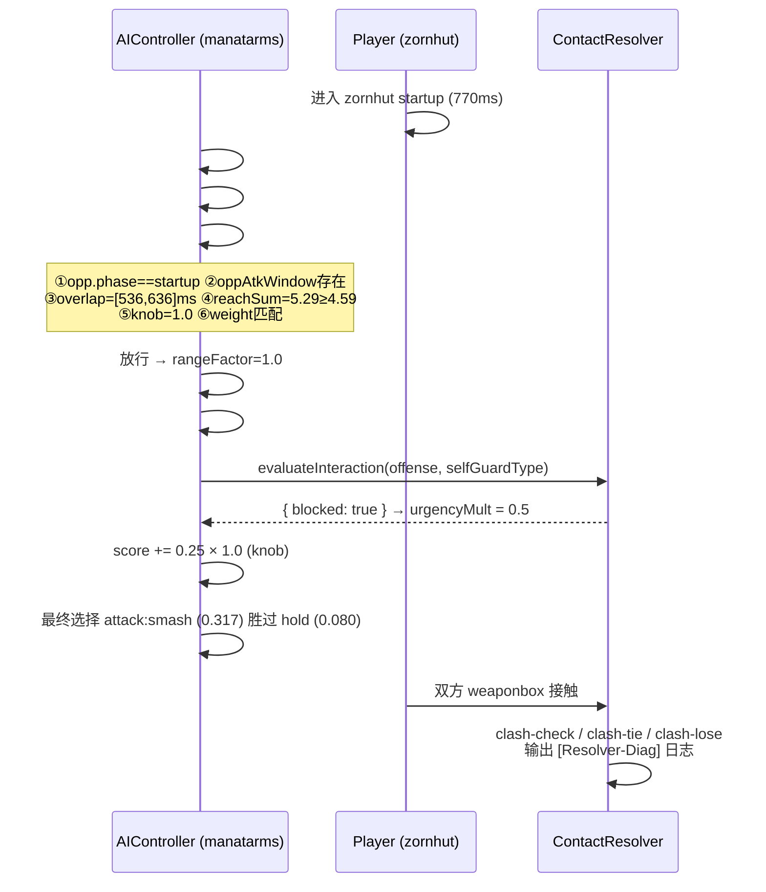

# 🗡️ BlindDuel — Clash Seeker 主动拼刀 AI 特性接入

## 1. 高层摘要 (TL;DR)

* **影响等级：🟠 Medium**
  * 引入一条**全新的 AI 评分维度**（Clash Seeker），会实质改变敌人出招决策；改动为**增量式**，无 API/数据库破坏性变更。
  * 附带若干**调试日志污染**、**默认场景切换**等需要清理的副产物。

* **核心变更：**
  * ✨ **新增 `clashSeeker` 攻击评分项**（`AIController.js`）——当对手正在起手且双方武器框激活窗口重叠时，允许 AI **突破 `maxRange` 硬门控**主动出招"撞刀"，并附加 Bonus 分。
  * ✨ **新增 2 个私有方法**：`#checkClashSeekerEligible()`（6 项资格检查）与 `#computeClashSeekerBonus()`（基础分 × 时序对齐 × 紧迫度）。
  * ⚙️ **新增配置**：`AITuning.attack.clashSeeker.baseBonus = 0.25`；`ep1_tavern_hall_night.json` 中 manatarms 敌人挂上 `aiProfile.clashSeekerWeight = 1.0`。
  * 🐛 **ContactResolver 大量无条件 `console.log`**（`[Resolver-Diag]`），每 tick 每接触都会打印，存在性能与日志洪水风险。
  * ⚠️ **`plans/HandOff.MD` 被调试日志整体覆盖**，原有 171 行「单场景多战斗重构交接」设计文档**内容丢失**。
  * 🎨 美术资产批量更新 + `manatarms_sword_smash.collider.json` 重新生成（weaponbox 类型由 `strong_blade` 变为 `weak_blade`）。

---

## 2. 视觉总览 (Code & Logic Map)

### 2.1 Clash Seeker 决策流（`#scoreAttack` 新增路径）



> ⚠️ **关键变化**：原代码 `if (sit.distance > maxRange) return 0;` 被替换为「资格检查 + 放行」分支。**这是本次唯一的硬门控语义变更**——AI 现在可能在自身最大射程之外出招，依赖武器碰撞来抵消。

### 2.2 模块 / 文件 / 关键方法 关系图



### 2.3 Clash Seeker 运行时交互时序



---

## 3. 详细变更分析

### 3.1 🧠 `AIController.js` — Clash Seeker 核心逻辑

**文件：** `scripts/Systems/AI/AIController.js`（+~160 行）

#### 3.1.1 硬门控改造：`maxRange` 早退 → 资格检查

* **改动前：**
  ```js
  if (sit.distance > maxRange) return 0;   // 超射程直接出局
  ```
* **改动后：** 引入 `clashEligible` 变量，超射程时改为调用 `#checkClashSeekerEligible()`；通过则 **放行**（`rangeFactor` 保持 `1.0`），不通过才 `return 0`。
* **同时**：`oppAtkWindow` 的计算位置从原 Line 1024（preemptive bonus 段）**前移至函数开头**（Line ~941），以供资格检查使用。这是本 diff 中唯一的变量作用域调整，preemptive bonus 段改为复用已声明变量。

#### 3.1.2 新增 `#checkClashSeekerEligible()` — 6 项资格检查

| # | 检查项 | 实现逻辑 | 来源 |
|---|--------|----------|------|
| ① | `opp.phase === "startup"` | 对手必须正在起手 | `sit.opp?.phase` |
| ② | `oppAtkWindow` 存在 | 对手有明确 attack profile | `sit.predictedOpponentEvents` |
| ③ | **overlap 时序** | 区间重叠判定：`max(myStart, oppStart) <= min(myEnd, oppEnd)`，非单端检查 | `timing.startupMs/activeMs` × `oppAtkWindow.startMs/activeDurationMs` |
| ④ | **reachSum 空间** | `myEffR + oppReach >= sit.distance` | `attack.range.maxReach + fwdBoost + rangeBuffer` + `oppAtkWindow.properties.reach` |
| ⑤ | **knob 开关** | `tuning.aiProfile.clashSeekerWeight > 0` | `Data/SceneDefs` 注入 |
| ⑥ | **weight 匹配** | `rank(myWeight) >= rank(oppWeight)`，即 `light(0) / heavy(1)`；`null` 视为中性不限制 | `attack.weight` vs `oppAtkWindow.properties.weight` |

> 📌 **代码注释明确**：「资格独立于普通距离门」，即 ③④⑥ 是**绕过射程硬门**的额外条件，而非放宽。

#### 3.1.3 新增 `#computeClashSeekerBonus()` — 评分计算

| 因子 | 计算公式 | 取值范围 | 说明 |
|------|----------|----------|------|
| `baseBonus` | `tuning.attack.clashSeeker?.baseBonus ?? 0.25` | 默认 `0.25` | 基础分 |
| `timingAlign` | `max(0.3, 1 - \|myStartup - oppTimeUntilActive\| / max(1, oppTimeUntilActive))` | `0.3 ~ 1.0` | 我方 active 起点越贴近对手 active 起点越高 |
| `urgencyMult` | 防得住 → `0.5`；防不住 → `1.0` | `0.5 / 1.0` | 防不住（heavy slash 破盾）时**必须 rush** |

* 内部**再次调用** `#checkClashSeekerEligible()`（注释标注「冗余但安全」）以保证单独调用不越界。
* 最终 `bonus = baseBonus × timingAlign × urgencyMult`，再乘 knob：`finalBonus = bonus × clashSeekerWeight`。

#### 3.1.4 评分分项（`_breakdown`）扩展

* `_breakdown` 新增第四个键：`clashSeeker`。
* 最终聚合改为四项求和：
  ```js
  score = _breakdown.common + _breakdown.preemptive + _breakdown.punish + _breakdown.clashSeeker;
  ```
* 调试输出新增 `+CLASH_SEEK=` 字段，触发条件扩展为 `_hasNonCommon`（含 `clashSeeker > 0`）。

#### 3.1.5 新增诊断日志（`[AI-Diag] clashSeekCheck`）

在 `debugVisible` 下逐项打印 ① ~ ⑥ 的通过情况及 `allClashEligible` 结论。
> ⚠️ 该诊断块**重复实现了 ③ / ④ / ⑥ 的判定逻辑**，与 `#checkClashSeekerEligible()` 并行存在，存在**逻辑漂移风险**（详见 §4 风险）。

---

### 3.2 ⚙️ 配置层：参数与 AI Profile

#### 3.2.1 `Data/AITuning.js`

| 配置项 | 旧值 | 新值 | 说明 |
|--------|------|------|------|
| `attack.clashSeeker.baseBonus` | *(不存在)* | `0.25` | Clash Seeker 基础加分，后续乘 `timingAlign` + `urgencyMult` |

#### 3.2.2 `Data/SceneDefs/ep1_tavern_hall_night.json`（manatarms 敌人实体）

| 字段 | 旧值 | 新值 | 影响 |
|------|------|------|------|
| `aiProfile.clashSeekerWeight` | *(不存在)* | `1.0` | **启用开关**，>0 才参与资格检查与加分 |
| `aiProfile.baseAggression` | *(不存在)* | `0.25` | Posture 层进攻性（低 → 偏保守/防御） |
| `aiProfile.baseDefense` | *(不存在)* | `0.75` | Posture 层防御倾向（高） |
| `aiProfile.retreatDesire` | *(不存在)* | `0.55` | 撤退欲望 |
| `aiTuningOverrides.attack.baseWeight` | `0.16` | `0.10` | **基础攻击分下调 37.5%** |
| `aiTuningOverrides.attack.repetitionCostRate` | `0.32` | `0.32` | 未变 |
| `aiTuningOverrides.attack.repetitionCostMax` | `0.64` | `0.64` | 未变 |
| `aiTuningOverrides.attack.preemptiveBonus` | `0.20` | `0.20` | 未变 |
| `aiTuningOverrides.defense.activeBase` | *(不存在)* | `0.95` | 新增 defense 覆写块 |
| `aiTuningOverrides.defense.startupCanActBase` | *(不存在)* | `0.80` | 同上 |
| `aiTuningOverrides.defense.startupTooLateBase` | *(不存在)* | `0.40` | 同上 |
| `aiTuningOverrides.defense.badDefensePenalty` | *(不存在)* | `0.0` | 同上 |

> 🔍 从 `plans/HandOff.MD` 的实测日志可见最终生效效果：
> `attackBreakdown(smash): common=-0.01 +PUNISH=0.12 +CLASH_SEEKER=0.25 → rawTotal=0.36`
> → 最终决策 `best=attack:smash(0.317) > hold(0.080) > attack:quart(0.094)`，AI **从"原地 hold"转为"主动扑上去拼刀"**。

---

### 3.3 🔨 `ContactResolver.js` — 诊断日志重构

**文件：** `scripts/Systems/ContactResolver.js`

* **核心变更：注释掉的旧日志 → 启用的无条件 `console.log`**，统一前缀 `[Resolver-Diag]`。

| 日志标签 | 触发时机 | 输出内容 |
|----------|----------|----------|
| `[Resolver-Diag] P1-attack-vs-shield` | 攻击武器框 vs 盾牌框接触 | 双方 `stateName@frameIndex`、box id/`boxRole`/`guardType`、trajectory、weight、attackId |
| `[Resolver-Diag] P1-block-result` | 护盾判定完成 | `blocked` / `canParry` / trajectory / weight / guardType |
| `[Resolver-Diag] P1-block-result (SHIELD_BROKEN)` | **新增 else 分支**：`blocked === false` | 明确标注破盾路径（heavy slash 打穿 shield） |
| `[Resolver-Diag] P1-clash-check` | 武器框 vs 武器框 | 双方 state/frame、boxRole、attack/weight |
| `[Resolver-Diag] P1-clash-tie` | 同 weight 对撞 | 双方 state/frame |
| `[Resolver-Diag] P2-hit` | 命中判定 | 双方 state/frame、weaponBox role/subtype、hitbox id、distX/distY vs sumHalf |

* **同时**：`#trace()` 内的日志内容也补充了 `tick=` 与 `stateName@frameIndex`。
* 移除了一段原本被 `/* */` 包裹的旧 `[HIT]` 调试代码。

> ⚠️ **这些日志不受 `debugTrace` 开关限制**（注释明确写了「额外输出一份到 console.log 不受 debugTrace 开关限制」）。

---

### 3.4 🎮 运行时与角色配置

| 文件 | 改动 | 影响 |
|------|------|------|
| `scripts/WorldState.js` | `currentSceneId`: `"prologue"` → `"ep1_tavern_hall_night"` | ⚠️ **默认启动场景被切换**，影响所有以 `WorldState` 为初始入口的流程（含新游戏、测试、剧情跳转） |
| `scripts/CharacterFactory.js` | `createManatarmsCharacter()` 新增 `maxHp: 10` | manatarms 血量上限固定为 10（此前走 `DEFAULT_CHARACTER_OPTIONS` 默认值） |

---

### 3.5 🎨 美术与碰撞数据

#### 3.5.1 `manatarms_sword_smash.collider.json` 重新生成

| 帧/框 | 旧值 | 新值 |
|-------|------|------|
| `generatedAtUtc` | `2026-10-22T05:39:39Z` | `2026-10-24T15:04:46Z` |
| frame0 `weaponbox_strong_blade_1` | subtype `strong_blade`，cx35 cy63 w49 h17 angle **90** | → `weaponbox_weak_blade_0`，subtype **`weak_blade`**，cx40.498 cy65 w45.077 h24.151 angle **-89.789** |
| frame0 `hitbox_2` | cx61 cy57 w57 h27 | **已删除**（编号重排为 hitbox_3） |
| frame1 `weaponbox_weak_blade_0` | cx16.5 cy57 w43 h10 angle 90 | → `weaponbox_weak_blade_1`，w45.086 h33.121 angle -89.835 |
| frame1 `hitbox_4` | cx51.5 cy62 w67 h30 | **已删除**（编号重排为 hitbox_3） |
| frame2 `hitbox_6 / hitbox_7` | 独立编号 | 重排为 `hitbox_4 / hitbox_5` |
| frame2 `weaponbox_strong_blade_3` | — | 重排为 `weaponbox_strong_blade_1` |

* 📌 **重要影响**：`strong_blade` → `weak_blade` 的 **subtype 变更直接改变战斗规则**——依据 `ContactResolver.evaluateInteraction()`：
  * `shield` 防 `thrust` + `light slash`，**唯独 `heavy slash` 破盾**；
  * `weight` 参与 `clash` 胜负判定（`weightA === weightB` → 平局双双失效）。
  * subtype/weight 的变化会**改变拼刀/破盾的实际结算结果**。

#### 3.5.2 新增 `Art/RawAssets/longswordman/longswordman_zornhut.json`

* LibreSprite 导出图集 JSON，**7 帧**（`longswordman_zornhut 0..6.ase`），单帧 `282×160`，时长 `20/200/300/250/100/300/250` ms。
* 图层结构（与碰撞遮罩绘制约定对应）：
  `Layer 1 / lower body / RootMotion / CollisionMask / pushBox / body / left arm / weapon / right arm / left arm_f / Layer 2`。
* ⚠️ `meta.image` 写入了**本机绝对路径** `"E:\\se\\BlindDuel\\Art\\RawAssets\\longswordman\\longswordman_zornhut.png"`，存在跨机可移植性问题。

#### 3.5.3 二进制美术资产更新

| 文件 | 类型 | 说明 |
|------|------|------|
| `Art/RawAssets/longswordman/longswordman_zornhut.ase` | LibreSprite | 与新增图集 JSON 配套（zornhut 攻击动画重绘） |
| `Art/RawAssets/manatarms_sword/manatarms_sword_smash.ase` | LibreSprite | smash 攻击动画重绘（对应 collider 重新生成） |
| `Art/RawAssets/Env/Tavern.ase` | LibreSprite | 酒馆环境重绘 |
| `Art/RawAssets/Env/arrow.ase` | LibreSprite | 箭矢道具重绘 |
| `Art/RawAssets/Env/floor.kra` | Krita | 地面重绘 |
| `Art/RawAssets/Env/treeline_pine.kra` | Krita | 松树树线重绘 |

---

### 3.6 📄 文档 / Skill / 流程资产

| 文件 | 类型 | 内容 |
|------|------|------|
| `.trae/skills/collider-occupancy-更新-skill/SKILL.md` | 🆕 **新增 Skill**（131 行） | 定义两条更新路线：**路线 A** 战斗角色 collider（`extract_collision_boxes.ps1`）、**路线 B** NPC occupancy（`extract_rootmotion_occupancy.ps1`）；含命令模板、批量 PowerShell 示例、**颜色约定表**（`#FFFF00`=hitbox / `#E37800`=strong_blade / `#FF0000`=weak_blade / `#7082C1`=root）、5 条常见问题（ExecutionPolicy、同帧连通域合并、≥6 像素阈值、root 回退、旧脚本路径） |
| `plans/BACKLOG.md` | ✏️ 新增 **B7** 条目 | 根因分析：`Manatarms.smash.minReach = 0.00` → `#getClosestMinReach()` 归零 → positioning retreat 阈值退化为 `distance ≤ 0.3`（贴脸才退），hold 区间覆盖 `(0, maxEffReach]` 全程。给出 A/B/C 三种候选方案，并指出「需求 2 依赖根因修复后再调 `retreatDesire`」 |
| `plans/HandOff.MD` | ⚠️ **内容被覆盖** | 原「单场景多战斗重构交接」171 行设计文档（BattleSession 方案 / 缺口分析 / 实施顺序 / 验收清单）**全部丢失**，替换为 85 行 AI 调试日志 + `{}` |
| `Data/Sequences/prologue_intro copy.json` | 🆕 新增（**文件名含空格 `copy`**） | 67 行 `prologue_intro` 过场序列：`fx.fadein` / `fx.letterbox` / `camera.scripted` / `hero.walk` / `companion.walk` / `camera.back`，时长 6600ms，hero 走到 `x=-30`、companion 走到 `x=-23` 后 `enterCompanionIdle` |

---

## 4. 影响与风险评估

### 4.1 破坏性变更

| 类别 | 判定 | 说明 |
|------|------|------|
| 公共 API / 导出接口 | ✅ 无破坏 | 新增的均为 `AIController` **私有方法**（`#` 前缀） |
| 配置结构 | ⚠️ **新增可选键** | `AITuning.attack.clashSeeker`、`aiProfile.clashSeekerWeight` 均为**新增**，缺省时 `?? 0` / `?? 0.25` 兜底，**不配置即行为不变**（向后兼容） |
| 数据库 / 存档 | ✅ 无 | 本项目无数据库层 |
| **游戏行为** | 🔴 **实质变更** | ① 超射程出招能力（绕过 `maxRange` 硬门）；② manatarms 攻击基础分下调；③ 敌人默认性格偏防御（`baseDefense 0.75`）；④ **smash 的 weaponbox subtype 由 `strong_blade` 变 `weak_blade`** → 影响 clash 胜负与破盾结算 |
| **默认启动场景** | 🔴 **变更** | `WorldState.currentSceneId` 由 `prologue` 改为 `ep1_tavern_hall_night`，影响新游戏/测试/剧情跳转的起点 |

### 4.2 ⚠️ 重点风险清单

| 级别 | 风险 | 位置 | 建议 |
|------|------|------|----------|
| 🔴 高 | **`HandOff.MD` 设计文档丢失**——171 行 BattleSession 重构方案被调试日志覆盖，无法恢复上下文 | `plans/HandOff.MD` | 从版本历史恢复文档内容，将日志另存为独立文件（如 `plans/logs/`） |
| 🔴 高 | **无条件 `console.log` 日志洪水**——每次接触判定都打印，每 tick 可产生数十行 | `ContactResolver.js` × 6 处 | 统一改为 `if (this.#debugEnabled)` 或 `this.#trace()` 包装；或至少把 `P1-clash-check` / `P2-hit` 这类**高频**日志降到 `debugVisible` 下 |
| 🟠 中 | **`activeDisplacement` 回退不一致**：主路径用 `attack.activeDisplacement ?? attack.displacement ?? 0`，资格检查只用 `attack.activeDisplacement ?? 0` | `AIController.js` L931 vs L1306 | 两处统一为同一取值逻辑，否则 dash 类攻击的 `myEffR` 会偏小 → 资格误判 |
| 🟠 中 | **诊断块逻辑重复**：debug 分支重写了 ③/④/⑥ 判定，与 `#checkClashSeekerEligible()` 可能漂移（当前 debug 用 `effectiveRange`、判定用 `myEffR`） | `AIController.js` L960-1007 | 诊断改为直接读取资格函数的中间结果（如返回 `{eligible, reasons}` 对象）而非重算 |
| 🟠 中 | **射程外出招的物理可行性**：AI 在 `distance > maxRange` 时仍出招，依赖武器碰撞抵消；若双方 weaponbox 实际覆盖不到，会出现「空气挥刀」 | `AIController.js` L954-1011 | 增加 `attack.weight` 之外的实际 weaponbox 覆盖校验；或限制仅在 `reachSum` 有足够余量（如 ≥ distance × 1.1）时放行 |
| 🟠 中 | **`baseWeight` 从 0.16 → 0.10** 的过度下调风险：若 Clash Seeker 未触发（如 `oppAtkWindow` 缺失），manatarms 将**几乎不主动进攻** | `ep1_tavern_hall_night.json` | 回归测试「无 profile / 无预测事件」路径下的攻击意愿 |
| 🟡 低 | **B7 根因未修**：`smash.minReach = 0.00` 导致 `#getClosestMinReach()` 归零，positioning 全程 hold | `plans/BACKLOG.md` B7 | 本次已在 B7 登记，但建议同批修复（方案 A：给 smash 补 `minReach = 0.5`） |
| 🟡 低 | **`Data/Sequences/prologue_intro copy.json`** 疑似临时副本，文件名含空格 | `Data/Sequences/` | 确认为正式资源则重命名；否则删除 |
| 🟡 低 | **`longswordman_zornhut.json` 写入本机绝对路径** | `meta.image` | 改为相对路径 |
| 🟡 低 | `maxHp: 10` 硬编码在工厂函数中 | `CharacterFactory.js` | 建议挪到角色定义文件（StateGraphDef / CharacterDef），便于策划调整 |

### 4.3 🧪 测试建议

**A. Clash Seeker 主路径**
1. `clashSeekerWeight = 0` → 确认 AI **完全不走**拼刀分支（`allClashEligible=false`，无 `CLASH_SEEKER` 加分），行为与改动前一致。
2. 对手处于 `startup` 且 weaponbox 窗口重叠 → 确认 `attackBreakdown` 出现 `+CLASH_SEEKER=0.25`，且该 attack 超越 `hold` 被选中。
3. `weight` 不匹配（我 `light` vs 敌 `heavy`）→ 确认 ⑥ 判定为 `false`，AI 不出拼刀招。
4. `weight` 为 `null`（如 dash）→ 确认视为中性，不被 ⑥ 拦截。

**B. 时序与边界**
5. `overlap` 恰好为**单点接触**（`overlapStart === overlapEnd`）→ 确认 `overlapStart <= overlapEnd` 通过（边界包含）。
6. `overlap` 无交集（我 active 结束早于对手 active 开始）→ 确认 ③ 拒绝。
7. `reachSum` **恰好等于** `distance` → 确认 ④ 通过（`>=`）。
8. `oppTimeUntilActive` 极小（对手即将 active）→ 确认 `timingAlign` 落在下限 `0.3`，不产生除零/NaN。

**C. 评分与配置**
9. `baseWeight` 覆写为 `0.10` 后，在**无 opp 预测事件**（`oppAtkWindow == null`）场景下 manatarms 的攻击意愿是否过低。
10. `defense.activeBase = 0.95` / `badDefensePenalty = 0.0` 下，被压制时的防御选择是否合理（对比 `guard` 与 `dodge` 得分）。

**D. 碰撞数据回归**
11. **重点**：`manatarms_sword_smash` 的 `strong_blade → weak_blade` 变更后，验证 ① 与 zornhut 对撞时 clash 胜负判定；② heavy slash 打 shield 的破盾路径；③ `P1-block-result (SHIELD_BROKEN)` 日志是否在正确时机出现。
12. `manatarms_sword_smash.collider.json` 的 `hitbox` 编号重排 → 确认没有按 id 硬编码引用的地方（例如命中特效绑定、序列引用）。

**E. 流程与场景**
13. `WorldState.currentSceneId` 切到 `ep1_tavern_hall_night` 后，**新游戏 / prologue 剧情 / 场景跳转 / 存档读取**四条路径均能正常进入。
14. `longswordman_zornhut.json` 图集 7 帧的 `duration` 合计与动画时长（1420ms，实测日志值）一致。
15. `prologue_intro copy.json` 序列能否被正确加载（文件名含空格，注意加载器路径处理）。

**F. 性能**
16. 在 60fps、双方高频攻击的场景下压测 `ContactResolver` 的 `[Resolver-Diag]` 日志开销，确认不成为帧率瓶颈。

---

## 5. 建议的合并前清理清单

- [ ] 恢复 `plans/HandOff.MD` 原有设计文档，调试日志另存
- [ ] 将 `ContactResolver.js` 中 6 处 `console.log` 收敛到调试开关内
- [ ] 删除 `Data/Sequences/prologue_intro copy.json`（或去空格重命名）
- [ ] 统一 `activeDisplacement` 在主路径与资格检查中的取值
- [ ] 统一 `myEffR` / `effectiveRange` 的计算来源，消除诊断块与判定函数的逻辑重复
- [ ] 修正 `longswordman_zornhut.json` 的 `meta.image` 绝对路径
- [ ] 确认 `WorldState.currentSceneId` 的新默认值是**有意**变更（而非调试残留）