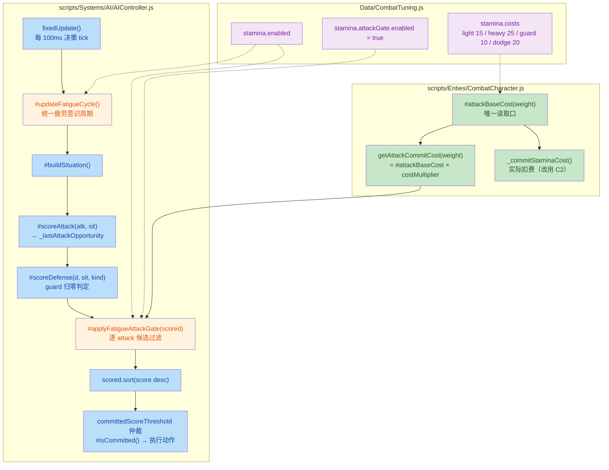
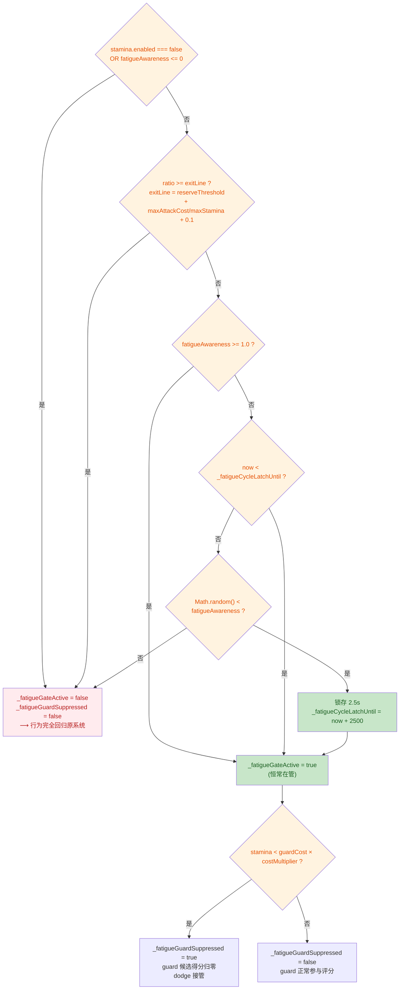
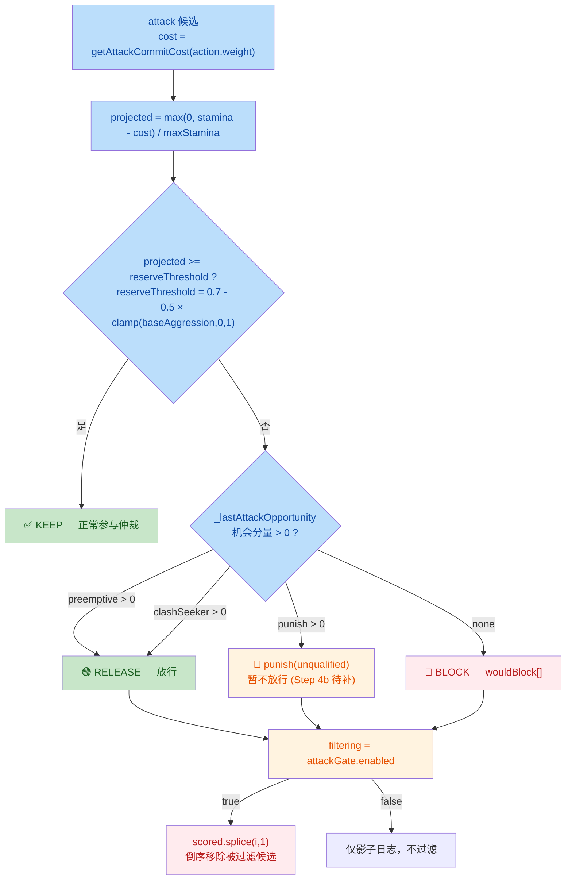
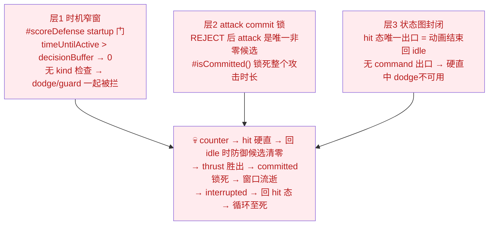

# 🔋 BlindDuel — AI Fatigue-Aware Attack Gate (26.11.9)

## 1. High-Level Summary (TL;DR)

- **Impact:** **Medium-High** — Introduces a new resource-eligibility **Gate** into the AI Utility decision pipeline (attacks are now vetoed when stamina reserve would drop below a personality-derived threshold), and **permanently flips the gate from shadow mode to live filtering**. Several **temporary debug flags were left enabled** in the same commit.

- **Key Changes:**
  - ✨ **New `#applyFatigueAttackGate(scored)`** in `AIController.js` — per-candidate stamina-reserve eligibility check, placed *after* scoring and *before* the global sort/arbitration.
  - ✨ **New `#updateFatigueCycle()`** replaces the old `#evaluateFatigueGuardGate()` — a single unified *fatigue-awareness cycle* now drives both the guard suppression and the attack gate (kills the double dice-roll).
  - ✨ **New `CombatCharacter.getAttackCommitCost(attackWeight)`** — public cost query so AI prediction and real stamina deduction read the **same source** (`#attackBaseCost`).
  - 🔧 **`CombatTuning.stamina.attackGate.enabled = true`** — the gate now actually removes candidates (was shadow/log-only).
  - 🐛 **Debug leftovers not reverted:** `ThrowComponent.DEBUG_INFINITE_AMMO = true`, `CombatSystem debugTrace = true`, manatarms `baseAggression = 1.0` (documented as *must revert*), and `WorldState` default scene changed to `ep1_tavern_room`.
  - 📄 **Three plan/handoff docs** rewritten/added; a **2529-line stale backup** `AIController - 副本.js` was committed into `scripts/Systems/AI/`.

---

## 2. Visual Overview (Code & Logic Map)

### 2.1 Decision pipeline — where the Gate sits



> 🧭 **Key ordering guarantee (D1):** the Gate runs **after** every candidate is scored and **before** `sort()` — so a vetoed attack lets *other legitimate candidates* compete, instead of a global-winner fallback.

### 2.2 Unified fatigue-awareness cycle (replaces the old guard gate)



### 2.3 Per-candidate Gate logic (the new business rule)



---

## 3. Detailed Change Analysis

### 3.1 🧠 `scripts/Systems/AI/AIController.js` — Core AI Decision Engine

**What Changed**

| Area | Before | After |
|---|---|---|
| Fatigue state vars | `_fatigueGateActive`, `_fatigueGuardLatchUntil` | `_fatigueGateActive`, `_fatigueGuardSuppressed`, `_fatigueCycleLatchUntil`, `_fatigueAttackGateLogUntil` |
| Fatigue evaluator | `#evaluateFatigueGuardGate()` (guard-only) | `#updateFatigueCycle()` (unified cycle) |
| Guard gate trigger | `_fatigueGateActive` (感知即压制) | `_fatigueGuardSuppressed` (周期在管 **且** 耐力低于 guard 物理风险线) |
| Attack filtering | *(none)* | `#applyFatigueAttackGate(scored)` |
| Opportunity signal | *(none)* | `#scoreAttack` → `_lastAttackOpportunity` side channel |

**a) Unified fatigue cycle — `#updateFatigueCycle()`** (Source: `scripts/Systems/AI/AIController.js`)

- **Enter** condition: `ratio < exitLine` (i.e. stamina ratio below the *attack-block upper edge*), then a single dice roll `Math.random() < fatigueAwareness`.
- **Latch**: `aware = 1` → always in management; `0 < aware < 1` → dice roll with a **2.5 s latch** (prevents per-100 ms-tick flip-flopping); `aware <= 0` → short-circuit, zero behavior change.
- **Exit**: `ratio >= exitLine`, where  `exitLine = reserveThreshold + maxAttackCost / maxStamina + 0.1` (fixed `+0.1` hysteresis, **no new knob** — D6).
  The `maxAttackCost` term is essential: using a bare `reserve + 0.1` would sit *below* the heavy-attack block edge and regress already-validated shadow behavior.
- **Guard suppression** is now *decoupled* from perception: `_fatigueGuardSuppressed = _fatigueGateActive && stamina < guardCost × costMultiplier`.

**b) Attack eligibility Gate — `#applyFatigueAttackGate(scored)`** (Source: `scripts/Systems/AI/AIController.js`)

- **Short-circuits (D8, full regression safety)**:
  `stamina.enabled === false` → return; `fatigueAwareness <= 0` → return; `!character.combat` → return; `!_fatigueGateActive` → return.
- **Reserve threshold (D2)**: `reserveThreshold = 0.7 - 0.5 × clamp(baseAggression, 0, 1)`.
  *Clamp is required* because elites/Bosses use `baseAggression` > 1 for attack multipliers — the clamp applies **only** to threshold derivation, never to attack scoring.
- **Projected stamina (D3)**: `projected = max(0, stamina - cost) / maxStamina`; **no pre-deduction** of miss/parried/outcome surcharges (they haven't happened yet).
- **Opportunity release (D4/R4)**: reuses `#scoreAttack`'s existing `_breakdown` components — `preemptive > 0` or `clashSeeker > 0` → **RELEASE**; `punish > 0` → tagged `punish(unqualified)` → **still blocked** (no per-candidate timing verification yet, R2/Step 4b pending).
- **Filtering (Step 3)**: when `attackGate.enabled === true`, blocked candidates are removed via **reverse-order `splice`** on `scored` *before* `sort()`, so downstream arbitration only sees candidate *absence* (never a modified score).

**c) `_scoreAttack` side channel** (Source: `scripts/Systems/AI/AIController.js`)

- `_lastAttackOpportunity = null` is reset **at the top of every `#scoreAttack` call** — critical, because `#scoreAttack` has early-return paths (e.g. min-reach rejection) that would otherwise leak the previous candidate's opportunity state.
- The snapshot is taken **after intent weights** are applied but **before** the multiplicative phases (`startupFactor` etc.), so it reflects the qualified opportunity bonus, not the final score.

**d) Logging / diagnostics**

| Log tag | When | Content |
|---|---|---|
| `[AI-Diag] fatigueCycle` | Cycle enter / exit | `aware`, `ratio`, `exit` threshold |
| `[AI-Diag] fatigueAttackGate` | `debugVisible` + 2.5 s throttle | `aware`, `stamina`, `reserve`, `wouldBlock[]`, `released[]` |
| `[AI-Diag] COMBAT:` | Combat outcome | **now includes** `stamina=x/max` and `fatigueCycle=on/off` |

---

### 3.2 🧮 `scripts/Enties/CombatCharacter.js` — Single Source of Truth for Cost

**What Changed**

- Added private `#attackBaseCost(attackWeight)` — the **only** place the attack cost table is read (`heavy` → `costs.attackHeavy`, otherwise `costs.attackLight`).
- Added public `getAttackCommitCost(attackWeight)` → `base × combat.costMultiplier`, returning `0` when the stamina system is disabled.
- `_commitStaminaCost()` now calls `#attackBaseCost(stateDef.attackWeight)` instead of inlining the table lookup.

> 🎯 **Why:** the AI must predict the *exact* cost the character will be charged, otherwise the reserve calculation drifts from reality (R3).

---

### 3.3 ⚙️ `Data/CombatTuning.js` — Gate Master Switch

```js
stamina: {
    ...
    /** 26.11.9 攻击耐力计划：攻击族疲劳资格 Gate 总开关（D8）
     *  false/缺省 = 影子模式（仅诊断日志，不过滤候选）；true = 实际过滤（Step 3 起） */
    attackGate: {
        enabled: true,      // ← was effectively shadow/off before this change
    },
},
```

| Key | Old | New | Effect |
|---|---|---|---|
| `stamina.attackGate.enabled` | *(absent → shadow)* | `true` | Blocked attack candidates are **physically removed** from the candidate pool |
| `stamina.enabled` | `true` | `true` | unchanged (master short-circuit still applies) |

---

### 3.4 ⚠️ Debug / Temporary Configuration Left EnabledThese are **not** part of the feature and are flagged by the project's own handoff as temporary.

| File | Setting | Current | Expected for shipping | Notes |
|---|---|---|---|---|
| `Data/SceneDefs/ep1_tavern_hall_night.json` | manatarms `baseAggression` | **`1.0`** (was `0.25`) | `0.25` | Handoff explicitly says *"临时验证改动，**必撤**"*. Also shifts `reserveThreshold` from **57.5 % → 20 %**, i.e. the boss now tolerates far lower stamina before the Gate bites. |
| `scripts/Components/ThrowComponent.js` | `DEBUG_INFINITE_AMMO` | **`true`** | `false` | Inline comment: *"正式验收必须为 false"*. Throws become free — invalidates any ammo/ammo-economy testing. |
| `scripts/Game.js` | `CombatSystem({ debugTrace })` | **`true`** | `false` | Extra combat trace logging in production runs. |
| `scripts/WorldState.js` | `currentSceneId` (constructor default) | **`"ep1_tavern_room"`** (was `"prologue"`) | `"prologue"` | Game boots into the tavern room instead of the prologue — affects first-run flow & any test that assumes prologue start. |

---

### 3.5 🧪 `Data/TestScripts/*.json` — Test Sequences Trimmed

| File | Change | Purpose |
|---|---|---|
| `manatarms_basic_sequence.json` | Removed `moveIntent {x:1,y:0}` (1300 ms), `smash` (1800 ms), `moveIntent {x:0,y:0}` (1500 ms) | Sequence is now **only** `reverse_quart` (1800 ms) — isolates a single AI counter-attack window |
| `rabble_stick_basic_sequence.json` | Removed the `dodge` step (3300 ms); `guard` wait shortened `2300 → 1000 ms` | Shrinks the guard window to expose the shorter reaction timing described in the death-chain analysis |

---

### 3.6 📚 Documentation & Planning

| File | Change | Summary |
|---|---|---|
| `plans/26.11.9 BlindDuel_Fatigue_Aware_Attack_Policy.md` | **New** (497 lines) | Upstream GPT design draft: the "Gate not Utility" principle, `fatigueAwareness` vs `baseAggression` separation, opportunity taxonomy, 9-scenario test matrix, Phases A–E, acceptance criteria. Explicitly **not** merged — the local plan supersedes it. |
| `plans/26.11.9 AI进攻决策引入耐力计划.MD` | **New** (121 lines) | Reviewed implementation plan: decisions **D1–D9**, revisions **R1–R4**, Steps 1–6 (Step 5 ✅ done), backlog of 6 deferred items, and **§6 known-issue analysis** of the "hitstun chain death" (3-layer root cause). |
| `plans/HandOff.MD` | **Fully rewritten** | Old content (single-scene multi-battle refactor, ~171 lines) replaced by a handoff for the fatigue-gate work: completed steps 1–5, **4 outstanding TODOs**, confirmed backlog, and a key-file index with line anchors. |

---

### 3.7 🗂️ Repository Hygiene

| File | Issue | Recommendation |
|---|---|---|
| `scripts/Systems/AI/AIController - 副本.js` | **New 2529-line file** — a stale backup of `AIController` from *before* the stamina system (contains **zero** references to `fatigueAwareness` / `stamina`). It sits inside the `scripts/` source tree. | **Delete or move outside the repo.** Risk: lint/import tooling may pick it up, and it will drift further out of sync. |
| `.trae/skills/collider-occupancy-更新-skill/SKILL.md` | **New** — tooling skill doc for regenerating `.collider.json` / `.occupancy.json` via two PowerShell extractors. | Fine to keep; documents color conventions (`#FFFF00` hitbox, `#E37800` strong blade, `#FF0000` weak blade, `#7082C1` root) and the ≥6 px connected-component rule. |
| `Art/RawAssets/Env/*.ase`, `*.kra` | Binary asset updates (Tavern, arrow, floor, treeline_pine) | No semantic diff to review — verify only that the intended art change is present. |
| `Audio/sfx/_raw/sliceinfo.txt` | **Newline-at-EOF only** | Cosmetic. |

---

## 4. Impact & Risk Assessment

### 🔴 Breaking / Behavioral Changes

| # | Change | Blast Radius | Mitigation present |
|---|---|---|---|
| **B1** | Attack candidates are now **removed** from the pool when projected stamina < reserve threshold | All AI-controlled attackers in every battle | `attackGate.enabled` master switch + `stamina.enabled` + `fatigueAwareness <= 0` triple short-circuit |
| **B2** | `reserveThreshold` derived from `baseAggression` — any AI whose aggression changed now has a *different* stamina policy | Scene/entity `aiProfile` consumers | Clamp to `[0,1]`; no per-character knob added |
| **B3** | `baseAggression` is now consumed by **three** signals (attack multiplier, `maxHoldMs`, threshold derivation) — tuning one can unintentionally shift the stamina policy | `AITuning` / `aiProfile` | ⚠️ Documented as backlog item #5 — *split the signal when tuning starts to conflict* |
| **B4** | Guard suppression now requires **both** an active cycle and sub-risk-line stamina (previously perception alone) | Defensive AI behavior, `fatigueAwareness = 1` bosses | This is the **fix** for a bug where guard was suppressed for the whole match |
| **B5** | `WorldState.currentSceneId` default changed | Boot flow, any scene-lookup test | ⚠️ Not part of the feature — should be reverted |
| **B6** | `ThrowComponent.DEBUG_INFINITE_AMMO = true` | Ammo economy, `BattleMode` ammo write-back (line 398 skips deduction) | ⚠️ Inline comment says it must be `false` for acceptance |

### ⚠️ Known Functional Gaps (documented in `plans/26.11.9 AI进攻决策引入耐力计划.MD` §6)

The diff ships a **confirmed, unresolved AI-death loop** — a 3-layer chain, and the two attempted P1 fixes were **rolled back with zero code residue**:



- ⚠️ **D8 assumption partially invalidated:** the plan assumed "dodge naturally takes over when guard is suppressed". When the fatigue cycle is active **and** stamina < guard cost, guard is zeroed *and* dodge cannot be scored during hitstun → **both defenses are empty** → death loop.
- 🕳️ **Step 4b pending:** `punish` opportunity release lacks per-candidate timing verification (`startup + travel ≤ remaining recovery`); the prediction layer does not yet emit recovery events, so `#buildSituation` needs a data source.
- 🕳️ **No symmetric constraint on dodge** (D9 deferred) → low-stamina AI may still throw away dodges for free.

### 🧪 Recommended Testing Scenarios

| # | Scenario | Expected |
|---|---|---|
| T1 | `stamina.enabled = false` **or** `fatigueAwareness = 0` | **Zero** behavior change vs. pre-diff AI (full regression) |
| T2 | `attackGate.enabled = false` | Shadow mode: only `[AI-Diag] fatigueAttackGate` logs, **zero** candidate removal |
| T3 | Full stamina, `awareness = 1` | Attack scores & intra-family ordering identical to pre-diff |
| T4 | Low stamina, `awareness = 1`, no opportunity | Normal attacks removed; `preemptive`/`clashSeeker` attacks still released |
| T5 | Low stamina, only `heavy` would breach the threshold | `heavy` blocked while `light` survives → proves **per-candidate** (not per-family) evaluation |
| T6 | `stamina = 0` | No `NaN` / division-by-zero; `0 < reserveThreshold` always ⇒ opportunity qualification required |
| T7 | `baseAggression = 0` vs `1.0` | `reserveThreshold` = 70 % vs 20 %; verify a single common scenario reproduces both extremes |
| T8 | Cycle boundary (ratio hovering near `exitLine`) | No 100 ms-tick oscillation; `fatigueCycle` log shows enter/exit transitions, not flapping |
| T9 | Both fighters low stamina | Natural disengage-and-recover; **no** infinite retreat, no camping, no `holdTimeout` loop |
| T10 | `awareness = 0.5` | Partial convergence (dice-fail ticks show no management) — **re-validate the three-tier awareness ladder** (R1 invalidated the old Step 2.3 "1 SUPPRESS ≈ 2.5 s ≈ 12 ticks" metric) |
| T11 | **Hitstun death chain regression** | Reproduce the `counter → hit → thrust → interrupted` loop; confirm no `defenseScore dodge 通过` while `selfState = hit` |
| T12 | Throw behavior under low stamina | Throw remains outside the Gate (D7); fatigue-adjusted timing still applied |

### ✅ Pre-Merge Checklist

- [ ] Revert `ep1_tavern_hall_night.json` → `baseAggression: 0.25`
- [ ] Revert `ThrowComponent.DEBUG_INFINITE_AMMO` → `false`
- [ ] Revert `Game.js` → `debugTrace: false`
- [ ] Revert `WorldState.currentSceneId` → `"prologue"`
- [ ] Delete `scripts/Systems/AI/AIController - 副本.js`
- [ ] Rename the log key `wouldBlock=` → `filtered=` / `released=` (handoff TODO #2 — the name is misleading in live-filtering mode)
- [ ] Append Step 6 validation records to the plan doc; archive the design draft
- [ ] Decide on the hitstun escape-window fix (data-layer `StateGraphDef` change) — it requires **both** the in-hitstun escape window and the post-hitstun defense-candidate gate, or the chain still breaks

---

### 📊 Change Inventory

| Category | Files | Semantic changes |
|---|---|---|
| 🧠 AI core | `AIController.js` | 5 (cycle, gate, side channel, guard trigger, logs) |
| 🧮 Rules | `CombatCharacter.js`, `CombatTuning.js` | 2 |
| ⚠️ Debug leftovers | `ep1_tavern_hall_night.json`, `ThrowComponent.js`, `Game.js`, `WorldState.js` | 4 |
| 🧪 Test data | `manatarms_basic_sequence.json`, `rabble_stick_basic_sequence.json` | 2 |
| 📄 Docs | 2 new plans + rewritten `HandOff.MD` | 3 |
| 🗂️ Hygiene | `AIController - 副本.js`, `SKILL.md`, 4 binary assets, `sliceinfo.txt` | 7 (mostly non-semantic) |
| **Total** | **20 files** | — |