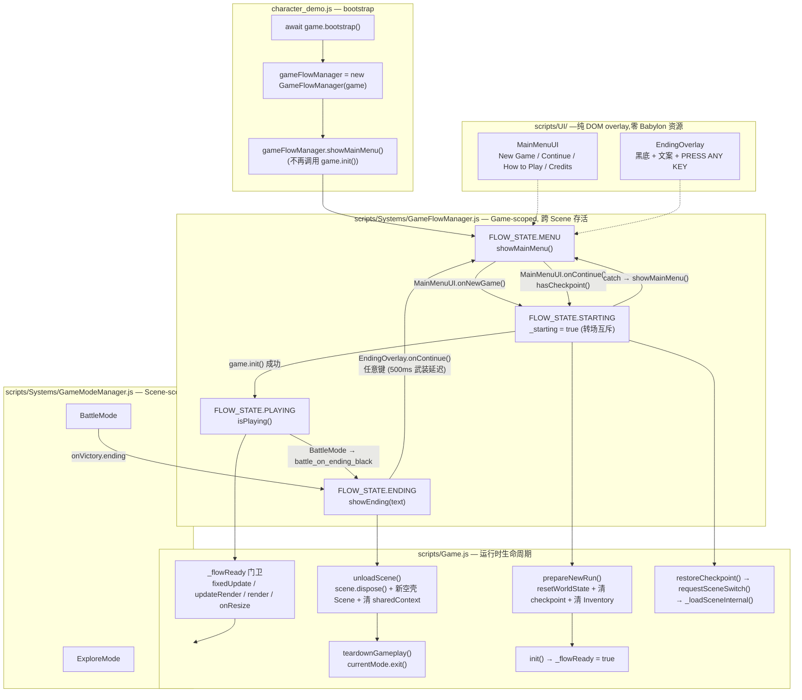
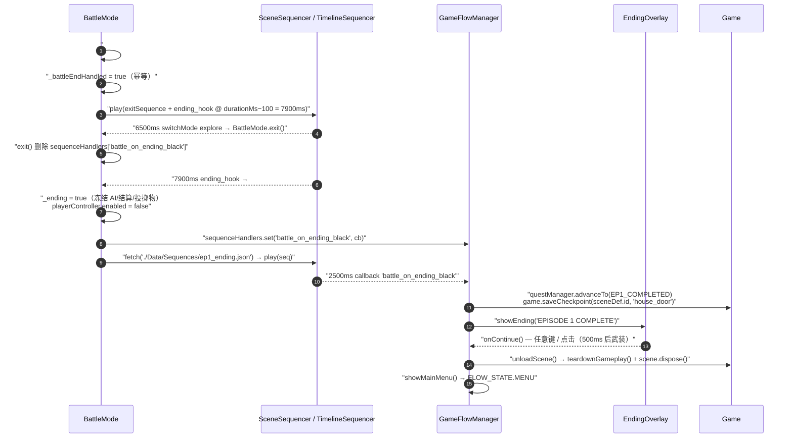

# 🎮 Blind Duel — Main Menu, Ending Flow & Combat Debugging

## 1. High-Level Summary (TL;DR)

- **Impact: Medium-High** — Introduces a **top-level game flow layer** (main menu → gameplay → ending → back to menu) around the existing scene/mode architecture, and lands the **Episode 1 completion chain** (victory → exit sequence → black-screen callback → scenario advance → ending overlay → unload → main menu). Also contains one **critical runtime bug** on the Continue path and several **debug flags left enabled**.

- **Key Changes:**
  - ✨ **New `GameFlowManager`** (`scripts/Systems/GameFlowManager.js`) — Game-scoped state machine with `MENU / STARTING / PLAYING / ENDING`, sitting *above* the existing Scene-scoped `GameModeManager`.
  - ✨ **New DOM overlays** — `scripts/UI/MainMenuUI.js` (4 buttons + How-to-Play/Credits subview) and `scripts/UI/EndingOverlay.js` (black screen + "press any key"), with CSS/DOM added to `babylon_demo.html`.
  - ✨ **True deferred init** — `character_demo.js` no longer calls `game.init()` at boot; `Game` gained a `_flowReady` gate, `teardownGameplay()`, `unloadScene()` and `prepareNewRun()`.
  - ✨ **Ending chain in `BattleMode`** — `onVictory.ending` branch, `_battleEndHandled` idempotence, `_ending` combat-simulation freeze, `ending_hook` callback → fetch `Data/Sequences/ep1_ending.json` → `battle_on_ending_black` handler.
  - 🐛 **Real bug fix** — `CombatCharacter._commitStaminaCost` used a bare undefined `costs` identifier on the guard/dodge branch → `ReferenceError` (crash whenever a dodge was committed).
  - ⚠️ **Debug leftovers** — `ThrowComponent.DEBUG_INFINITE_AMMO = true`, `CombatSystem debugTrace: true`, enemy `maxHp: 7/6 → 1`, `baseAggression: 0.25 → 1.0`.
  - 🗑️ **Repo hygiene issues** — a 2,529-line duplicate `AIController - 副本.js` committed into `scripts/`, and `plans/HandOff.MD` overwritten with raw console logs.

---

## 2. Visual Overview (Code & Logic Map)

### 2.1 Layering — where the new flow manager sits



### 2.2 Ending chain — exact callback ordering



---

## 3. Detailed Change Analysis

### 3.1 🆕 New system — `GameFlowManager` (Game-scoped flow state machine)

**File:** `scripts/Systems/GameFlowManager.js` *(new, 106 lines)*

| Member | Responsibility | Notes |
|---|---|---|
| `FLOW_STATE` | `MENU / STARTING / PLAYING / ENDING` | Enum-style constant |
| `showMainMenu()` | Freeze player input, hide HUD DOM, show menu | Sets `playerController.enabled = false` |
| `showEnding(text)` | Freeze input, hide HUD, show ending overlay | Called by `BattleMode` black-screen callback |
| `startNewGame()` | `prepareNewRun()` → `game.init()` → PLAYING | Guarded by `_starting` + `isPlaying()` |
| `continueGame()` | `game.restoreCheckpoint({ fadeInAfter: true })` → PLAYING | Requires `game.hasCheckpoint()` |
| `_onEndingDismiss()` | `game.unloadScene()` → `showMainMenu()` | Full unload to cold-start-equivalent state |
| `_setHudVisible(v)` | Toggles `#hp-bar`, `#hud-left`, `#dialogue-bubble-container` | ⚠️ Hand-rolled id list — flagged in BACKLOG for a future HUD base class |
| `dispose()` | Disposes `EndingOverlay` only | ⚠️ `MainMenuUI` has no `dispose()` |

> **Design intent (from `plans/26.11.11 主菜单和通关逻辑.MD`):** the existing `GameModeManager` is *Scene-scoped* and hardcodes `start("explore")` on every `Scene.init()`, so it cannot host a main menu. The new manager is deliberately **Game-scoped**, event-driven, holds no Babylon/Scene references, and never enters the main loop.

---

### 3.2 🆕 New UI overlays

**File:** `scripts/UI/MainMenuUI.js` *(new, 108 lines)*

- Four buttons: **New Game / Continue / How to Play / Credits**.
- `refresh()` disables **Continue** when `hasCheckpoint()` is false.
- Subviews (`How to Play` / `Credits`) share one overlay container; they do **not** change the flow state (stay in `MENU`).
- `openCredits()` fetches `./docs/AudioLicensesInfo.MD` at runtime and renders it line-by-line; falls back to `"Failed to load audio credits."` on error. *(Verified: `docs/AudioLicensesInfo.MD` exists and the `ui` bus exists in `Data/Audio/audio_buses.json`.)*
- Static key-binding help list (`A/D` move, `J` attack, `K` heavy, `L` throw, `P/Esc` pause, `C` camera).

**File:** `scripts/UI/EndingOverlay.js` *(new, 56 lines)*

- Black full-screen overlay + `ending-text` + `"- PRESS ANY KEY -"` hint.
- **Fresh input edge** implemented via a **500 ms arming delay** (`setTimeout(() => this._armed = true, 500)`) so a still-held attack key from the battle cannot instantly dismiss the ending screen.
- Listens on `window` for `keydown` / `mousedown`; `dispose()` removes both listeners.

**File:** `babylon_demo.html` — adds `#main-menu`, `#menu-subview`, `#ending-overlay` DOM plus ~80 lines of CSS (dark parchment theme, `z-index: 1000`, `.hidden { display: none }`).

---

### 3.3 ✏️ `scripts/Game.js` — runtime lifecycle rework

| New / Changed API | Behaviour |
|---|---|
| `_flowReady` (bool) | Gate on `fixedUpdate()`, `updateRender()`, `render()`, `onResize()`. **Only set `true` inside `init()`.** |
| `init()` | If `_flowReady` is already true → `scene.dispose()` + build a **fresh** `Scene` (avoids leaking entities/subscriptions on the ending → New Game path). Cold start reuses the bootstrap shell. |
| `teardownGameplay()` | Extracted from `restoreCheckpoint()`; explicitly calls `currentMode.exit()` (skipping `explore`) to clear stale `context.basePosition / target / fighterDistance` that would otherwise make `DuelCameraRig.compute` jump after a blend. Idempotent. |
| `unloadScene()` | `teardownGameplay()` → `scene.dispose()` → new empty `Scene` → nulls **18 scene-level `sharedContext` keys** → `_flowReady = false`. Returns to a *cold-start-equivalent* state. |
| `prepareNewRun()` | `resetWorldState()` + `_checkpoint = null` + `inventoryManager.items = []` (prevents "Continue reloading old progress" after New Game). |
| `resetWorldState()` | `currentSceneId` now uses the new `INITIAL_SCENE_ID` constant instead of the hard-coded `"prologue"`. |
| `dispose()` | Now also calls `this.gameFlowManager?.dispose?.()`. |
| `CombatSystem` | ⚠️ `debugTrace: false → true`. |

**`sharedContext` keys cleared by `unloadScene()`:** `scene, babylonScene, entityPool, actorRegistry, entityRegistry, controllerRegistry, character, rabbleController, rabbleStick, pushboxResolver, stageBoundary, walkArea, sceneVisualSystem, sceneDef, battleDefs, stageMaskData, camera, pendingBattleSession`.
*(Verified: `Scene.init()` re-populates all of these, so clearing them is safe.)*

---

### 3.4 ✏️ `scripts/Systems/Modes/BattleMode.js` — ending branch

**What changed:**

- `enter()` initialises `_battleEndHandled = false` and `_ending = false`.
- `exit()` now also deletes `sequenceHandlers["battle_on_ending_black"]` (dead-reference cleanup across runs).
- `fixedUpdate()` returns immediately when `this._ending` — freezes AI decisions, combat resolution and projectiles while the ending sequence plays. `SceneSequencer` is driven separately by `Scene.fixedUpdate`, so the cutscene still advances.
- `#checkBattleEnd()` guards with `_battleEndHandled` (the old `sceneSequencer.isBusy()` guard only covered the *playing* window, not the callback window).
- New `onVictory.ending` branch: the normal exit sequence is deep-copied, an `ending_hook` **callback track** is appended at `durationMs − 100` (deliberately *before* the sequence-completion check to avoid a same-frame race), then played.
- New `#beginEndingSequence()`: sets `_ending`, disables `playerController`, registers the one-shot `battle_on_ending_black` handler, fetches `endingDef.sequenceUrl`, and plays it. On fetch failure it **falls back** to invoking the handler directly so the flow is never blocked.

**Timing for the shipped `battle_tavern_night_manatarms` exit sequence (8000 ms):**

| Time | Event |
|---|---|
| 0 – 6500 ms | Exit sequence: sheath @2500 ms, camera blend to explore @1000 ms (5500 ms) |
| **6500 ms** | `switchMode → explore` → `BattleMode.exit()` (handler not yet registered → safe) |
| **7900 ms** | `ending_hook` → `#beginEndingSequence()` → registers `battle_on_ending_black` |
| +2500 ms | `ep1_ending.json` callback → advance scenario + `saveCheckpoint` + `showEnding` |

---

### 3.5 ✏️ Data / configuration changes

| File | Key | Old | New | Impact |
|---|---|---|---|---|
| `Data/ScenarioMilestones.js` | `SCENARIO.EP1_COMPLETED` | — | `210` | New completion milestone |
| `scripts/SceneDefs.js` | `BATTLE_TAVERN_NIGHT_MANATARMS.onVictory.ending` | — | `{ text, scenario, sequenceUrl }` | Data-driven ending entry point |
| `scripts/SceneDefs.js` | `combatantConfig.enemy_2.maxHp` | `6` | **`1`** | ⚠️ Debug value — final fight is trivial |
| `scripts/SceneDefs.js` | `combatantConfig.enemy_1.maxHp` | `7` | **`1`** | ⚠️ Debug value |
| `Data/SceneDefs/ep1_tavern_hall_night.json` | `enemy_1.aiProfile.baseAggression` | `0.25` | **`1.0`** | ⚠️ AI aggression4× |
| `Data/CombatTuning.js` | `stamina.attackGate.enabled` | absent | **`true`** | Switches the fatigue eligibility gate from *shadow mode* (log-only) to *actually filtering* attack candidates |
| `Data/Audio/audio_clips.json` | `ui_button_click` | — | `47125__gyzhor__lightsaber3.mp3`, vol `0.5`, pitch `[1.3, 1.5]`, bus `ui` | Menu click SFX (placeholder asset) |
| `scripts/WorldState.js` | `INITIAL_SCENE_ID` (exported const) | `"prologue"` (inline) | `"ep1_tavern_night"` | Fixes New Game entering the wrong scene |
| `scripts/Components/ThrowComponent.js` | `DEBUG_INFINITE_AMMO` | `false` | **`true`** | ⚠️ Infinite ammo — the file comment says *"正式验收必须为 false"* |
| `Data/TestScripts/*.json` | — | 3–4 steps | 1–2 steps | Test scripts trimmed for faster iteration |

**New file:** `Data/Sequences/ep1_ending.json` — `durationMs: 3000`; a `cameraEffect` fade `from 0 → 1` to black over 1500 ms, plus a `callback` at `atMs: 2500` invoking the string handler `battle_on_ending_black`.

---

### 3.6 ✏️ Combat / AI diagnostics (supporting instrumentation)

| File | Change |
|---|---|
| `scripts/Enties/CharacterBase.js` | `enterState()` now records `prevStateName`, `_prevStateHeldMs` and `_stateEnteredAtMs`; `pushCommand()` logs every **dropped** command (`[CharCmd] DROPPED id=… state=… cmd=…`) |
| `scripts/Systems/AI/AIController.js` | `fixedUpdate(dtMs, tickCount)` now records `_lastTick`; all `[AI-Diag]` / `[Phase0]` logs gained `id=`, `tick=`, current-state duration, previous-state hold time, opponent attack elapsed-ms, and self stamina |
| `scripts/Enties/CombatCharacter.js` | **Bug fix:** `cost = costs.guard` → `cost = st.costs.guard`; `cost = costs.dodge` → `cost = st.costs.dodge` (bare `costs` was an undefined identifier → `ReferenceError` on every guard/dodge stamina commit) |

---

### 3.7 🗑️ Repository hygiene / documentation changes

| File | Change | Concern |
|---|---|---|
| `scripts/Systems/AI/AIController - 副本.js` | **New** — a 2,529-line verbatim copy of `AIController.js` (pre-change version; still has `fixedUpdate(dtMs = 0)` and the old log format) committed inside `scripts/` | ⚠️ Stale duplicate in the source tree — will confuse grep/tooling and can silently diverge |
| `plans/HandOff.MD` | **Overwritten**: the 171-line “单场景多战斗重构交接” design document was deleted and replaced with ~142 lines of pasted `[AI-Diag]` / `[Phase0]` console output | ⚠️ Irreversible loss of a design handoff doc |
| `plans/26.11.11 主菜单和通关逻辑.MD` | **New** — full design plan (background, option analysis, 3-layer responsibility split, ending data contract, timing fix, risk register, landing record §十) | ✅ Good documentation |
| `plans/INDEX.md` | 2026-11-12 update log entry summarising the landing | ✅ |
| `plans/BACKLOG.md` | New items: abstract a HUD base class, save to disk, unify `currentSceneId` constant *(closed ✅)*, make `Scene.debugLayer` on-demand, unify a `Widget` base class | ✅ |
| `PROJECT_CONTEXT.md` | Documents `GameFlowManager` as Game-scoped | ⚠️ **Drift:** the doc mentions `_suspendWorld/_resumeWorld`, but the implementation actually uses `Game.unloadScene()` |
| `.trae/skills/collider-occupancy-更新-skill/SKILL.md` | **New** agent skill: two PowerShell routes (`extract_collision_boxes.ps1` for combat characters → `.collider.json`, `extract_rootmotion_occupancy.ps1` for NPCs → `.occupancy.json`) | ✅ Unrelated to the feature; fine as tooling doc |
| `Art/RawAssets/Env/*.ase`, `*.kra` | Binary-only changes (Tavern, arrow, floor, treeline_pine) | ℹ️ No reviewable content |
| `Audio/sfx/_raw/sliceinfo.txt` | Trailing-newline fix only | ℹ️ |

---

## 4. Impact & Risk Assessment

### 4.1 🔴 Critical — `_flowReady` is never set on the **Continue** path

`Game.init()` is the **only** place that sets `_flowReady = true` (`scripts/Game.js:210`). But:

```
character_demo.js   →  no longer calls game.init() at boot   ⇒ _flowReady === false
GameFlowManager.continueGame()
  └─ game.restoreCheckpoint({ fadeInAfter: true })
       └─ requestSceneSwitch() → _loadSceneInternal()          ⇒ _flowReady still false
```

With `_flowReady === false`, **all four** main-loop entry points early-return:

```js
fixedUpdate(clock) { this.clock = clock; if (!this._flowReady) return; this.scene.fixedUpdate(clock); }
updateRender(clock){ this.clock = clock; if (!this._flowReady) return; this.scene.updateRender(clock); }
render()            {                            if (!this._flowReady) return; this.scene.render(); }
onResize()          {                            if (!this._flowReady) return; this.scene.onResize(); }
```

**Result: clicking “Continue” loads the scene but never renders or updates it → black / frozen screen.** The same applies to *ending → main menu → Continue*, because `unloadScene()` sets `_flowReady = false` and only `New Game` (→ `init()`) can restore it.

> **Suggested fix:** set `this._flowReady = true;` at the end of `_loadSceneInternal()` (`Game.js:~505`) — that covers every scene-load path (Continue, defeat→checkpoint, scene transitions) — or at minimum inside `GameFlowManager.continueGame()` after `await this.game.restoreCheckpoint(...)`.

This is exactly the “步骤 6 全链路回归” (full-chain regression) that the plan doc lists as still outstanding.

### 4.2 🟠 Debug flags / balance values left enabled

| Item | Value | Why it matters |
|---|---|---|
| `ThrowComponent.DEBUG_INFINITE_AMMO` | `true` | Infinite ammo for all throwers; the file’s own comment states it **must be `false` for final acceptance** |
| `CombatSystem` `debugTrace` | `true` | Verbose combat trace in every run |
| `enemy_1` / `enemy_2` `maxHp` | `1` | Both tavern fights die in one hit — no balance signal, and the ending flow can be triggered trivially |
| `aiProfile.baseAggression` | `1.0` | 4× the previous value; changes AI behaviour for `enemy_1` |
| `CombatTuning.stamina.attackGate.enabled` | `true` | Flips the fatigue gate from shadow/log mode to **actually filtering** attack candidates — a real gameplay change that should be called out separately |

### 4.3 🟠 Ordering landmine in `BattleMode.exit()`

`exit()` **unconditionally** deletes `sequenceHandlers["battle_on_ending_black"]`. Today it is safe only because `switchMode explore` (6500 ms) fires *before* `ending_hook` (7900 ms). Any battle whose `exitSequence` has `switchMode` at/after `durationMs − 100` — or a `durationMs < 100` (which clamps `hookAtMs` to `0`) — would delete the handler **before** the ending sequence’s 2500 ms callback fires, leaving the game **stuck on a black screen** with no ending overlay.

> **Suggested fix:** only delete the handler if the ending sequence was never started, e.g. guard with `if (!this._ending) { …delete… }`, or move the cleanup into `GameFlowManager`/`Game.unloadScene()`.

### 4.4 🟡 Smaller issues

| Issue | Location | Suggestion |
|---|---|---|
| `plans/HandOff.MD` content destroyed | `plans/HandOff.MD` | Restore the original doc from VCS; keep console logs in a separate `plans/logs/` file |
| Stale duplicate of `AIController.js` in `scripts/` | `scripts/Systems/AI/AIController - 副本.js` | Delete from the repo (keep the backup outside the source tree) |
| `MainMenuUI` has no `dispose()` | `scripts/UI/MainMenuUI.js` | Add `dispose()` that removes button listeners; call it from `GameFlowManager.dispose()` |
| `EndingOverlay.dispose()` leaves the `#ending-overlay` node in the DOM | `scripts/UI/EndingOverlay.js` | `this._root?.remove()` |
| `EndingOverlay` dismisses on **any** `mousedown` anywhere | `scripts/UI/EndingOverlay.js` | Restrict to clicks on the overlay itself, or keep as-is (acceptable for a prototype) |
| `_setHudVisible` hard-codes 3 DOM ids | `scripts/Systems/GameFlowManager.js` | Already logged in BACKLOG (HUD base class) — fine |
| `PROJECT_CONTEXT.md` mentions `_suspendWorld/_resumeWorld` that do not exist | `PROJECT_CONTEXT.md:69` | Update the doc to describe `Game.unloadScene()` |
| `Game.unloadScene()` leaves `sharedContext.assets` / `smoothedFighterDistance` | `scripts/Game.js:363` | Harmless (`Scene.init()` re-assigns them) |
| `onResize()` is gated by `_flowReady` → canvas not resized while in the menu | `scripts/Game.js:260` | Verify the canvas re-fits when the scene loads |
| `Game.init()`’s `if (this._flowReady)` branch is effectively dead after `unloadScene()` | `scripts/Game.js:180` | Two overlapping “fresh scene” mechanisms — consider consolidating |

### 4.5 ✅ No breaking API / schema changes

- No public API removals; all new Game methods are **additive**.
- No database / persistent schema changes (checkpoint is still in-memory only — explicitly deferred to a future `SaveManager`).
- `onVictory.ending` is an **optional** block — battles without it keep the original exit path (already covered by the `BATTLE_FIELD_2` and rabble-stick definitions).
- `INITIAL_SCENE_ID` is a new **export**; the old inline `"prologue"` string is gone but was never a public API.

### 4.6 🧪 Testing suggestions for the reviewer

**Happy path**
1. Cold boot → main menu appears, canvas is dark, **no scene loaded yet**.
2. **New Game** → tavern scene loads, HUD visible, player controllable.
3. Win `battle_tavern_night_manatarms` → exit sequence (sheath + camera blend) → 7900 ms black fade → **“EPISODE 1 COMPLETE”** overlay → press any key → back to main menu.
4. Verify `worldState.scenario === 210` and a checkpoint exists at `house_door` (Continue enabled).
5. **Continue** → scene restores with correct HP / buffs / inventory / flags. ⚠️ *This is the step expected to fail today (§4.1).*
6. **New Game** after an ending → fresh scenario, empty inventory, **Continue greyed out** until a checkpoint is saved again.

**Edge cases**
- Click **New Game** repeatedly / rapidly → only one transition (`_starting` mutex).
- Click **Continue** with no checkpoint → button disabled; also guarded in `continueGame()`.
- **How to Play** / **Credits** subview → Back returns to the main menu and the flow state stays `MENU`.
- **Credits** with `docs/AudioLicensesInfo.MD` missing → graceful fallback text.
- Hold the attack key through the victory → the ending overlay must **not** dismiss instantly (500 ms arming).
- Audio unlock: the first menu click should resume the `AudioContext` (button click satisfies the `pointerdown` requirement).
- Press **P / Esc / C** while in the menu → nothing happens (`isPlaying()` gate in `character_demo.js`).
- Defeat path → `restoreCheckpoint` → the battle camera must **not** jump after the blend (the `teardownGameplay()` regression this refactor was meant to preserve).
- Ending sequence JSON missing / 404 → the fallback must still show the ending overlay (no soft-lock).

**Regression**
- Re-run the two trimmed `Data/TestScripts/*.json` scripts.
- Confirm the `guard` / `dodge` stamina commit no longer throws (the `st.costs` fix) — previously it crashed whenever a dodge was committed.
- Confirm AI fatigue gating now actually filters attacks (`attackGate.enabled = true`) and that `baseAggression = 1.0` + `maxHp = 1` were **intentional** (or revert them).