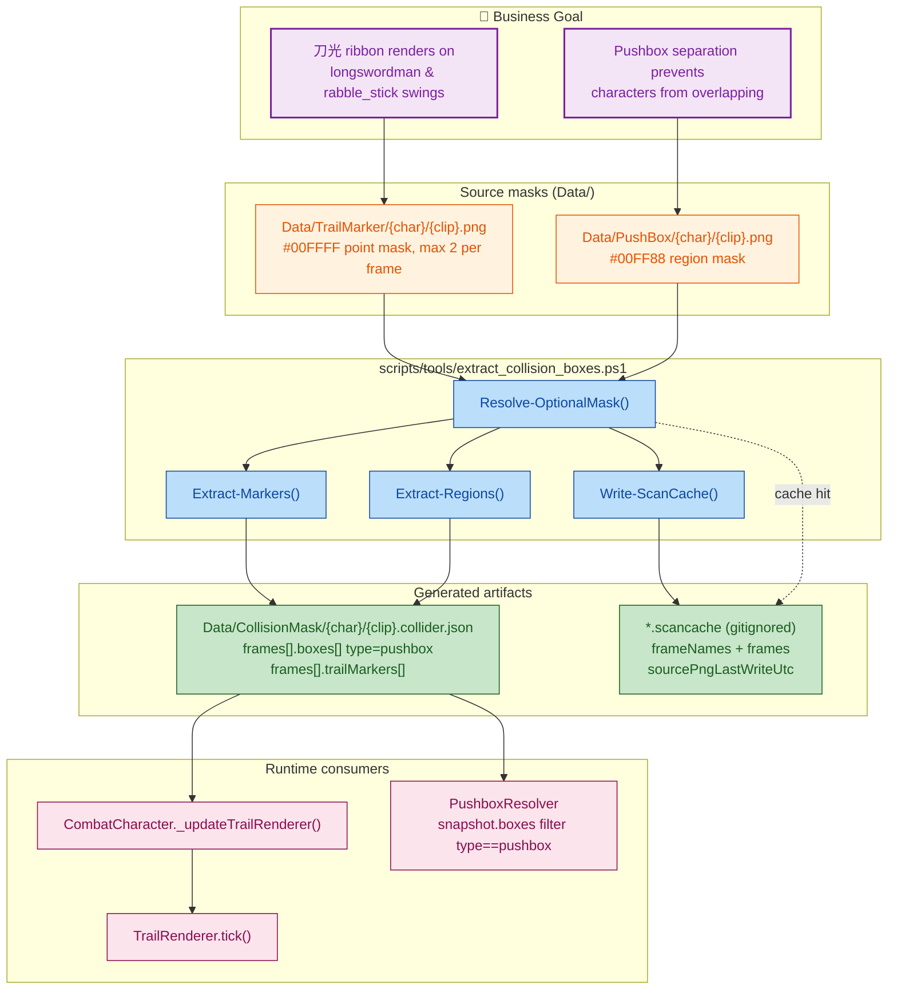
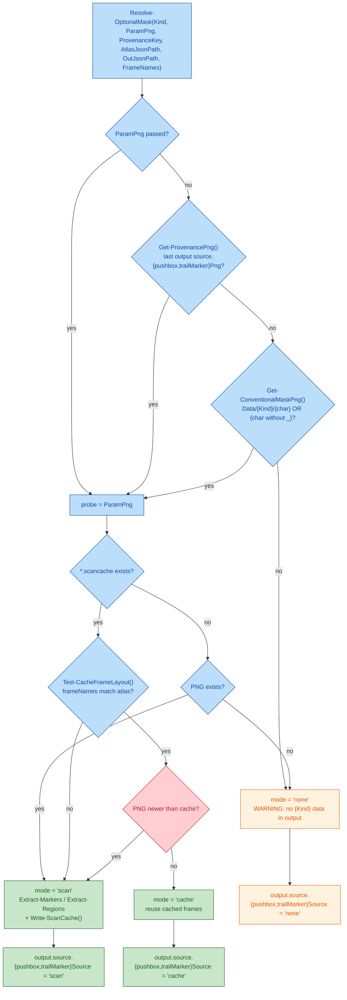
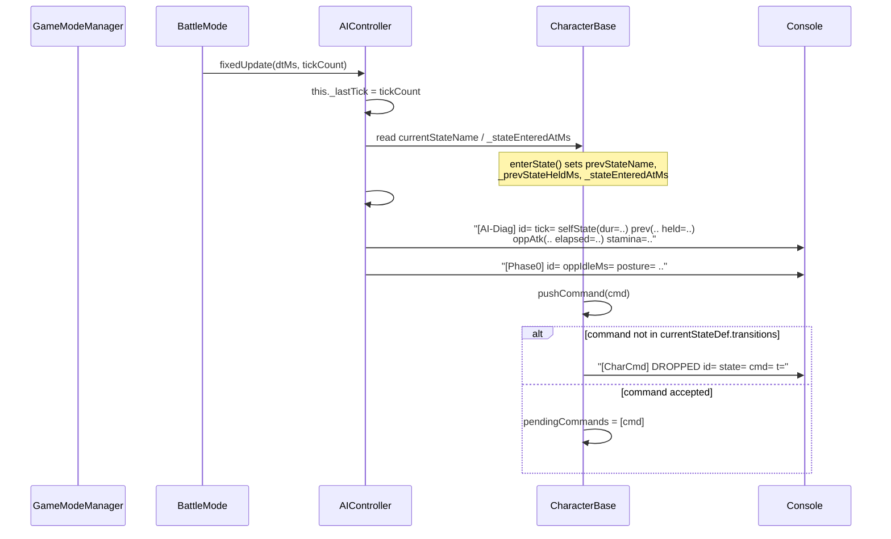

## 1. High-Level Summary (TL;DR)

**Impact: Medium** — Two independent workstreams plus some leftover debug state.

1. **🐛 Weapon-trail (刀光) data repair** — Several `.collider.json` files were stale products of an old scan run (no `-TrailMarkerPng`), so `trailMarkers` were empty and no ribbon rendered. All affected clips were re-scanned, and the offline scan tool gained a **`.scancache` cache + provenance mechanism** so optional masks (pushbox / trailmarker) are never silently dropped again.
2. **🔍 AI / combat diagnostics** — `CharacterBase` now records state-transition timings, and every `[AI-Diag]` / `[Phase0]` log line carries `id=`, `tick=`, current/previous state duration, opponent attack elapsed-ms and stamina.
3. **⚠️ Debug values left switched ON** — infinite ammo, 1-HP enemies, and 4× AI aggression. These are explicitly marked "must be `false` for final acceptance" in the source.
4. **🗑️ Repo hygiene issues** — a stale 2,529-line duplicate of `AIController.js` was committed *inside* `scripts/`, and the 171-line design handoff `plans/HandOff.MD` was overwritten.

### Key Changes

| # | Area | Change |
|---|------|--------|
| 1 | `scripts/tools/extract_collision_boxes.ps1` | New `Resolve-OptionalMask()` chain + `.scancache` read/write + `source.pushboxSource` / `trailMarkerSource` provenance |
| 2 | `Data/CollisionMask/**` (5 files) | Re-scanned: pushbox boxes + `trailMarkers` now populated (zornhut / quart / nachschlag / swing / dash) |
| 3 | `scripts/Enties/CharacterBase.js` | `enterState()` records `prevStateName` / `_prevStateHeldMs` / `_stateEnteredAtMs`; `pushCommand()` logs dropped commands |
| 4 | `scripts/Systems/AI/AIController.js` | `fixedUpdate(dtMs, tickCount)` records `_lastTick`; all diag logs enriched with id / tick / durations |
| 5 | `ThrowComponent.js`, `scripts/SceneDefs.js`, `ep1_tavern_hall_night.json` | Debug values enabled: `DEBUG_INFINITE_AMMO=true`, `maxHp 7/6 → 1`, `baseAggression 0.25 → 1.0` |

---

## 2. Visual Overview (Code & Logic Map)

### 2.1 Weapon-trail data pipeline (business goal → files → methods)

### 2.2 Optional-mask resolution order (new tool logic)

### 2.3 AI / combat diagnostics flow

---

## 3. Detailed Change Analysis

### 3.1 🛠 Collider Scan Tooling — `scripts/tools/extract_collision_boxes.ps1`

**What changed:** The script previously *required* `-PushBoxPng` / `-TrailMarkerPng` to be passed; if omitted, the corresponding mask data was silently written as `null` into the output. That silent-drop behaviour is exactly what produced the stale `.collider.json` files behind the missing weapon trails (Source: `plans/HandOff.MD`).

**New helper functions:**

| Function | Purpose |
|---|---|
| `Get-ProvenancePng($outJsonPath, $key)` | Reads the *previous* output's `source.pushboxPng` / `source.trailMarkerPng` to rediscover the mask that was used last time |
| `Get-CacheProp($obj, $name)` | Null-safe property accessor for `ConvertFrom-Json` objects |
| `Test-CacheFrameLayout($cacheData, $frameNames)` | Verifies the cached `frameNames` array matches the current atlas frame list (index-by-index) |
| `Get-ConventionalMaskPng($atlasJsonPath, $kind)` | Directory-convention probe: `Data/{PushBox|TrailMarker}/{character}/{basename}.png`, trying both `{character}` and the underscore-stripped variant (`rabblestick` vs `rabble_stick`) |
| `Resolve-OptionalMask(...)` | Orchestrates probe → cache validation → returns `mode = scan \| cache \| none` |
| `Write-ScanCache($pngPath, $cacheType, $frameNames, $framesData)` | Writes `<mask>.scancache` next to the PNG |

**Cache-invalidation rules (new):**

| Condition | Behaviour |
|---|---|
| `*.scancache` missing | Scan the PNG and create the cache |
| Cache `frameNames` ≠ atlas frame names | ⚠️ WARNING `cache frame layout mismatch with atlas, rescanning` |
| PNG `LastWriteTimeUtc` newer than `sourcePngLastWriteUtc` | ⚠️ WARNING `png is newer than its cache, rescanning` |
| Cache valid | Reuse cached frames, no re-scan |

**New output fields:**

| Field | Values | Meaning |
|---|---|---|
| `source.pushboxSource` | `scan` / `cache` / `none` | Where pushbox data came from this run |
| `source.trailMarkerSource` | `scan` / `cache` / `none` | Where trail-marker data came from this run |

**Also:** a per-frame `Write-Progress` bar was added (the docs note that scanning a large atlas in pure PowerShell is slow, and the progress bar prevents "looks hung" misdiagnosis).

### 3.2 📦 Regenerated Collision Data — `Data/CollisionMask/**/*.collider.json`

**Root cause addressed:** stale scan output where `trailMarkers` was `[]` → `_updateTrailRenderer()` had no sample points → no ribbon was built (Source: `plans/HandOff.MD`, `plans/INDEX.md` update log).

| File | Pushbox boxes added | Trail markers added (per frame) | `source.*` header |
|---|---|---|---|
| `longswordman/longswordman_zornhut.collider.json` | 7 (`pushbox_0`…`pushbox_6`, 26×25 @90°) | f2: 1 pt · f3: 2 pts · f4: 2 pts | paths → `.\Data\...`, `pushboxSource/trailMarkerSource = scan` |
| `longswordman/longswordman_quart.collider.json` | 4 (`pushbox_0`…`pushbox_3`, 45×27) | f1: 1 pt · f2: 2 pts · f3: 2 pts | same |
| `longswordman/longswordman_nachschlag.collider.json` | 5 (`pushbox_0`…`pushbox_4`, 42×28 / 59×27 / 33×28) | f1: 1 pt · f2: 2 pts · f3: 2 pts | same |
| `rabble_stick/rabble_stick_swing.collider.json` | 4 (`pushbox_0`…`pushbox_3`, 42×38 → 58×38) | f1: 1 pt · f2: 2 pts | same |
| `rabble_stick/rabble_stick_dash.collider.json` | (already present) | (already present) | mask paths + `pushboxSource/trailMarkerSource = scan`, timestamp refreshed |

**Runtime meaning of the new data:**
- `trailMarkers` → 1 point = *sampling point* (tip); 2 points = *edge line* (midpoint = sample, length = width, direction = blade cross-section).
- `boxes[type == "pushbox"]` → consumed by `PushboxResolver` (`scripts/Systems/PushboxResolver.js:14`) to keep characters from clipping through each other.

> ⚠️ **Path-style regression:** every `source.atlasJson` / `collisionPng` / `rootPng` / `pushboxPng` / `trailMarkerPng` value changed from POSIX (`Data/CollisionMask/...`) to Windows (`.\\Data\\CollisionMask\\...`). Runtime does **not** read these (it uses `AssetManifest` paths), but any tooling/CI that resolves them will now break on non-Windows hosts.

### 3.3 🔍 Combat Diagnostics — `scripts/Enties/CharacterBase.js`

**What changed:** state transitions became time-stamped so the AI logs can explain *why* a command was accepted or dropped.

| Location | Change |
|---|---|
| `enterState()` (L529-533) | Now stores `this.prevStateName`, `this._prevStateHeldMs` (how long the *previous* state was held), and `this._stateEnteredAtMs` (when the current state was entered) |
| `pushCommand()` (L585) | Logs every **rejected** command: `[CharCmd] DROPPED id=… state=… cmd=… t=…` — previously the rejection was silent |

### 3.4 🤖 AI Controller Diagnostics — `scripts/Systems/AI/AIController.js`

| Change | Detail |
|---|---|
| `fixedUpdate(dtMs = 0, tickCount = null)` | Signature widened (backward compatible); stores `this._lastTick` |
| `onCombatResult()` log | Now `id=`, `tick=`, `selfState=…(dur=Xms)`, `prev=…(held=Xms)`, `oppAtk=…(elapsed=Xms)` |
| Decision log (`#makeDecision`) | Now `id=`, `tick=`, plus `self=<state>@<normTime>` and `stamina=` |
| `#logPhase0Status` | Now prefixed with `id=` |
| `dodgeGate REJECT` log | Now prefixed with `id=` |
| New computation | `oppAtkElapsedMs = oppNorm * (ap.timing?.totalMs ?? 0)` — opponent attack elapsed time derived from normalized animation time |

> Note: `oppAtkElapsedMs` assumes `normalizedTime` maps linearly onto `totalMs`, which is only true if the clip plays at 1.0 speed and the state's `totalMs` equals the clip duration. Worth sanity-checking against a slow-motion / hitstop scenario.

### 3.5 🎮 Debug / Balance Values (must be reverted before acceptance)

| File | Key | Old | New | Risk |
|---|---|---|---|---|
| `scripts/Components/ThrowComponent.js` | `ThrowComponent.DEBUG_INFINITE_AMMO` | `false` | **`true`** | 🔴 The file's own comment says *"正式验收必须为 false"* — all throwers have infinite ammo |
| `scripts/SceneDefs.js` | `BATTLE_TAVERN_NIGHT_RABBLE.combatantConfig.enemy_1.maxHp` | `7` | **`1`** | 🟠 Tavern fight dies in one hit — no balance signal |
| `scripts/SceneDefs.js` | `BATTLE_TAVERN_NIGHT_MANATARMS.combatantConfig.enemy_2.maxHp` | `6` | **`1`** | 🟠 Same; also makes the ending flow trivially reachable |
| `Data/SceneDefs/ep1_tavern_hall_night.json` | `enemy_1.aiProfile.baseAggression` | `0.25` | **`1.0`** | 🟠 4× aggression — changes enemy behaviour |
| `Data/TestScripts/rabble_stick_basic_sequence.json` | steps | `guard` 2300 ms + `dodge` 3300 ms | `guard` 1000 ms | ℹ️ Test shortened for faster iteration |
| `Data/TestScripts/manatarms_basic_sequence.json` | steps | 4 steps (`reverse_quart` → move → `smash` → stop) | 1 step (`reverse_quart` 1800 ms) | ℹ️ Test shortened |

### 3.6 📚 Documentation & Repo Hygiene

| File | Change | Assessment |
|---|---|---|
| `COLLIDER_UPDATE_SKILL.md` | Added `Data/PushBox/` + `Data/TrailMarker/` to the layout, `-PushBoxPng`/`-TrailMarkerPng` to the command template, cache explanation, **corrected the colour table** (`#FF0000` = strong_blade, `#E37800` = weak_blade — they were swapped), added `#00FF88` pushbox / `#00FFFF` trailmarker rows, batch loop now passes mask paths, added caveats 6 & 7 | ✅ Good — but see ⚠️ below |
| `PROJECT_CONTEXT.md` | Documents the `.scancache` mechanism, the two new provenance fields, and that `*.scancache` is **not** committed | ✅ |
| `plans/INDEX.md` | New `Update Log (2026-11-12)` entry summarising the trailmarker repair + cache mechanism | ✅ |
| `plans/HandOff.MD` | 🔴 **Overwritten**: the 171-line *"单场景多战斗重构交接"* design document (BattleSession abstraction, multi-enemy controller map, per-battle sequences, prologue extra-battle data draft) was deleted and replaced with the trailmarker troubleshooting note | ⚠️ **Irreversible loss of an unfinished design handoff** — should be archived under `plans/archived/` |
| `plans/BACKLOG.md` | Added `error on refreshing` under the *manual* section | ℹ️ |
| `.trae/skills/collider-occupancy-更新-skill/SKILL.md` | **New** agent skill: two PowerShell routes (collider for combatants, occupancy for NPCs), colour conventions, FAQ | ⚹️ **Stale** — it documents the *old* parameter names (`-CollisionAtlasJson` / `-CollisionAtlasPng` / `-RootAtlasJson` / `-RootAtlasPng`), which do **not** match the real script (`-AtlasJson` / `-CollisionPng` / `-RootPng`), and it still lists the swapped strong/weak-blade colours and omits pushbox/trailmarker entirely |
| `scripts/Systems/AI/AIController - 副本.js` | **New** 2,529-line verbatim copy of `AIController.js` (pre-change version: old `fixedUpdate(dtMs = 0)`, old log format) committed **inside `scripts/`** | ⚠️ **Stale duplicate in the source tree** — pollutes grep, can silently diverge, and any `scripts/**/*.js` globbing tool may pick it up |
| `.gitignore` | Added `*.scancache` and `*.*~` | ✅ |
| `Audio/sfx/_raw/sliceinfo.txt` | Trailing-newline fix only | ℹ️ |
| `Art/RawAssets/Env/*` (`Tavern.ase`, `arrow.ase`, `floor.kra`, `treeline_pine.kra`) | Binary-only changes | ℹ️ No reviewable content |

> ⚠️ **Doc contradiction:** `COLLIDER_UPDATE_SKILL.md` says *".scancache 与 PNG 一起入库"*, while `.gitignore` (adds `*.scancache`), `PROJECT_CONTEXT.md` (*"不入版本库"*) and `plans/INDEX.md` (*"不入库"*) all say the cache is **not** committed. One of the two must be corrected.

---

## 4. Impact & Risk Assessment

### 4.1 🔴 Breaking / High-Risk Items

| # | Item | Impact |
|---|---|---|
| 1 | `ThrowComponent.DEBUG_INFINITE_AMMO = true` | Thrower ammo economy is bypassed entirely; the source comment explicitly forbids this for acceptance |
| 2 | `enemy_1`/`enemy_2` `maxHp = 1` + `baseAggression = 1.0` | Both tavern battles become one-hit; no meaningful AI/balance telemetry can be collected from these runs |
| 3 | `AIController - 副本.js` inside `scripts/` | Duplicate module in the runtime source tree — grep/build tooling pollution, silent divergence, confusion over which file is canonical |
| 4 | `plans/HandOff.MD` overwritten | The multi-battle `BattleSession` design spec is gone; the refactor it described is still listed as planned work |
| 5 | `source.*` paths now Windows-style (`.\Data\...`) | Any consumer resolving these strings on Linux/macOS/CI will fail to find the files |

### 4.2 🟠 Moderate Risks

| # | Item | Impact |
|---|---|---|
| 6 | `pushCommand()` logs every dropped command, unconditionally | Potentially high-volume console output (per rejected command per frame) in production — consider gating behind a debug flag |
| 7 | `Resolve-OptionalMask` uses `catch { }` (silently swallows) | A malformed `.scancache` degrades to a rescan instead of failing loudly — acceptable, but the warning text should say *why* |
| 8 | `Get-ConventionalMaskPng` tries both `{char}` and `{char without _}` | If both directories exist, the first match wins — could silently pick the wrong asset |
| 9 | `AIController` computes `oppAtkElapsedMs` from `normalizedTime × totalMs` | Incorrect if the clip is time-scaled (slow-mo / hitstop) — the number may not match wall-clock elapsed time |
| 10 | New `.trae` skill file uses outdated CLI flags | Following it verbatim will fail: the script accepts `-AtlasJson` / `-CollisionPng` / `-RootPng`, not `-CollisionAtlasJson` / `-CollisionAtlasPng` / `-RootAtlasJson` / `-RootAtlasPng` |

### 4.3 ✅ Low Risk / Safe

- `CharacterBase` new fields (`prevStateName`, `_prevStateHeldMs`, `_stateEnteredAtMs`) are additive; `CombatCharacter.js` only uses `prevStateName` as a local `const`, so there is no name clash.
- `AIController.fixedUpdate(dtMs, tickCount)` — the new second parameter is optional; all existing call sites still work.
- `.gitignore` additions (`*.scancache`, `*.*~`) are purely additive.
- Re-scanned collider data is regenerated output and is safe to revert.

### 4.4 🧪 Testing Suggestions

**Tooling (`extract_collision_boxes.ps1`)**

1. Run once **with** `-PushBoxPng` / `-TrailMarkerPng` → expect `source.pushboxSource = "scan"` and a new `.scancache` beside the PNG.
2. Run again **without** those flags → expect `source.*Source = "cache"`, identical `frames[]`, and no rescan.
3. `touch` the mask PNG → expect the *"png is newer than its cache, rescanning"* warning and a fresh cache.
4. Rename/remove a frame in the atlas JSON → expect the *"cache frame layout mismatch"* warning and a rescan.
5. Delete the mask PNG **and** the cache → expect the *"no param, no cache, no mask png found"* WARNING and `source.*Source = "none"`.
6. Verify the underscore-less directory fallback for rabble (`Data/TrailMarker/rabblestick/`) resolves correctly.

**In-game**

7. Confirm ribbons render for **zornhut / quart / nachschlag** (hero) and **swing** (rabble) — check both the 1-point (tip) and 2-point (edge) marker semantics.
8. Confirm character separation works with the new pushbox boxes — hero and enemy must not overlap during close-range exchanges.
9. Confirm `clash` still has **no** trail (its mask asset is still missing — remains in BACKLOG).
10. Verify `[AI-Diag]` / `[Phase0]` / `[CharCmd]` output: `id=` and `tick=` present, state durations plausible, and **no** `[CharCmd] DROPPED` spam during normal play.

**Gameplay / regression**

11. Re-run the tavern battles with restored `maxHp` (7 / 6) and `baseAggression = 0.25` to compare AI behaviour against the tuned baseline.
12. Re-enable `DEBUG_INFINITE_AMMO = false` and confirm throw ammo is consumed correctly and `ThrowComponent.MAX_AMMO = 99` still holds.
13. Execute the outstanding *"步骤 6 全链路回归 + 战败路径回归"* from `plans/26.11.11 主菜单和通关逻辑.MD` — the new `maxHp = 1` values make the ending reachable without a real fight.
14. Confirm the two `.collider.json` sets remain consistent after regeneration (all 5 files should carry `pushboxSource`/`trailMarkerSource` and non-empty `trailMarkers` where masks exist).

### 4.5 Recommended Follow-ups

| Priority | Action |
|---|---|
| 🔴 P0 | Revert `DEBUG_INFINITE_AMMO → false`, `maxHp → 7 / 6`, `baseAggression → 0.25` |
| 🔴 P0 | Delete `scripts/Systems/AI/AIController - 副本.js` (or move it out of `scripts/`, e.g. `plans/attachments/`) |
| 🟠 P1 | Restore the overwritten `plans/HandOff.MD` design doc from git history into `plans/archived/` |
| 🟠 P1 | Normalise `source.*` paths in the `.collider.json` files back to forward slashes (and make the script emit normalised paths) |
| 🟠 P1 | Fix the `.trae` skill file to use the real parameter names and the corrected colour table; resolve the `.scancache` "in repo / not in repo" doc contradiction |
| 🟢 P2 | Gate `[CharCmd] DROPPED` logging behind a debug flag; verify `oppAtkElapsedMs` under time-scaled animations |