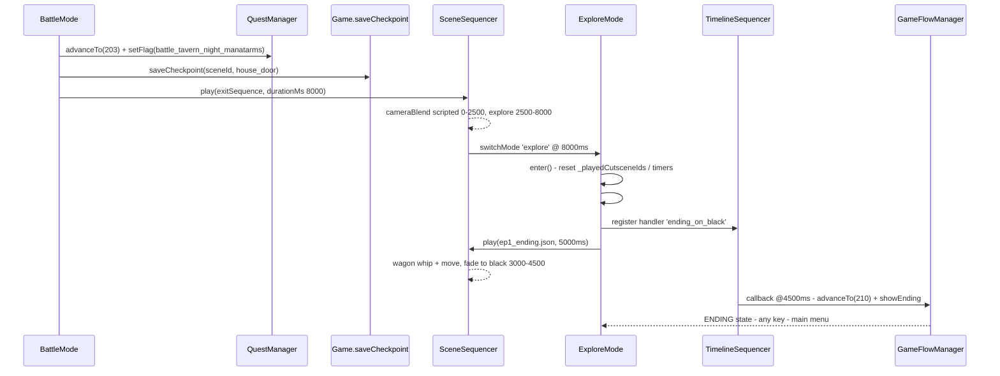
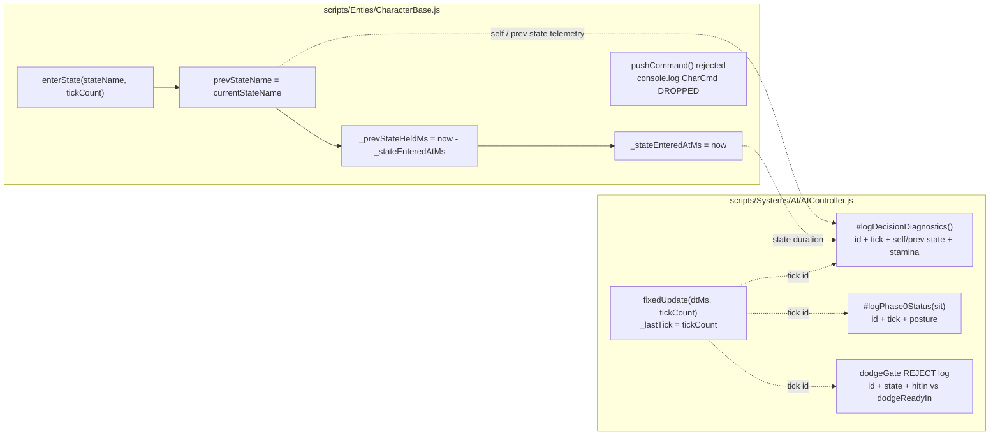

## 1. High-Level Summary (TL;DR)

**Impact:** 🟡 **Medium–High** — This is a **structural refactor of the win/ending flow** in the game *BlindDuel*, plus a batch of AI-telemetry, balance and tooling changes. The ending sequence is no longer owned by `BattleMode`; it is now driven by the **SceneDef `cutsceneInvokers`** mechanism (same pattern as the prologue), which removes a fragile cross-mode coupling and fixes a visible **camera jitter** on battle exit.

**Key Changes:**

1. ✨ **Ending decoupled from `BattleMode`** — removed `#beginEndingSequence()`, the `_ending` simulation-freeze flag, and the `battle_on_ending_black` handler registration. Victory now only advances scenario/flags/checkpoint and plays the normal exit sequence.
2. ✨ **New `cutsceneInvokers` entry (`ep1_ending`)** in `Data/SceneDefs/ep1_tavern_night.json`, gated by `scenarioMin: 203`, with new `ending` semantics handled by `ExploreMode.#updateCutsceneInvokers()` → `ending_on_black` handler (advance to scenario `210` + `showEnding()`).
3. 🎯 **Camera-jitter fix** — manatarms `exitSequence` timing re-aligned so `cameraBlend.endMs == switchMode.atMs == durationMs == 8000` (was `blend end 6000 / switchMode 7500`).
4. 🔍 **AI diagnostics enriched** — `AIController` logs now carry `id` + `tick` + state durations; `CharacterBase.enterState()` records `prevStateName` / `_prevStateHeldMs` / `_stateEnteredAtMs`; dropped commands are now logged.
5. ⚠️ **Debug leftovers** — `ThrowComponent.DEBUG_INFINITE_AMMO` flipped to `true`, and a stale **backup copy** of `AIController` (`AIController - 副本.js`, 2529 lines) was committed into `scripts/Systems/AI/`.

---

## 2. Visual Overview (Code & Logic Map)

### 2.1 Business Goal ↔ Module ↔ Methods — New Ending Flow

```mermaid
flowchart TD
    subgraph Goal["🎯 Business Goal — Ending decoupled, no camera jitter"]
        G1["Victory leads to ending<br/>without camera jitter"]
        G2["BattleMode only owns<br/>battle responsibilities"]
    end

    subgraph BM["scripts/Systems/Modes/BattleMode.js"]
        A1["#checkBattleEnd()"]
        A2["#handleVictory(sceneSequencer)"]
        A3["questManager.advanceTo(203)"]
        A4["questManager.setFlag('battle_tavern_night_manatarms')"]
        A5["game.saveCheckpoint('house_door')"]
        A6["sceneSequencer.play(exitSequence)"]
    end

    subgraph SD["Data/SceneDefs/ep1_tavern_night.json"]
        D1["cutsceneInvokers[0]<br/>id = ep1_ending"]
        D2["condition: scenarioMin 203"]
        D3["ending: text + scenario 210"]
    end

    subgraph EX["scripts/Systems/Modes/ExploreMode.js"]
        B1["enter()<br/>_playedCutsceneIds.clear()"]
        B2["#updateCutsceneInvokers(dtMs)"]
        B3["sequenceHandlers.set('ending_on_black', fn)"]
        B4["_unregisterSequenceHandlers()<br/>delete('ending_on_black')"]
    end

    subgraph TS["scripts/Systems/TimelineSequencer.js"]
        C1["_getHandler('ending_on_black')"]
        C2["callback clip @4500ms<br/>handler(ctx, clip)"]
    end

    subgraph GFM["scripts/Systems/GameFlowManager.js"]
        D4["showEnding(text)"]
    end

    G1 --> A1
    A1 --> A2
    A2 --> A3
    A2 --> A4
    A2 --> A5
    A2 --> A6
    A6 -->|"exit sequence 8000ms"| B1
    B1 --> B2
    D1 --> B2
    D2 --> B2
    D3 --> B2
    B2 -->|"armDelayMs 500"| B3
    B3 --> C1
    C1 --> C2
    C2 --> D4
    D4 --> G1
    B4 -.cleanup.-> B3 G2 --- BM
```

### 2.2 End-to-End Timing (Sequence Diagram)



### 2.3 AI Telemetry Pipeline (Debug-only)



---

## 3. Detailed Change Analysis

### 3.1 Component: `BattleMode` — Ending Ownership Removed

**Source:** `scripts/Systems/Modes/BattleMode.js`

**What Changed:**
- The `onVictory.ending` branch was **deleted** from `#handleVictory()`. Previously, when `BattleDef.onVictory.ending` existed, BattleMode injected an `ending_hook` callback track into the exit sequence (at `durationMs - 100`) and relayed to `#beginEndingSequence()`.
- `#beginEndingSequence()` — which registered the `battle_on_ending_black` handler, disabled the player controller, and `fetch()`-ed the ending JSON — was **removed entirely**.
- The `_ending` flag was removed from three places: `enter()` initialization, the `fixedUpdate()` early-return freeze (`if (this._ending) return;`), and the `exit()` handler cleanup.
- **Consequence:** victory now *immediately* applies `scenario` / `flags` / `questStages` / `checkpoint` through the normal path before returning to Explore mode.

**Table — removed symbols (breaking for any external caller):**

| Removed Symbol | Kind | Replacement |
|---|---|---|
| `BattleMode#beginEndingSequence()` | private method | `ExploreMode` ending handler |
| `BattleMode._ending` | instance flag | *none* (freeze mechanism dropped) |
| `battle_on_ending_black` | sequence handler name | `ending_on_black` |
| `BattleDef.onVictory.ending` | data contract | `SceneDef.cutsceneInvokers[].ending` |

---

### 3.2 Component: `ExploreMode` — Cutscene Invoker Gains `ending` Semantics

**Source:** `scripts/Systems/Modes/ExploreMode.js`

**What Changed:**

1. **`enter()` — per-run reset of cutscene state.** Because the `ExploreMode` instance is reused across scenes (Scene.js does not rebuild it), the de-duplication set `_playedCutsceneIds` and the pending timers `_cutsceneTimers` are now cleared on every entry. Without this, a second playthrough would find `ep1_ending` already in the set and the ending would never fire again.

2. **`#updateCutsceneInvokers()` — new `ending` branch.** Before fetching the sequence, if `invoker.ending` is present, a one-shot handler `ending_on_black` is registered into `context.sequenceHandlers`. On invocation it deletes itself, advances the scenario and shows the completion screen.

3. **`_unregisterSequenceHandlers()` — added `handlers.delete("ending_on_black")`** so the handler does not leak as a dead reference into the shared, cross-scene `sequenceHandlers` map.

**Code Snippet (critical):**
```js
if (invoker.ending) {
    const handlers = this.context.sequenceHandlers;
    handlers?.set("ending_on_black", () => {
        handlers?.delete("ending_on_black");
        const { questManager, game } = this.context;
        if (questManager && invoker.ending.scenario) {
            questManager.advanceTo(invoker.ending.scenario);
        }
        game?.gameFlowManager?.showEnding(invoker.ending.text ?? "EPISODE COMPLETE");
    });
}
```

---

### 3.3 Component: Scenario Milestones & Scene Data

**What Changed:**

| File | Change | Old Value | New Value |
|---|---|---|---|
| `Data/ScenarioMilestones.js` | New milestone constant | *(absent)* | `EP1_TAVERN_NIGHT_VICTORY: 203` |
| `Data/ScenarioMilestones.js` | Ordering | `202` → `210` | `202` → **`203`** → `210` |
| `Data/SceneDefs/ep1_tavern_night.json` | New `cutsceneInvokers` array | *(absent)* | 1 invoker `ep1_ending` |
| `Data/SceneDefs/ep1_tavern_night.json` | `enemy_1` spawn `pos` | `[-6.4, -0.4]` | `[-7.4, -0.4]` |
| `Data/SceneDefs/ep1_tavern_night.json` | `bt_field_1` trigger `pos` | `[-10, 0, 0]` | `[-12, 0, 0]` |
| `Data/Sequences/ep1_ending.json` | New `hero.command` track | *(absent)* | `inputLock locked:true @0ms` |
| `Data/Sequences/ep1_ending.json` | Black-screen callback `fn` | `battle_on_ending_black` | `ending_on_black` |
| `Data/SceneDefs/ep1_tavern_hall_night.json` | `aiProfile.baseAggression` | `0.25` | `1.0` |
| `scripts/SceneDefs.js` | `BATTLE_TAVERN_NIGHT_MANATARMS.onVictory` | had `ending:{...}` | now `scenario: SCENARIO.EP1_TAVERN_NIGHT_VICTORY` |

**New `cutsceneInvokers` schema (used):**

| Field | Type | Value | Purpose |
|---|---|---|---|
| `id` | string | `ep1_ending` | De-dup key (in-memory + `flagOnPlay`) |
| `sequenceUrl` | string | `Data/Sequences/ep1_ending.json` | Sequence to fetch |
| `armDelayMs` | int | `500` | Delay after condition hit, lets the explore camera settle |
| `flagOnPlay` | string | `ep1_ending_played` | Persistent world flag guard |
| `condition.scenarioMin` | int | `203` | Arm only after the victory milestone |
| `condition.flagNot` | string | `ep1_ending_played` | Do not replay once played |
| `ending.text` | string | `EPISODE 1 COMPLETE` | Passed to `GameFlowManager.showEnding()` |
| `ending.scenario` | int | `210` (`EP1_COMPLETED`) | Scenario advanced at the black-screen callback |

---

### 3.4 Component: Camera Jitter Fix — Exit Sequence Timing Alignment

**Source:** `scripts/SceneDefs.js` (`BATTLE_TAVERN_NIGHT_MANATARMS.exitSequence`, `durationMs: 8000`)

**What Changed:** The documented rule (§6.5 of the TimelineSequencer guide) requires `cameraBlend.endMs`, `switchMode.atMs` and `durationMs` to be aligned. The old values left a "frozen window" where the camera had already been returned to the explore rig while the mode was still `BattleMode`, releasing the accumulated state difference as a one-frame jump.

| Clip | Old | New | Note |
|---|---|---|---|
| `hero.command` → `inputLock locked:false` | `7500` | `8000` | Unlock aligns with duration |
| `camera` → `cameraBlend → scripted` | `startMs 0, durationMs 500` | `startMs 0, durationMs 2500` | Slower scripted hand-off |
| `camera` → `cameraBlend → explore` | `startMs 500, durationMs 5500` (end **6000**) | `startMs 2500, durationMs 5500` (end **8000**) | End now == `durationMs` |
| `mode` → `switchMode explore` | `7500` (hack, "earlier switch for playing ending correctly") | `8000` | Hack comment removed |

The **guide** (`docs/TimelineSequencer User Guide.md`) was updated with the rule, the measured evidence (`CAM_JITTER_TARGET dist=2.1150` vs `CAM_JITTER_POS 0.26`, one-frame delta after `cameraBlend END`) and a record of the rejected "tracking blend" fix attempt.

---

### 3.5 Component: AI Telemetry (`AIController` + `CharacterBase`)

**Source:** `scripts/Systems/AI/AIController.js`, `scripts/Enties/CharacterBase.js`

**What Changed (debug-only, no gameplay impact):**

| Location | Change |
|---|---|
| `AIController.fixedUpdate(dtMs, tickCount = null)` | New optional `tickCount` parameter → stored in `this._lastTick` |
| `AIController` COMBAT diag | Added `id`, `tick`, self state **duration**, **prev state + held ms**, opponent attack **elapsed ms** |
| `AIController` decision diag | Added `id`, `tick`, self state + normalized time, stamina |
| `AIController` dodge-gate diag | Added `id` to the `dodgeGate REJECT` line |
| `AIController` `[Phase0]` diag | Added `id` |
| `CharacterBase.enterState()` | Records `prevStateName`, `_prevStateHeldMs` (how long the *previous* state was held), `_stateEnteredAtMs` |
| `CharacterBase.pushCommand()` | Logs rejected commands: `[CharCmd] DROPPED id=… state=… cmd=… t=…` |

**Opponent attack elapsed computation (new):**
```js
const oppNorm = opp.animation?.normalizedTime ?? 0;
oppAtkTag = `${ap.stateName}/${this.#getAttackPhase(ap, oppNorm)}`;
oppAtkElapsedMs = oppNorm * (ap.timing?.totalMs ?? 0);
```

> `fixedUpdate(dtMs, tickCount)` is already wired end-to-end: `Scene.fixedUpdate` → `GameModeManager.fixedUpdate(dtMs, tickCount)` → `BattleMode.fixedUpdate` → `opponent?.controller?.fixedUpdate?.(dtMs, tickCount)`.

---

### 3.6 Component: AI Tuning, Test Scripts & Debug Flags

| File | Change | Risk |
|---|---|---|
| `scripts/Components/ThrowComponent.js` | `DEBUG_INFINITE_AMMO` `false` → **`true`** | ⚠️ **High** — the file's own comment says *"正式验收必须为 false"*. Infinite ammo in the shipped build. |
| `Data/TestScripts/manatarms_basic_sequence.json` | Removed move + `smash` + idle steps (now only `reverse_quart` + 1800ms) | Test coverage reduced |
| `Data/TestScripts/rabble_stick_basic_sequence.json` | `guard` wait `2300` → `1000`; **`dodge` step removed** | Test coverage reduced |
| `scripts/Systems/AI/AIController - 副本.js` | **New 2529-line backup copy** of `AIController.js` (current file is 3138 lines → copy is ~600 lines stale) | ⚠️ Repo hygiene — dead duplicate shipped in `scripts/` |

---

### 3.7 Component: Documentation, Skills & Assets

| File | Change |
|---|---|
| `plans/26.11.14 通关流程调整计划.MD` | **New** — full design plan for the battle/ending decoupling (Step 1 decouple, Step 2 ending screen), including risk analysis |
| `plans/HandOff.MD` | **Rewritten** — now a trail-marker (刀光) debugging handoff: root cause = stale `.collider.json` scan artifacts; includes re-scan command table and the outstanding *clash* trail-marker asset TODO |
| `.trae/skills/collider-occupancy-更新-skill/SKILL.md` | **New** skill — two routes (`extract_collision_boxes.ps1` → `.collider.json`, `extract_rootmotion_occupancy.ps1` → `.occupancy.json`), batch PowerShell template, mask colour conventions, 5 common pitfalls |
| `docs/TimelineSequencer User Guide.md` | New rule on aligning `cameraBlend.endMs` / `switchMode.atMs` / `durationMs`; jitter diagnostics + rejected-fix record |
| `docs/AudioLicensesInfo.MD` | 2 new assets: *wagon cart on gravel* (Martineerok), *Whip Crack 01* (CGEffex) — both CC-Attribution 4.0 (matches the wagon sequence in `ep1_ending.json`) |
| `PROJECT_CONTEXT.md` | `ExploreMode` description updated to document the new `ending` semantics and that `BattleDef.onVictory.ending` was removed |
| `Audio/sfx/_raw/sliceinfo.txt` | Trailing-newline only |
| `Art/RawAssets/Env/Tavern.ase`, `arrow.ase`, `floor.kra`, `treeline_pine.kra` | Binary asset updates (no textual diff) |

---

## 4. Impact & Risk Assessment

### 🔴 Breaking Changes

| Change | Impact |
|---|---|
| `BattleDef.onVictory.ending` removed from the contract | Any other `BattleDef` (or future content) relying on `onVictory.ending` will **silently no-op**. Currently only the manatarms battle used it → verified safe, but the capability was removed from the shared API. |
| `battle_on_ending_black` handler removed | Old ending JSON files referencing this `fn` will only log a warning (`TimelineSequencer` → `handler not found for fn=…`) and **not** advance the scenario. |
| `AIController.fixedUpdate(dtMs, tickCount)` | Signature widened — **backwards compatible** (default `null`), but any subclass/caller overriding it must be reviewed. |
| `ExploreMode.enter()` now clears `_playedCutsceneIds` | Invokers **without** `flagOnPlay` will re-arm on every ExploreMode entry (cross-scene replay). Only `ep1_ending` uses `flagOnPlay`, so currently safe. |

### 🟠 Risks & Concerns

1. **⚠️ `DEBUG_INFINITE_AMMO = true` is committed** — the code comment explicitly demands `false` for formal acceptance. Must be reverted before shipping/QA sign-off.
2. **⚠️ Duplicate AI controller in `scripts/`** — `AIController - 副本.js` is a stale2529-line copy inside the source tree. It will be picked up by any glob-based tooling/import sweep and can drift silently. Should be deleted (git history preserves it) or moved outside `scripts/`.
3. **🟡 `_playedCutsceneIds.clear()` on every `enter()`** — the persistent guard now relies solely on the world flag `ep1_ending_played`, which is written **directly to `worldState.flags`** (bypassing `questManager` / `_notify`). If that flag is not persisted in the save file, the ending may re-trigger on reload after victory.
4. **🟡 `scenarioMin: 203` fires "instantly"** — any future `spawnIf` / `stateMap` / music anchor written against `203` will take effect at the exact moment of victory rather than after the ending plays. The plan explicitly flags this (no such anchors exist today).
5. **🟡 Reduced test-script coverage** — `manatarms` lost its `smash` + movement steps and `rabble_stick` lost the `dodge` step; the AI dodge/throw paths are now less exercised by the automated sequences.
6. **🟡 Stale comment** in `scripts/Systems/GameFlowManager.js:49` still refers to the removed `battle_on_ending_black` callback name — should be updated to `ending_on_black`.
7. **🟡 `baseAggression` 0.25 → 1.0** for the tavern-hall-night enemy is a large jump in an already-tuned AI; it interacts directly with the `CombatPosture` layer and the throw/debug behaviour being investigated.

### 🟢 Positive / Low Risk

- The removed `_ending` freeze was a **battle-mode responsibility leak**; BattleMode is now purely a battle mode.
- `TimelineSequencer` tolerates a missing callback handler with a warning instead of throwing — verified at `TimelineSequencer.js:464-466`.
- `Scene._evaluateCondition` already supports `scenarioMin` → the new invoker condition needs no new runtime code.
- `GameFlowManager.showEnding()` → main menu path is **unchanged** (zero-diff).

---

## 5. 🧪 Testing Suggestions

**Ending flow (highest priority):**
1. Win the manatarms battle → verify `scenario` reaches **203** *before* returning to Explore, and `battle_tavern_night_manatarms` flag is set (enemy_2 must **not** respawn).
2. Verify the exit sequence plays fully (sheath @2500, scripted blend 0–2500, explore blend 2500–8000, `switchMode explore` @8000) with **no camera jump** — watch for `CAM_JITTER_DETECTED` in the console.
3. Verify `ep1_ending` fires ~500ms after returning to Explore: wagon whip + move, fade to black at 3000–4500, black-screen callback at 4500 → scenario **210** + `EPISODE 1 COMPLETE` screen.
4. Verify the hero's input is **locked** during the ending (new `inputLock` track) and that the ending does **not** unlock it afterwards.

**Regression / edge cases:**
5. **Play the scene twice** (re-enter `ep1_tavern_night`) → the ending must fire again (validates the `_playedCutsceneIds.clear()` + `flagOnPlay` combination).
6. Load a save made at the victory moment → confirm whether `ep1_ending_played` persisted; if not, decide if the ending should be blocked on reload.
7. Defeat the manatarms → verify the defeat path still restores the `house_door` checkpoint and that the ending is **not** triggered.
8. Quit/reload mid-ending → confirm the missing `ending_on_black` handler only warns and does not leave the game in a stuck black screen.

**AI / combat:**
9. Re-run the trimmed test scripts and confirm the AI logs now show `id`, `tick`, `selfState(...dur=)` and `prev(...held=)` values that make sense (state durations should be non-zero and plausible).
10. Verify the new `[CharCmd] DROPPED` log correctly surfaces commands rejected by `#canAcceptCommand()` (e.g. attacking while locked).
11. Tune check: `baseAggression = 1.0` for the tavern-hall-night enemy — verify it does not spam attacks or neglect dodge/guard.
12. 🔴 **Before QA sign-off:** set `ThrowComponent.DEBUG_INFINITE_AMMO` back to `false` and delete `scripts/Systems/AI/AIController - 副本.js`.

**Asset / tooling:**
13. Re-scan the trail-marker colliders per `.trae/skills/collider-occupancy-更新-skill/SKILL.md` and confirm `zornhut / quart / nachschlag / swing` show knife trails; the *clash* marker PNGs still need to be drawn.

---

### 📋 Changed Files At a Glance (26 files)

| Area | Files |
|---|---|
| **Core logic (6)** | `scripts/Systems/Modes/BattleMode.js`, `scripts/Systems/Modes/ExploreMode.js`, `scripts/Systems/AI/AIController.js`, `scripts/Enties/CharacterBase.js`, `scripts/SceneDefs.js`, `scripts/Components/ThrowComponent.js` |
| **New backup file (1)** | `scripts/Systems/AI/AIController - 副本.js` |
| **Data / config (7)** | `Data/ScenarioMilestones.js`, `Data/SceneDefs/ep1_tavern_night.json`, `Data/SceneDefs/ep1_tavern_hall_night.json`, `Data/Sequences/ep1_ending.json`, `Data/TestScripts/manatarms_basic_sequence.json`, `Data/TestScripts/rabble_stick_basic_sequence.json`, `Audio/sfx/_raw/sliceinfo.txt` |
| **Docs / plans (6)** | `PROJECT_CONTEXT.md`, `plans/26.11.14 通关流程调整计划.MD` *(new)*, `plans/BACKLOG.md`, `plans/HandOff.MD`, `docs/TimelineSequencer User Guide.md`, `docs/AudioLicensesInfo.MD` |
| **Skill (1)** | `.trae/skills/collider-occupancy-更新-skill/SKILL.md` *(new)* |
| **Binary art (4)** | `Art/RawAssets/Env/Tavern.ase`, `arrow.ase`, `floor.kra`, `treeline_pine.kra` |