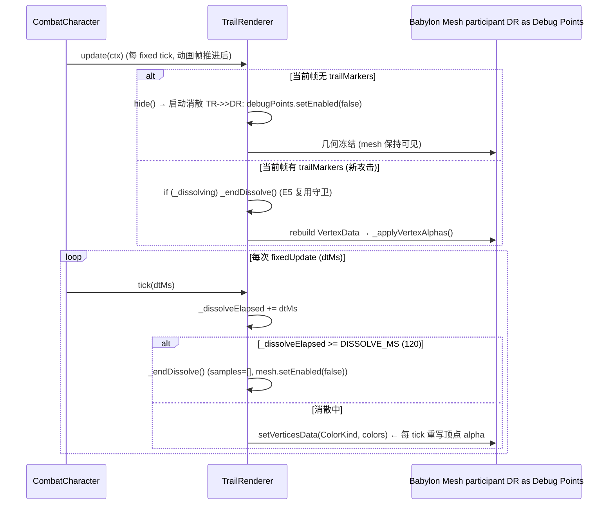
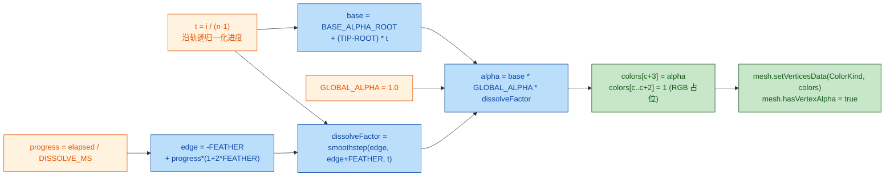

# 📜 Code Review Summary — Weapon Trail (刀光) Ending Effect + Debug Flag Overrides

## 1. High-Level Summary (TL;DR)

* **Impact:** 🟡 **Medium** — Implements the *weapon-trail dissolve* VFX feature end‑to‑end (per‑vertex alpha + fade‑out sweep), while **simultaneously flipping several debug/production flags** that change runtime behavior (infinite ammo, combat trace, default scene, AI controller disabled).

### ✨ Key Changes

1. **✨ `TrailRenderer.js` — new dissolve state machine + per‑vertex alpha pipeline**
   Adds `_dissolving` / `_dissolveElapsed` state, a single alpha exit point `_applyVertexAlphas()`, a new `tick(dtMs)` clock hook, and rewrites `hide()` from *"hide instantly"* → *"start 120 ms dissolve sweep"*.
2. **✨ `CombatCharacter.js` / `CharacterBase.js` — two one‑line hooks**
   `fixedUpdate()` now unconditionally drives `trailRenderer.tick(dtMs)` (placed **before** the `isDead` early‑return), and `setCollisionVisible()` forwards the **X‑key** debug toggle into `TrailRenderer.setDebugVisible()`.
3. **⚠️ Debug/production flags flipped (likely accidental leftovers)**
   `ThrowComponent.DEBUG_INFINITE_AMMO` `false → true`, `CombatSystem.debugTrace` `false → true`, `WorldState.currentSceneId` `prologue → ep1_tavern_hall_night`, and the `manatarms` enemy in the tavern scene switched `controller: "ai" → "dummy"`.
4. **🗑️ Dead code + doc churn**
   A **2 529‑line stale backup copy** `scripts/Systems/AI/AIController - 副本.js` was committed (not imported anywhere), and `plans/HandOff.MD` was **overwritten with a raw console‑log dump**, destroying the previous multi‑battle design handoff.
5. **📚 Documentation & tooling**
   Two archived plan docs added (`26.10.31 刀光计划`, `26.11.1 刀光结束效果计划`), `PROJECT_CONTEXT.md` / `plans/INDEX.md` updated, and a new Trae skill `collider-occupancy-更新-skill/SKILL.md` for regenerating collider/occupancy JSON via PowerShell.

---

## 2. Visual Overview (Code & Logic Map)

### 2.1 Weapon Trail component map — Business goal → files → methods

```mermaid
flowchart TD
    subgraph GOAL["🎯 Business Goal: 刀光结束效果 (Weapon Trail Ending Effect)"]
        G1["整体半透明 (translucent ribbon)"]
        G2["起点→终点 渐隐消散 (root→tip dissolve sweep)"]
        G3["X 键联动 debug 采样点显隐"]
    end

    subgraph TRF["🟦 scripts/Components/TrailRenderer.js"]
        TR1["buildRibbon()<br/>creates ribbon mesh + VertexData"]
        TR2["_applyVertexAlphas()<br/>E6 alpha exit point"]
        TR3["#smoothstep(a,b,x)<br/>feather band easing"]
        TR4["hide()<br/>starts dissolve (idempotent)"]
        TR5["tick(dtMs)<br/>E3 dissolve clock"]
        TR6["_endDissolve()<br/>terminal cleanup"]
        TR7["update(ctx)<br/>marker sampling + E5 guard"]
        TR8["setDebugVisible(value)"]
    end

    subgraph CHF["🟩 scripts/Enties/CombatCharacter.js"]
        CH1["fixedUpdate(dtMs)<br/>calls trailRenderer.tick(dtMs)"]
        CH2["_updateTrailRenderer()<br/>calls trailRenderer.update(ctx)"]
    end

    subgraph CBF["🟩 scripts/Enties/CharacterBase.js"]
        CB1["setCollisionVisible(value)<br/>forwards to trailRenderer"]
    end

    subgraph SCN["🟨 scripts/Scene.js (unchanged)"]
        SC1["_onKeyDown 'x' → _applyDebugVisible()"]
    end

    G1 --> TR2
    G2 --> TR4    G2 --> TR5
    G3 --> SC1
    SC1 --> CBF
    CBF --> TR8
    TR8 --> TR7
    CH1 --> TR5
    TR5 --> TR2
    TR5 --> TR6
    TR2 --> TR3
    TR4 --> TR5
    CH2 --> TR7
    TR7 --> TR6
    TR7 --> TR4

    classDef goal fill:#fff3e0,color:#e65100,stroke:#e65100
    classDef trail fill:#bbdefb,color:#0d47a1,stroke:#0d47a1
    classDef ent fill:#c8e6c9,color:#1a5e20,stroke:#1a5e20
    classDef scn fill:#f3e5f5,color:#7b1fa2,stroke:#7b1fa2
    class G1,G2,G3 goal
    class TR1,TR2,TR3,TR4,TR5,TR6,TR7,TR8 trail
    class CH1,CH2,CB1 ent
    class SC1 scn
```

### 2.2 Sequence — one attack: sample → show → dissolve → cleanup



### 2.3 Alpha composition formula (E6: three separable factors)



---

## 3. Detailed Change Analysis

### 3.1 🟦 Component: `TrailRenderer` (Weapon Trail VFX) — *core feature*

**What Changed**
* **New alpha channel pipeline (E1/E2/E6).** A new `_applyVertexAlphas()` is the **single exit point** for all alpha computation, writing a `Float32Array(n*2*4)` into `BABYLON.VertexBuffer.ColorKind`. RGB is written as `1` as a placeholder — hue still comes from `emissiveColor`, and only the **A channel** is borrowed (`diffuseColor` is black). The material gained `this.mesh.hasVertexAlpha = true` so Babylon actually multiplies `vColor.a` into `finalAlpha`.
* **New dissolve state machine (E3/E4).** `hide()` no longer disables the mesh. Instead it enters the `DISSOLVING` state; `tick(dtMs)` advances `_dissolveElapsed` and rewrites vertex alpha each fixed tick; `_endDissolve()` performs the terminal cleanup (`samples = []`, `collectedSamples = []`, `mesh.setEnabled(false)`).
* **⚠️ E5 decision was revised during implementation.** The original plan said *"clip change terminates the dissolve"* — that proved wrong, because entering `idle`/`recovery` **always** changes the clip, which would clear the trail on the very first frame of the dissolve. The guard was therefore moved to the *"a new marker was sampled"* branch in `update(ctx)`, i.e. a genuinely new attack. This is documented as a plan deviation in both `plans/INDEX.md` and the archived plan §10.
* **Debug visibility is now instance-level.** `setDebugVisible(value)` was added and is wired in parallel with the static `TrailRenderer.DEBUG_POINTS` switch, so debug sample points can be toggled at runtime by the **X key** without disabling the whole debug subsystem.

**New tuning constants (all static on `TrailRenderer`)**

| Constant | Value | Meaning |
|---|---|---|
| `BASE_ALPHA_ROOT` | `0.0` | Base gradient alpha at the blade root (`t=0`) |
| `BASE_ALPHA_TIP` | `0.64` | Base gradient alpha at the blade tip (`t=1`) |
| `GLOBAL_ALPHA` | `1.0` | Global translucency multiplier (plan originally suggested `0.9`) |
| `DISSOLVE_MS` | `120` | Total dissolve duration, accumulated in fixed ticks |
| `DISSOLVE_FEATHER` | `0.18` | Feather band width as a fraction of the trail (smoothstep band) |

**Instance state added**

| Field | Init | Purpose |
|---|---|---|
| `_dissolving` | `false` | Dissolve state flag (also the idempotency guard in `hide()`) |
| `_dissolveElapsed` | `0` | Accumulated dissolve progress in ms |
| `_debugVisible` | `true` | Per‑instance debug sample‑point visibility (X key) |

**Behavioral notes**

* `hide()` is now **idempotent**: a second call while `_dissolving` is `true` returns immediately, so the `enterState` fallback + `update()` path cannot restart the dissolve timer.
* `collectedSamples` is cleared when the dissolve starts, but **`samples` (ribbon vertices) are deliberately retained** so the frozen geometry can still be rendered while fading.
* `dispose()` now resets `_dissolving` / `_dissolveElapsed` to avoid a stale-state leak.
* The `for (const p of this.debugPoints) p.setEnabled(false)` loop was **moved out of `_endDissolve()` into `hide()`** — a cleanup responsibility shift.

---

### 3.2 🟩 Entities: `CombatCharacter` & `CharacterBase` — *hook points*

| File | Method | Change | Rationale |
|---|---|---|---|
| `scripts/Enties/CombatCharacter.js` | `fixedUpdate(dtMs)` | `this.trailRenderer?.tick(dtMs);` added **before** the `this.combat.isDead` early‑return | Dissolve keeps running even when the character dies mid‑attack; non‑dissolving state returns instantly (≈0 cost) |
| `scripts/Enties/CharacterBase.js` | `setCollisionVisible(value)` | `this.trailRenderer?.setDebugVisible?.(value);` | Forwards the X‑key toggle (`Scene._applyDebugVisible` → `setCollisionVisible`) into the trail renderer |

*Source: `scripts/Enties/CombatCharacter.js`, `scripts/Enties/CharacterBase.js`.*

---

### 3.3 ⚠️ Configuration & runtime flags flipped — *review these first*

| File | Setting | Old | New | Risk |
|---|---|---|---|---|
| `scripts/Components/ThrowComponent.js` | `DEBUG_INFINITE_AMMO` | `false` | **`true`** | 🔴 Ammo never depletes. The code comment explicitly states *"正式验收必须为 false"* (must be `false` for formal acceptance). `ThrowComponent.hasAmmo()` and the ammo decrement are both short‑circuited. |
| `scripts/Game.js` | `CombatSystem({ debugTrace })` | `false` | **`true`** | 🟡 Verbose combat tracing at runtime (log volume / perf). |
| `scripts/WorldState.js` | `currentSceneId` | `"prologue"` | **`"ep1_tavern_hall_night"`** | 🟡 The game now boots into the tavern scene instead of the prologue — affects any smoke test / default boot path. |
| `Data/SceneDefs/ep1_tavern_hall_night.json` | `manatarms.controller` | `"ai"` | **`"dummy"`** | 🟠 The `manatarms` enemy in the tavern scene **no longer fights** — it becomes an inert dummy. Makes sense for trail/visual testing, but must not ship. |

> **Note:** `PROJECT_CONTEXT.md` still documents `DEBUG_INFINITE_AMMO` as *"正式环境必须 false"*, yet the code now says `true` — the code and the documentation disagree.

---

### 3.4 🟨 Data & test configuration

| File | Change | Effect |
|---|---|---|
| `Data/TestScripts/manatarms_basic_sequence.json` | Reduced to a **single** step: `reverse_quart` + `waitMs: 1800` | Removed the `moveIntent {x:1,y:0}` (1300 ms), the `smash` attack (1 800 ms), and the stop‑move step. Test script now exercises **only the thrust trail**, no slash. |
| `Data/SceneDefs/ep1_tavern_hall_night.json` | `manatarms` → `controller: "dummy"` | See §3.3. |

---

### 3.5 🗑️ Dead code: `scripts/Systems/AI/AIController - 副本.js`

* **New file, 2 529 lines** — an *older snapshot* of `scripts/Systems/AI/AIController.js` (literally "copy" in Chinese).
* **Not imported anywhere** in the project (verified: zero references to `副本` in any `.js` file) → **pure dead weight**.
* **It is already out of sync** with the live controller: the copy is missing `#logPhase0Status()` and `#getMaxHoldMs()`, both of which exist in the real `AIController.js`.
* ⚠️ A file named `副本` in `scripts/` is a classic source of accidental imports and merge conflicts. **Recommendation: delete it** (or move it outside `scripts/`, e.g. into `plans/archived/`).

---

### 3.6 📚 Documentation, plans & tooling

| File | Type | Change |
|---|---|---|
| `plans/archived/26.11.1 刀光结束效果计划.MD` | **New** (152 lines) | Full plan for the trail ending effect — requirements, decision table `E1`–`E6`, implementation design, 7 test scenarios, and a §10 "landing record" documenting the **E5 deviation** and the unplanned X‑key integration. |
| `plans/archived/26.10.31 刀光计划.MD` | **New** (257 lines) | Archived plan for the trail **geometry** phase — decision table `D1`–`D9` (world‑space sampling, marker PNG pipeline, `t ∈ [0,1]` vertex reservation, `hide()` dissolve entry reservation = "D8"). |
| `plans/INDEX.md` | Modified | New `## Update Log (2026-11-01)` section describing the landing; current‑work line updated (fade‑along‑trail D8③ retired → Phase ④ texture/feather/glow still pending). |
| `plans/BACKLOG.md` | Modified | Removed the `projectile vs shield` backlog item. |
| `PROJECT_CONTEXT.md` | Modified | §3 trail entry expanded (alpha formula, dissolve constants, E5 note); §6 corrected — the debug master switch is actually the **X key**, not the C key as previously documented; §9.2 sampling chain updated. |
| `plans/HandOff.MD` | ⚠️ **Replaced** | The171‑line *"single‑scene multi‑battle refactor handoff"* design document was **deleted and replaced with a 468‑line raw browser console log dump** (`[AI-Diag] …`, `[Phase0] …`, `[Ambient sfx] …`). **Valuable design content was lost.** |
| `.trae/skills/collider-occupancy-更新-skill/SKILL.md` | **New** (131 lines) | Trae agent skill: two PowerShell routes (combat `collider.json` via `extract_collision_boxes.ps1`, NPC `occupancy.json` via `extract_rootmotion_occupancy.ps1`), directory conventions, batch‑processing template, and the collision‑mask color code table (`#FFFF00` hitbox, `#E37800` strong blade, `#FF0000` weak blade, `#7082C1` root). |
| `Art/RawAssets/…` (5 files) | Binary | `Tavern.ase`, `arrow.ase`, `floor.kra`, `treeline_pine.kra`, `longswordman_quart.ase` — binary asset edits (no textual diff). |

---

## 4. Impact & Risk Assessment

### 🔴 Breaking / Behavioral Changes

| # | Change | Impact |
|---|---|---|
| 1 | `TrailRenderer.hide()` semantics | **API semantic break.** Previously the trail vanished instantly; now it lingers for ~120 ms while fading. Any caller relying on synchronous hiding (e.g. a state‑switch "no residual trail" assertion) will observe a 120 ms ghost. Only `CombatCharacter`/`enterState` currently call it. |
| 2 | `mesh.hasVertexAlpha = true` | The ribbon now renders **translucent**. Any screenshot/visual‑regression baseline that expected an opaque trail will break. Colour must stay on `emissiveColor` — moving hue to vertex RGB would double‑multiply against the black `diffuseColor`. |
| 3 | `WorldState.currentSceneId` default | Boot path changed from `prologue` → `ep1_tavern_hall_night`. Scripts/automated runs that assume the prologue will start in the wrong scene. |
| 4 | `manatarms.controller: "dummy"` | The tavern enemy stops acting. Behavioural regression for anyone playing/scene‑testing that scene. |
| 5 | `ThrowComponent.DEBUG_INFINITE_AMMO = true` | Ammo economy is effectively disabled (both `hasAmmo()` and the decrement are skipped). Contradicts the stated acceptance rule. |

### ⚠️ Risks & Smells

* 🟠 **Debug flags left enabled** — 4 of them (`DEBUG_INFINITE_AMMO`, `debugTrace`, dummy controller, scene override) look like local‑test leftovers that were committed.
* 🟠 **`AIController - 副本.js`** — 2 529 lines of stale, unimported duplicate in the live `scripts/` tree; already drifted from the real controller.
* 🟠 **`plans/HandOff.MD` overwritten with a log dump** — irreversible loss of the multi‑battle refactor design notes (BattleSession proposal, gaps list, acceptance checklist).
* 🟡 **`_endDissolve()` vs `hide()` cleanup split** — debug‑point hiding now happens only in `hide()`. If a dissolve is terminated through the **E5 path** (`_endDissolve()` called directly from `update()`), debug points are *not* re‑hidden by that path — they are hidden by the preceding clip‑change branch, so behaviour is currently correct but **coupled and fragile**.
* 🟡 **Per‑tick vertex buffer rewrite** — `setVerticesData(ColorKind, …)` allocates a new `Float32Array` every fixed tick during the 120 ms dissolve (≈ hundreds of vertices → small, but a GC churn source). A reusable buffer would be cheaper.
* 🟢 **No schema/DB/API contract changes** — data files are cosmetic/test‑only; no public API signature was changed except the `hide()` semantic noted above.

### 🧪 Suggested Testing Scenarios

**Trail / VFX**
1. **Transparency** — trail is visibly translucent; sprite pixels show through; hue still matches `TRAIL_COLORS` (no colour shift from vertex RGB).
2. **Base gradient** — alpha at the root is lower than at the tip; verify with `facing = -1` as well (the gradient is based on trail order, not world X).
3. **Dissolve sweep** — after the attack ends, the trail erases **root → tip** with a feathered (non‑hard) boundary over ~120 ms.
4. **Clash freeze** — during a clash freeze the trail stays visible and does **not** dissolve (state did not switch → `hide()` not called).
5. **Rapid re‑attack (E5)** — start a second attack while the first trail is mid‑dissolve → the old ribbon must be cleared **immediately**, with no residual or flicker.
6. **Death during attack** — kill the character mid‑attack; the dissolve must still complete (the `tick()` call sits **before** the `isDead` early return).
7. **Debug toggle (X key)** — toggling X hides/shows trail sample points *and* the root/weaponbox debug visuals together; re‑enabling must not leave stale points.

**Configuration / regression**
8. 🔴 **Re‑verify the four debug flags** before merging: set `DEBUG_INFINITE_AMMO = false`, `debugTrace = false`, restore `manatarms.controller = "ai"`, and restore `WorldState.currentSceneId = "prologue"` — or explicitly confirm each is intended.
9. **Run `manatarms_basic_sequence`** — confirm the trimmed script (thrust only,1 800 ms) still produces the expected trail, and separately re‑test the removed slash + movement path.
10. **Long‑run perf** — profile a fight with continuous attacking; confirm the per‑tick vertex color rewrite causes no visible GC hitch.
11. **Regression suite** — run the existing prologue / `battle_field_1` / `battle_field_2` / tavern battles to confirm the trail changes did not affect combat resolution (the plan claims `CombatSystem` / `StateGraphDef` / the scan pipeline are untouched — verify that claim).

### 🧹 Suggested Cleanup

* Delete `scripts/Systems/AI/AIController - 副本.js` (or relocate outside `scripts/`).
* Restore `plans/HandOff.MD` from version control and store the console dump in a separate file (e.g. `plans/logs/2026-11-01_ai_diag.md`).
* Revert or consciously confirm the four debug flags listed in §3.3.

---