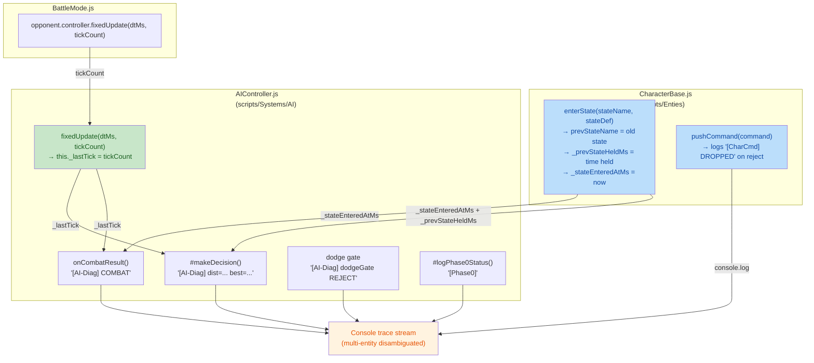
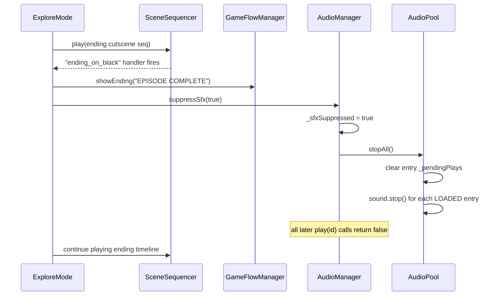
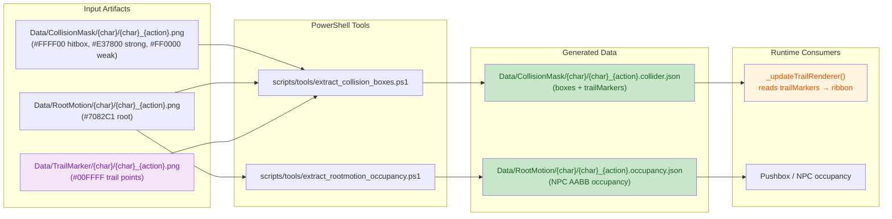

# Code Review Report — BlindDuel

## 1. High-Level Summary (TL;DR)

- **Impact:** **Medium** — A mixed bag of **debug instrumentation** (AI state/tick tracing), a **new global SFX suppression channel** for the ending cutscene, **data-driven tuning tweaks**, plus **two artifacts that should not ship** (a debug flag left `ON`, and a stale 2,529-line backup file of `AIController.js` committed into the source tree).

- **Key Changes:**
  1. 🐛 **AI observability overhaul** — `AIController` now stamps every diagnostic log with `id=` and `tick=`, and `CharacterBase` records **state-entry timestamps** (`prevStateName`, `_prevStateHeldMs`, `_stateEnteredAtMs`) so logs can distinguish "player vs AI" and "how long was I stuck in this state".
  2. 🔇 **New global SFX mute** — `AudioManager.suppressSfx(true)` + `AudioPool.stopAll()`, triggered automatically when the ending cutscene reaches the black screen.
  3. ⚙️ **Gameplay tuning** — Tavern enemy `baseAggression` raised `0.25 → 1.0`; both combat test scripts trimmed to shorter sequences.
  4. ⚠️ **`ThrowComponent.DEBUG_INFINITE_AMMO` flipped to `true`** — infinite ammo is now live; the code comment explicitly states acceptance requires `false`.
  5. 🗑️ **Committed a stale backup** — `scripts/Systems/AI/AIController - 副本.js` (2529 lines) is an *older* copy of the AI controller sitting next to the real one.
  6. 🧰 **Tooling docs** — New `.trae` skill for regenerating `.collider.json` / `.occupancy.json`, and `plans/HandOff.MD` fully rewritten to document the **trail-marker (刀光) missing-ribbon** root cause.

---

## 2. Visual Overview (Code & Logic Map)

### 2.1 AI State-Timing Instrumentation Flow



### 2.2 Ending Cutscene → SFX Suppression Sequence



### 2.3 Asset Pipeline Touched by the Handoff Doc



---

## 3. Detailed Change Analysis

### 3.1 🐛 AI Diagnostic Instrumentation — `scripts/Systems/AI/AIController.js`

**What Changed:** Pure observability work. No scoring, gating, or combat behavior was altered.

- **`fixedUpdate(dtMs, tickCount)`** now accepts an optional tick counter and stores it in `this._lastTick` (Source: `AIController.js:278`). The wiring already existed — `BattleMode.js:211` calls `opponent?.controller?.fixedUpdate?.(dtMs, tickCount)` — so no caller change was needed.
- **Opponent attack elapsed time** — `oppAtkElapsedMs = oppNorm * (ap.timing?.totalMs ?? 0)` is now derived alongside the existing phase tag, giving the attack's *age* rather than just its phase.
- **Self state duration** — `selfStateDur = performance.now() - self._stateEnteredAtMs`; this field only exists because `CharacterBase` now populates it.
- **All four diagnostic log sites** gained a `id=` prefix and a `tick=` prefix.

| Log Tag | Site | Fields Added |
|---|---|---|
| `[AI-Diag] COMBAT` | `onCombatResult` | `id`, `tick`, `selfState(dur=…ms)`, `prev(held=…ms)`, `oppAtk(elapsed=…ms)` |
| `[AI-Diag] dist=…` | `#makeDecision` | `id`, `tick`, `self={state}@normTime`, `stamina` |
| `[AI-Diag] dodgeGate REJECT` | dodge latency gate | `id` |
| `[Phase0]` | `#logPhase0Status` | `id` |

**Why it matters:** Previously, when two AI instances logged to the same console, their lines were indistinguishable — a major blocker for debugging AI-vs-player state divergence.

---

### 3.2 🐛 Character State Timing — `scripts/Enties/CharacterBase.js`

**What Changed:** Two instrumentation points, both non-behavioral.

1. **State entry bookkeeping** (`CharacterBase.js:528-534`)

 ```js
   this.prevStateName = prevStateName;
   this._prevStateHeldMs = this._stateEnteredAtMs != null
       ? performance.now() - this._stateEnteredAtMs : 0;
   this._stateEnteredAtMs = performance.now();
   ```

   → Enables the "how long was I in the previous state?" question, which is exactly what AI-dodge and posture decisions hinge on.

2. **Dropped-command trace** (`CharacterBase.js:585`)

   ```js
   console.log(`[CharCmd] DROPPED id=${this.id} state=${...} cmd=${command} t=${performance.now().toFixed(0)}`);
   ```

   → Surfaces commands rejected by `#canAcceptCommand` (e.g. attacking while committed). ⚠️ This fires **per dropped command, unconditionally** — potential console spam in heavy combat.

---

### 3.3 🔇 Global SFX Suppression — `AudioManager.js` / `AudioPool.js` / `ExploreMode.js`

**What Changed:** A new one-way mute channel used to silence combat audio the moment the ending screen appears.

| File | Symbol | Kind | Description |
|---|---|---|---|
| `scripts/Systems/AudioManager.js` | `_sfxSuppressed` | new field | Boolean gate; reset to `false` in `detachScene()` |
| `scripts/Systems/AudioManager.js` | `play(id, options)` | modified | Early-returns `false` when `_sfxSuppressed` is set |
| `scripts/Systems/AudioManager.js` | `stopAllSfx()` | **new method** | Delegates to `this._pool.stopAll()` |
| `scripts/Systems/AudioManager.js` | `suppressSfx(suppressed)` | **new method** | Sets the flag; when `true`, immediately calls `stopAllSfx()` |
| `scripts/Systems/Audio/AudioPool.js` | `stopAll()` | **new method** | Clears `entry._pendingPlays`, then `sound.stop()` on every `LOADED` entry |
| `scripts/Systems/Modes/ExploreMode.js` | `ending_on_black` handler | modified | Calls `game?.audioManager?.suppressSfx(true)` right after `showEnding()` |

**Design note:** `stopAll()` mirrors the existing single-URL `stop(url)` semantics (including the `onSoundStop` callback), so the audio-manager bookkeeping stays consistent. Music and ambient buses are **not** touched — only SFX.

**Known limitation (documented in-repo):** `Data/Audio/audio_clips.json` now carries a `_comment` on `ui_button_click` recording that the `_sfxSuppressed` check is **bus-agnostic** — UI-bus sounds are also blocked while the ending screen is up. The comment proposes a future fix (gate only on `getClipBus(id) === 'sfx'`, since `AudioDatabase.getClipBus` defaults unlabelled clips to `sfx`).

---

### 3.4 ⚙️ Data & Tuning Changes

| File | Field | Old | New | Effect |
|---|---|---|---|---|
| `Data/SceneDefs/ep1_tavern_hall_night.json` | `spawns[].aiProfile.baseAggression` | `0.25` | `1.0` | ⚠️ Tavern enemy becomes maximally aggressive (4×) |
| `Data/TestScripts/manatarms_basic_sequence.json` | script steps | 4 steps (`reverse_quart`, move, `smash`, move) | 1 step (`reverse_quart`) | Test sequence trimmed to isolate one attack |
| `Data/TestScripts/rabble_stick_basic_sequence.json` | steps / `waitMs` | `attack`, `guard` (2300ms), `dodge` (3300ms) | `attack`, `guard` (1000ms) | `dodge` step removed; guard hold shortened |
| `Data/Audio/audio_clips.json` | `ui_button_click._comment` | — | added | Documents the SFX/UI bus suppression caveat |
| `Audio/sfx/_raw/sliceinfo.txt` | trailing newline | missing | added | Whitespace-only cleanup |

---

### 3.5 🆕 New Files

| File | Type | Purpose |
|---|---|---|
| `.trae/skills/collider-occupancy-更新-skill/SKILL.md` | Skill doc (131 lines) | Two routes: **A** battle-character `.collider.json` via `extract_collision_boxes.ps1`, **B** NPC `.occupancy.json` via `extract_rootmotion_occupancy.ps1`. Includes color conventions (`#FFFF00` hitbox, `#E37800` strong blade, `#FF0000` weak blade, `#7082C1` root) and 5 common pitfalls (ExecutionPolicy bypass, 1px separation to avoid connected-component merging, ≥6px minimum blob, root fallback, legacy script path). |
| `Data/RootMotion/longswordman/longswordman_run.occupancy.json` | Generated data | 4-frame occupancy AABBs (40×16 px) with `root`/`action` anchors per frame, generated 2026-11-16. |
| `scripts/Systems/AI/AIController - 副本.js` | **Stale backup — should be deleted** | Full2529-line copy of `AIController.js` **without** the new `tickCount` plumbing and **without** the new `id=`/`tick=` log prefixes. 副本 = "duplicate". |

---

### 3.6 📄 `plans/HandOff.MD` — Full Rewrite

The handoff document was **replaced** (171 lines → 34 lines), switching topic from *"single-scene multi-battle refactor"* to *"trail-marker (刀光) missing ribbon investigation (2026-11-12)"*.

- **Root cause identified:** the `.collider.json` scan artifacts for `longswordman_zornhut / quart / nachschlag` and `rabble_stick_swing` are **stale** — their `trailMarkers` arrays are empty `[]`, while the source PNGs in `Data/TrailMarker/` are intact. Trail rendering is purely data-driven (`_updateTrailRenderer` reads `trailMarkers` → empty array → no ribbon).
- **Fix:** re-run `extract_collision_boxes.ps1` **with** `-TrailMarkerPng` for each affected clip (a sample command is included).
- **Leftover:** `clash` trail markers for both characters **do not exist as assets** yet — listed as BACKLOG.

---

### 3.7 🎨 Binary Art Assets

`Art/RawAssets/Env/Tavern.ase`, `arrow.ase` (Aseprite) and `floor.kra`, `treeline_pine.kra` (Krita) were modified — **binary diffs only**, no reviewable content. These are environment art updates and are outside the code-review surface, but should be eyeballed in-editor for regressions (layer/style changes may affect the tavern scene's lighting or collision proxy).

---

## 4. Impact & Risk Assessment

### ⚠️ Breaking / Behavior Changes

| # | Item | Severity | Detail |
|---|---|---|---|
| 1 | `ThrowComponent.DEBUG_INFINITE_AMMO = true` | **High** | Ammo never depletes. The in-code comment states *"正式验收必须为 false"* (must be `false` for formal acceptance). Shipping this masks all ammo-balance and AI throw-decision defects. |
| 2 | `scripts/Systems/AI/AIController - 副本.js` committed | **High** | A duplicate `AIController` class in the source tree. Any glob-based import (`scripts/Systems/AI/*.js`), editor indexer, or future copy-paste will silently use the **stale** logic — it lacks the `tickCount` parameter and the new log fields. **Delete before merge.** |
| 3 | `AudioManager.play()` returns `false` while suppressed | Medium | New global gate; UI-bus sounds are blocked too (documented in `audio_clips.json`). |
| 4 | `baseAggression` 0.25 → 1.0 | Medium | Tavern-hall enemy becomes far more aggressive — changes fight difficulty and QA script expectations. |
| 5 | `AIController.fixedUpdate(dtMs, tickCount)` | Low | Signature widened with an **optional**2nd parameter — backward compatible for all existing call sites. |
| 6 | `_sfxSuppressed` reset in `detachScene()` | Low | If the scene is detached/re-attached after the ending, suppression is **silently lost** and combat SFX resume. |
| 7 | Unconditional `[CharCmd] DROPPED` log | Low | Per-drop console output in hot combat paths; consider throttling or gating behind `debugVisible`. |

### 🧪 Testing Suggestions

**Audio / ending flow**
- Fire the ending cutscene in `ep1_tavern_hall_night`; confirm **all** combat SFX stop exactly at the black-screen transition, and that **music/ambient continue** (they should not be muted).
- Click UI buttons on the ending screen — expect **no sound** today (known limitation); confirm this matches the intended design or file a follow-up for the `getClipBus(id) === 'sfx'` refinement.
- Trigger the ending, then **reload / detach the scene** and confirm `_sfxSuppressed` resets (i.e. SFX audibly resume) — or decide whether it should persist.

**AI instrumentation**
- Run a battle with **both** player and AI and confirm `[AI-Diag]` / `[Phase0]` lines are now distinguishable by `id=` and `tick=`.
- Deliberately spam a command while the AI is committed to an attack; confirm the `[CharCmd] DROPPED` line shows the right `state` and `t`, and assess console volume.
- Verify `selfState(dur=…ms)` and `prev(held=…ms)` values are sane — e.g. `dur` should be ≈0 right after a state entry.

**Gameplay / data**
- Re-run the tavern-hall battle with `baseAggression = 1.0`; confirm the enemy is still beatable and the AI does not spam attacks unconditionally.
- Re-run the trimmed `manatarms_basic_sequence` and `rabble_stick_basic_sequence` test scripts to confirm they still load and terminate correctly (note `rabble_stick` no longer exercises the `dodge` path).
- **Revert `DEBUG_INFINITE_AMMO` to `false`** and re-validate AI throw behavior with real ammo.

**Asset pipeline**
- Verify the newly added `longswordman_run.occupancy.json` loads and produces a sane 40×16 AABB per frame.
- Execute the skill's batch PowerShell loop for `longswordman` and confirm the regenerated `.collider.json` now contains **non-empty `trailMarkers`** for `zornhut / quart / nachschlag` — this is the actual fix for the missing 刀光.
- Confirm the `clash` trail-marker PNGs are still missing (expected) and that a `WARNING` is logged when a frame exceeds 2 trail points.

**Hygiene**
- Delete `scripts/Systems/AI/AIController - 副本.js` from the commit.
- Re-generate the four binary art assets review — open `Tavern.ase`, `arrow.ase`, `floor.kra`, `treeline_pine.kra` in Aseprite/Krita and confirm no accidental layer destruction.

---

### 📌 Summary of Required Pre-Merge Actions

1. ❌ Set `ThrowComponent.DEBUG_INFINITE_AMMO = false`.
2. ❌ Delete `scripts/Systems/AI/AIController - 副本.js`.
3. ⚖️ Confirm `baseAggression = 1.0` is intentional for the tavern enemy.
4. 🧹 Review the four binary art assets manually (no textual diff available).