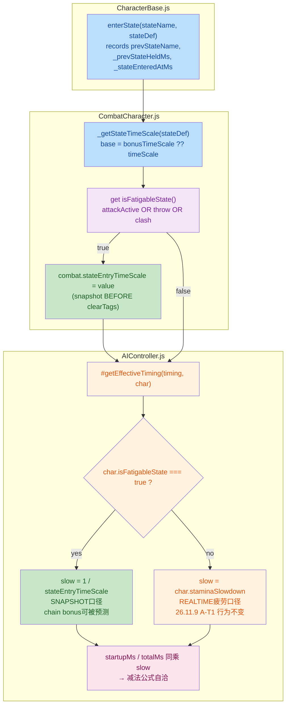
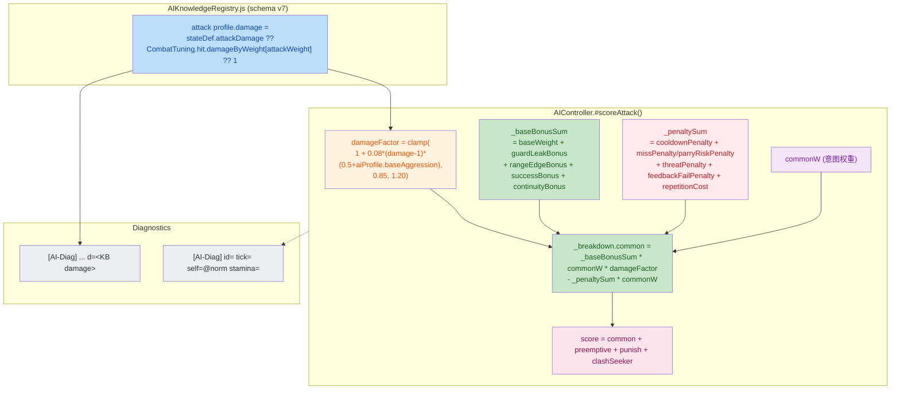

## 1. High-Level Summary (TL;DR)

- **Impact:** **Medium-High** — Touches the core AI decision loop (`AIController`), the combat timing model (`CombatCharacter`), the AI knowledge cache (`AIKnowledgeRegistry`), plus scene/character tuning data and tooling docs. It implements the **"26.11.24 AI 识别招式伤害差异"** plan (Goals A + B) and also carries a set of **runtime/debug configuration changes that look like leftovers from a play-test session**.

- **Key Changes:**
  1. ✨ **Effective Timing sync (Goal A)** — `CombatCharacter._getStateTimeScale()` now **snapshots** the final entry time-scale into `combat.stateEntryTimeScale`; `AIController.#getEffectiveTiming()` **branches** on the target's state (snapshot口径 vs. realtime fatigue口径) so chain-bonus acceleration (e.g. `chainBonus` → `bonusTimeScale`) becomes predictable for both self and opponent.
  2. ✨ **Damage-aware Utility scoring (Goal B)** — `AIKnowledgeRegistry` schema **v6 → v7** now exposes `damage` per attack profile; `AIController.#scoreAttack()` applies a **bounded multiplicative `damageFactor`** (`clamp(1 + 0.08×(damage-1)×(0.5+baseAggression), 0.85, 1.20)`), with a **penalty-protection clause** so penalties are subtracted at original value *after* multiplication.
  3. 🔍 **Diagnostics instrumentation** — `[AI-Diag]` / `[Phase0]` / `[CharCmd]` logs now carry `id=`, `tick=`, `d=` (damage), state durations, opponent attack elapsed-ms, and dropped-command traces.
  4. ⚠️ **Debug/tuning leftovers** — `ThrowComponent.DEBUG_INFINITE_AMMO` flipped to `true`, hero `maxHp` 1 → 10, `baseAggression` 0.25 → 1.0, `INITIAL_SCENE_ID` → `ep1_tavern_hall_night`, and `plans/HandOff.MD` was **overwritten with ~1,900 lines of raw console log**.
  5. 📚 **Docs & tooling** — Two new plan documents, `PROJECT_CONTEXT.md` correction (reverse_quart no longer overrides damage), and a new `.trae/skills/collider-occupancy-更新-skill/SKILL.md`.

---

## 2. Visual Overview (Code & Logic Map)

### 2.1 Goal A — Effective Timing (entry-snapshot vs. realtime-fatigue split)



### 2.2 Goal B — Damage-aware Utility scoring (B1 → B2 → B3)



---

## 3. Detailed Change Analysis

### 3.1 🕐 Component: `CombatCharacter` — Timing Snapshot & Fatigue Source of Truth

**What Changed**
- **A1 — Entry snapshot (Source: `scripts/Enties/CombatCharacter.js`):** `_getStateTimeScale(stateDef)` now writes its **return value** into `this.combat.stateEntryTimeScale` (initialized to `1.0` in the `combat` object literal). The snapshot therefore already contains **both** `bonusTimeScale` substitution *and* fatigue slowdown.
  - ⚠️ **Red line documented in code:** the snapshot must be taken from the function's return value inside `enterState` (before `clearTags`) — reading `animation.getTimeScale()` afterwards is dirty data because **hitstop sets animation timeScale to 0**.
- **Single-source fatigable list (Source: `scripts/Enties/CombatCharacter.js`):** the previously **inlined** fatigue check (`attackActive === true || name === "throw" || name === "clash"`) was extracted into a public getter **`get isFatigableState()`**. Both the animation slowdown path and the AI prediction path now consume this one getter, eliminating the "two lists drifting apart" hazard.

| Before | After |
|---|---|
| Fatigue check inlined in `_getStateTimeScale` | `get isFatigableState()` (single source) |
| No snapshot of final time-scale | `combat.stateEntryTimeScale` captured at entry |
| Bonus/fatigue effects invisible to AI prediction | AI reads the snapshot → chain-bonus acceleration is predictable |

---

### 3.2 🧠 Component: `AIController` — Effective Timing Routing (A2)

**What Changed**
- `#getEffectiveTiming(timing, char)` (Source: `scripts/Systems/AI/AIController.js`) is no longer a single "multiply by realtime fatigue" formula. It now **routes by target character state**:

| Target state | Timing source | Rationale |
|---|---|---|
| `char.isFatigableState === true` (attack / throw / clash already entered) | `slow = 1 / char.combat.stateEntryTimeScale` | The snapshot *is* the rule's own output — immune to rule drift, and the only way to see an **opponent's** chain-bonus acceleration (opponent's tags are cleared by the time AI predicts) |
| otherwise (idle / guard — predicted candidate not yet entered) | `slow = char.staminaSlowdown` (26.11.9 realtime fatigue) | Preserves **A-T1**: behaviour without tags must be byte-identical to pre-change |

- The two口径 are **mutually exclusive, never additive**; `startupMs` and `totalMs` are scaled by the same factor so the subtraction-based formulas stay self-consistent.

---

### 3.3 📚 Component: `AIKnowledgeRegistry` — Damage Knowledge (B1)

**What Changed**
- **Schema version bumped `6 → 7`** with a doc comment explaining the addition.
- Each attack profile now records a **`damage`** field, resolved with the **exact same expression the combat resolution uses**:
  ```js
  damage: stateDef.attackDamage ?? CombatTuning.hit.damageByWeight?.[stateDef.attackWeight] ?? 1
  ```
- **Source of truth** is `Data/CombatTuning.js` → `hit.damageByWeight = { light: 1, heavy: 2 }`, plus per-move `attackDamage` overrides in `Data/StateGraphDef/*.json`.
- ✅ Verified: no parallel/duplicated damage table was introduced in `aiProfile` (a risk explicitly flagged in the plan docs).

---

### 3.4 ⚔️ Component: `AIController.#scoreAttack` — Bounded Damage Factor (B2)

**What Changed**
- A new frozen constant block `DAMAGE_FACTOR_TUNING` centralizes all tunables:

| Constant | Value | Meaning |
|---|---:|---|
| `perDamagePoint` | `0.08` | Sensitivity per extra damage point |
| `aggressionScaleBase` | `0.5` | Base of the aggression scale term |
| `factorFloor` | `0.85` | Lower clamp (only reachable if `damage < 1`) |
| `factorCeiling` | `1.20` | Upper clamp — the *diversity guard* against one move dominating |
| `defaultAggression` | `0.5` | Fallback when `aiProfile.baseAggression` is absent |

- **Formula:** `damageFactor = clamp(1 + 0.08 × (damage − 1) × (0.5 + aiProfile.baseAggression), 0.85, 1.20)`
- **Personality hook:** sensitivity comes from the **config-level** `aiProfile.baseAggression` (deliberately *not* dynamic `caution`, to avoid a feedback loop / behaviour noise).
- **Penalty-protection clause:** the `common` bucket was previously collapsed with a single `_breakdown.common *= commonW`. It is now tracked as **two running totals**:
  - `_baseBonusSum` — base weight + `guardLeakBonus` + `rangeEdgeBonus` + `feedbackSuccessBonus` + `continuityBonus`
  - `_penaltySum` — `cooldownPenalty` + `missPenalty`/`parryRiskPenalty` + `threatPenalty` + `feedbackFailPenalty` + `repetitionCost`
  - Final composition: `common = _baseBonusSum × commonW × damageFactor − _penaltySum × commonW`
- ✅ **Verified drift-free:** every one of the 10 `_breakdown.common` mutations in the method is tracked by exactly one of the two accumulators (`damage=1` ⇒ `damageFactor=1.0` ⇒ output is item-for-item identical to the old formula → **zero drift for light attacks**).

**Resulting factor values (per plan B-T2):**

| `baseAggression` | damage = 1 | damage = 2 (heavy) | damage = 3 (nachschlag) |
|---:|---:|---:|---:|
| `0.25` | 1.00 | 1.06 | 1.12 |
| `1.00` | 1.00 | 1.12 | 1.24 → **capped 1.20** |

---

### 3.5 🔍 Component: Diagnostics / Telemetry

**What Changed**

| File | Addition |
|---|---|
| `scripts/Systems/AI/AIController.js` | `fixedUpdate(dtMs, tickCount)` now stores `this._lastTick`; every `[AI-Diag]` / `[Phase0]` line gains **`id=`** and **`tick=`** |
| `scripts/Systems/AI/AIController.js` | `[AI-Diag] COMBAT` adds opponent attack **elapsed ms** (`oppNorm × timing.totalMs`), self state **duration**, and **prev-state held ms** |
| `scripts/Systems/AI/AIController.js` | Attack breakdown adds **`d=<KB damage>`** (B3) — prints the *raw* damage, not the factor, so the factor can be back-computed; `d=?` is the signal that the KB cache is stale |
| `scripts/Systems/AI/AIController.js` | `[AI-Diag] dodgeGate REJECT` now prints the character id |
| `scripts/Enties/CharacterBase.js` | `enterState()` records `prevStateName`, `_prevStateHeldMs`, `_stateEnteredAtMs` (feeds the new duration diagnostics) |
| `scripts/Enties/CharacterBase.js` | `pushCommand()` logs **`[CharCmd] DROPPED id= state= cmd= t=`** when a command is rejected by `#canAcceptCommand` |
| `scripts/Game.js` | Checkpoint restore logs hero `hp / maxHp / isDead / stamina` and warns if `newHero` is missing from `entityPool` |

---

### 3.6 🎮 Component: Gameplay / Data Tuning Changes

| File | Change | Risk |
|---|---|---|
| `Data/SceneDefs/ep1_tavern_hall_night.json` | `aiProfile.baseAggression`: **`0.25 → 1.0`** | ⚠️ **4× aggression** — directly multiplies the damage-factor sensitivity (`aggScale` 0.75 → 1.5). Combined with `damage=2` heavy moves this is the biggest behavioural lever in this diff |
| `Data/StateGraphDef/ManatarmsSword.json` | **removed** `"attackDamage": 3` from `reverse_quart` | Intentional (plan **D4 final correction**): since AI combo-chaining is out of scope this round, `reverse_quart` fires only from idle with no combo context → falls back to `light = 1`. Keeps KB damage identical to combat resolution |
| `scripts/CharacterFactory.js` | hero `maxHp`: **`1 → 10`** | ⚠️ Debug/balance value — hero previously died in one hit |
| `scripts/Components/ThrowComponent.js` | `DEBUG_INFINITE_AMMO`: **`false → true`** | 🚨 **Must be `false` for formal acceptance** (the code comment itself says so) |
| `scripts/WorldState.js` | `INITIAL_SCENE_ID`: `ep1_tavern_night` → **`ep1_tavern_hall_night`** | Scene rename; old scene id no longer boots |
| `Data/TestScripts/manatarms_basic_sequence.json` | Trimmed to a single `reverse_quart` step (removed move/smash/hold steps) | Test-script narrowing — reduces coverage of the automated sequence runner |
| `Data/TestScripts/rabble_stick_basic_sequence.json` | Removed the `dodge` step; `guard` wait `2300 → 1000 ms` | ↓ dodge-path coverage in the scripted test |
| `Audio/sfx/_raw/sliceinfo.txt` | Newline at EOF | Cosmetic |
| `Art/RawAssets/Env/*.ase`, `*.kra` | Binary re-saves (`Tavern.ase`, `arrow.ase`, `floor.kra`, `treeline_pine.kra`) | Not reviewable from diff; verify no accidental layer/frame loss |

---

### 3.7 📚 Component: Documentation & Tooling

| File | Content |
|---|---|
| `plans/26.11.24 AI处理招式伤害差异GPT-Guildline.MD` *(new)* | Upstream **guideline** spec: Base vs. Effective Attack Profile, Tag-as-modifier principle, "combat system is the authority", 3-phase rollout, explicit **do-not-do** list, acceptance tests A–E |
| `plans/26.11.24 AI识别招式伤害差异计划.MD` *(new)* | **Code-grounded execution plan**: decision log (D1–D4, P3, B), implementation steps A1–A3 / B1–B4 with the A/B regression matrix, and remaining backlog (D2 combo, defense-side damage awareness, `recklessness` param) |
| `PROJECT_CONTEXT.md` | Updated the `CombatTuning` description: `attackDamage` override now cited as **`nachschlag = 3` only**; `reverse_quart` explicitly documented as **no override → light fallback (26.11.25 D4 final correction)** |
| `.trae/skills/collider-occupancy-更新-skill/SKILL.md` *(new)* | Trigger-phrase-driven skill: two routes (`.collider.json` for combat chars via `extract_collision_boxes.ps1`, `.occupancy.json` for NPCs via `extract_rootmotion_occupancy.ps1`), colour convention table, and 5 known pitfalls (ExecutionPolicy, same-frame connected components, ≥6px minimum, root fallback, stale script path) |
| `plans/HandOff.MD` | 🚨 **Replaced**: the original 171-line design doc (multi-battle-scene refactor handoff) was overwritten by **~2,036 lines of pasted runtime console log** (Resolver-Diag / Ambient sfx / TimelineSeq / CharCmd) |

---

## 4. Impact & Risk Assessment

### ⚠️ Breaking / Behavioural Changes

| # | Change | Nature |
|---|---|---|
| 1 | `AIKnowledgeRegistry` schema **`6 → 7`** | **Cache invalidation** — any consumer keying on the old schema version must be refreshed; stale profiles would surface as `d=?` in the diag line |
| 2 | `#scoreAttack` now **multiplies the common bucket by `damageFactor`** | **Utility ordering can change** for `damage ≥ 2` attacks. Bounded to `[0.85, 1.20]`, but "bounded ≠ no impact" — cross-category ordering is *not* guaranteed stable (explicitly accepted in plan B-T3) |
| 3 | `#getEffectiveTiming` now **branches** | Previously-read paths (Startup Factor, Preemptive Bonus, opponent event prediction, dodge/defense gates) now consume a **different time-scale source** for characters already inside a fatigable state. This is the intended fix, but it changes prediction accuracy for chain-bonus states |
| 4 | `INITIAL_SCENE_ID` renamed to `ep1_tavern_hall_night` | Old scene id unreachable at boot; any hard-coded `"ep1_tavern_night"` strings elsewhere will break |
| 5 | `plans/HandOff.MD` content destroyed | Documentation regression — the multi-battle-scene design handoff is **no longer recoverable from this file** |

### 🚨 High-Priority Risks to Address Before Merge

1. **`ThrowComponent.DEBUG_INFINITE_AMMO = true`** — explicitly flagged in-code as *"正式验收必须为 false"*. Shipping this makes every throw unlimited.
2. **`baseAggression 0.25 → 1.0`** combined with the new damage factor — this is a **simultaneous** change to both the personality knob and the scoring formula; attribution of any observed behaviour shift will be ambiguous. Consider splitting the commit or reverting the scene value.
3. **Hero `maxHp 1 → 10`** — likely a play-test value, not a design change.
4. **`plans/HandOff.MD` = log dump** — restore the original doc from VCS and move the log elsewhere.
5. **`#getEffectiveTiming` snapshot staleness** — `stateEntryTimeScale` is only refreshed on `enterState`. If a character leaves a fatigable state without entering a new one, the snapshot keeps the last value; confirm the non-fatigable branch is always taken for idle/guard (it is, via `isFatigableState`), and that no path reads the snapshot directly outside `#getEffectiveTiming`.

### 🧪 Testing Suggestions

**A — Timing correctness**
- **A-T1 (no tag):** AI behaviour must be **identical** to pre-change; confirm `fatigueCycle` and the `stamina` field in `[AI-Diag] COMBAT` are unchanged.
- **A-T2 (tag):** player parry → `zornhut` (1.2×) and Manatarms `quart → reverse_quart` (1.5×). Verify the **defense timing gate** and **dodge i-frame gate** line up with the actual animation, *and* that the **opponent-side** prediction sees the accelerated startup.
- **A-T3 (fatigue):** verify the two口径 are not stacked — a fatigued AI in idle must still scale *predicted* candidates by the realtime factor.
- **A-T4 (tag expiry / hitstop):** snapshot must refresh on every `enterState`, leave no residue, and must **not** be polluted during hitstop (animation timeScale = 0).

**B — Damage decision**
- **B-T1 (data):** KB must report `light = 1`, `heavy = 2`, `nachschlag = 3`, and `reverse_quart = 1` (post-D4). Zero `d=?` occurrences → cache v7 is healthy.
- **B-T2 (bounds & personality):** at `baseAggression = 1.0` → `damage 3 ⇒ 1.24 → capped 1.20`, `damage 2 ⇒ 1.12`, `damage 1 ⇒ 1.00`; at `0.25` → `1.12 / 1.06`. Also verify **penalties are not amplified**: two candidates with the same damage but different `repetitionCost` must differ by exactly the raw penalty, not `penalty × damageFactor`.
- **B-T3 (cross-category):** construct a situation where **Guard** is clearly better; the damage bonus must **not** flip the choice to a light attack. (Log evidence in the plan: `hold(0.142)` beat `attack(0.037)`.)
- **B-T4 (diversity):** capture a **baseline** `[AI-Diag] best=` / `top3=` distribution *before* enabling the damage term, then compare. Confirm no single move monopolises selection and that `repetitionCost` still bites on the new favourite move.

**Regression / housekeeping**
- `INITIAL_SCENE_ID` rename — boot the game and confirm the correct scene loads and checkpoint restore works.
- `CombatTuning.hit.damageByWeight` and `StateGraphDef.attackDamage` must stay the **single** authority — no second damage table may appear in `aiProfile`.
- Restore `plans/HandOff.MD`, reset `DEBUG_INFINITE_AMMO`, and decide on `maxHp = 10` / `baseAggression = 1.0` before merge.
- Verify the trimmed `TestScripts` still cover the intended paths (the removed `dodge` step reduces scripted dodge coverage — consider keeping a separate dodge script).