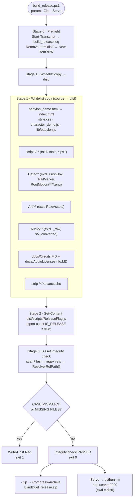
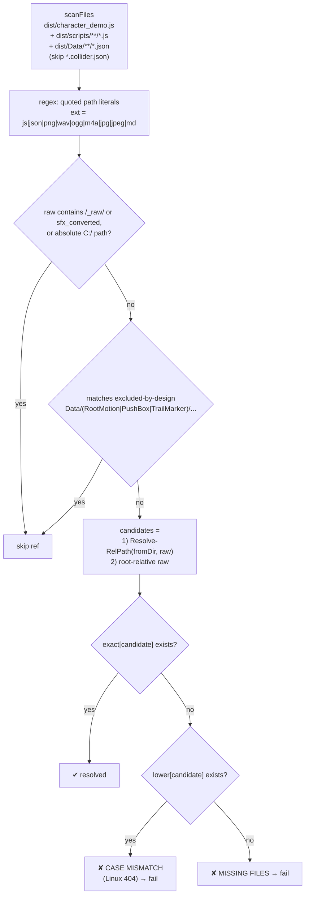
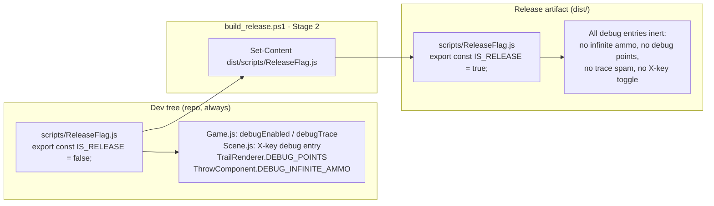

## 1. High-Level Summary (TL;DR)

- **Impact:** 🟡 **Medium** — Introduces a **repeatable release build & publish pipeline** for the BlindDuel web game (new `scripts/tools/build_release.ps1`), plus the operator documentation, an agent skill, and archived planning docs that surround it. **No gameplay/combat logic was touched.** The only runtime-visible data change is the removal of one dangling audio clip entry that pointed at a non-existent file.
- **Key Changes:**
  - ✨ **NEW `scripts/tools/build_release.ps1`** (177 lines) — whitelist copy → `dist/`, build-time release-flag overwrite, **case-sensitive asset integrity check**, optional `-Zip` (itch.io archive) and `-Serve` (local preview).
  - ✨ **NEW `docs/ReleaseGuide.MD`** — Chinese-language build & publish guide (commands, dev/release isolation, exclusion rationale, itch.io upload flow).
  - 🔧 **`.gitignore`** — now ignores `dist/` and `build_release.log` (and finally ends with a newline).
  - 🐛 **`Data/Audio/audio_clips.json`** — removed the `pickup` clip entry that referenced the **non-existent** `./Audio/sfx/player/pickup_01.wav` (it would have tripped the new `MISSING FILES` check and failed the build).
  - 📚 **New `.trae` skill** (collider/occupancy regeneration) + **two archived plan docs** (`26.11.25` checklist, `26.11.26` build-pipeline plan) + **BACKLOG** refresh.
  - 🎨 **5 binary env art sources** updated (`Art/RawAssets/Env/*`) — deliberately **excluded** from `dist/` by design.

---

## 2. Visual Overview (Code & Logic Map)

### 2.1 `build_release.ps1` — 4-stage release pipeline

### 2.2 Stage 3 — integrity check resolution algorithm

### 2.3 Dev ↔ Release isolation via the `IS_RELEASE` flag

---

## 3. Detailed Change Analysis

### 3.1 🆕 Release Build Pipeline — `scripts/tools/build_release.ps1` (new, 177 lines)

**What Changed:** Introduces the project's first reproducible *release* build for a **tool-less native ES-modules static site** (no `package.json`, no Vite, real entry point is `babylon_demo.html`). The script is deliberately **copy-based** (no bundler, no minification) and has exactly three responsibilities: **filter → flag overwrite → integrity verification**.

**CLI surface**

| Param | Type | Required | Description |
|---|---|---|---|
| *(none)* | — | no | Build `dist/` only |
| `-Zip` | switch | no | Also produce `BlindDuel_release.zip` at repo root (`Compress-Archive dist/*`) |
| `-Serve` | switch | no | Also serve `dist/` on `http://127.0.0.1:9000` via `python -m http.server` |

Key globals: `$ErrorActionPreference = "Stop"`, `$root` = parent of `scripts/tools`, `$dist` = `$root/dist`, `$fail` = exit-code accumulator (`exit $fail` → CI-friendly).

**Stage 1 — whitelist copy (what lands in `dist/`)**

| Source | Destination | Notes |
|---|---|---|
| `babylon_demo.html` | `dist/index.html` | **Renamed** — itch.io requires `index.html` at zip root |
| `style.css`, `character_demo.js` | `dist/` | Game entry modules |
| `lib/babylon.js` | `dist/lib/` | Runtime library |
| `scripts/**` | `dist/scripts/` | Excludes `scripts/tools/` and strips every `*.ps1` |
| `Data/**` | `dist/Data/` | Excludes `PushBox/`, `TrailMarker/`; strips `RootMotion/**/*.png` (JSON kept — it *is* runtime) |
| `Art/**` | `dist/Art/` | Excludes `Art/RawAssets/` (`.ase`/`.kra` sources) |
| `Audio/**` | `dist/Audio/` | Excludes `_raw/`, `sfx_converted/`; **keeps `_converted/`** (referenced by `audio_clips.json`) |
| `docs/Credits.MD`, `docs/AudioLicensesInfo.MD` | `dist/docs/` | Required — `MainMenuUI.openCredits()` `fetch()`es both at runtime (CC attribution) |
| `**/*.scancache` | *deleted* | Tool cache, stripped globally in `dist/` |

**Stage 3 — integrity check (the interesting part)**

- **Scan sources:** `dist/character_demo.js` + `dist/scripts/**/*.js` + `dist/Data/**/*.json`. Files matching `*.collider.json` are **skipped as scan sources** (their `source.*` provenance fields point at tool-only PNGs and would be false positives).
- **Extraction:** regex over quoted string literals containing a `/` and one of `js|json|png|wav|ogg|m4a|jpg|jpeg|md`. Deliberately *over-approximating* (not a JS parser) — "report more, miss less".
- **Resolution:** two candidates per reference — (1) relative to the *referencing file's* directory (ES-import style), (2) root-relative (manifest/`fetch()` style). `Resolve-RelPath()` normalizes `.` / `..` segments.
- **Exclusions by design:** `/_raw/`, `sfx_converted`, absolute Windows paths (`C:/…` recorded by extraction tools), `Data/RootMotion/**.png`, `Data/PushBox/**`, `Data/TrailMarker/**`.
- **Verdict:** exact hit → OK; lowercase-only hit → **CASE MISMATCH** (Windows dev vs. case-sensitive itch.io Linux host); otherwise → **MISSING FILES**. Both classes set `$fail = 1`.

> The case-sensitivity check is the real value-add: `Test-Path` on Windows is case-insensitive and would never catch `longswordman_Guard.json` vs `longswordman_guard.json`.

### 3.2 🔧 `Data/Audio/audio_clips.json` — removed dangling `pickup` clip

| Clip id | Before | After | Reason |
|---|---|---|---|
| `pickup` | `clips: ["./Audio/sfx/player/pickup_01.wav"]`, `volume 0.8`, `pitch [0.96,1.04]`, `bus sfx` | **removed** | `Audio/sfx/player/` does not exist in the repo → the new integrity check would report `MISSING FILES` and **fail the build** |

- **Runtime impact verified:** `grep` over `scripts/` shows **no caller** of `audio.play("pickup")` — only `TimelineSequencer.js:944` calls `audioManager.play(id)` generically. `AudioManager.play()` simply forwards to the player; an unknown id is a silent no-op.
- ✅ Safe: the clip was already dead (its file has been missing). Removing it makes the **data** honest and the **build** green.

### 3.3 ✨ `docs/ReleaseGuide.MD` (new) — operator-facing publish runbook

Documents: the three build commands, the full-rebuild guarantee, log location, the **two hard publish gates** (`MISSING FILES`, `CASE MISMATCH`), the dev/release isolation contract, the itch.io upload flow (zip → Uploads → *"This file will be played in the browser"* → **Private first, then Public**), and the exclusion rationale table:

| Exclusion | Rationale (26.11.26 audit) |
|---|---|
| `Art/RawAssets/` | Art sources (`.ase`/`.kra`); runtime sprites come from `Art/Sprite/` |
| `Audio/**/_raw/`, `Audio/sfx_converted/` | Raw / intermediate transcodes; zero runtime refs |
| `Data/PushBox/`, `Data/TrailMarker/` | Edit-time mask sources; zero runtime refs (provenance consumed by tools only) |
| `Data/RootMotion/**/*.png` | Same — but its **JSON** (`occupancy`/`atlas`) **is** runtime and is kept |
| `Data/TestScripts/` | Referenced by `AssetManifest.js:8-10` → **must keep** |
| `docs/` (only 2 files) | Credits menu `fetch()`es them at runtime (CC compliance) |

Also records the **deferred** items: WAV→ogg/m4a transcoding (≈80-90 % size win), PNG/JSON compression, and the **Vite migration trigger** (`IS_RELEASE` → `import.meta.env.PROD`, call sites untouched).

### 3.4 🔧 `.gitignore`

| Entry | Before | After | Purpose |
|---|---|---|---|
| `dist/` | *absent* | **added** | Build output is generated — must not be committed |
| `build_release.log` | *absent* | **added** | Transcript log at repo root |
| `*.log` | last line, *no trailing newline* | now newline-terminated | Fixes `\ No newline at end of file` |

### 3.5 🤖 `.trae/skills/collider-occupancy-更新-skill/SKILL.md` (new) — agent-facing automation

Defines **two routes** for regenerating collision/occupancy data, triggered by keywords (*"更新 collider"*, *"更新 occupancy"*, *"重新生成 collider.json"*, …):

| Route | Script | Applies to | Output |
|---|---|---|---|
| **A** — combat collider | `scripts/tools/extract_collision_boxes.ps1` | `longswordman`, `rabble_stick` | `Data/CollisionMask/{char}/{char}_{action}.collider.json` |
| **B** — NPC occupancy | `scripts/tools/extract_rootmotion_occupancy.ps1` | `traveller`, `merchant`, `merchant2` | `Data/RootMotion/NPCs/{npc}.occupancy.json` |

Includes a **batch PowerShell template** (auto-derives the action name, skips with a warning when the RootMotion counterpart is missing) and a **color contract** for mask authoring:

| Color | Meaning |
|---|---|
| `#FFFF00` | hitbox |
| `#E37800` | weaponbox + subtype `strong_blade` |
| `#FF0000` | weaponbox + subtype `weak_blade` |
| `#7082C1` | root anchor (scanned by **both** scripts) |

Plus 5 gotchas (ExecutionPolicy bypass, same-frame connected-component merging → keep 1 px gaps, ≥6 px minimum component for collision scans, root fallback to previous frame, stale `scripts/extract_collision_boxes.ps1` → use `scripts/tools/`).

### 3.6 📚 Archived planning docs (new)

- `plans/archived/26.11.25 Development & Release Build 隔离 Checklist.MD` — the 6-phase master checklist (git baseline → dev/release feature isolation → config classification → production build → release verification → docs & delivery) that governed this work.
- `plans/archived/26.11.26 构建-发布管线计划.MD` — the concrete implementation plan (Phase 0 Git baseline → Phase A `IS_RELEASE` flag → Phase B `build_release.ps1` → Phase C optional `package.json` → Phase D validation → Phase E docs/merge/tag). Both are **archived** = considered executed.

### 3.7 📋 `plans/BACKLOG.md`

| Change | Items |
|---|---|
| **Removed** | `重击额外伤害` |
| **Added** | `通关后 continue 清理`, `tavern hall 去人物重导`, `tavern night 血量`, `nashachlag 范围加大`, `rabble thrust 动画帧加长`, `fullthrust 稍加快`, `AI反应速度增加疲劳惩罚` |

### 3.8 🎨 Binary env art sources (`Art/RawAssets/Env/`)

`Tavern.ase`, `arrow.ase` (Aseprite) and `floor.kra`, `tavern_room.kra`, `treeline_pine.kra` (Krita) — binary-only diffs, no textual change. These are **editor sources** and are explicitly excluded from `dist/`, so they do not affect the shipped build.

---

## 4. Impact & Risk Assessment

### 4.1 Breaking Changes

| Area | Breaking? | Detail |
|---|---|---|
| Game runtime / combat / AI | ❌ None | No `scripts/` gameplay file was modified |
| `Data/Audio/audio_clips.json` | ⚠️ **Minor data change** | The `pickup` clip id no longer exists. No current caller → no audible change. If a future animation/timeline event fires `play("pickup")`, it becomes a **silent no-op** (not an exception) — worth re-adding the asset or the clip if that SFX is ever wanted. |
| Public API / schema | ❌ None | No REST/API or DB schema touched |
| Build entry point | ✅ New | `dist/` + `BlindDuel_release.zip` are new build artifacts; `dist/` is now git-ignored |

### 4.2 ⚠️ Risks & Gaps (worth a reviewer's attention)

1. **`BlindDuel_release.zip` is written to the repo root but is NOT in `.gitignore`** — only `dist/` and `build_release.log` were added. A stray `git add .` would commit the release archive. → *Suggest adding `BlindDuel_release.zip` (or `*.zip`) to `.gitignore`.*
2. **Extension allowlist gaps in the integrity regex** — only `js|json|png|wav|ogg|m4a|jpg|jpeg|md` are checked. The repo contains **`.mp3`** assets (e.g. `Audio/sfx/47125__gyzhor__lightsaber3.mp3`, `486410__martineerok__wagon-cart-on-gravel.ogg`) and `.flac`/`.ktx` may appear later; **those references are silently unverified**. → *Consider `mp3|flac|webp|glb`.*
3. **Path must contain a `/`** — a root-level single-file reference (e.g. `"foo.js"` with no directory) is never captured by the regex.
4. **`-Serve` uses `python`**, while the archived plan's `package.json` used `py -m http.server` — on Windows many machines only expose the `py` launcher. → *Inconsistent; may fail with "python not found".*
5. **Package size is not minimized** — `Data/CollisionMask/**/*.png` (mask sources) and `Data/StageMask/{depth,obstacle,walkarea}/*.png` are **not excluded**, unlike `PushBox`/`TrailMarker`. They are tool inputs, so they inflate the zip. → *Deliberate? The guide does not list them; consider adding to the exclusion table.*
6. **`*.diag.log` files** under `Data/RootMotion/**` are copied into `dist/` (only `*.scancache` is stripped). Harmless but noisy.
7. **`Get-ChildItem -Exclude` is leaf-name based** — `"RawAssets"`, `"_raw"`, `"sfx_converted"`, `"tools"` exclusions rely on exact leaf names; a renamed folder would silently leak into the package.
8. **`dist/` is destroyed on every run** (`Remove-Item -Recurse -Force`) — any manual tweak inside `dist/` is lost. Intended, but worth stating in the guide.
9. **`Compress-Archive`** is slow on large trees and has a per-file size limit; fine at current scale, but a switch to `tar`/`7z` may be needed later.
10. **`Phase C (package.json` remote-control scripts`) is not in this diff** — the plan treats it as optional/deferred. If operators expect `npm run build`, it does not exist yet.

### 4.3 🧪 Testing Suggestions

**Build script**
- Run `powershell -ExecutionPolicy Bypass -File scripts/tools/build_release.ps1` → expect `Integrity check PASSED` and exit code **0**; confirm `dist/index.html`, `dist/lib/babylon.js`, `dist/scripts/ReleaseFlag.js` exist.
- **Negative test for the integrity gate:** temporarily rename a case, e.g. `dist/.../longswordman_Guard.json` → `..._guard.json`, re-run, and confirm the script reports **CASE MISMATCH** and exits **1**. Then restore and confirm PASS.
- **Negative test for MISSING:** delete a `dist/Data/...json` referenced from `AssetManifest.js` and confirm a `MISSING FILES` report + non-zero exit.
- Confirm `dist/` contains **no** `Art/RawAssets`, `Audio/**/_raw`, `Audio/sfx_converted`, `Data/PushBox`, `Data/TrailMarker`, `Data/RootMotion/**/*.png`, `*.scancache`, `*.ps1`, `plans/`, or extra `*.md` files.

**Release flag isolation (run against `dist/`, never the source tree)**
- Verify infinite ammo is off, `X` key toggles nothing, no debug points on the blade trail, no trace spam in the console.
- Verify `scripts/ReleaseFlag.js` in the **repo** is still `IS_RELEASE = false` (dev experience unchanged).

**Packaging / publishing**
- `-Zip` → confirm `index.html` is at the **zip root** (no wrapper folder) and that `docs/Credits.MD` + `docs/AudioLicensesInfo.MD` are present.
- `-Serve` → play the prologue from `http://127.0.0.1:9000` and confirm: main menu → Credits dialog renders (attribution fetch works), scene transitions, combat, throwables, ambient/SFX playback (incl. `swing_metal_slide`, which lives in the kept `_converted/` folder), keyboard **and** gamepad, fullscreen.
- Upload to itch.io as a **Private** page first, verify in-browser, then flip to Public.

**Regression**
- Confirm `AudioManager.play("pickup")` is never expected by any animation-event or timeline JSON (already grep-verified: no callers).
- Confirm `Data/TestScripts/*.json` (3 files) are present in `dist/` — `AssetManifest.js` fetches them strictly and startup fails on a missing file.

**Skill (`collider-occupancy-更新-skill`)**
- Dry-run Route A on `longswordman` and Route B on `traveller`; confirm the outputs land in the documented directories and that the **1 px gap** rule avoids merged connected components.