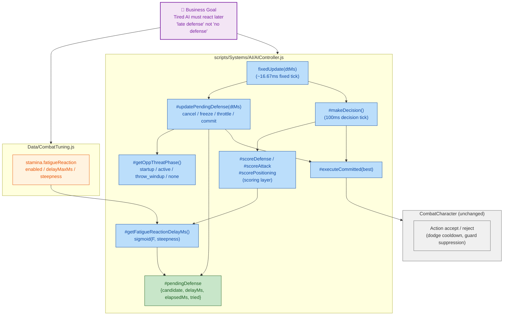
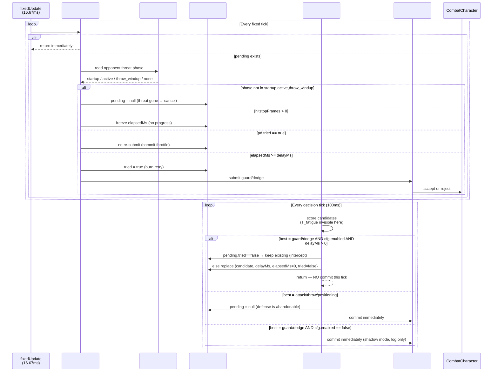

# 🎯 Code Review Summary — AI Fatigue Reaction Delay (26.11.26) + Boot Scene Switch

## 1. High-Level Summary (TL;DR)

**Impact:** **Medium-High** — Introduces a brand-new AI combat mechanic (fatigue-driven reaction latency) that changes how enemies defend, flips the game's boot scene, and rewrites several planning documents. Runtime logic is confined to **2 JS files**, but the behavioral blast radius covers every duel in the game.

**Key Changes:**

| # | Change | Scope |
|---|---|---|
| 1 | ✨ **New `#pendingDefense` latch** in `AIController` — defense commits (guard/dodge) are deferred by a fatigue-scaled delay instead of executing immediately | `scripts/Systems/AI/AIController.js` |
| 2 | ✨ **Sigmoid delay curve** `#getFatigueReactionDelayMs()` — `delay = delayMaxMs / (1 + e^((0.5−F)·steepness))`, `F = 1 − staminaRatio` | `scripts/Systems/AI/AIController.js` |
| 3 | ✨ **Fixed-tick driver** `#updatePendingDefense()` + `#getOppThreatPhase()` — moves commit timing from the 100 ms decision tick to the ~16.67 ms fixed tick | `scripts/Systems/AI/AIController.js` |
| 4 | ⚙️ **New config block** `CombatTuning.stamina.fatigueReaction` (`enabled` / `delayMaxMs` / `steepness`) | `Data/CombatTuning.js` |
| 5 | 🔀 **Boot scene switched** `INITIAL_SCENE_ID`: `"prologue"` → `"ep1_tavern_night"` | `scripts/WorldState.js` |
| 6 | 📚 **Docs/tooling**: new plan doc, INDEX/BACKLOG/PROJECT_CONTEXT updates, new Trae skill file, 5 binary env-art sources, `HandOff.MD` overwritten with a raw console log | `plans/`, `.trae/skills/`, `Art/RawAssets/` |

---

## 2. Visual Overview (Code & Logic Map)

### 2.1 Goal → Module → Method Map



### 2.2 Dual-Clock Sequence (why this diff exists)



---

## 3. Detailed Change Analysis

### 3.1 🧠 Component: `AIController` — Fatigue Reaction Delay

**What Changed:** A defense candidate that wins utility arbitration is no longer executed on the spot. It is **latched** into `#pendingDefense` and executed later by a fixed-tick driver, at which point the elapsed time equals a stamina-derived delay. Scoring is completely unchanged — the delay is invisible to the scoring layer (a hard architectural constraint of the design).

#### New private members / methods

| Symbol | Kind | Purpose |
|---|---|---|
| `#pendingDefense` | field | `{ candidate, delayMs, elapsedMs, tried }` — `null` means no pending defense |
| `#getFatigueReactionDelayMs()` | method | Returns the **theoretical** delay always (even in shadow mode) so the distribution can be observed in logs |
| `#updatePendingDefense(dtMs)` | method | Fixed-tick driver: cancel check → hitstop freeze → `tried` throttle → due-commit |
| `#getOppThreatPhase()` | method | Lightweight re-read of the opponent's threat phase, reusing `#getAttackPhase()` |

#### Decision-path gate (in `#makeDecision()`, `AIController.js:607-637`)

```javascript
if (best.kind === "guard" || best.kind === "dodge") {
    const cfg = CombatTuning.stamina?.fatigueReaction;
    const delayMs = this.#getFatigueReactionDelayMs();
    if (cfg?.enabled && delayMs > 0) {
        if (this.#pendingDefense && !this.#pendingDefense.tried) return;   // no starvation
        this.#pendingDefense = { candidate: best, delayMs, elapsedMs: 0, tried: false };
        return;                                                           // defer the commit
    }
    // shadow mode: log only, commit immediately
} else {
    this.#pendingDefense = null;   // attack / throw / positioning wins → abandon defense
}
this.#executeCommitted(best);
```

#### `#pendingDefense` lifecycle

| State | `tried` | Replaceable by a new defense candidate? | On `elapsedMs >= delayMs` |
|---|---|---|---|
| `null` | – | – | – |
| Waiting | `false` | ❌ **No** — guarantees every latch gets exactly one commit attempt (no starvation) | Commit once → `tried = true` |
| Submitted | `true` | ✅ Yes — replaced with a **full new delay** (`elapsedMs` reset to 0) | Already submitted → no re-commit (throttle) |

#### Which action paths consume the delay (per plan §2)

| Path | Delayed? | Rationale |
|---|---|---|
| Melee `guard` / `dodge` commit | ✅ Yes | Core target |
| Reactive projectile `dodge` | ✅ Yes (same latch, **no feasibility gate**) | Mirrors the player philosophy — never block input, just arrive late |
| Reactive projectile `cut` | ❌ No | `timingAlignment` is a pure physical window — an *active* choice |
| Preemptive projectile | ❌ No | Planning ahead ≠ reacting to a sudden stimulus |
| `positioning` (posPlan / B5 preemptive) | ❌ No | Strategic movement ≠ defensive reaction |
| `escapeLatency` (dodge i-frame window) | ❌ No | Deliberately allows "right judgement, late execution" |
| `cutReadyMs` (throw risk self-assessment) | ❌ No | Keeps the fatigue penalty out of the AI's timing arithmetic |
| Scoring layer | ❌ Invisible | Latch is implemented *before* commit, so scoring can never use `T_fatigue` |

---

### 3.2 ⚙️ Component: `CombatTuning` — New Config Block

**What Changed:** New rule-level config block inside the existing `stamina` section (deliberately *not* in `AITuning`, because this is a rule-layer mechanic, not an AI-profile concern).

| Key | Type | Default | Description |
|---|---|---|---|
| `stamina.fatigueReaction.enabled` | `boolean` | `true` | `true` = active mode (delay applied). `false` = **shadow mode** — logs the delay distribution but commits immediately |
| `stamina.fatigueReaction.delayMaxMs` | `number` (ms) | `100` | Upper bound of the delay at zero stamina (`F = 1`). Tuning range documented as `[100, 200]` |
| `stamina.fatigueReaction.steepness` | `number` | `10` | Sigmoid slope. Higher = sharper transition around `F = 0.5` |

**Sigmoid shape (verified against the shipped log samples):**

| Stamina | `F = 1 − ratio` | Theoretical `delayMs` | Logged `waitedMs` |
|---|---|---|---|
| 100/100 | 0.00 | ≈ 0.7 ms | **17** ⚠️ |
| 83/100 | 0.17 | ≈ 4 ms | 17 |
| 51/100 | 0.49 | ≈ 49 ms | 50 |
| 36/100 | 0.64 | ≈ 81 ms | 83 |
| 12/100 | 0.88 | ≈ 98 ms | 100 |

---

### 3.3 🔀 Component: `WorldState` — Boot Scene Switch

**What Changed:** One-line change to the exported boot scene constant.

| Constant | Old Value | New Value | Notes |
|---|---|---|---|
| `INITIAL_SCENE_ID` | `"prologue"` | `"ep1_tavern_night"` | Consumed by `WorldState` constructor **and** `Game.js:304` (`resetWorldState`). Target scene **exists** (`Data/SceneDefs/ep1_tavern_night.json`, `id: "ep1_tavern_night"`), and `ep1_tavern_hall_night.json` already transitions *into* it |

> The `plans/INDEX.md` 26.11.27 log confirms this was an intentional bug fix — the `WorldState` constructor already booted `ep1_tavern_night` while `resetWorldState` fell back to `prologue` (a historical inconsistency), and the constant was introduced to unify them.

---

### 3.4 📚 Component: Planning & Documentation

| File | Change | Notes |
|---|---|---|
| `plans/26.11.26 AI基于疲劳的反应延迟计划.MD` | 🆕 **New** (144 lines) | Full design plan: mechanism, boundary table, implementation steps, verification matrix, non-goals, landing record with 3 documented deviations, acceptance results, 2 known issues, and a §9 "upgrade decision" for the fixed-tick commit |
| `plans/INDEX.md` | Updated | Status banner now leads with "AI 基于疲劳的反应延迟 26.11.26 已完成关闭"; new `Update Log (2026-11-27)` entry listing mechanism, config, deviations, and known issues |
| `plans/BACKLOG.md` | Updated | Removed `tavern night 血量` + `AI反应速度增加疲劳惩罚` (both delivered/handled); **added** `tavern night 打完刷新再continue manatarms动画直接放了` (new bug) |
| `PROJECT_CONTEXT.md` | Updated | `CombatTuning` description now lists `fatigueReaction`; `AIController` description now lists `#getFatigueReactionDelayMs` and `#pendingDefense` |
| `plans/HandOff.MD` | ⚠️ **Fully replaced** (171 → 491 lines) | Previous "single-scene multi-battle refactor" handoff doc **deleted**; new content is 491 lines of raw `[AI-Diag]` / `[Resolver-Diag]` console output |

---

### 3.5 🛠️ Component: Tooling & Art Assets

| File | Change | Notes |
|---|---|---|
| `.trae/skills/collider-occupancy-更新-skill/SKILL.md` | 🆕 **New** (131 lines) | Agent skill with keyword triggers, two routes (battle-character `collider` via `extract_collision_boxes.ps1`, NPC `occupancy` via `extract_rootmotion_occupancy.ps1`), directory conventions, batch PowerShell template, colour legend, and 5 FAQ items |
| `Art/RawAssets/Env/Tavern.ase` | 🔄 Binary | Aseprite source |
| `Art/RawAssets/Env/arrow.ase` | 🔄 Binary | Aseprite source |
| `Art/RawAssets/Env/floor.kra` | 🔄 Binary | Krita source |
| `Art/RawAssets/Env/tavern_room.kra` | 🔄 Binary | Krita source |
| `Art/RawAssets/Env/treeline_pine.kra` | 🔄 Binary | Krita source |

> The runtime PNGs (`Art/Environment/tavern_room.png`, `Data/StageMask/{walkarea,obstacle,depth}/tavern_room.png`) are **not** part of this changeset — the art source edits are not yet reflected in the exported assets.

---

## 4. Impact & Risk Assessment

### 4.1 ⚠️ Breaking / Behavioural Changes

| Change | Type | Severity | Notes |
|---|---|---|---|
| `INITIAL_SCENE_ID` → `ep1_tavern_night` | **Boot behaviour** | 🔴 High | The `prologue` scene is no longer reachable at boot. `Game.js:304` (`resetWorldState`) also changes. Any checkpoint/save from the prologue flow may not restore into `ep1_tavern_night` |
| Defense commits are now deferred | **Gameplay** | 🟠 Medium | Every guard/dodge the AI chooses is delayed by ≥1 fixed tick. Affects all enemies, all weapons, all scenes |
| New `CombatTuning.stamina.fatigueReaction` block | Config | 🟢 Low | Additive only; `enabled: false` fully restores the old behaviour (shadow mode) |
| `plans/HandOff.MD` content destroyed | Documentation | 🟠 Medium | The "单场景多战斗重构交接" handoff document is gone — unrecoverable from this diff |

### 4.2 🐛 Risks & Design Concerns

1. **⚠️ Minimum ~16.7 ms defense latency for *every* enemy, even at full stamina.**
   At `stamina = 100/100`, `F = 0` → `delayMs = 100/(1+e⁵) ≈ 0.67 ms`, which still passes the `delayMs > 0` gate → the candidate is latched → the commit cannot happen until the **next fixed tick**. The shipped logs confirm this: `fatigueDefenseDelay: ... delayMs=1 stamina=100/100` → `fatigueDefenseCommit: ... waitedMs=17 delayMs=1`.
   *Recommendation:* treat `delayMs < oneFixedTick` as "commit immediately" (e.g. `delayMs > 16` or `delayMs >= dtMs`), so a rested AI has **zero** artificial latency.

2. **⚠️ Pending is cancelled entirely once the opponent leaves `startup`/`active`/`throw_windup`.**
   `#getOppThreatPhase()` returns `"none"` for any non-attacking state, and `#getAttackPhase()` returns `"recovery"` after the active window. So if the opponent's `startup + active` window is shorter than the delay, the latch is **dropped without ever committing** — producing *"no defense"* rather than the intended *"late defense"*.
   *Recommendation:* consider preserving the latch into `recovery` (commit anyway — the plan explicitly accepts physically-late defense as the expected failure mode), or at minimum log the cancel reason so the difference is measurable.

3. **⚠️ `tried = true` is set *before* the commit is attempted.**
   If `#executeCommitted()` is rejected by the Character layer (dodge cooldown, guard suppression, self already committed), the retry opportunity is silently consumed. Recovery requires a *new* decision tick to re-latch, which — per the plan — pays the **full delay again** (the "re-latch loop" known issue #1: each round costs one extra ~100 ms decision tick).

4. **⚠️ `#updatePendingDefense()` runs *before* the `#isCommitted()` early-return in `fixedUpdate`.**
   An AI that is mid-attack will still attempt the pending defense commit, which is then rejected. This is consistent with the "attack priority" rule but means `tried` can be burned by a commit that was never physically viable.

5. **ℹ️ `#getOppThreatPhase()` duplicates part of `#buildSituation()`'s opponent-analysis logic** (the code comment claims "同口径"). The two paths can drift; a single shared helper would be safer.

6. **ℹ️ `this.opponentKB.attacks.find(...)` / `.throws.find(...)` are executed on every fixed tick** for every AI. Small but avoidable per-frame allocation/iteration cost — worth caching the profile lookup by `stateName`.

7. **ℹ️ `handOff.MD` log dump repeats a known hygiene problem.** `plans/commits_detailed/26.11.25` already flagged that `HandOff.MD` had been overwritten with ~1,900 lines of raw console log. It has now happened again (491 lines). Consider a `.gitignore`/lint guard for `plans/HandOff.MD` or a dedicated `plans/logs/` folder.

### 4.3 🧪 Testing Suggestions

**Functional — the delay itself**
- [ ] **Full stamina (100/100)**: verify a defense with **no** artificial latency (see Risk #1 — currently expected to show `waitedMs ≈ 17`).
- [ ] **Mid fatigue (≈50/100)**: `delayMs ≈ 49` → verify `waitedMs ≈ 50` (not 100, not 17).
- [ ] **Deep fatigue (≈12/100)**: `delayMs ≈ 98` → verify `waitedMs ≈ 100`.
- [ ] Monotonicity: sample `delayMs` across the stamina range and confirm it is non-increasing as stamina drops (plan §7 claims ≤2 ms deviation from theory).

**Lifecycle / cancellation**
- [ ] **Threat disappears** (opponent recovers or stops attacking before the delay elapses) → pending must be cancelled and **not** committed; confirm no orphan pending remains.
- [ ] **New defense candidate while `tried == false`** → must be ignored (no starvation, no premature commit).
- [ ] **New defense candidate while `tried == true`** → must replace the latch with a *fresh full delay* and reset `tried`.
- [ ] **Attack/throw/positioning wins the arbitration** → pending must be cleared immediately ("defense is abandonable, attack wins").
- [ ] **Hitstop during the wait** → `elapsedMs` must freeze (guard `hitstopFrames > 0`).

**Regression**
- [ ] **No regressions** in `positioning` / `disengage` / `posPlan` (the plan explicitly lists these as must-not-regress).
- [ ] **No "standing still while staring at the attacker"** or "walking into the hit" during the pending window (plan §4 observation item).
- [ ] **Dodge i-frame path** — confirm the reactive projectile dodge still commits (it shares the same dodge commit pool) and that `escapeLatency` is *not* folded into `T_fatigue`.
- [ ] **Scoring-layer blindness** — assert that `#scoreDefense` / `#scoreAttack` / `#scorePositioning` receive no fatigue-delay input (e.g. the same stamina level always produces the same candidate ranking).
- [ ] **Re-latch loop** — count `fatigueDefenseDelay → fatigueDefenseCommit` pairs; consecutive pairs with an identical `delayMs` indicate a rejected commit (known issue #1).

**Scene / boot**
- [ ] Boot the game and confirm **`ep1_tavern_night`** loads (not `prologue`), including `house_door` spawn availability for checkpoint restore.
- [ ] Run `resetWorldState` and confirm the scene id matches the constructor's value.
- [ ] Verify the `prologue` flow is still reachable through an explicit scene switch (it is currently orphaned at boot).

**Config toggles**
- [ ] Set `fatigueReaction.enabled = false` → verify **shadow mode**: `mode=shadow` logs appear, but defense commits are immediate and `waitedMs` is not observed.
- [ ] Remove the whole `fatigueReaction` block → verify `#getFatigueReactionDelayMs()` returns `0` and the AI behaves exactly as before the feature.

**Artifacts**
- [ ] Re-export the runtime PNGs from the updated `.ase` / `.kra` sources (`Art/Environment/tavern_room.png`, `Data/StageMask/**/tavern_room.png`) so the art change is actually visible.
- [ ] Restore or archive the previous `plans/HandOff.MD` content, and move the new console log into a dedicated log/fixture file.

---