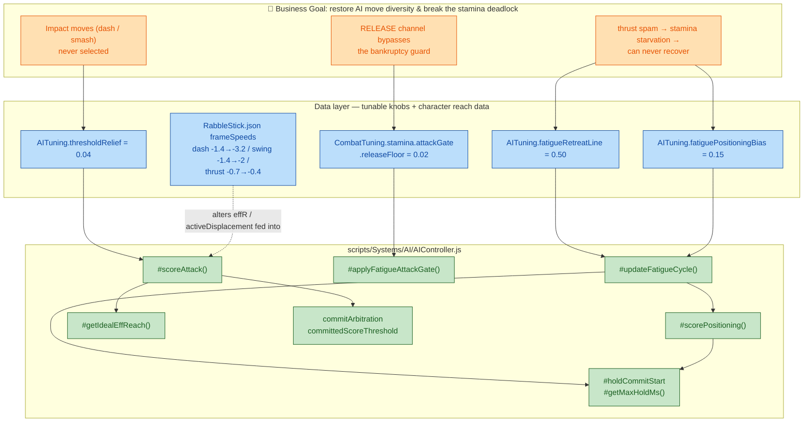
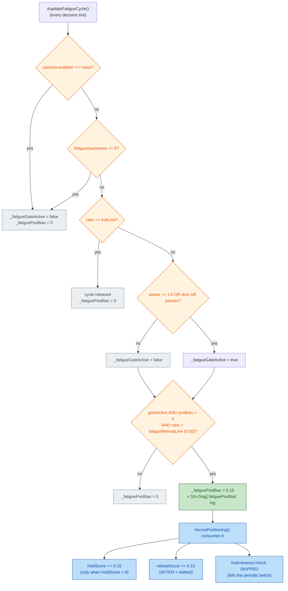
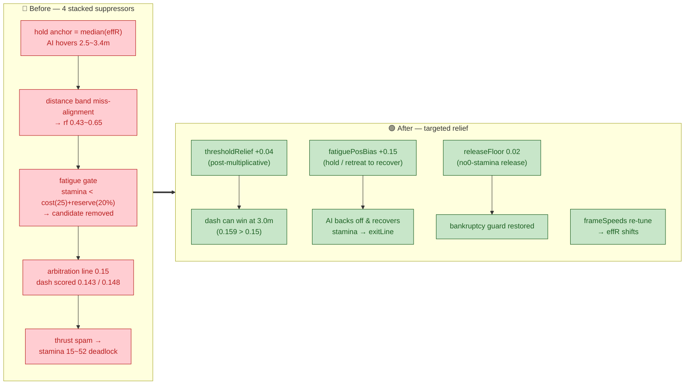

# 🧠 Code Review — AI Fatigue Regression Fix (26.11.27)

> **Project:** BlindDuel · **Scope:** AI utility-scoring layer, stamina/fatigue gating, character state-graph data, and investigation docs
> **Theme:** A structured investigation → tuning-parameterized fix for *"impact moves (dash/smash) are never selected, thrust dominates"*.

---

## 1. High-Level Summary (TL;DR)

* **Impact:** **High** — changes the AI's *decision-making core* (attack scoring, fatigue gate, positioning weights) plus the character's attack range data. Tuned via4 new configuration knobs so any single change can be reverted to legacy behavior by setting it to `0`.
* **Key Changes:**
1. **P2-A `thresholdRelief`** — a flat score bonus for attacks whose reach is shorter than the positioning hold anchor (median), added *after* all multiplicative stages so it isn't shrunk by `rangeFactor`/`posture`. Unblocks "just barely under threshold" impact attacks. (`AIController.js:1518-1526`, `AITuning.js:45`)
  2. **P1.2 `releaseFloor`** — the fatigue gate's "opportunity release" channel (preemptive / clashSeeker) now requires the attack to leave a minimum stamina remainder, closing a bankruptcy hole where a 0-stamina AI could still release a 25-cost smash. (`AIController.js:1898-1916`, `CombatTuning.js:113`)
  3. **P1.1 `fatiguePositioningBias`** — a new `_fatiguePosBias` state lets a low-stamina AI *choose to hold/retreat* (wait and recover) instead of spam-attacking into a stamina deadlock. Also suppresses the hold-timeout "twitch". (`AIController.js:2026-2104`, `2639-2666`, `2723-2728`)
  4. **Character range data** — `RabbleStick.json` `frameSpeeds` re-tuned for `dash` (-1.4→-3.2), `swing` (-1.4→-2), `thrust` (-0.7→-0.4), directly changing each attack's effective reach (`effR`).
  5. **Docs** — a 469-line root-cause investigation, a 64-line fix plan, a rewritten `HandOff.MD`, and a new agent skill for collider/occupancy regeneration.

---

## 2. Visual Overview (Code & Logic Map)

### 2.1 Goal ↔ Module ↔ Method



### 2.2 Where `thresholdRelief` lands in the attack score pipeline (P2-A)

```mermaid
graph LR
    A["base + intent buckets<br/>(common / preemptive / punish / clashSeeker)"] --> B["× startupFactor"]
    B --> C["× rangeFactor (rf)<br/>distance decay"]
    C --> D["× combatPosture.attackMultiplier"]
    D --> E["× aiProfile.attackPreferences"]
    E --> F["+ thresholdRelief (0.04)<br/>ONLY if effectiveRange &lt; idealEffReach"]
    F --> G["#applyFatigueAttackGate()<br/>may REMOVE the candidate entirely"]
    G --> H["committedScoreThreshold<br/>0.15 × baseWeight/0.40"]

    classDef s fill:#f3e5f5,color:#7b1fa2,stroke:#7b1fa2
    classDef new fill:#fff3e0,color:#e65100,stroke:#e65100,stroke-width:3px
    classDef gate fill:#ffcdd2,color:#b71c1c,stroke:#b71c1c
    class A,B,C,D,E,H s
    class F new
    class G gate
```



> ⚠️ **Key ordering fact:** the relief is added *before* the arbitration threshold, so it directly feeds the gate — and it is applied *before* the fatigue gate removes candidates (so it cannot resurrect a stamina-blocked attack, ✅).

### 2.3 P1.1 — Fatigue-cycle bias lifecycle



### 2.4 The suppression chain — before vs. after



---

## 3. Detailed Change Analysis

### 3.1 🧮 AI Scoring Layer — `#scoreAttack()` (P2-A `anchorMisalignRelief`)

**Component:** `scripts/Systems/AI/AIController.js:1518-1526`

**What Changed:**
A flat bonus is appended to an attack's utility score, but **only** for attacks whose effective reach is shorter than the positioning hold anchor.

```js
// Source: scripts/Systems/AI/AIController.js:1518
const thresholdRelief = this.tuning.thresholdRelief ?? 0;
if (thresholdRelief > 0 && effectiveRange > 0) {
    const idealEffReach = this.#getIdealEffReach();
    if (effectiveRange < idealEffReach) score += thresholdRelief;
}
```

* **Why after the multiplicative stages?** The in-code rationale is explicit: adding it earlier lets `rangeFactor` / `combatPosture.attackMultiplier` / `attackPreferences` shrink it back below the 0.15 line. The flat add makes the magnitude predictable (`0.124 + 0.04 = 0.164 > 0.15`).
* **Why is it targeted?** `#getIdealEffReach()` returns the **median** of all attacks' reach. So the *shortest* attacks (dash / smash — the impact moves) get relief; the median attack (swing) and long attacks (thrust) do not. This is the "anchor mis-alignment" compensation described in the plan.
* **Value history:** `0.03 → 0.04`. At `0.03`, the dash still missed by `0.001` at the AI's 3.0 m approach stop distance (`rf=0.31 → 0.119 + 0.03 = 0.149 < 0.15`), which made dash purely reactive ("only fires if the opponent advances"). `0.04` clears the line (`0.159`) while keeping the 3.1 m+ case out of range.

| Attack (rabble) | `effR` vs median | Receives `+0.04`? |
|---|---|---|
| `thrust` | `2.94` > median `2.65` | ❌ No |
| `swing` | `2.65` = median | ❌ No |
| `dash` | `2.49` < median `2.65` | ✅ Yes |

---

### 3.2 🛡️ AI Fatigue Gate — `#applyFatigueAttackGate()` (P1.2 `releaseFloor`)

**Component:** `scripts/Systems/AI/AIController.js:1898-1916`

**What Changed:**
The gate normally blocks an attack when the projected stamina after committing would fall below the reserve line (`0.7 - 0.5 × aggression`). Two "opportunity" classes — `preemptive` and `clashSeeker` — were allowed to **bypass** that block entirely, which let a 0-stamina AI release a 25-cost attack (documented as the "bankruptcy hole", investigation §8.4).

```js
// Source: scripts/Systems/AI/AIController.js:1916
const releaseable = (opportunity === "preemptive" || opportunity === "clashSeeker")
                    && projected >= releaseFloor;
```

* **Parenthesization matters.** The `&&` binds tighter than `||`. The added parentheses are what make the floor apply to **both** opportunity types; without them `preemptive` would remain completely unchecked.
* **`punish` is still intentionally excluded** (per the R2 design note — punish has no per-candidate timing verification yet).
* **Not a hard block — a floor.** With `releaseFloor = 0.02`, a release must still leave2% of max stamina. A candidate at `stamina = 0` has `projected = 0` → `→BLOCK`.

**Parameter table:**

| Param | File | Old | New | Semantics |
|---|---|---|---|---|
| `attackGate.releaseFloor` | `Data/CombatTuning.js:113` | *(absent)* | `0.02` | Minimum projected stamina ratio a released candidate must leave. `0` = rollback to unconditional release. |
| `attackGate.enabled` | `Data/CombatTuning.js:109` | `true` | `true` *(unchanged)* | Confirmed restored to filter mode (the investigation's shadow-mode experiment was reverted). |

---

### 3.3 🔋 Low-Stamina Recovery Behavior — `#updateFatigueCycle()` + `#scorePositioning()` (P1.1)

**Component:** `scripts/Systems/AI/AIController.js:2026-2104`, `2639-2666`, `2723-2728`

**What Changed — three coordinated pieces:**

**(a) New state field `_fatiguePosBias`**, computed once per decision tick inside the existing fatigue-cycle state machine:

```js
// Source: scripts/Systems/AI/AIController.js:2094
const posBias = this.tuning.fatiguePositioningBias ?? 0;
const retreatLine = this.tuning.fatigueRetreatLine ?? 0.35;
const prevPosBias = this._fatiguePosBias ?? 0;
this._fatiguePosBias = (this._fatigueGateActive && posBias > 0 && ratio < retreatLine) ? posBias : 0;
```

It is explicitly reset to `0` on **all three** early-exit paths (`stamina.enabled === false`, `fatigueAwareness <= 0`, `ratio >= exitLine`), so the bias can never leak past the fatigue window. A rising-edge diagnostic log (`[AI-Diag] fatiguePosBias`) was added.

**(b) Hold score boost — gated on existing hold eligibility:**
```js
// Source: scripts/Systems/AI/AIController.js:2664
if ((this._fatiguePosBias ?? 0) > 0 && holdScore > 0) {
    holdScore += this._fatiguePosBias;
}
```
The `holdScore > 0` condition is deliberate: it respects the hold band (`closestMinReach< dist ≤ idealEffReach × 1.15`) and the hold-timeout zeroing, so the bias never *manufactures* hold eligibility outside the band.

**(c) Retreat score boost — applied AFTER the posture multiplier:**
```js
// Source: scripts/Systems/AI/AIController.js:2726
if ((this._fatiguePosBias ?? 0) > 0) {
    retreatScore += this._fatiguePosBias;
}
```
The in-code comment records the first attempt's failure: added *before* `retreatScore *= retMult`, the `0.12` bias was diluted by the posture multiplier (≈0.73) down to `0.088`, which lost to `approach (0.129)` — the AI could not actually back off. Adding after the multiply makes it predictable (`0.15` vs `approach 0.129`).

**(d) Hold-timeout suppression (anti-"twitch"):**
```js
// Source: scripts/Systems/AI/AIController.js:2641
if (this.#holdCommitStart !== null && (this._fatiguePosBias ?? 0) <= 0) {
```
While recovering, the hold timeout no longer zeroes `holdScore`. Otherwise: timeout → holdScore = 0 → `retreat` wins a beat (step back half a step) → next beat `hold` wins → stop → repeat, producing a visible periodic twitch.

**Parameter table:**

| Param | File | Old | New | Default-off | Rationale (from source comments) |
|---|---|---|---|---|---|
| `fatigueRetreatLine` | `Data/AITuning.js:55` | *(absent)* | `0.50` | — | Was `0.35`; `0.35` closed the bias too early, leaving a 36~45 gap where dash needed `stamina ≥ 46` to pass the gate, so thrust kept winning. `0.50` covers the whole gap. |
| `fatiguePositioningBias` | `Data/AITuning.js:56` | *(absent)* | `0.15` | `0` = legacy | Was `0.12`; at `0.12` the AI could not out-score `approach (0.129)` outside the hold band, so it did not retreat cleanly. |

---

### 3.4 ⚙️ Tuning Data Layer

**Component:** `Data/AITuning.js`, `Data/CombatTuning.js`

| Key | File | Old Value | New Value | Description |
|---|---|---|---|---|
| `thresholdRelief` | `Data/AITuning.js:45` | *(none)* | `0.04` | Flat score bonus for attacks with `effR < idealEffReach`; `0` restores legacy scoring. |
| `fatigueRetreatLine` | `Data/AITuning.js:55` | *(none)* | `0.50` | Stamina-ratio threshold below which the low-stamina recovery bias activates. |
| `fatiguePositioningBias` | `Data/AITuning.js:56` | *(none)* | `0.15` | Flat bonus added to `holdScore` / `retreatScore`; `0` disables P1.1. |
| `attackGate.releaseFloor` | `Data/CombatTuning.js:113` | *(none)* | `0.02` | Minimum projected stamina ratio required to use the opportunity-release path; `0` restores unconditional release. |
| *(comment typo)* | `Data/AITuning.js:34` | `钳制` | `錨制` | Cosmetic fix (traditional vs. simplified character). |

> ✅ **All four new knobs are individually revertible to legacy behavior by setting them to `0`** — a deliberate discipline stated in the fix plan (§五 "全部改动走 tuning 参数，默认值 = 现行为").

---

### 3.5 ⚔️ Character Range Data — `Data/StateGraphDef/RabbleStick.json`

**Component:** `Data/StateGraphDef/RabbleStick.json` (lines 159, 180, 199)

**What Changed:** `frameSpeeds` control per-frame displacement during weaponbox-active frames; `AIKnowledgeRegistry.js:373-380` sums them into `activeDisplacement`, which feeds `effR = maxReach + |disp| + rangeBuffer(0.2)`. **The weapon hitbox (`maxR = 1.59`) never changed** — only the lunge distance.

| State | Old `frameSpeeds` | New `frameSpeeds` | Δ | Effect on `effR` |
|---|---|---|---|---|
| `thrust` | `[0, 0.1, -0.7]` | `[0, 0.1, -0.4]` | Lunge **reduced** | `effR` **shorter** (2.94 → ~2.67) |
| `dash` | `[0, -0.1, -1.4, -1, 0]` | `[0, -0.1, -3.2, -1, 0]` | Lunge **+128%** | `effR` **longer** (2.29 → 2.65) |
| `swing` | `[0, 0.2, -1.4]` | `[0, 0.2, -2]` | Lunge **+43%** | `effR` **longer** (~2.49 → ~2.65) |

**Gameplay meaning:** dash and swing now reach ~2.65 m — the same as the hold anchor — so they overlap the AI's natural hover band instead of sitting outside it. Thrust was pulled *in*, so it no longer trivially wins at every distance.

---

### 3.6 📚 Documentation & Agent Skill

| File | Change | Content |
|---|---|---|
| `plans/26.11.27 引入疲劳后AI行为多样性退化调查.MD` | **New** (469 lines) | Full root-cause investigation §一–§九: distance-band mis-alignment, the fatigue-gate × distance × arbitration-line multiplication, three range-data experiments (World A/B/C) with a contribution breakdown, an external-review section, and a same-dimension confirmation for `manatarms/smash`. |
| `plans/26.11.27 疲劳感知导致AI行为退化修复计划.MD` | **New** (64 lines) | Fix plan: P1.2 ✅ accepted, P1.1 (this diff), P2-A (this diff), P3 (deferred `holdAnchorBias`), plus 4 explicit "observation only" items and a single-variable verification discipline. |
| `plans/HandOff.MD` | **Rewritten** (171 → 506 lines) | Old content ("单场景多战斗重构交接" / single-scene multi-battle refactor) **replaced** with the fatigue-investigation handoff:30-second conclusion, a code-anchor quick-reference table, list of changes made, next steps, and the World-C baseline log dump. |
| `.trae/skills/collider-occupancy-更新-skill/SKILL.md` | **New** (131 lines) | Agent skill: two PowerShell routes (`extract_collision_boxes.ps1` for combatants → `.collider.json`; `extract_rootmotion_occupancy.ps1` for NPCs → `.occupancy.json`), directory conventions, batch PowerShell templates, and the collision-mask color code (`#FFFF00` hitbox / `#E37800` strong blade / `#FF0000` weak blade / `#7082C1` root). |

---

### 3.7 🎨 Art Assets (Binary — content not inspectable)

| File | Status |
|---|---|
| `Art/RawAssets/Env/Tavern.ase` | Binary — modified |
| `Art/RawAssets/Env/arrow.ase` | Binary — modified |
| `Art/RawAssets/Env/floor.kra` | Binary — modified |
| `Art/RawAssets/Env/tavern_room.kra` | Binary — modified |
| `Art/RawAssets/Env/treeline_pine.kra` | Binary — modified |

> These are Aseprite (`.ase`) and Krita (`.kra`) source files. Git reports them as binary, so **no semantic diff is available in review**. They appear thematically related to the tavern/environment work mentioned in the investigation (the `manatarms` fight takes place in the tavern hall). ⚠️ The reviewer should open them in Aseprite/Krita to confirm the visual intent — these are the highest-uncertainty items in the change set.

---

## 4. Impact & Risk Assessment

### 4.1 🔴 Breaking Changes

**None in the public API sense.** All changes are additive and gated by tuning parameters:

| Concern | Assessment |
|---|---|
| Public API / exports | ✅ Unchanged — no signature or export changes |
| Database schema | ✅ N/A |
| Data format | ⚠️ `RabbleStick.json` `frameSpeeds` semantics unchanged, but **values** changed → any saved gameplay data depending on reach needs re-validation |
| Save files / replays | ✅ Unaffected |
| Rollback path | ✅ Excellent — set `thresholdRelief = 0`, `fatiguePositioningBias = 0`, `releaseFloor = 0` to fully restore legacy AI behavior |

---

### 4.2 ⚠️ Risks & Review Flags

| # | Severity | Area | Issue | Recommendation |
|---|---|---|---|---|
| **R1** | 🔴 **High** | `thresholdRelief` vs. personality scaling | `thresholdRelief = 0.04` is applied **before** the arbitration threshold, and the threshold is normalized per personality: `0.15 × clamp(baseWeight/0.40, 0.25, 1.5)` (`AIController.js:526-529`). For `manatarms` (`baseWeight = 0.10`) the threshold is **0.0375 < 0.04**. A zero-scoring attack (e.g. `rf = 0`, out of range) would be lifted from `0.000` to `0.040` and **pass the gate on the relief alone**. This can re-introduce the exact "out-of-range whiff" the plan lists as open observation item #3 (`smash` committed at `dist4.37~5.09`). Mitigation today is that positioning candidates usually score higher (`approach ≈ 0.12~0.34`), but gaps exist. | Add a `rangeFactor > 0` (or `sit.distance <= maxRange`) precondition, or scale the relief by the personality factor (`× _baseWeightScale`), so it can never exceed the local threshold. **Test `manatarms` specifically.** |
| **R2** | 🟡 **Medium** | `fatigueRetreatLine` vs. `exitLine` | The bias window (`ratio < 0.50`) is only reachable if the fatigue cycle is still active, which requires `ratio < exitLine`, where `exitLine = (0.7 - 0.5×agg) + maxCost/maxStamina + 0.1` (`AIController.js:2044-2048`). For `rabble` (agg 1.0, maxCost 25) → `exitLine = 0.55` ✅. But a character with `maxCost = 15` → `exitLine = 0.45 < 0.50` ⇒ **P1.1 silently never activates for that character.** | Verify `exitLine > fatigueRetreatLine` for every character (`hero`, `rabble_stick`, `manatarms`, …), or derive the bias window from `exitLine` instead of a second absolute constant. |
| **R3** | 🟡 **Medium** | Scale mismatch in the relief condition | `effectiveRange = maxReach + fwdBoost + rangeBuffer(0.2)` (`AIController.js:1100`) but `#getIdealEffReach()` returns `maxReach + fwdBoost` **without** `rangeBuffer` (`AIController.js:3182-3187`). The condition `effectiveRange < idealEffReach` therefore really means *"reach + 0.2 < median reach"* — i.e. **0.2 m stricter** than the comment's "effR < idealEffReach" suggests. | Either add `rangeBuffer` to `#getIdealEffReach()` (it is also the positioning anchor, so this has wider blast radius — analyze first) or compare like-for-like quantities. |
| **R4** | 🟡 **Medium** | Data version vs. documented baseline | The new `HandOff.MD` declares the baseline as **"World C"** (`dash frameSpeeds[2] ≈ -2.4`, `effR 2.49`, KB `disp = -0.70`), but the committed data has `-3.2` (World B, `effR 2.65`) — and `swing` was also changed to `-2` (not part of any documented "world"). The doc itself warns: *"开局自检 `[AI KB]` 行 disp/maxR 确认数据版本（世界 C 的 -6.4 插曲教训）"*. | Re-baseline the acceptance logs against the **actual** committed values before signing off, or reconcile the doc. Confirm the `[AI KB]` line at session start. |
| **R5** | 🟢 **Low** | Uninitialized field | `_fatiguePosBias` is **not** initialized in the constructor (`:78-81` initializes `_fatigueGateActive`, `_fatigueGuardSuppressed`, `_fatigueCycleLatchUntil`, `_fatigueAttackGateLogUntil` — but not `_fatiguePosBias`). All read sites use `?? 0`, so behavior is safe, but it is `undefined` before the first `#updateFatigueCycle()` call. | Add `this._fatiguePosBias = 0;` next to the other fatigue fields for clarity and to avoid `undefined` leaking into future code. |
| **R6** | 🟢 **Low** | Doc overwrite | `plans/HandOff.MD` was fully rewritten — the previous "单场景多战斗重构交接" (multi-battle refactor) handoff was **deleted from the working tree** (recoverable only from git history). | Confirm the multi-battle refactor handoff is no longer needed, or archive it under its own file. |
| **R7** | 🟢 **Low** | Hold-timeout suppression | While `_fatiguePosBias > 0`, `#holdCommitStart` never resets, so `holdScore` keeps receiving the bias for the whole fatigue window (bounded by `ratio < 0.50` and cycle activity). | Confirm the AI does not over-hold in long low-stamina stretches. |
| **R8** | ⚪ **Info** | Binary art assets | 5 `.ase` / `.kra` files changed with no diffable content. | Visual review required outside the diff. |

---

### 4.3 🧪 Testing Suggestions

**P1.2 — `releaseFloor` (already accepted per plan, re-verify):**
- [ ] `manatarms` fight: filter `fatigueAttackGate|best=attack` → **zero** occurrences of `proj=0%` → `→RELEASE`. The plan reports 6/8 opportunity entries now correctly `→BLOCK`.
- [ ] **Positive path (still unverified per the plan):** a `clashSeeker` opportunity window landing at `stamina 22~30` must still produce a legal `→RELEASE` (this case never triggered in the acceptance run — explicitly flagged as a non-blocking gap).
- [ ] `rabble` fight: confirm no `opp=` entries appear (expected — no opportunity qualification) and no regression.

**P1.1 — `fatiguePositioningBias`:**
- [ ] Filter `POS:|fatiguePosBias|fatigueAttackGate` → confirm `POS: retreat` / `hold` become non-zero at low stamina and that `[AI-Diag] fatiguePosBias` fires on the rising edge.
- [ ] **Ratio-band sweep:** verify the bias engages below50% and releases above `exitLine`; verify the 36~50% band (the gap the old `0.35` line left) now behaves as intended.
- [ ] Confirm the periodic "twitch" (hold↔retreat alternation) is gone — compare against the pre-fix baseline.
- [ ] Confirm stamina actually **recovers** (the deadlock's real symptom) instead of merely hovering.
- [ ] **Per-character check:** for each character, log `ratio`, `exitLine`, and `_fatiguePosBias` together to confirm the bias window is reachable (see **R2**).

**P2-A — `thresholdRelief`:**
- [ ] `rabble`: confirm dash commits at the ~3.0 m approach stop distance (`sc ≈ 0.159 > 0.15`), and **not** at 3.1 m+ (out-of-range must stay out).
- [ ] Confirm `thrust` / `swing` scores are **byte-identical** to baseline (they must receive no relief).
- [ ] **`manatarms` regression pass** (highest priority, see **R1**): confirm no out-of-range `smash` commits appear; compare the `commitArbitration` filtered list against the World-C baseline.
- [ ] Verify the arbitration line still blocks genuinely low-value **defensive** candidates (dodge/guard) — the plan's stated acceptance criterion.

**Data changes — `RabbleStick.json`:**
- [ ] Playtest dash/swing reach feel; confirm `maxR = 1.59` (weapon hitbox) is unchanged and only the lunge moved.
- [ ] Confirm the `[AI KB]` re-scan line reports the expected `disp` values for the committed `frameSpeeds`.

**General:**
- [ ] Full regression on `prologue_battle`, `battle_field_1/2`, and the tavern room.
- [ ] Confirm `CombatTuning.stamina.attackGate.enabled === true` (shadow mode reverted) in the committed config.

---

### 4.4 🧭 Reviewer Summary

| Aspect | Verdict |
|---|---|
| **Change quality** | ⭐⭐⭐⭐☆ — Well-instrumented: every new knob is configurable, defaults are documented, and the source comments record *why* each value was chosen (including first-attempt failures). |
| **Risk profile** | ⚠️ **R1 is the one to resolve before merge** — `thresholdRelief (0.04)` exceeds `manatarms`' normalized threshold (`0.0375`), so the flat relief can single-handedly admit a zero-scoring out-of-range attack. |
| **Tuning discipline** | ✅ Excellent — every behavioral change is behind a parameter defaulting to a legacy-equivalent value (`0` = off). |
| **Documentation** | ⭐⭐⭐⭐⭐ — The investigation doc is genuinely strong: it falsifies its own hypothesis (§8.3), corrects an earlier conclusion (§7.2), and explicitly distinguishes the two character archetypes. **But** the committed data (R4) does not match the documented World-C baseline. |
| **Scope hygiene** | ⚠️ Mixed — the AI fix is coherent, but 5 binary art files and a full `HandOff.MD` rewrite ride along in the same change set. |
| **Blocking issues** | **R1** (threshold vs. personality scaling), **R2** (unreachable bias window for cheap-attack characters), **R4** (baseline/data mismatch). R3–R8 are non-blocking. |