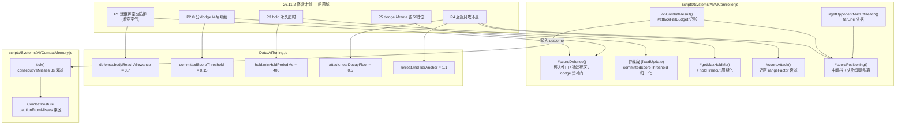
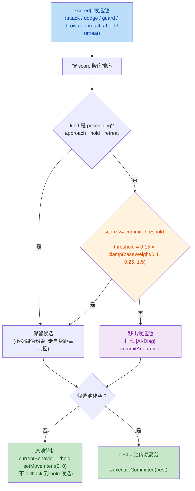

# 🔍 Code Review — BlindDuel Combat AI "26.11.2" Fix Plan

## 1. High-Level Summary (TL;DR)

- **Impact: High** — This is a **combat-AI decision-layer overhaul** implementing the closed `plans/26.11.2 AI问题修复计划.MD` (Steps 0/1/1b/1c/2/3/4/4c/4d/5). It changes *when the AI is allowed to act*, not just *how it scores*. It also carries **three debug/dev toggles left switched ON** and **two repo-hygiene regressions** that must be cleaned before merge.

- **Key Changes:**
  - ✨ **Defense eligibility gates** (`#scoreDefense`): reachability now uses the *physical* model `(maxReach + fwdBoost + bodyReachAllowance) × 1.05 + selfClosure`, plus a **near-range dead zone** (`distance < minReach − allowance` → 0) and a **self-closure rule** (AI walking toward the opponent closes distance during the enemy's active window).
  - ✨ **Commit arbitration** (Step 2/4d): committed actions (`attack/dodge/guard/throw`) must clear a **normalized** `committedScoreThreshold` (scaled by the character's `attack.baseWeight`, clamped `[0.25, 1.5]`); positioning candidates are exempt. No qualifying candidate → **stand still**, never a 0-score dodge tie-break.
  - ✨ **Near-range spacing** (Step 4A/4B/4c): per-attack `rangeFactor` near-side decay (`nearDecayFloor: 0.5`), a **retreat mid-tier** anchored to `closestMinReach × 1.1`, and a **budget-based failure-driven disengage** (`#attackFailBudget` + 4 s latch + edge decay).
  - 🐛 **holdTimeout re-semanticized** (Step 3): timeout is now *periodic* (resets `holdCommitStart`) with a `minHoldPeriodMs: 400` floor — fixes `baseAggression = 1.0` permanently disabling hold.
  - ✨ **dodge i-frame eligibility gate** (Step 5): `timeUntilHit < escapeLatency` → dodge scores 0.
  - ⚠️ **Debug flags shipped ON**: `ThrowComponent.DEBUG_INFINITE_AMMO = true`, `CombatSystem debugTrace: true`, and `WorldState.currentSceneId = "ep1_tavern_room"`.
  - ⚠️ **Repo hygiene**: a 2,529-line stale duplicate `AIController - 副本.js` committed into `scripts/`, and `plans/HandOff.MD` was **overwritten with raw console logs**, destroying the original architecture hand-off document.

---

## 2. Visual Overview (Code & Logic Map)

### 2.1 Goal → Module → Method mapping



### 2.2 Commit arbitration flow (Step 2 + Step 4d) — the highest-impact change



### 2.3 Failure-driven disengage runtime loop (Step 4c)

```mermaid
sequenceDiagram
    participant CS as CombatSystem
    participant AI as AIController
    participant CM as CombatMemory
    participant CP as CombatPosture
    participant CH as Character

    CS->>AI: onCombatResult({outcome:"miss", targetState:"thrust"})
    AI->>AI: #attackFailBudget.set("thrust", n+1)
    AI->>CM: onOutcome("attack:miss","thrust")
    CM->>CM: consecutiveMisses++ ; _lastMissAt = now
    CM->>CP: consecutiveMisses → caution 乘区
    Note over CM: tick():3s 无新 miss → consecutiveMisses = 0

    loop 每个决策 tick (100ms)
        AI->>AI: #scorePositioning()
        AI->>AI: attemptsPerAttack = attMult >= 1.0 ? 2 : 1
        AI->>AI: allTried = 每个近战招失败数 >= attemptsPerAttack
        alt allTried 且 distance <= maxEffReach 且 oppPhase ∈ {none, recovery}
            AI->>AI: #disengageUntilTs = now + 4000<br/>#disengageLine = line(attMult 插值)<br/>#attackFailBudget.clear()
            AI->>CH: retreat boost = 0.5 × (line+0.3 − distance)/0.3
        else 交换窗口 (startup / active)
            AI->>AI: 锁存保留, boost 本 tick 不生效<br/>(交由 defense 候选)
        end
    end
```

---

## 3. Detailed Change Analysis

### 3.1 🛡️ `AIController.#scoreDefense()` — Defense eligibility gates (Step 1 / 1b / 1c / 5)

**What Changed** — the defense pipeline previously had a *fake* reachability gate (`oppEffReach = maxReach + rangeBuffer`, opened to `× 1.5` ≈ 6.7 m). It now models the actual hit geometry, and adds two brand-new hard gates.

| Gate | Old | New | Rationale |
|---|---|---|---|
| Far reachability | `distance > (maxReach + rangeBuffer) × 1.5` → 0 | `distance > (maxReach + fwdBoost + bodyAllow) × 1.05 + selfClosure` → 0 | `rangeBuffer` is a *scoring* margin, not physics; `×1.5` opened the whole unreachable band |
| Near dead zone | *(none)* | `distance < minReach − bodyAllow` → 0 | Enemy's `weaponbox` near end overshoots the body → attack physically cannot connect |
| `bodyReachAllowance` | — | `0.7` (was `0.45`) | AI measures root-to-root; hit detection is `weaponbox × hitbox`. Calibrated from real hits at **4.90–5.10 m** |
| Self closure | *(none)* | `min(0.3, currentSpd × timeUntilActiveEnd / 1000)` | While walking toward the enemy, the hit lands *closer* than the current reading |
| Dodge i-frame | *(none)* | `timeUntilHit < escapeLatency` → 0 | `dodgeActive` is a whole-state flag; if the hit lands before i-frames start, the dodge is worthless |

**Key snippet (near dead zone + dodge gate):**

```js
// 近端（Step 1b）：AI 站进 minR 死区（贴脸）时该攻击物理上打不到
const oppMinReach = oppAtk.range?.minReach ?? 0;
if (oppMinReach > 0 && sit.distance < oppMinReach - bodyAllow) {
    return 0; // 贴脸死区：weaponbox 近端越过身体，够不到
}
```

> ⚠️ **Note:** the opponent's `speed × time` closure was *deliberately rejected* (plan §9) — only the AI's own side uses speed, because the AI's direction comes from its own `moveIntent` and its speed from the engine.

---

### 3.2 ⚖️ Commit arbitration (Step 2) + per-character threshold normalization (Step 4d)

**What Changed** — `AITuning.committedScoreThreshold` existed since v1 but **was never read** (dead config). It is now wired into the decision layer as a *filter-pool* (not "only look at the top score"), so a filtered leader can still yield a correct winner from the remaining pool.

**Threshold normalization formula (new, Step 4d):**

```
_baseWeightScale = (tuning.attack.baseWeight ?? AITuning.attack.baseWeight) / (AITuning.attack.baseWeight || 0.4)
commitThreshold  = tuning.committedScoreThreshold(0.15) × clamp(_baseWeightScale, 0.25, 1.5)
```

| Character profile | `attack.baseWeight` | Scale (clamped) | Effective threshold | Effect |
|---|---|---|---|---|
| Default (rabble etc.) | `0.4` | `1.00` | **0.15** | unchanged |
| `manatarms` (defensive) | `0.10` | `0.25` (clamped from 0.25) | **0.0375** | restores `quart` (0.085) to the pool |
| Hypothetical | `0.8` | `1.50` (clamped from 2.0) | **0.225** | stricter |

**Why Step 4d exists:** `manatarms` has an attack-score ceiling of ≈ `0.09`; the absolute `0.15` threshold made its attack pool **structurally empty** → infinite hold (the same disease as the archived 26.10.25 plan).

**Fallback semantics changed:** the "all scores are 0 → hold" branch now explicitly **does not** fall back to the `hold` candidate (hold itself may already be zeroed by `holdTimeout`) — it just idles with `moveIntent(0,0)`.

---

### 3.3 ⏱️ `holdTimeout` re-semanticized (Step 3) + duplicate-block cleanup

| Aspect | Old | New |
|---|---|---|
| Timeout meaning | "hold permanently disabled" | "this position intent must be **re-evaluated**" — timer resets, next cycle begins |
| `maxHoldMs` | `totalAttackMs × (1 − aggression)` | `max(…, hold.minHoldPeriodMs = 400)` |
| `baseAggression = 1.0` | `maxHoldMs = 0` → timed out **every tick, forever** | floor of **400 ms** guarantees at least one full evaluation period |
| Dead code | — | A **duplicated** `if (kind === "hold") { … } else { … }` block in `#executeCommitted` was removed (the surviving block at the top of the positioning branch is semantically identical) |

> ✅ The removal is a **pure de-duplication** — the surviving block still clears `#holdCommitStart` on `approach`/`retreat`, and committed `attack/defense/throw` still reset it at the end of `#executeCommitted` (line ~2674). No behavior change.

---

### 3.4 🏃 Near-range spacing governance (Step 4A / 4B)

**What Changed** — the "desire vacuum" (1.3–2.0 m) had `attack` at full score, `retreat` structurally at 0, `hold` zeroed by timeout → the only motive was to attack. Two *paired* fixes:

**4A — attack near-side decay (anchored per-attack, not per-character):**

```js
const rangeSpan = effectiveRange - minReach;
if (sit.distance < effectiveRange && rangeSpan > 0.01) {
    const nearFloor = this.tuning.attack.nearDecayFloor ?? 0.5;
    const t = clamp((sit.distance - minReach) / rangeSpan, 0, 1);
    rangeFactor *= nearFloor + (1 - nearFloor) * t;
}
```

> Per-attack anchoring means **long attacks feel the "too close" penalty before short attacks** — a short attack (`dash`, `minR = 1.11`) is not punished inside its own comfort zone. A mirrored copy of this decay was also added to the **diagnostic breakdown printer** so the displayed `rf` matches the real score.

**4B — retreat mid-tier** (fills the gap above the "must retreat" line):

| Band | Retreat score |
|---|---|
| `distance > 0.55 × closestMinReach` | 0 (vacuum) |
| `0.55×closestMinReach < distance ≤ 1.1×closestMinReach` | linear `0 → 0.5` |
| `distance ≤ idealEffReach × 0.4` | flat `0.5` (pre-existing hard floor) |

> 🔁 The anchor was **moved twice**: `0.7 × idealEffReach` → `1.1 × closestMinReach`, because the old anchor covered `1.3–1.87 m` and permanently blocked the AI from reaching the `dash` comfort zone.

---

### 3.5 🧠 Failure-driven disengage (Step 4c) — the most novel mechanism

**Trigger (budget-based, not "N consecutive misses"):**

```
attemptsPerAttack = attMult >= 1.0 ? 2 : 1        // reuses posture.attackMultiplier as "how many tries per weapon"
allTried          = EVERY melee attack has failed >= attemptsPerAttack times
trigger           = allTried && distance <= maxEffReach && oppPhase ∈ {none, recovery}
on trigger        = #disengageUntilTs = now + 4000ms ; #disengageLine = line ; #attackFailBudget.clear()
```

**Retreat target line (interpolated from `posture.attackMultiplier` — no new tuning knob):**

| `attMult` | Semantic | Target line |
|---|---|---|
| `MAX` (1.4) | High aggression | `0.85 × ownEffectiveReach` — turn back just inside own range |
| `1.0` | Standard | `1.00 × ownEffectiveReach` — exactly outside own attack range |
| `MIN` (0.6) | Low aggression | `max(ownEffectiveReach, opponentMaxEffectiveReach)` — outside **both** ranges |

**Anti-jitter:** the boost is `0.5 × (line + 0.3 − distance) / 0.3`, i.e. **full 0.5 at the line, 0 at `line + 0.3`** → the score is continuous across the boundary, so the AI *drifts* to the edge instead of flipping movement direction every 100 ms (the old `retreat 0.5` vs `approach 0.12` hard flip was visibly twitchy).

**Gating red line preserved:** the boost is only applied when `oppPhase ∈ {none, recovery}`; during `startup`/`active` the latch is *kept* but the boost is suppressed, so **normal exchanges never mechanically retreat**.

**New helper:** `#getOpponentMaxEffReach()` — mirrors `#getMeleeMaxEffReach()` but sources `opponentKB` (used only for `farLine`; returns `0` if the opponent has no attack data).

---

### 3.6 🧾 `CombatMemory` — miss-count time decay

| Field | Change |
|---|---|
| `_lastMissAt` | **new** — timestamp of the last `attack:miss` / `attack:parried` |
| `tick()` | `if (consecutiveMisses > 0 && (now − _lastMissAt) > 3000) consecutiveMisses = 0` |

**Why it matters:** `consecutiveMisses` feeds `CombatPosture`'s `cautionFromMisses` multiplier. Without decay, old failures permanently suppressed `approach`, pinning the AI at the edge of its range forever. Note this also **loosens the caution posture** after 3 s of no new misses — a side effect beyond the disengage feature itself.

---

### 3.7 ⚙️ `Data/AITuning.js` — configuration changes

| Key | Old | New | Type | Purpose |
|---|---|---|---|---|
| `committedScoreThreshold` | `0.15` (unread) | `0.15` (**now wired + normalized**) | modified | Commit arbitration threshold |
| `defense.activationThreshold` | `0.3` | **removed** | deleted | Dead config — never read by `AIController` |
| `defense.startupTooLateBase` | `0.3` | **removed** | deleted | Dead config — never read by `AIController` |
| `defense.bodyReachAllowance` | — | `0.7` | added | Hitbox-extension allowance of the victim (`0.45` → `0.7` after re-measurement) |
| `attack.nearDecayFloor` | — | `0.5` | added | Near-side attack decay floor (explicitly a *starting point*, not a validated value) |
| `hold.minHoldPeriodMs` | — | `400` | added | Lower bound for one hold evaluation period |
| `retreat.midTierAnchor` | — | `1.1` | added | Retreat mid-tier anchor × `closestMinReach` |

> 🗑️ Two dead knobs were deleted — `ep1_tavern_hall_night.json` still contains a leftover `startupTooLateBase` key that is now **read by nobody** (flagged in `PROJECT_CONTEXT.md` as a cleanup candidate).

---

### 3.8 🎮 Gameplay data & debug toggles

| File | Change | Risk |
|---|---|---|
| `Data/StateGraphDef/RabbleStick.json` | `swing.attackWeight`: `light` → **`heavy`** | ⚠️ **Gameplay change.** `attackWeight` drives clash resolution in `ContactResolver` (weight comparison → `clash_tie` / `clash_lose`) and KB scanning. `dash` was already `heavy`, `thrust` is `light`. This changes how Rabble behaves in weapon clashes — confirm it is intentional and not a tuning leftover. |
| `Data/TestScripts/manatarms_basic_sequence.json` | Removed `moveIntent {x:1}` + `smash` + `moveIntent {x:0}` steps | ⚠️ Reduced coverage of the automated test script (the movement/smash segment no longer exercises the AI). |
| `scripts/Game.js` | `CombatSystem({ debugTrace: false })` → **`true`** | ⚠️ **Debug on** — per-hit combat tracing in production. |
| `scripts/Components/ThrowComponent.js` | `DEBUG_INFINITE_AMMO = false` → **`true`** | 🔴 **Must revert.** The file's own comment says *"正式验收必须为 false"*. Infinite ammo masks every throw-balance defect. |
| `scripts/WorldState.js` | `currentSceneId`: `"prologue"` → **`"ep1_tavern_room"`** | ⚠️ The game now boots **directly into the ep1 tavern** instead of the prologue. Test-only default left in source. |
| `Art/RawAssets/Env/*.ase`, `*.kra` | 4 binary assets changed (Tavern, arrow, floor, treeline_pine) | ❓ Binary — not reviewable from the diff. Note they are **raw authoring sources**; confirm the exported runtime assets were regenerated too. |

---

### 3.9 📚 Documentation, tooling & repo hygiene

| File | Change | Note |
|---|---|---|
| `plans/26.11.2 AI问题修复计划.MD` | **New** (352 lines) | Full fix plan with implementation retrospective, accept/reject list for the GPT architecture review, and a §8 "open observations" backlog. |
| `plans/INDEX.md` | Update Log entry (2026-11-03) | Records all Steps 0–6 and the Step6 deferral. |
| `PROJECT_CONTEXT.md` | AI system description extended | Now lists all six new mechanisms; also flags the stale `startupTooLateBase` key. |
| `plans/HandOff.MD` | 🔴 **Original 171-line hand-off document DELETED**, replaced with ~600 lines of raw `[AI-Diag]` console output | **Documentation regression.** The deleted content was the *single-scene multi-battle refactor* hand-off (BattleSession design, Scene/BattleMode/TimelineSequencer gaps, prologue data draft, acceptance checklist). Console logs are not a hand-off document and are better stored as artifacts. |
| `.trae/skills/collider-occupancy-更新-skill/SKILL.md` | **New** (131 lines) | Agent skill for regenerating `.collider.json` / `.occupancy.json` via the two PowerShell tools, with the mask color convention table. |
| `scripts/Systems/AI/AIController - 副本.js` | 🔴 **New** — 2,529-line **stale duplicate** of `AIController.js` | It is the **pre-fix** snapshot (still contains *"Phase 2: 直接执行最高分（不再有 threshold 硬门控…）"* and no `committedScoreThreshold`). It sits inside `scripts/`, so `import` paths resolve, IDEs index it, and it will drift silently. Delete it or move it out of the source tree. |

---

## 4. Impact & Risk Assessment

### 4.1 🔴 Blocking issues (must fix before merge)

| # | Issue | Why |
|---|---|---|
| 1 | `ThrowComponent.DEBUG_INFINITE_AMMO = true` | Explicitly documented as forbidden for acceptance. Masks all throw-balance regressions. |
| 2 | `CombatSystem debugTrace: true` | Per-hit trace logging in the shipping build (perf + log spam). |
| 3 | `WorldState.currentSceneId = "ep1_tavern_room"` | Game no longer boots into `prologue`; a dev convenience leaked into source. |
| 4 | `scripts/Systems/AI/AIController - 副本.js` committed | 2.5 K-line stale duplicate inside the module search path. |
| 5 | `plans/HandOff.MD` original content destroyed | Loss of the multi-battle refactor hand-off; the replacement is console noise. |

### 4.2 ⚠️ Behavioral / design risks

- **No API/schema breaks** — this is a **self-contained AI-layer change**. `AITuning` gained keys (with `??` defaults everywhere) and **lost two dead keys** (`defense.activationThreshold`, `defense.startupTooLateBase`). Any external scene config still setting those two keys will be silently ignored.
- **Thresholds are unproven constants.** `bodyReachAllowance 0.7`, `nearDecayFloor 0.5`, `midTierAnchor 1.1`, `minHoldPeriodMs 400` are explicitly documented in the code as *"验证起点，不是结论"* (validation starting points, not conclusions). They are calibrated against **one** opponent (thrust, `maxReach 4.15`) and one enemy body — expect per-character retuning.
- **Regression surface: defensive characters.** The whole `committedScoreThreshold` normalization exists because `manatarms` could not attack at all. Any *new* character with `baseWeight < 0.15 / maxAttackScore` will hit the same structural-empty-pool trap. The clamp floor of `0.25` limits how low the threshold can go.
- **Known collateral effect:** `CombatMemory.consecutiveMisses` 3 s decay also relaxes the `CombatPosture` `cautionFromMisses` multiplier — an unintended second-order change to posture responsiveness.
- **Doc/code drift (low severity, worth fixing):**
  - The plan's Step 4 row still says `retreat.midTierAnchor = 0.7` / "(0.4×ideal, 0.7×ideal]" while Step 4c and the implementation use `1.1 × closestMinReach`.
  - Plan §1 states the far gate is `× 1.1`; the implementation uses `× 1.05` (the later 1b/1c revision) — the §1 text was not updated.
  - Plan §4c says failures counted are *"miss/parried/guard_blocked/interrupted"*, but the code counts **only `attack:miss` and `attack:parried`**. Blocked and interrupted attacks never consume the disengage budget.
- **Logging volume:** four new `[AI-Diag]` streams (`COMBAT`, `commitArbitration`, `defenseGate REJECT`, `dodgeGate REJECT`, `disengage`) fire per decision tick. They are `debugVisible`-gated, but `debugVisible` defaults to `true` (`options.debugVisible ?? true`) — worth checking before a performance pass.

### 4.3 🧪 Testing suggestions

**Gate regressions (from plan §7, mapped to the new code):**

| # | Scenario | Expected | Grep |
|---|---|---|---|
| 1 | Normal thrust whiffed at **5.2 m+** | **no** defense reaction | `best=` has no `dodge`/`guard` |
| 2 | Thrust **tip range4.5–4.9 m** | defense reaction **must** still fire (`bodyReachAllowance` covers tip-graze) | `best=guard/dodge` present |
| 3 | Rush attack with forward displacement | defense preserved | `best=guard/dodge` |
| 4 | Point-blank `< minR − allowance` (thrust < 2.3 m) | that attack must **not** trigger defense; **switch to a short move** (`nachschlag minR 1.09`) and it **must** trigger | `defenseGate REJECT` |
| 5 | AI **approaching** through an enemy attack | `toward=true spd>0` → closure > 0, boundary widens | `defenseGate REJECT ... closure=` |
| 6 | CAUTIOUS, 1.3–2.0 m, both idle | `retreat` is competitive, `best=retreat` occasionally | `POS:` `r>0` |
| 7 | AGGRESSIVE, 1.3–2.0 m | pressure maintained, **no 0-score dodge**, non-attack ticks present | no `best=dodge(0.000)` |
| 8 | Opp `startup` + clash opportunity | `preemptive/clashSeeker` bonus **still outranks** the retreat mid-tier | `top3=` #1 is `attack` |
| 9 | Repeated attack failures, all candidates low | **no zero-score action** committed | `best=dodge(0.000)` disappears |
| 10 | `baseAggression = 1.0` boundary | `holdTimeout` is **periodic**, not per-tick | `holdTimeout` recurs every ~400 ms |
| 11 | AI in own-attack `recovery`, enemy fast move incoming | dodge **not** chosen when `escapeLatency > timeUntilHit` | `dodgeGate REJECT` |
| 12 | `manatarms` (baseWeight 0.10) | attack pool **non-empty**, `best=attack:...` reachable | `commitArbitration: threshold=0.0375` |
| 13 | Weapon-library sweep failure | disengage triggers only after **every** melee move failed `attemptsPerAttack` times | `disengage TRIGGER` |
| 14 | Disengage target line | continuous retreat (no direction flip), and dash comfort zone (1.11–1.6 m) reachable | `disengage:` boost decays to 0 |
| 15 | Threshold regression | low-value-but-valid reactions (throw defense, normal block) **not** filtered out | throw-defense trigger rate unchanged |

**Targeted unit-ish checks:**

- `#getMaxHoldMs()` with `baseAggression = 1.0` → must return **≥ 400**, not `0`.
- `#getOpponentMaxEffReach()` with an opponent that has **no** attacks → must return `0` and must not throw (`Math.max()` on an empty spread would be `-Infinity`, guarded by `perAttackEffReach.length > 0` ✅).
- Commit arbitration with **all** candidates at `0.000` → must idle, **must not** commit a `dodge`.
- `CombatMemory.tick()` with `consecutiveMisses = 2` and no new miss for > 3 s → counter resets to `0`.

**Smoke checks before merge:**

- Set `DEBUG_INFINITE_AMMO = false`, `debugTrace = false`, `currentSceneId = "prologue"`.
- Delete `scripts/Systems/AI/AIController - 副本.js`; confirm no import references it.
- Restore `plans/HandOff.MD` from version control and file the AI-Diag log separately (e.g. `plans/logs/`).
- Re-run the `manatarms_basic_sequence` test script — and **re-add** the trimmed `moveIntent`/`smash` steps, or accept the reduced coverage explicitly.