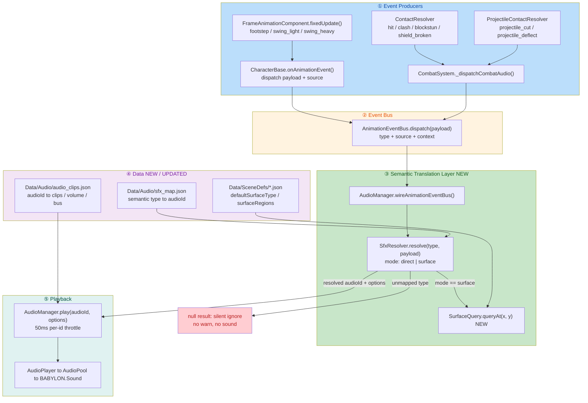
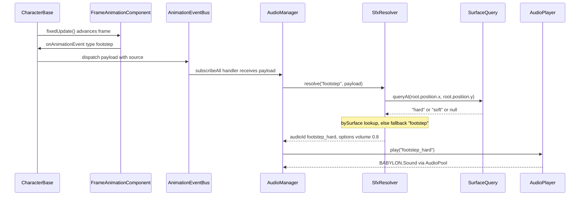
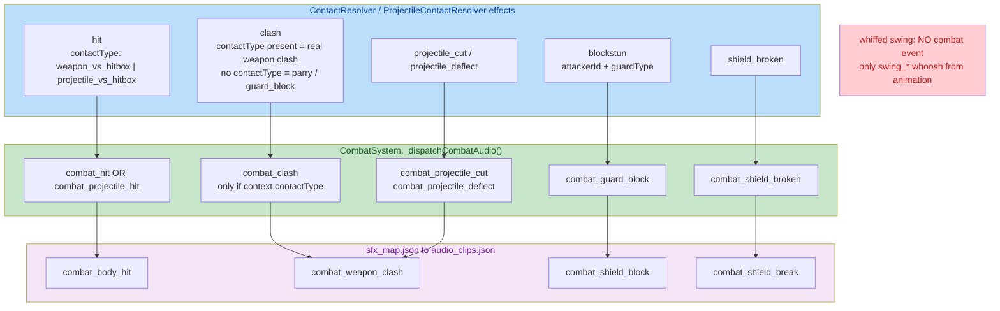
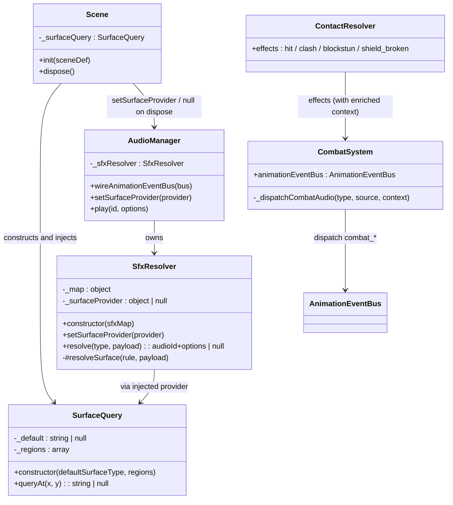

# 🎧 Event-Driven Audio Refactor — Semantic SFX Layer, Surface Footsteps, Combat SFX

## 1. High-Level Summary (TL;DR)

**Impact:** 🔴 **High** — This is a **cross-cutting refactor of the entire audio pipeline**. Previously the animation event `type` string *was* the audio id (`AudioManager.play(payload.type)`); now every sound request must pass through a **table-driven semantic translation layer**. Combat gained its first sound feedback, footsteps became surface-aware, and several **debug flags were left enabled**.

**Key Changes:**

- ✨ **New semantic translation layer** — `scripts/Systems/Audio/SfxResolver.js` maps *semantic event type* → *audio id* via the new table `Data/Audio/sfx_map.json`. Unmapped types are now **silently ignored** (fixes the `unknown clip` warn spam from `throw_draw` / `throw_release`).
- ✨ **Surface-aware footsteps** — new `scripts/Systems/SurfaceQuery.js` + `defaultSurfaceType` / `surfaceRegions` in SceneDefs; footstep audio now depends on where the character lands (`hard` → `footstep_hard`, otherwise soft fallback).
- ✨ **Combat results finally make sound** — `CombatSystem` now dispatches `combat_*` semantic events (`hit` / `clash` / `guard_block` / `shield_broken` / `projectile_*`) derived from real `ContactResolver` outcomes. A **whiffed swing plays nothing**.
- ✨ **Context enrichment** — `ContactResolver` now attaches `attackTrajectory` / `attackWeight` to hits and `attackerId` / `guardType` to blockstuns, enabling future per-weapon / per-guard sound variants.
- ⚠️ **Debug leftovers committed** — `CombatSystem debugTrace: true`, `ThrowComponent.DEBUG_INFINITE_AMMO = true`, and the default start scene switched to `ep1_tavern_room` (which has **no** `defaultSurfaceType`).

---

## 2. Visual Overview (Code & Logic Map)

### 2.1 New Event → Audio Pipeline



### 2.2 Footstep Surface Resolution (Sequence)



> ✅ **Coordinate convention verified:** the game is2.5D on the **XY ground plane** (`root.position.x` = horizontal, `root.position.y` = ground depth; Babylon `z` is derived via `Z_FACTOR` for alpha sorting). `SurfaceQuery` therefore uses the same `(x, y)` / `minX..maxY` rectangle convention as the existing `WalkArea` entity — consistent.

### 2.3 Combat Result → Event Dispatch (`CombatSystem`)



### 2.4 New Module Structure



---

## 3. Detailed Change Analysis

### 3.1 ✨ Component: `SfxResolver` — Semantic Translation Layer (NEW)

**File:** `scripts/Systems/Audio/SfxResolver.js` *(54 lines, new)*

**What Changed:**
- Introduces a **pure, table-driven translation** between *what happened* (event type) and *what it sounds like* (audio id). Gameplay code no longer names an audio asset.
- Two resolution modes:
  - `direct` (default) — `type → audioId` 1:1 mapping.
  - `surface` — resolves the landing **surface type** first, then looks up a `bySurface` table, else uses `fallback`.
- **Unmapped types return `null` → the caller stays silent.** This is the deliberate fix for the `unknown clip` warning noise caused by non-audio events (`throw_draw`, `throw_release`).

```js
resolve(type, payload = {}) {
    const rule = this._map[type];
    if (!rule) return null;                       // ← silent ignore
    if (rule.mode === "surface") return this.#resolveSurface(rule, payload);
    if (typeof rule.audioId !== "string") return null;
    ...
}
```

- Surface lookup reads `payload.source.root.position` — `source` is injected by `CharacterBase.onAnimationEvent` (`dispatch({ ...payload, source: this })`), so **no animation-system change was needed**.
- Defensive coding: `source?.root?.position` and `?? 0` guards mean a non-character source (e.g. an NPC entity without `.root`) degrades to `fallback` instead of throwing.

### 3.2 ✨ Component: `SurfaceQuery` — Ground Material Lookup (NEW)

**File:** `scripts/Systems/SurfaceQuery.js` *(25 lines, new)*

**What Changed:**
- Pure query layer over SceneDef surface data — **no Babylon dependency**, no physics raycasting (deliberate: BlindDuel is 2.5D, so a 2D rectangle lookup suffices).
- Region resolution uses **reverse iteration ("later-defined wins")**, mirroring the existing `walkAreas` evaluation convention in the codebase.

```js
queryAt(x, y) {
    for (let i = this._regions.length - 1; i >= 0; i--) {   // ← later-defined wins
        const r = this._regions[i];
        if (x >= r.minX && x <= r.maxX && y >= r.minY && y <= r.maxY) return r.surfaceType;
    }
    return this._default;
}
```

- ⚠️ **Note:** the constructor filters regions to those with a string `surfaceType`, but does **not** validate that `minX/maxX/minY/maxY` are numbers — a malformed region would compare against `undefined` and silently never match.

### 3.3 🔧 Component: `AudioManager` — Wiring the Resolver

**File:** `scripts/Systems/AudioManager.js`

| Change | Before | After |
|---|---|---|
| Import | — | `import { SfxResolver } from "./Audio/SfxResolver.js"` |
| Constructor | `clips / buses / music` only | `+ const sfxMap = audioAssets.sfxMap ?? {}` → `this._sfxResolver = new SfxResolver(sfxMap)` |
| `wireAnimationEventBus()` | `this.play(payload.type, …)` — **type used as audioId** | `resolve()` → `this.play(resolved.audioId, { source, …resolved.options })` |
| New API | — | `setSurfaceProvider(provider)` → delegates to the resolver |

**Behavioural impact:** any event type **not present in `sfx_map.json` is now silent** — the mapping table is now a **mandatory allow-list**, not an optional override.

**✅ Regression audit (verified against `Data/AnimationEvents/**`):** every animation event type currently emitted is covered.

| Event type emitted in repo | In `sfx_map.json`? | Result |
|---|---|---|
| `footstep` | ✅ (`mode: surface`) | plays `footstep_hard` / `footstep` |
| `swing_light`, `swing_heavy` | ✅ direct | unchanged |
| `on_cloaked`, `off_cloaked`, `on_draw_sheath` | ✅ direct | unchanged |
| `throw_draw`, `throw_release` | ❌ intentionally absent | silent (was the warn-noise bug) |
| `on_land`, `pickup` | n/a — played via `TimelineSequencer.playAudio` → `audioManager.play(id)` directly | **unaffected** |

### 3.4 ✨ Component: `CombatSystem` — Combat Result Events

**File:** `scripts/Systems/CombatSystem.js`

**What Changed:** a new private helper `_dispatchCombatAudio(type, source, context)` dispatches a semantic event onto the shared `AnimationEventBus`, **inside each effect-consumption branch** (one effect → one semantic result → naturally no duplication).

| Effect branch | Dispatched event | Condition / rationale |
|---|---|---|
| `hit` | `combat_hit` | normal weapon hit (`contactType === "weapon_vs_hitbox"`) |
| `hit` | `combat_projectile_hit` | when `contactType === "projectile_vs_hitbox"` |
| `clash` | `combat_clash` | **only if `effect.context.contactType` exists** — parry / guard_block reuse the `clash` effect *without* `contactType`, so they stay silent (prevents double sound with `combat_guard_block`) |
| `blockstun` | `combat_guard_block` | guard block and parry |
| `shield_broken` | `combat_shield_broken` | heavy slash broke the shield |
| `projectile_cut` | `combat_projectile_cut` | informational branch |
| `projectile_deflect` | `combat_projectile_deflect` | deflection branch |

**Wiring:** `CombatSystem` is constructed **before** the bus exists, so `Game.js` back-fills the reference after bus creation:

```js
// scripts/Game.js
this.combatSystem = new CombatSystem({ combatTuning: CombatTuning, debugTrace: true });
...
this.animationEventBus = new AnimationEventBus();
this.combatSystem.animationEventBus = this.animationEventBus;   // ← back-fill
```

> 💡 `CombatSystem` already accepts `options.animationEventBus` — the back-fill could be avoided by moving bus creation earlier or by re-assigning via the constructor. Minor architectural smell, not a bug.

### 3.5 🔧 Component: `ContactResolver` — Richer Effect Context

**File:** `scripts/Systems/ContactResolver.js`

| Effect | Field added | Source | Purpose |
|---|---|---|---|
| `hit` | `attackTrajectory` | `contact.weapon.attackTrajectory` | future light/heavy slash sound variants |
| `hit` | `attackWeight` | `contact.weapon.attackWeight` | future intensity/volume tiers |
| `blockstun` (parry path) | `attackerId`, `guardType` | `offenseCharId`, `defenseBox.guardType` | attacker/defender + guard-vs-shield semantics |
| `blockstun` (guard_block path) | `attackerId`, `guardType` | same | same |

Both `blockstun` pushes were updated — **purely additive, backwards compatible** (existing `knockbackX` untouched).

### 3.6 🔧 Component: `Scene` — Surface Provider Lifecycle

**File:** `scripts/Scene.js`

```js
// init() — after walk areas are applied
this._surfaceQuery = new SurfaceQuery(sceneDef.defaultSurfaceType, sceneDef.surfaceRegions);
this._game.audioManager?.setSurfaceProvider(this._surfaceQuery);

// dispose() — provider cleared BEFORE the audio scene detaches
this._game?.audioManager?.setSurfaceProvider(null);
this._game?.audioManager?.detachScene();
```

- The provider follows the **scene lifecycle** (same pattern as `attachScene` / `detachScene`), so no stale surface data leaks across scene changes.
- ⚠️ **Robustness nit:** the `setSurfaceProvider(null)` call sits **inside** the `if (this.scene) { … }` guard — if `dispose()` runs when `this.scene` is already null, the stale provider is **not** cleared and the previous scene's surface data survives.

### 3.7 ⚠️ Component: Dev-Environment / Debug Leftovers

| File | Change | Assessment |
|---|---|---|
| `scripts/Game.js` | `new CombatSystem({ …, debugTrace: true })` (was `false`) | ⚠️ **Combat debug logging left ON** |
| `scripts/Components/ThrowComponent.js` | `DEBUG_INFINITE_AMMO = false → true` | ⚠️ **Infinite ammo left ON** — the file's own comment says *"正式验收必须为 false"* |
| `scripts/WorldState.js` | `currentSceneId = "prologue" → "ep1_tavern_room"` | ⚠️ **Default start scene switched** — and that scene lacks `defaultSurfaceType` (see below) |
| `Data/TestScripts/manatarms_basic_sequence.json` | Removed `moveIntent` + `smash` steps (kept only `quart` / `reverse_quart`) | ⚠️ **Reduced throw-test coverage** — the regression script no longer exercises movement or smash |
| `scripts/Systems/AI/AIController - 副本.js` | **NEW 2 529-line file** — a stale snapshot copy of the live `AIController.js` (2 918 lines) | ⚠️ **Backup committed into `scripts/`** — verified **not imported anywhere**; high risk of editing the wrong file / silent drift |
| `Art/RawAssets/Env/*.ase`, `*.kra` | Binary edits (Tavern, arrow, floor, treeline_pine) | No code impact |

### 3.8 📋 Data Configuration Changes

#### `Data/Audio/sfx_map.json` *(NEW — the semantic allow-list)*

| Semantic event | Mode | audioId | Volume |
|---|---|---|---|
| `footstep` | `surface` | `hard` → `footstep_hard`; fallback → `footstep` | 0.8 (hard) |
| `swing_light` | direct | `swing_light` | — |
| `swing_heavy` | direct | `swing_heavy` | — |
| `on_cloaked` | direct | `on_cloaked` | — |
| `off_cloaked` | direct | `off_cloaked` | — |
| `on_draw_sheath` | direct | `on_draw_sheath` | — |
| `combat_hit` | direct | `combat_body_hit` | — |
| `combat_clash` | direct | `combat_weapon_clash` | — |
| `combat_guard_block` | direct | `combat_shield_block` | — |
| `combat_shield_broken` | direct | `combat_shield_break` | — |
| `combat_projectile_cut` | direct | `combat_weapon_clash` | — |
| `combat_projectile_deflect` | direct | `combat_weapon_clash` | — |
| `combat_projectile_hit` | direct | `combat_body_hit` | — |

> `throw_draw` / `throw_release` are **intentionally absent** → silent (the warn-noise fix).

#### `Data/Audio/audio_clips.json` *(5 new clip entries — all placeholder)*

| audioId | clips | volume | bus |
|---|---|---|---|
| `footstep_hard` | `./Audio/sfx/47125__gyzhor__lightsaber3.mp3` | 0.8 | sfx |
| `combat_body_hit` | `./Audio/sfx/47125__gyzhor__lightsaber3.mp3` | 0.9 | sfx |
| `combat_weapon_clash` | `./Audio/sfx/47125__gyzhor__lightsaber3.mp3` | 0.9 | sfx |
| `combat_shield_block` | `./Audio/sfx/47125__gyzhor__lightsaber3.mp3` | 0.85 | sfx |
| `combat_shield_break` | `./Audio/sfx/47125__gyzhor__lightsaber3.mp3` | 1.0 | sfx |

> ⚠️ All five new ids point at the **same lightsaber mp3 placeholder**, and unlike the pre-existing entries they have **no `pitch` randomization** → every hit, block and hard footstep sounds literally identical. Replacement is a one-line path swap per id once real assets land.

#### `Data/SceneDefs/*.json` — surface data

| SceneDef | `defaultSurfaceType` | `surfaceRegions` |
|---|---|---|
| `ep1_tavern` | `hard` | — (not authored) |
| `ep1_tavern_hall` | `hard` | — |
| `ep1_tavern_hall_night` | `hard` | — |
| `ep1_tavern_night` | `hard` | — |
| `prologue` | `soft` | — |
| ⚠️ `ep1_tavern_room` | **missing** | — |

> ⚠️ `ep1_tavern_room.json` is **the new default start scene** but has no `defaultSurfaceType` → `queryAt()` returns `null` → footstep silently falls back to the *soft* `footstep` clip, i.e. the tavern room will play the forest-footstep sound.

#### `scripts/AssetManifest.js`

| Key | Value |
|---|---|
| `audio.sfxMap` | `./Data/Audio/sfx_map.json` *(new)* |

Loaded through the generic `loadDataAssets` → `resolveManifestNode`, so `assets.audio.sfxMap` reaches `AudioManager` via `new AudioManager(this.assets.audio ?? {})`.

### 3.9 📚 Documentation & Tooling Changes

| File | Change |
|---|---|
| `plans/archived/26.11.3 声音系统事件驱动改造计划.MD` | **New (158 lines)** — full design doc: background, 7 design decisions, event→sound responsibility table, data structures, Step 1–4 plan, asset requirements, explicit non-goals. Status line records **Steps 1–3 implemented & verified, Step 4 backlog not started** |
| `plans/commits_detailed/26.11.3 声音系统事件驱动改造.MD` | **New (453 lines)** — a full commit write-up of this very change (TL;DR + mermaid diagrams + file-by-file analysis) |
| `plans/HandOff.MD` | ⚠️ **Fully rewritten** (171 → 149 lines) — the previous *"单场景多战斗重构交接"* handoff was replaced by the audio event-driven design; the old content now only exists in git history |
| `plans/INDEX.md` | New Update Log entry (2026-11-03) for the audio refactor. ⚠️ **Duplicate `## Update Log (2026-11-03)` heading** — the new section was inserted directly above the existing one with the same title |
| `PROJECT_CONTEXT.md` | §3 registers `SfxResolver.js` + `SurfaceQuery.js`; audio config line now lists `sfx_map.json`; §9 rewrites the AnimationEvent chain description (action-timing vs. combat-result vs. surface footsteps) |
| `.trae/skills/collider-occupancy-更新-skill/SKILL.md` | **New (131 lines)** — agent skill for regenerating collider / occupancy JSON via two PowerShell scripts (`extract_collision_boxes.ps1`, `extract_rootmotion_occupancy.ps1`) |
| `docs/AudioLicensesInfo.MD` | Added `lightsaber3.mp3` (gyzhor, CC0) and `Footsteps on hollow wood` (florianreichelt, CC0) attributions — ⚠️ still **no trailing newline** |
| `Audio/sfx/_raw/sliceinfo.txt` | Trailing-newline fix only (the new `459970__florianreichelt__footsteps-on-hollow-wood.mp3` was **not** registered here) |

> 💡 The licensed `459970__florianreichelt__footsteps-on-hollow-wood.mp3` exists in `Audio/sfx/_raw/` but is **not referenced** by `audio_clips.json` yet — the intended "hard footstep" material is imported but unsliced/unused.

---

## 4. Impact & Risk Assessment

### 🔴 Breaking / Behavioural Changes

| # | Change | Impact |
|---|---|---|
| B1 | **`sfx_map.json` is now an allow-list** | Any animation/combat event type not in the map is **permanently silent**. Adding a new animation event without a map entry = no sound, no warning. This is a *silent* failure mode — easy to miss in QA. |
| B2 | **`AudioManager.wireAnimationEventBus` no longer accepts raw ids** | Any external code that dispatched a bare audio id through the animation bus now produces no sound. (Verified: no such caller exists in-repo.) |
| B3 | **`WorldState.currentSceneId` → `ep1_tavern_room`** | Changes the default boot scene for all entry points (game boot, tests, cinematics). Combined with B4 this changes footstep audio on startup. |
| B4 | **`ep1_tavern_room` lacks `defaultSurfaceType`** | New default scene resolves to `null` surface → falls back to the *soft* `footstep` clip. Likely wrong for a wooden tavern room. |
| B5 | **`CombatSystem` now dispatches onto the shared `AnimationEventBus`** | `combat_*` events are visible to **every** `subscribeAll` subscriber. Verified: `AudioManager` is currently the only `subscribeAll` consumer (all others use typed `subscribe(type, …)`), so no cross-talk today — but a future typed subscriber for `combat_*` would also fire. |
| B6 | **`ContactResolver` effect context enriched** | Purely additive — existing consumers of `effect.context` are unaffected. ✅ |

### ⚠️ Debug / Environment Risks (must be reverted before merge)

| # | Item | Impact |
|---|---|---|
| D1 | `ThrowComponent.DEBUG_INFINITE_AMMO = true` | **Infinite ammo in the shipped build.** The file's own comment states *"正式验收必须为 false"*. Directly contradicts acceptance criteria. |
| D2 | `CombatSystem({ debugTrace: true })` | Per-tick combat trace logging → console spam + measurable frame cost in duels. |
| D3 | `AIController - 副本.js` committed into `scripts/` | 2 529-line stale duplicate of a 2 918-line live file. Not imported (verified), but it invites editing the wrong file and creates permanent drift/confusion. Should be moved to `plans/` or deleted. |
| D4 | `manatarms_basic_sequence.json` trimmed | The throw test script lost its movement and `smash` steps → weaker regression net for the very throw/projectile paths this change touches. |

### ⚠️ Audio Quality Risks

| # | Item | Impact |
|---|---|---|
| A1 | All 5 new clip ids → **one lightsaber mp3** | Footstep / body hit / weapon clash / shield block / shield break are literally the same sound. |
| A2 | New clip entries lack `pitch` ranges | Existing entries randomize pitch (`[0.92, 1.08]`); new ones don't → no variation, machine-gun effect on repeated hits. |
| A3 | `combat_projectile_cut` and `combat_projectile_deflect` **share the id** `combat_weapon_clash` | `AudioManager.play` throttles **per id** (50 ms). A cut followed by a deflect within 50 ms → the second sound is silently dropped. |
| A4 | Parry and shield-block both map to `combat_shield_block` | `guardType` is now carried in the payload but **not used** by the map — parry, guard and shield all sound identical. |
| A5 | `surfaceRegions` is implemented but **no scene defines any** | The whole region-override code path is currently **untested**; only `defaultSurfaceType` is exercised. |

### 🧪 Testing Suggestions

1. **Footstep by surface**
   - Walk in `prologue` → soft `footstep` (forest-footsteps wav).
   - Walk in `ep1_tavern` / `_hall` / `_night` / `_hall_night` → `footstep_hard`.
   - Walk in `ep1_tavern_room` (new default scene) → **expect hard, verify you actually get soft** (see D4/B4).
2. **Surface region override** — author a temporary `surfaceRegions` rectangle in `ep1_tavern` and verify the boundary switches correctly, including **overlapping regions** (later-defined must win) and positions exactly on the rectangle edge (inclusive `>=` / `<=`).
3. **Combat result sounds (one per outcome, exactly one sound each)**
   - Normal weapon hit → `combat_hit`.
   - Whiffed swing → **no** combat sound (only the `swing_*` whoosh).
   - Weapon-vs-weapon clash → `combat_clash` **once** (not twice).
   - Parry → `combat_guard_block` **once** (verify the reused `clash` effect stays silent — this is the `contactType` gate).
   - Guard block → `combat_guard_block`; heavy slash through shield → `combat_shield_broken`.
   - Projectile: cut → `combat_projectile_cut`; deflect → `combat_projectile_deflect`; projectile hits body → `combat_projectile_hit`.
4. **Throttle interaction** — trigger a projectile cut+deflect within 50 ms and confirm both are audible (see A3).
5. **Warn-noise regression** — trigger `throw_draw` / `throw_release` and confirm the console shows **no** `unknown clip id` warning (the original bug).
6. **Scene lifecycle** — switch scenes rapidly and confirm footstep surface data does not leak from the previous scene (and that `dispose()` with `this.scene === null` does not leave a stale provider, per §3.6).
7. **Debug-flag sweep** — grep for `debugTrace: true`, `DEBUG_INFINITE_AMMO = true` and revert before merge (D1, D2).
8. **Regression sweep** — confirm `on_land` and `pickup` still play (they use `TimelineSequencer.playAudio` → direct `audioManager.play`, bypassing the resolver) and that `throw_draw` / `throw_release` still drive the **gameplay** side of `BattleMode` (typed bus subscription, unaffected by the resolver).

### 🛠️ Recommended Follow-ups (non-blocking)

- 📄 Merge `Data/Audio/sfx_map.json` volume into `audio_clips.json` (or document that `sfx_map` volume **overrides** the clip def volume — `AudioPlayer` prefers `options.volume`, making the clip-def volume dead for mapped entries).
- 🧹 Fix the duplicate `## Update Log (2026-11-03)` heading in `plans/INDEX.md`.
- 🧹 Move `AIController - 副本.js` out of `scripts/` into `plans/archived/` (or delete it).
- 🎵 Slice & wire `459970__florianreichelt__footsteps-on-hollow-wood.mp3` as the real `footstep_hard` source, and register it in `Audio/sfx/_raw/sliceinfo.txt`.
- 🔊 Add `pitch` randomization to the new clip entries.