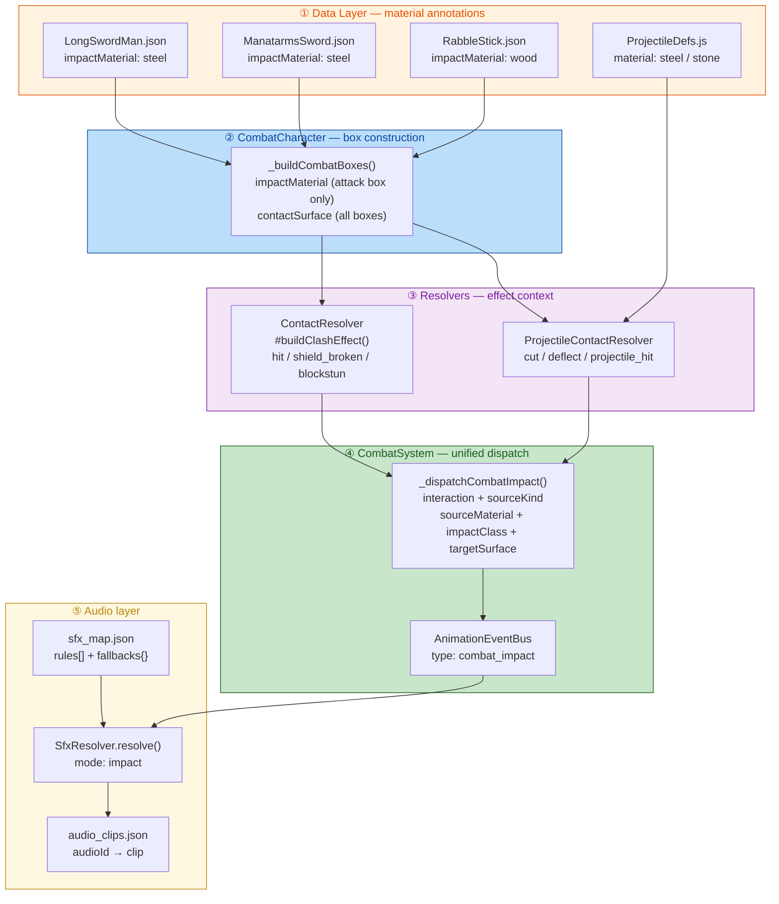
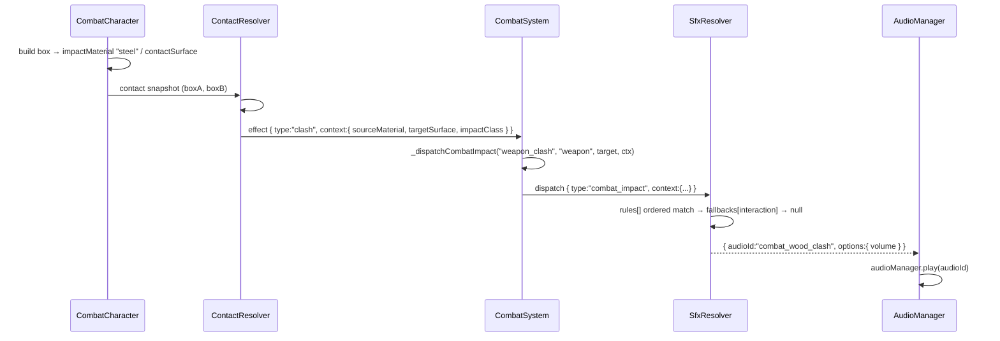
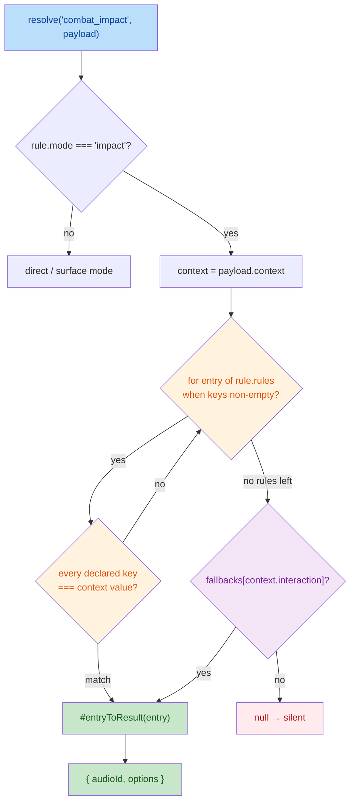

# 1. High-Level Summary (TL;DR)

**Impact: High** — This is an **audio architecture refactor** that collapses7 ad-hoc `combat_*` semantic events into a single structured **`combat_impact` Impact Event**, and reworks the whole combat→audio chain to carry **material / surface / impact-class** metadata. It also silently *repairs* combat SFX that were previously broken (audio IDs mapped but never defined).

**Key Changes:**

- ✨ **Unified Impact Event** — `CombatSystem._dispatchCombatAudio()` → `_dispatchCombatImpact(interaction, sourceKind, source, ctx)`, emitting a single `combat_impact` event with a **5-field structured context** (`interaction` / `sourceKind` / `sourceMaterial` / `impactClass` / `targetSurface`).
- ✨ **New `SfxResolver` mode `"impact"`** — ordered **partial-match rules** (`when` fields compared for equality) → `fallbacks[interaction]` → silent `null`. *New sound combinations now require only a JSON line, zero code.*
- ✨ **Material data annotation** — `impactMaterial` (attack states), `contactSurface` (guard states), `bodySurface` (state-graph root), `material` (`ProjectileDefs.js`); propagated through `CombatCharacter` boxes → resolvers → effect context.
- 🐛 **Fixed silent combat SFX** — all 7 `combat_*` / `footstep_hard` clip definitions were **missing** from `audio_clips.json` (mapped but undefined ⇒ `AudioPlayer` warned and played nothing). They are added here.
- ⚠️ **Debug/dev leftovers enabled** — `CombatSystem.debugTrace: true`, `ThrowComponent.DEBUG_INFINITE_AMMO = true`, and the startup scene changed to `ep1_tavern_room`.
- 🧹 **Repo hygiene** — a stale 2,528-line backup `AIController - 副本.js` was committed; `plans/HandOff.MD` was rewritten and lost its previous content.

---

# 2. Visual Overview (Code & Logic Map)

## 2.1 End-to-end Impact Event pipeline



## 2.2 Runtime sequence — a steel sword clash



## 2.3 SfxResolver `impact` mode decision flow



---

# 3. Detailed Change Analysis

## 3.1 ⚔️ Combat event consolidation — `scripts/Systems/CombatSystem.js`

**What Changed:** The7 separate `combat_*` dispatches (`combat_hit`, `combat_clash`, `combat_guard_block`, `combat_shield_broken`, `combat_projectile_cut`, `combat_projectile_deflect`, `combat_projectile_hit`) are replaced by **one** dispatch type `combat_impact` carrying a structured context. Audio semantics are no longer baked into the event name.

> **Core principle (Source: `plans/26.11.3 声音材质映射细分计划.MD`):** *The collision system decides *what* happened; the audio system decides *what it should sound like*.*

| Old event type | New `interaction` | `sourceKind` | Fallback `audioId` |
|---|---|---|---|
| `combat_hit` | `body_hit` | `weapon` | `combat_body_hit` |
| `combat_clash` | `weapon_clash` | `weapon` | `combat_weapon_clash` |
| `combat_guard_block` | `shield_block` | `weapon` | `combat_shield_block` |
| `combat_shield_broken` | `shield_broken` | `weapon` | `combat_shield_break` |
| `combat_projectile_cut` | `projectile_cut` | `weapon` | `combat_weapon_clash` |
| `combat_projectile_deflect` | `projectile_deflect` | `weapon` | `combat_weapon_clash` |
| `combat_projectile_hit` | `projectile_hit` | `projectile` | `combat_body_hit` |

**Critical snippet** — the new dispatch builder:

```js
_dispatchCombatImpact(interaction, sourceKind, source, effectContext) {
    this.animationEventBus?.dispatch({
        type: "combat_impact",
        source: source ?? null,
        context: {
            interaction,
            sourceKind,
            sourceMaterial: effectContext?.sourceMaterial ?? null,
            impactClass:    effectContext?.attackWeight   ?? null,   // ⚠️ see §4.1
            targetSurface:  effectContext?.targetSurface ?? null
        }
    });
}
```

**De-duplication preserved:** `parry` / `guard_block` still reuse the `clash` effect but **without** `contactType`, so `CombatSystem` skips the clash sound (`if (effect.context?.contactType)`). The defender's `blockstun` effect emits the `shield_block` impact instead — one impact ⇒ one sound.

---

## 3.2 🎯 Resolver context pass-through — `ContactResolver.js` / `ProjectileContactResolver.js`

**What Changed:** Both resolvers now embed material metadata into the **effect context** so the audio layer never has to re-derive physics.

| File | Effect type | Fields added |
|---|---|---|
| `ContactResolver.js` | `hit` | `sourceMaterial` (weapon), `targetSurface` (hitbox surface) |
| `ContactResolver.js` | `shield_broken` | `sourceMaterial`, `targetSurface`, `impactClass` |
| `ContactResolver.js` | `blockstun` (parry) | `sourceMaterial`, `targetSurface`, `impactClass` |
| `ContactResolver.js` | `blockstun` (guard_block) | `sourceMaterial`, `targetSurface`, `impactClass` |
| `ContactResolver.js` | `clash` (`#buildClashEffect`) | `sourceMaterial` (other side), `targetSurface` (own side), `impactClass` |
| `ProjectileContactResolver.js` | `projectile_cut` | `sourceMaterial` (projectile), `targetSurface` (cutter's weapon) |
| `ProjectileContactResolver.js` | `projectile_deflect` | `sourceMaterial`, `targetSurface` |
| `ProjectileContactResolver.js` | `hit` (`projectile_vs_hitbox`) | `sourceMaterial` (projectile), `targetSurface` (hitbox) |

**`#buildClashEffect()` signature extended** to accept the two participating boxes:

```js
#buildClashEffect(targetId, otherId, contactType, targetPos, otherPos, targetBox = null, otherBox = null) {
    // ...
    sourceMaterial: otherBox?.impactMaterial ?? null,                    // the other party's weapon
    targetSurface:  targetBox?.impactMaterial ?? targetBox?.contactSurface ?? null, // this party's weapon
    impactClass:    targetBox?.attackWeight ?? null,
}
```

Because clashes are emitted **twice** (once per combatant, each from its own perspective), `sourceMaterial` and `targetSurface` are *swapped* between the two effects — which is exactly what allows the two demo rules (`sourceMaterial: wood` / `targetSurface: wood`) to both resolve.

---

## 3.3 🧱 Box-level material parsing — `scripts/Enties/CombatCharacter.js`

**What Changed:** Two new fields are stamped onto every combat box, alongside the existing `attackWeight` / `attackTrajectory`:

```js
// attack box only — the material this move's active frame strikes with
impactMaterial: boxRole === "attack" ? (this.currentStateDef?.impactMaterial ?? null) : null,
// every box — the surface this character currently presents
contactSurface: this.currentStateDef?.contactSurface ?? this.stateGraph?.bodySurface ?? null,
```

`contactSurface` resolution order = **guard-state override → state-graph `bodySurface` → `null`**.

---

## 3.4 📘 Material data ownership (Step 1 — data layer)

| Field | Owner | Values in this diff | Semantics |
|---|---|---|---|
| `impactMaterial` | State-graph **attack states** | `steel` / `wood` | Material the *attacker* strikes with on the active frame |
| `contactSurface` | State-graph **guard/shield states** (override) | `steel` / `wood` | Surface the defender presents while in that stance |
| `bodySurface` | State-graph **root** (fallback) | `flesh` | Default contact surface of the character |
| `material` | `Data/ProjectileDefs.js` | `steel` / `stone` | Material of the thrown projectile |

| State-graph file | `bodySurface` | Attack states annotated | Guard `contactSurface` |
|---|---|---|---|
| `LongSwordMan.json` | `flesh` | 6 states → `steel` | `steel` |
| `ManatarmsSword.json` | `flesh` | 3 states → `steel` | — (no guard state) |
| `RabbleStick.json` | `flesh` | 3 states → `wood` | `wood` |

| Projectile | `material` |
|---|---|
| `dagger` | `steel` |
| `spear` | `steel` |
| `rock` | `stone` |

---

## 3.5 🔊 Audio resolution — `scripts/Systems/Audio/SfxResolver.js` + `Data/Audio/sfx_map.json`

**What Changed:** A third resolution mode `"impact"` was added alongside `"direct"` and `"surface"`.

- **Rule matching is *partial*:** only the keys declared in `when` participate; a `context` field that the rule does not declare is ignored. This deliberately avoids a multi-dimensional full cross-product (5 interactions × 3 materials × 2 classes × 3 surfaces ⇒ 90 combinations).
- **Empty `when` is skipped** as a configuration error (`keys.length === 0 → continue`).
- **Fallback chain:** `rules[]` → `fallbacks[interaction]` → `null` (silent).

`Data/Audio/sfx_map.json` — 7 flat entries replaced by 1 rule set:

| `when` (all declared keys must equal the context) | `audioId` |
|---|---|
| `interaction: body_hit` + `sourceMaterial: stone` | `combat_stone_hit` |
| `interaction: weapon_clash` + `sourceMaterial: wood` | `combat_wood_clash` |
| `interaction: weapon_clash` + `targetSurface: wood` | `combat_wood_clash` |

| `fallbacks[interaction]` | `audioId` |
|---|---|
| `body_hit` | `combat_body_hit` |
| `weapon_clash` | `combat_weapon_clash` |
| `shield_block` | `combat_shield_block` |
| `shield_broken` | `combat_shield_break` |
| `projectile_cut` | `combat_weapon_clash` |
| `projectile_deflect` | `combat_weapon_clash` |
| `projectile_hit` | `combat_body_hit` |

---

## 3.6 🎵 Clip definitions — `Data/Audio/audio_clips.json` (+7)

**What Changed:** 7 new clip definitions were added. **Critically, all four pre-existing `combat_*` IDs referenced by the old `sfx_map` were missing from this file** — `AudioPlayer.play()` logs `unknown clip id` and returns `false`, so **combat SFX were entirely silent before this diff**. The same applies to `footstep_hard` (mapped by `footstep.bySurface.hard`).

| New `audioId` | Volume | Bus | Clip (all identical placeholder) |
|---|---|---|---|
| `footstep_hard` | 0.8 | `sfx` | `47125__gyzhor__lightsaber3.mp3` |
| `combat_body_hit` | 0.9 | `sfx` | `47125__gyzhor__lightsaber3.mp3` |
| `combat_stone_hit` | 0.85 | `sfx` | `47125__gyzhor__lightsaber3.mp3` |
| `combat_wood_clash` | 0.8 | `sfx` | `47125__gyzhor__lightsaber3.mp3` |
| `combat_weapon_clash` | 0.9 | `sfx` | `47125__gyzhor__lightsaber3.mp3` |
| `combat_shield_block` | 0.85 | `sfx` | `47125__gyzhor__lightsaber3.mp3` |
| `combat_shield_break` | 1.0 | `sfx` | `47125__gyzhor__lightsaber3.mp3` |

> All 7 point at the same **lightsaber** placeholder — by design (per the plan) until real source material lands, but it means the 3 new *rules* are **not audibly distinguishable** today.

---

## 3.7 👣 Footstep surface types — `Data/SceneDefs/*.json`

**What Changed:** `defaultSurfaceType` added to 5 scene defs; consumed by `Scene.js` → `new SurfaceQuery(sceneDef.defaultSurfaceType, …)` → `AudioManager.setSurfaceProvider()` → `SfxResolver` `mode: "surface"`.

| Scene def | `defaultSurfaceType` | Resolved footstep |
|---|---|---|
| `prologue.json` | `soft` | `footstep` (fallback) |
| `ep1_tavern.json` | `hard` | `footstep_hard` |
| `ep1_tavern_hall.json` | `hard` | `footstep_hard` |
| `ep1_tavern_night.json` | `hard` | `footstep_hard` |
| `ep1_tavern_hall_night.json` | `hard` | `footstep_hard` |
| ⚠️ `ep1_tavern_room.json` | **not set** (file not in this diff) | `footstep` (soft) — inconsistent with its siblings |

---

## 3.8 🔧 Debug / dev switches (⚠️ shipping risk)

| File | Switch | Old | New | Impact |
|---|---|---|---|---|
| `scripts/Game.js` | `CombatSystem({ debugTrace })` | `false` | **`true`** | Verbose resolver tracing on every combat tick |
| `scripts/Components/ThrowComponent.js` | `DEBUG_INFINITE_AMMO` | `false` | **`true`** | Unlimited ammo — comment explicitly says *"正式验收必须为 false"* |
| `scripts/WorldState.js` | `currentSceneId` | `"prologue"` | **`"ep1_tavern_room"`** | Boot scene changed (and that scene lacks `defaultSurfaceType`) |

---

## 3.9 📄 Documentation, plans & tooling

| File | Change |
|---|---|
| `plans/26.11.3 声音材质映射细分计划.MD` | **New** — full design spec: 5 dimensions, context schema, rule-set format, Step 1–3 checklist, Step 4 backlog, "explicitly not doing" list |
| `plans/HandOff.MD` | **Rewritten** — the previous *single-scene multi-battle refactor* handoff was **replaced** by GPT audio-architecture advice; markdown tables were flattened into plain lines |
| `plans/INDEX.md` | New `Update Log (2026-11-03)` entry registering the audio-material work |
| `PROJECT_CONTEXT.md` | §9.2 audio section rewritten to document the new `combat_impact` chain, `mode: impact`, and material ownership |
| `.trae/skills/collider-occupancy-更新-skill/SKILL.md` | **New** agent skill — two extraction routes (`extract_collision_boxes.ps1` for combatants, `extract_rootmotion_occupancy.ps1` for NPCs) + mask colour conventions |
| `Data/TestScripts/manatarms_basic_sequence.json` | Test sequence trimmed to a single `reverse_quart` step (valid JSON) |
| `Audio/sfx/_raw/sliceinfo.txt` | Trailing newline added (cosmetic) |
| `Art/RawAssets/Env/{Tavern.ase, arrow.ase, floor.kra, treeline_pine.kra}` | Binary re-saves of raw art sources — no code impact |

---

# 4. Impact & Risk Assessment

## 4.1 🐛 `impactClass` is effectively always `null` (except `body_hit`)

**Severity: Medium-High** — blocks the documented Step 4 backlog item *"impactClass rules (light/heavy clash differentiation)"*.

The dispatch builder reads **`effectContext?.attackWeight`**:

```js
impactClass: effectContext?.attackWeight ?? null,
```

but the resolvers write the value under the key **`impactClass`**:

| Effect | Key present in effect context | Resulting `impactClass` |
|---|---|---|
| `hit` (melee) | `attackWeight` ✅ | `light` / `heavy` ✔ |
| `clash` | `impactClass` only | `null` ✘ |
| `blockstun` → `shield_block` | `impactClass` only | `null` ✘ |
| `shield_broken` | `impactClass` only | `null` ✘ |
| `hit` (projectile) | *(neither)* | `null` ✘ |
| `projectile_cut` / `projectile_deflect` | *(neither)* | `null` ✘ |

**Fix:** either read `effectContext?.impactClass ?? effectContext?.attackWeight ?? null`, or standardise the resolvers on the key `impactClass`.

## 4.2 🐛 `projectile_cut` / `projectile_deflect` invert the documented field semantics

**Severity: Medium** — will bite whoever writes Step 4 rules.

The plan documents `sourceMaterial` = *"melee → attacker's `impactMaterial`; projectile → `ProjectileDefs.material`"*, i.e. **the material of the thing that caused the impact**. But for a *cut*, the cutter is the cause and the projectile is the victim, yet the implementation stores:

```js
sourceMaterial: getProjectileDef(proj.projectileType)?.material ?? null, // ← projectile materialtargetSurface:  box.impactMaterial ?? box.contactSurface ?? null,          // ← cutter's weapon material
```

…while `sourceKind` is hard-coded to `"weapon"`. So for `projectile_cut` the fields are swapped relative to the contract (source=weapon **kind** but source=**projectile** material). Either the schema should be documented as "source/target are relative to the *impact*, not the *cause*", or the cut/deflect branch should be inverted.

## 4.3 ⚠️ The plan's own verification snippet cannot work as written

**Severity: Low-Medium** — blocks the documented console-assertion acceptance check.

`plans/26.11.3 …MD` §4.3 tells the reviewer to run `r.resolveImpact({ interaction: "body_hit", sourceMaterial: "stone" })`, but:

- `#resolveImpact` is a **private** class method → `r.resolveImpact(...)` throws `TypeError`.
- Its real signature is `#resolveImpact(rule, context)`, and it returns `{ audioId, options } | null`, **not** an `audioId` string.

**Suggested fix:** expose a thin public test hook, e.g. `resolveImpactContext(context)` → `audioId`, so the documented assertions can actually be executed.

## 4.4 ⚠️ Missing `defaultSurfaceType` on the new boot scene

`WorldState.currentSceneId` now points at `ep1_tavern_room`, but `Data/SceneDefs/ep1_tavern_room.json` was **not** touched by this diff and has no `defaultSurfaceType`. Footsteps there resolve to the soft `footstep` while every sibling tavern scene resolves to `footstep_hard`. Add `"defaultSurfaceType": "hard"` for consistency.

## 4.5 ⚠️ Debug flags must be reverted before merge

`debugTrace: true`, `DEBUG_INFINITE_AMMO = true`, and the scene-id change look like local debugging leftovers. The `ThrowComponent` comment explicitly states *"正式验收必须为 false"*.

## 4.6 🧹 Stray backup file committed

`scripts/Systems/AI/AIController - 副本.js` — a **2,528-line** stale snapshot of `AIController.js` (current file: 2,918 lines), so it is **not** a byte-identical backup. It is dead code with a non-ASCII filename and should be deleted (and `*副本*.js` added to `.gitignore`).

## 4.7 ⚠️ Two sounds per clash — now potentially *different* sounds

Clashes emit **two** effects (one per combatant). Previously both resolved to the same `combat_weapon_clash`; with the new rules a steel-vs-wood clash resolves `combat_wood_clash` for *both* sides (via `sourceMaterial: wood` on one side and `targetSurface: wood` on the other) — consistent, but it doubles the playback rate. If this causes audible doubling, consider de-duplicating clash impacts by contact key.

## 4.8 🔁 Documentation regression in `plans/HandOff.MD`

The file was overwritten with new content **and** its markdown tables were flattened into plain lines (`维度	示例	数据来源`), so it renders poorly. The previous *single-scene multi-battle refactor* handoff was lost — consider keeping it under `plans/archived/`.

---

## 4.9 ✅ Breaking changes

| Change | Type | Impact |
|---|---|---|
| 7 `combat_*` event types removed from `sfx_map.json` | **Event API break** | Any external consumer listening for `combat_hit` / `combat_clash` / … now receives nothing. Only `SfxResolver` is affected today, but `AnimationEventBus` subscribers outside the audio layer would break. |
| `combat_impact` event type introduced | New API | `context` is now a flat structured object — `payload.context` shape changed for combat events. |
| `SfxResolver` gains `mode: "impact"` | Additive | `"direct"` / `"surface"` modes untouched — no break. |
| `SfxResolver.resolve()` public contract | **Unchanged** | Still returns `{ audioId, options } \| null`. |
| `ProjectileDefs` / state-graph JSON | **Additive only** | New optional fields; no existing key changed or removed. |

No database schema changes. No public HTTP/API changes.

## 4.10 🧪 Testing suggestions

**Functional (impact pipeline)**
1. **Steel sword → body**: expect `interaction: body_hit`, `sourceKind: weapon`, `sourceMaterial: "steel"`, `targetSurface: "flesh"` ⇒ fallback `combat_body_hit`.
2. **Wood stick → body**: `sourceMaterial: "wood"` ⇒ falls through to fallback (no wood-body rule yet) — confirm it is *not* `combat_stone_hit`.
3. **Wood stick → steel sword clash**: expect `combat_wood_clash` on **both** participants (one via `sourceMaterial: wood`, the other via `targetSurface: wood`) — verify no double-loudness.
4. **Steel vs steel clash**: expect `combat_weapon_clash` fallback; confirm `impactClass` — expect `null` (§4.1 bug) and file/track the fix.
5. **Rock throw → body**: expect `projectile_hit` + `sourceMaterial: "stone"` ⇒ rule match `combat_stone_hit`.
6. **Dagger throw → cut by sword**: expect `projectile_cut`; note `sourceMaterial` = `"steel"` (dagger) and `targetSurface` = `"steel"` (sword) — confirm the inversion in §4.2.
7. **Parry**: expect **exactly one** impact (`shield_block`), no `weapon_clash`.
8. **Whiffed attack**: expect **no** `combat_impact` event at all.
9. **Heavy slash vs shield**: expect `shield_broken`; confirm `impactClass` is `null` (bug) and that `targetSurface` is the shield's `contactSurface`.

**Data / config**
10. `Ctrl+Shift+R` hard reload → **no console errors**, `sfx_map.json` returns 200.
11. Confirm **no** `unknown clip id` warnings in the console (this is the regression test for the previously-missing clip definitions).
12. Parse-validate all edited JSON:5 scene defs, 3 state-graph defs, `sfx_map.json`, `audio_clips.json`, `manatarms_basic_sequence.json`.
13. Footsteps: walk in `ep1_tavern` (expect `footstep_hard`) vs `prologue` (expect `footstep`), and confirm the **gap** in `ep1_tavern_room` (§4.4).
14. Exercise the plan's §4.3 console assertions **after** adding a public `resolveImpact` hook — verify rule hit, fallback, and `null` (silent) for an unknown `interaction`.

**Pre-merge hygiene**
15. Revert `debugTrace → false`, `DEBUG_INFINITE_AMMO → false`, and decide whether `currentSceneId` should stay `ep1_tavern_room`.
16. Delete `scripts/Systems/AI/AIController - 副本.js`.
17. Run the full regression: prologue battle, tavern battles, projectile throw/cut/deflect, parry, guard-block, shield-break.

---

## 4.11 📋 Full file inventory (32 changed files)

| Group | Files |
|---|---|
| **Core audio pipeline** (7) | `scripts/Systems/CombatSystem.js`, `scripts/Systems/Audio/SfxResolver.js`, `scripts/Systems/ContactResolver.js`, `scripts/Systems/ProjectileContactResolver.js`, `scripts/Enties/CombatCharacter.js`, `Data/Audio/sfx_map.json`, `Data/Audio/audio_clips.json` |
| **Data — materials** (4) | `Data/ProjectileDefs.js`, `Data/StateGraphDef/{LongSwordMan, ManatarmsSword, RabbleStick}.json` |
| **Data — scenes** (5) | `Data/SceneDefs/{prologue, ep1_tavern, ep1_tavern_hall, ep1_tavern_night, ep1_tavern_hall_night}.json` |
| **Debug switches** (3) | `scripts/Game.js`, `scripts/Components/ThrowComponent.js`, `scripts/WorldState.js` |
| **Docs / plans** (6) | `plans/26.11.3 声音材质映射细分计划.MD` *(new)*, `plans/HandOff.MD`, `plans/INDEX.md`, `PROJECT_CONTEXT.md`, `.trae/skills/collider-occupancy-更新-skill/SKILL.md` *(new)*, `Data/TestScripts/manatarms_basic_sequence.json` |
| **Binary / asset** (7) | `Art/RawAssets/Env/{Tavern.ase, arrow.ase, floor.kra, treeline_pine.kra}`, `Audio/sfx/_raw/sliceinfo.txt`, `scripts/Systems/AI/AIController - 副本.js` *(new, stale backup)* |