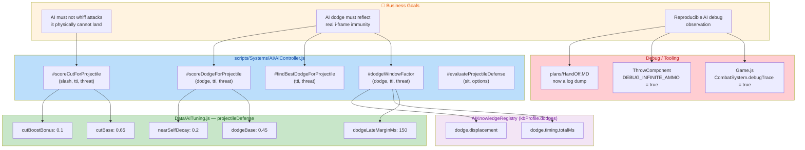
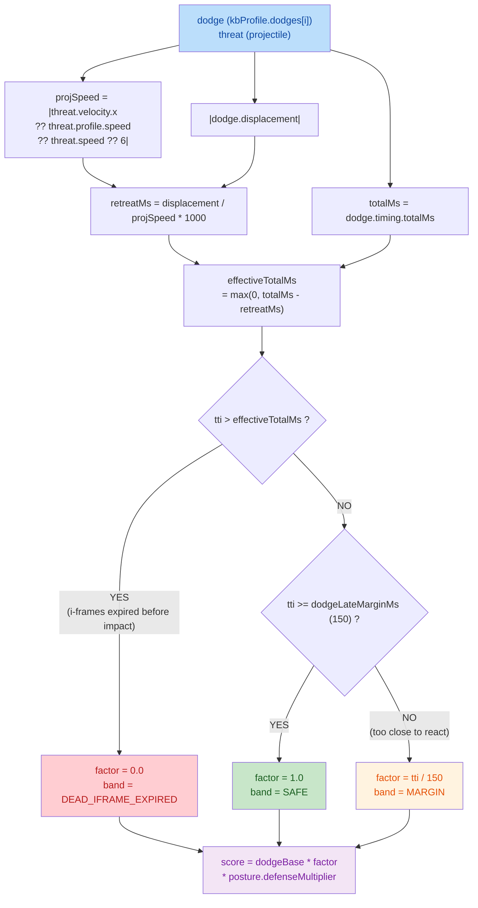
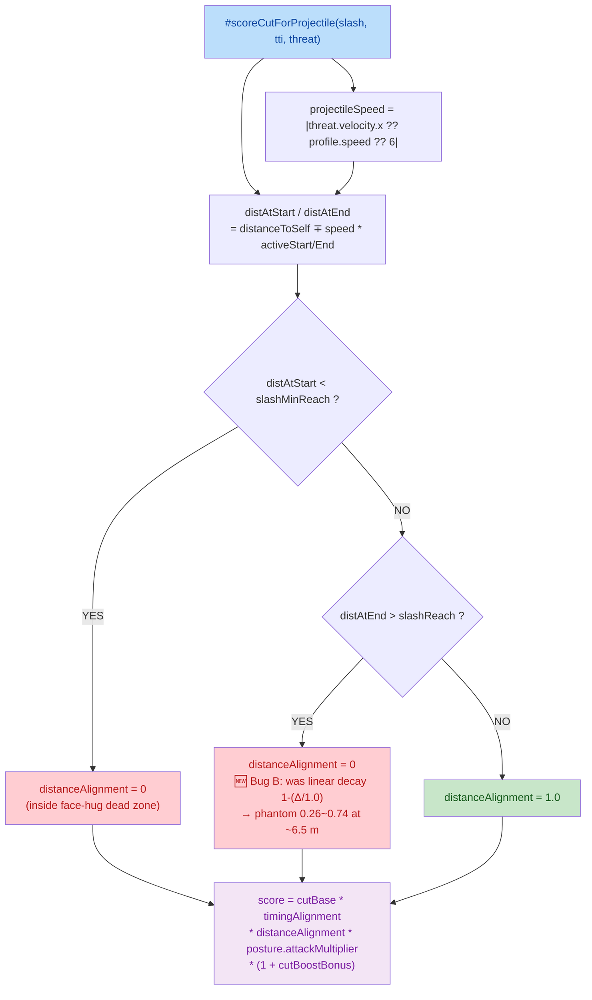
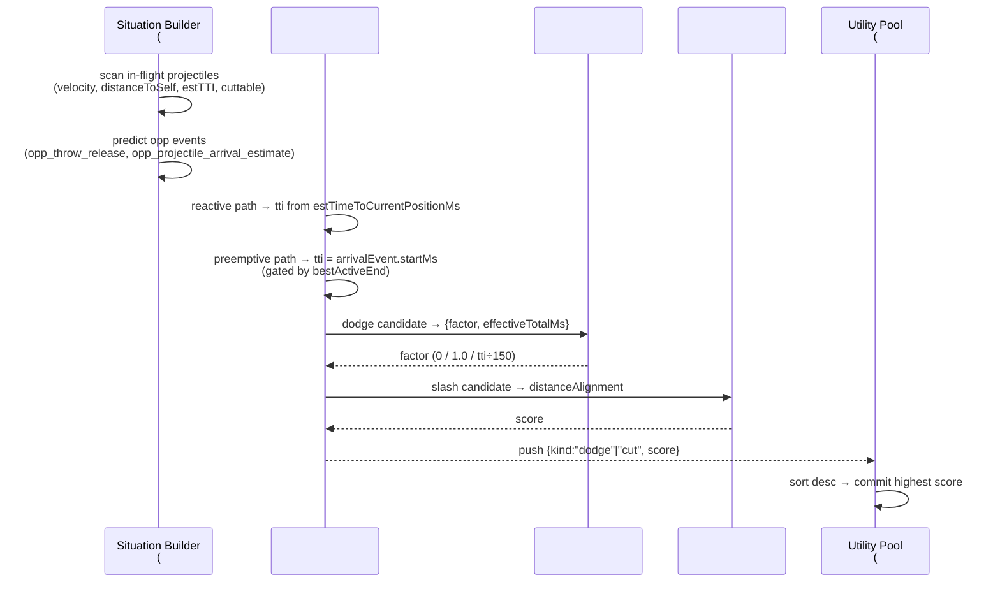

## 1. High-Level Summary (TL;DR)

* **Impact:** **Medium** — The core change is a **correctness fix to the AI's projectile-defense scoring** (`AIController.js` + `AITuning.js`). Two AI bugs ("Bug A" dodge i-frame semantics, "Bug B" cut out-of-range phantom score) are fixed. However, the same changeset also flips **two production debug flags on**, switches the **default boot scene**, **overwrites a design document with a raw console-log dump**, and **commits a stale 2,529-line backup copy of `AIController.js`** into the source tree.
* **Key Changes:**
  * ✨ **Bug A fix** — Dodge survival is now modelled as an **i-frame window** (`tti ≤ totalMs − retreatMs`) instead of the old positional-dodge "perfect window" heuristic. New shared helper `#dodgeWindowFactor()` replaces duplicated logic in `#findBestDodgeForProjectile()` / `#scoreDodgeForProjectile()`.
  * ✨ **Bug B fix** — `distanceAlignment` for projectile **cut** scoring is now hard `0` when the projectile never enters weaponbox reach (previously a linear decay that gave phantom `0.26–0.74` scores, making the AI swing-and-whiff at ~6.5 m).
  * 🔧 **Tuning API change** — `dodgeTimeWindowPeak`, `dodgeTooLateRatio`, `dodgeTooEarlySpan` **removed**; `dodgeLateMarginMs: 150` **added** in `Data/AITuning.js`.
  * ⚠️ **Debug flags left ON** — `CombatSystem.debugTrace: false → true` (`scripts/Game.js`) and `ThrowComponent.DEBUG_INFINITE_AMMO: false → true` (unlimited ammo; the code comment itself says *"正式验收必须为 false"*).
  * 🗑️ **Repo hygiene regressions** — `plans/HandOff.MD` (171-line design doc) replaced by a **576-line console-log dump**; new file `scripts/Systems/AI/AIController - 副本.js` is a **stale backup** of the AI controller.

---

## 2. Visual Overview (Code & Logic Map)

### 2.1 Business Goal → Module → Key Methods



### 2.2 Bug A — New Dodge i-frame Window Model



### 2.3 Bug B — Cut Scoring Range Alignment



### 2.4 Runtime Sequence — Reactive vs Preemptive Projectile Defense



---

## 3. Detailed Change Analysis

### 3.1 🐛 `scripts/Systems/AI/AIController.js` — Bug A: Dodge i-frame Semantics

**What Changed:** The dodge-vs-projectile scoring was rebuilt around the **correct physical model**: a dodge is not a *positional* evade (there is no "perfect timing window" to hit), it is a **timed immunity window** (`dodgeActive` i-frames covering `[0, totalMs]`).

* **New private method** `#dodgeWindowFactor(dodge, tti, threat)` returns `{ factor, effectiveTotalMs }`:
  * `projSpeed` = `|threat.velocity?.x ?? threat.profile?.speed ?? threat.speed ?? 6|` — `6` matches `ProjectileDefs.dagger.speed`, so units stay consistent (world units/s).
  * `retreatMs` = `|dodge.displacement| / projSpeed * 1000` — **this is the first time `dodge.displacement` is consumed**; previously the KB scan computed it and it was discarded. It models the back-step delay that pushes the real impact later.
  * `effectiveTotalMs` = `max(0, totalMs − retreatMs)` → the i-frame window ends earlier when the AI retreats.
  * `factor`: `0` if `tti > effectiveTotalMs` (i-frames expired → dead), `1.0` if `tti ≥ dodgeLateMarginMs`, else `tti / dodgeLateMarginMs` (a "commit execution latency" insurance ramp for extremely close projectiles).
* **De-duplication:** `#findBestDodgeForProjectile()` and `#scoreDodgeForProjectile()` previously each contained an *identical copy* of the window formula. Both now delegate to the shared helper → single source of truth.
* **Diagnostics rewritten:**
  * Bands `TOO_LATE / PERFECT / EARLY_DECAY / WAY_TOO_EARLY` → `DEAD_IFRAME_EXPIRED / SAFE / MARGIN`.
  * Log now prints `iframesEnd@`, `totalMs`, `retreatMs`, and drops the obsolete `surplus`/`actEnds@` fields.

```js
// scripts/Systems/AI/AIController.js (#dodgeWindowFactor)
const projSpeed = Math.abs(threat.velocity?.x ?? threat.profile?.speed ?? threat.speed ?? 6);
const retreatMs  = Math.abs(dodge.displacement ?? 0) / projSpeed * 1000;
const effectiveTotalMs = Math.max(0, totalMs - retreatMs);

if (tti > effectiveTotalMs)      factor = 0;                 // 闪完了才到 → 必死
else if (tti >= tun.dodgeLateMarginMs) factor = 1.0;          // 到达落在免疫窗内 → 存活
else                             factor = tti / tun.dodgeLateMarginMs; // 极近：commit 执行延迟保险
```

### 3.2 🐛 `scripts/Systems/AI/AIController.js` — Bug B: Cut Out-of-Range Phantom Score

**What Changed:** In `#scoreCutForProjectile()`, the `distanceAlignment` branch for "projectile never enters weaponbox reach" previously used a **linear decay**:

```js
// ❌ OLD — gave phantom scores, AI swung at 6.5 m and whiffed
distanceAlignment = Math.max(0, 1 - (distAtEnd - slashReach) / 1.0);
// ✅ NEW — physically impossible to hit → hard zero
distanceAlignment = 0;
```

* **Why it mattered:** at ~6.5 m the decay still yielded `0.26 ~ 0.74`, multiplied by `cutBase (0.65)` and `cutBoostBonus`, which was enough to out-rank `approach` in the Utility pool → the AI committed to a slash it could not possibly connect with (visible in `plans/HandOff.MD` logs: `best=attack:swing(0.304)` at `dist=7.09`).
* **Consistency:** the neighbouring "face-hug dead zone" branch already used a hard `0`; this change makes the two out-of-range branches symmetric.

### 3.3 ⚙️ `Data/AITuning.js` — `projectileDefense` Knob Changes

| Knob | Old Value | New Value | Status | Description |
|---|---|---|---|---|
| `dodgeTimeWindowPeak` | `300` (ms) | — | 🗑️ **Removed** | Positional-dodge "perfect window" width — no longer meaningful under i-frame semantics |
| `dodgeTooLateRatio` | `0.5` | — | 🗑️ **Removed** | Positional-dodge late-decay coefficient |
| `dodgeTooEarlySpan` | `700` (ms) | — | 🗑️ **Removed** | Positional-dodge early-decay span |
| `dodgeLateMarginMs` | — | `150` (ms) | ✨ **Added** | `tti` below this → AI cannot commit a dodge in time → factor ramps linearly to 0 |
| `dodgeBase` | `0.45` | `0.45` | ➖ Unchanged | Dodge base utility score |
| `cutBase` | `0.65` | `0.65` | ➖ Unchanged | Cut base utility score |
| `cutTooSlowSpan` | `500` | `500` | ➖ Unchanged | Cut slow-decay span |
| `nearSelfDecay` | `0.2` | `0.2` | ➖ Unchanged | Penalty when projectile already overlaps self |
| `cutBoostBonus` | `0.1` | `0.1` | ➖ Unchanged | Cut reward bonus over dodge |

> **Note:** the removed knobs are still referenced by `plans/INDEX.md` and `plans/BACKLOG.md` as open backlog items — those docs are now **stale**.

### 3.4 🎛️ Debug Flags Flipped On (⚠️ Ship Risk)

| File | Symbol | Old | New | Comment in Code | Risk |
|---|---|---|---|---|---|
| `scripts/Game.js` | `CombatSystem({ debugTrace })` | `false` | **`true`** | — | ⚠️ Verbose combat/projectile traces in every build |
| `scripts/Components/ThrowComponent.js` | `ThrowComponent.DEBUG_INFINITE_AMMO` | `false` | **`true`** | *"仅用于调试 AI 投掷行为；**正式验收必须为 false**"* | 🔴 **Ammo economy bypassed** — `canThrow()` always true, `consumeAmmo()` never decrements |

> Both flags are explicitly documented as debug-only and must be reverted before acceptance.

### 3.5 🌐 `scripts/WorldState.js` — Default Boot Scene

| Field | Old Value | New Value | Note |
|---|---|---|---|
| `this.currentSceneId` | `"prologue"` | `"ep1_tavern_night"` | ✅ Valid scene id (`Data/SceneDefs/ep1_tavern_night.json`); dev convenience to jump straight to the tavern duel |

### 3.6 🧪 `Data/TestScripts/manatarms_basic_sequence.json` — Test Script Trimmed

| Step | Action | Status |
|---|---|---|
| 1 | `command: "quart"` (1800 ms) | ➖ Kept |
| 2 | `command: "reverse_quart"` (1800 ms) | ➖ Kept |
| 3 | `moveIntent: {x: 1, y: 0}` (1300 ms) | 🗑️ **Removed** — no longer walks right |
| 4 | `command: "smash"` (1800 ms) | 🗑️ **Removed** |
| 5 | `moveIntent: {x: 0, y: 0}` (1500 ms) | 🗑️ **Removed** — stop-move no longer needed |

The script is now a pure **`loop: true`** attack cycle (`quart` → `reverse_quart`), which better isolates attack animation/collider behaviour from locomotion.

### 3.7 📚 `.trae/skills/collider-occupancy-更新-skill/SKILL.md` — New Skill Doc (✨)

New 131-line agent skill with **YAML front-matter trigger keywords** and **two documented routes**:

| Route | Script | Applicable Characters | Output |
|---|---|---|---|
| **A — Collider** | `scripts/tools/extract_collision_boxes.ps1` | Combat chars: `longswordman`, `rabble_stick` | `*.collider.json` |
| **B — Occupancy** | `scripts/tools/extract_rootmotion_occupancy.ps1` | NPCs: `traveller`, `merchant`, `merchant2` | `*.occupancy.json` |

Includes: per-action PowerShell command templates, a **batch loop** example, directory conventions, a **color convention table** (hitbox `#FFFF00`, strong blade `#E37800`, weak blade `#FF0000`, root anchor `#7082C1`), and a 5-item FAQ (ExecutionPolicy bypass, same-frame connected-component merging, 6-pixel minimum, root fallback, deprecated script path).

### 3.8 🗑️ `plans/HandOff.MD` — **Design Doc Destroyed by Log Dump**

| Aspect | Before | After |
|---|---|---|
| Content | 171-line design document: *"单场景多战斗重构交接"* (single-scene / multi-battle refactor handoff) — conclusions, gap analysis, `BattleSession` design, data draft, 8-step implementation order, acceptance checklist | 576 lines of **raw `[AI-Diag]` / `[Phase0]` / `[ProjectileResolver]` console output** |
| Value | Planning document for the multi-battle architecture | Unreviewable log spam |

The committed log actually documents the **bug symptoms** the fixes address — e.g. `projDodge: ... band=DEAD_IFRAME_EXPIRED`, `projCut[reactive]: ... distAlign=0.49 score=0.304` at `dist=6.96`, and `preemptive_gate: ... distErr≈3.32m (scoreCut 未扣 releaseRemaining 飞行距离 → alignment 虚高)` — so it is useful as *evidence*, but it **must not replace the design doc**.

### 3.9 🗃️ `scripts/Systems/AI/AIController - 副本.js` — Stale Backup Committed (🆕)

* **2,529-line copy** of `AIController.js` added as a **new source file** (Chinese filename "副本" = "copy").
* Verified it is **older than the current file**, not a snapshot of it:
  * Still contains the **pre-Bug-A** logic (`dodgeTimeWindowPeak` / `dodgeTooLateRatio` / `dodgeTooEarlySpan`) — 6 occurrences.
  * Still contains the **pre-Bug-B** linear decay, but in an even older form: `distanceAlignment = Math.max(0, 1 - (criticalDist - slashReach) / 1.0)` (uses `criticalDist`, not `distAtEnd`).
  * **Missing** recent features present in the live controller: `commitArbitration`, `posPlanBonus`, `positioningPlan`, `distAtEnd`/`distAtStart` band model, `projDodge` diagnostics.
* It is the **only remaining runtime reference to the removed `AITuning` knobs** → it will silently break if anyone imports it.

### 3.10 🎨 `Art/RawAssets/Env/*` — Binary Asset Updates

| File | Type | Change |
|---|---|---|
| `Tavern.ase` | Aseprite sprite | 🔁 Binary (content differs) |
| `arrow.ase` | Aseprite sprite | 🔁 Binary (content differs) |
| `floor.kra` | Krita document | 🔁 Binary (content differs) |
| `treeline_pine.kra` | Krita document | 🔁 Binary (content differs) |

Environment art for the tavern area — consistent with the new default scene `ep1_tavern_night`.

### 3.11 🔤 `Audio/sfx/_raw/sliceinfo.txt` — Trivial

* Only change: **newline added at end of file** (`\ No newline at end of file` removed). No semantic change to the audio slice table.

---

## 4. Impact & Risk Assessment

### 🔴 Breaking / Regressions

| # | Item | Impact | Recommended Action |
|---|---|---|---|
| 1 | **`ThrowComponent.DEBUG_INFINITE_AMMO = true`** | Ammo economy completely bypassed — `canThrow()` always `true`, `consumeAmmo()` never decrements. Any ammo-balancing test or acceptance run is invalid. | **Revert to `false`** before merge |
| 2 | **`CombatSystem.debugTrace = true`** | Per-frame combat/projectile trace output in all builds → perf + log noise | **Revert to `false`** (or gate behind a dev flag) |
| 3 | **`AITuning.projectileDefense` key removal** | `dodgeTimeWindowPeak` / `dodgeTooLateRatio` / `dodgeTooEarlySpan` deleted → any external consumer (editor tooling, tuning dashboards, the committed `AIController - 副本.js`) reading them gets `undefined` | Confirmed **no live runtime references** remain; delete the backup copy file |
| 4 | **`plans/HandOff.MD` overwritten** | Loss of the multi-battle refactor design doc | Restore from VCS and store the log dump under a separate `plans/logs/` path |
| 5 | **`AIController - 副本.js` in `scripts/Systems/AI/`** | Stale duplicate of the AI controller sits inside the runtime source folder; risks being imported, and pollutes search/indexing | **Delete** (or move to an out-of-tree backup folder) |
| 6 | **`WorldState.currentSceneId = "ep1_tavern_night"`** | Game now boots directly into EP1 tavern instead of the prologue → prologue flow untested by default | Gate behind a dev flag / restore `prologue` for release |
| 7 | **Behaviour change: dodge is now a hard gate** | `factor = 0` whenever `tti > effectiveTotalMs` means the AI will **never** score a dodge that cannot work — it will pick another action (often `approach`). This is correct, but it will visibly change AI behaviour in every projectile encounter. | Regression-test projectile encounters |

### ⚠️ Design Risks in the New Code| Risk | Detail | Mitigation |
|---|---|---|
| **Approximation: full-`displacement` retreat delay** | `retreatMs` uses the **entire** dodge displacement, but only the portion accumulated *before impact* actually matters. For a projectile arriving mid-animation, the true delay is smaller → the window is treated as slightly shorter than reality. | Acceptable bias (conservative), but consider integrating `dodge.frameSpeeds` over the partial window for precision |
| **Absolute value erases direction** | `Math.abs(dodge.displacement)` assumes the dodge always retreats *away* from the projectile. In the current 2D side-view (AI always right, player always left) this holds, but it breaks for projectiles thrown from behind/above or for a dodge that moves *toward* the threat. | Add a sign check against `threat.velocity.x` when the game leaves the strict left/right layout |
| **`dodgeLateMarginMs = 150` is an unvalidated guess** | The comment calls it *"执行延迟保险"* — a hand-picked linear ramp. | Calibrate against real `commit → dodgeActive` latency measured in `CombatCharacter` |
| **Bug B is all-or-nothing** | `distanceAlignment = 0` removes the previous *soft* signal entirely; there is no intermediate band for "close but unreachable" | If AI now over-commits to `approach` instead of a whiffed slash, consider a small floor band instead of a hard 0 |
| **Shared-helper refactor changes `#findBestDodgeForProjectile` tie-breaks** | Both callers now share one factor function; the "best dodge" selection may pick a different dodge than before for equal `factor` values (first-max wins). | Verify with the `dodge.stateName` field in the `[AI-Diag] projDodge` log |

### 🧪 Suggested Testing Scenarios

**Dodge / projectile defence (Bug A)**
1. **Dodge that works** — projectile `tti` well inside `totalMs` (e.g. `tti = 300 ms`, `totalMs = 950 ms`) → expect `factor = 1.0`, band `SAFE`, dodge score ≈ `0.45 × posture.defenseMultiplier`.
2. **Dodge too late** — `tti > effectiveTotalMs` (e.g. `tti = 1087 ms`, `totalMs = 950`, `retreatMs = 108`) → expect `factor = 0`, band `DEAD_IFRAME_EXPIRED`, and **dodge must not be chosen**.
3. **Point-blank** — `tti < 150 ms` → expect `factor = tti / 150` (partial credit only).
4. **Retreat-sensitive case** — same projectile, two dodges with different `displacement` → the one with the *smaller* retreat delay must score higher.
5. **Non-dagger projectiles** — `rock` (`speed = 16`) and `spear` (`speed = 8`) → verify `projSpeed` resolves from `threat.profile.speed` on the preemptive path and `threat.velocity.x` on the reactive path (units stay consistent).
6. **Preemptive path** — opponent in `throw_windup` with `predictedTTI > bestActiveEnd` → preemptive must still be skipped, reactive takes over after release.

**Cut / melee (Bug B)**
7. **Out of reach** — projectile band entirely beyond `slash.maxReach` (e.g. `distAtEnd ≈ 6.96 m` vs `slashReach = 2.59`) → expect `distAlign = 0.00` and **no slash commitment**.
8. **In reach** — projectile band overlapping `[minReach, maxReach]` → expect `distAlign = 1.00` and cut score `≈ 0.65 × 1.1 = 0.715` before posture multipliers.
9. **Face-hug dead zone** — `distAtStart < slashMinReach` → still `0`.

**Regression / hygiene**
10. ⚠️ Revert both debug flags and confirm `canThrow()` returns `false` at `ammo = 0`, and that `consumeAmmo()` decrements.
11. Boot the game and confirm the intended scene (prologue vs `ep1_tavern_night`).
12. Run the trimmed `manatarms_basic_sequence.json` loop and confirm `quart` / `reverse_quart` still cycle and the AI no longer walks right.
13. Confirm no import of `AIController - 副本.js` exists anywhere (`grep` for `副本`), then delete the file.
14. Restore `plans/HandOff.MD` from VCS; move the captured log to `plans/logs/`.

---

### 📌 Reviewer Summary Table

| File | Type | Verdict | Priority |
|---|---|---|---|
| `scripts/Systems/AI/AIController.js` | Logic fix (Bug A + Bug B) | ✅ **Good** — correct physics model, removes duplication | P0 — validate behaviour change |
| `Data/AITuning.js` | Config | ✅ **Good** — documented rationale for removed/added knobs | P1 — sync `plans/INDEX.md` / `BACKLOG.md` |
| `scripts/Game.js` | Debug flag | ⚠️ **Must revert** `debugTrace → false` | P0 |
| `scripts/Components/ThrowComponent.js` | Debug flag | 🔴 **Must revert** `DEBUG_INFINITE_AMMO → false` | P0 |
| `scripts/WorldState.js` | Default scene | ⚠️ **Dev-only** — gate it | P1 |
| `Data/TestScripts/manatarms_basic_sequence.json` | Test data | ✅ **Good** — cleaner attack-cycle isolation | P2 |
| `.trae/skills/collider-occupancy-更新-skill/SKILL.md` | Docs/tooling | ✅ **Good** — useful, well-structured skill | P3 |
| `plans/HandOff.MD` | Docs | 🔴 **Regression** — restore design doc | P0 |
| `scripts/Systems/AI/AIController - 副本.js` | Junk file | 🔴 **Delete** — stale 2.5k-line duplicate in runtime folder | P0 |
| `Art/RawAssets/Env/*` (4 files) | Binary art | ℹ️ **Review visually** — no textual diff available | P2 |
| `Audio/sfx/_raw/sliceinfo.txt` | Whitespace | ℹ️ **No impact** — EOF newline only | P3 |