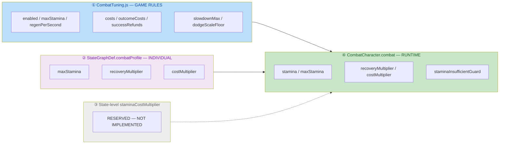

# 🔋 Stamina (Fatigue) System — Block 1 Implementation

## 1. High-Level Summary (TL;DR)

**Impact:** **High** — This diff implements an entire **fatigue/stamina combat mechanic** that touches the core combat loop (cost, regen, timing slowdown, guard-break routing), plus a new UI element, and ships several **debug flags left enabled** plus **two latent logic bugs** that break the stated "player and AI follow identical rules" design goal.

**Key Changes:**

- ✨ **New `stamina` resource** on `CombatCharacter.combat` (`stamina` / `maxStamina` / `staminaRatio`), sourced from a new `CombatTuning.stamina` config block (Source: `Data/CombatTuning.js`, `scripts/Enties/CombatCharacter.js`).
- ✨ **Two-tier cost model**: base action cost charged at **commit time** (`_commitStaminaCost()`) + outcome surcharge charged on result (`applyOutcomeStaminaCost()`), with **defense-success refunds** (`applyDefenseSuccessRefund()`).
- ✨ **Continuous fatigue slowdown** via the existing `timeScale` mechanism — `timeScale = base / (1 + 0.4 × (1 − staminaRatio))` — applied to attack/throw/clash states only; guard & dodge are exempt.
- ✨ **Insufficient-guard routing** in `ContactResolver`: a guard entered without enough stamina now resolves to **clash** instead of a clean block, with a light/heavy gradient (heavy punches through, light does not).
- ✨ **New `scripts/UI/StaminaBar.js`** — a world-anchored overhead stamina bar with a red→green spectrum gradient, lazily created and disposed by `BattleMode`.
- ⚠️ **Debug/dev switches left ON** in the same commit: `debugTrace: true`, `DEBUG_INFINITE_AMMO = true`, enemy controller switched to `"test"`, and the default boot scene changed to `ep1_tavern_room`.
- ⚠️ **A 2,529-line duplicate `AIController - 副本.js`** ("copy") was committed inside `scripts/Systems/AI/`.

---

## 2. Visual Overview (Code & Logic Map)

### 2.1 Business Goal → Module → Key Methods

```mermaid
graph TD
    BG["🎯 Business Goal<br/>Make continuous attacking cost stamina<br/>so mindless aggression is punished"]

    subgraph TUNE["Data/CombatTuning.js — GLOBAL RULES"]
        T1["stamina.enabled"]
        T2["stamina.costs"]
        T3["stamina.outcomeCosts"]
        T4["stamina.successRefunds"]
        T5["stamina.slowdownMax / dodgeScaleFloor"]
    end

    subgraph CHAR["scripts/Enties/CombatCharacter.js — RUNTIME STATE"]
        C1["combat.stamina / maxStamina"]
        C2["_commitStaminaCost()"]
        C3["applyOutcomeStaminaCost(outcome)"]
        C4["applyDefenseSuccessRefund(outcome)"]
        C5["_regenStamina(dtMs)"]
        C6["_getStateTimeScale(stateDef)"]
        C7["get staminaRatio()"]
    end

    subgraph PROFILE["StateGraphDef.combatProfile — INDIVIDUAL FITNESS"]
        P1["maxStamina"]
        P2["recoveryMultiplier"]
        P3["costMultiplier"]
    end

    subgraph RESOLVE["scripts/Systems/ — RESOLUTION PIPELINE"]
        R1["ContactResolver<br/>insufficientGuard → clash"]
        R2["CombatSystem.#dispatchOutcomes()<br/>attacker outcome cost"]
        R3["CombatSystem.#dispatchDefenderOutcomes()<br/>defender refund"]
    end

    subgraph UI["scripts/UI/StaminaBar.js + babylon_demo.html"]
        U1["StaminaBar.update()"]
        U2["BattleMode.updateRender()"]
    end

    BG --> T1
    BG --> T2
    T1 --> C2
    T1 --> C3
    T1 --> C4
    T1 --> C5
    T1 --> C6
    T2 --> C2
    T3 --> C3
    T4 --> C4
    T5 --> C6
    P1 --> C1
    P2 --> C4
    P2 --> C5
    P3 --> C2
    P3 --> C3
    C2 --> R1
    C1 --> R1
    C3 --> R2
    C4 --> R3
    C7 --> C6
    C7 --> U1
    U2 --> U1

    style BG fill:#fff3e0,color:#e65100
    style TUNE fill:#bbdefb,color:#0d47a1
    style CHAR fill:#c8e6c9,color:#1a5e20
    style PROFILE fill:#f3e5f5,color:#7b1fa2
    style RESOLVE fill:#ffcdd2,color:#b71c1c
    style UI fill:#e0f7fa,color:#006064
```



### 2.2 Combat Exchange Sequence — where stamina is charged

```mermaid
sequenceDiagram
    autonumber
    participant P as Attacker (CombatCharacter)
    participant CR as ContactResolver
    participant CS as CombatSystem
    participant D as Defender (CombatCharacter)

    Note over P: enterState() → super.enterState()
    P->>P: _getStateTimeScale(stateDef)<br/>reads staminaRatio BEFORE cost → slowdown locked
    P->>P: _commitStaminaCost()<br/>light 15 / heavy 25 / guard 10 / dodge 20
    P->>P: staminaInsufficientGuard =<br/>(stamina &lt; guardCost) — pre-cost snapshot
    P->>P: _dodgeFrameSpeedScale =<br/>floor + (1-floor) × staminaRatio

    P->>CR: weaponbox contact
    CR->>CR: read guardSnapshot.staminaInsufficientGuard
    alt insufficientGuard &amp;&amp; weight=heavy
        CR-->>CS: clash_lose (defender) + hitstop<br/>attacker attack NOT invalidated → Phase 2 hit lands
    else insufficientGuard (light)
        CR-->>CS: clash_lose (defender) + hitstop<br/>attacker attack invalidated
    else canParry
        CR-->>CS: defenseSuccess "parry"<br/>attacker attack invalidated
    else normal block
        CR-->>CS: defenseSuccess "guard_block"<br/>attacker attack invalidated
    end

    CS->>P: applyOutcomeStaminaCost(outcome)<br/>miss 10 / parried 5 / guard_blocked 5 / clash 5
    CS->>D: applyDefenseSuccessRefund(outcome)<br/>guard:success 25 / dodge:success 25
    D->>D: _regenStamina(effectiveDeltaMs)<br/>paused in attack/guard/dodge/throw/clash/hit/stunned
```

### 2.3 Configuration Layering (decision D10)



---

## 3. Detailed Change Analysis

### 3.1 🏋️ Component: `CombatCharacter` — Stamina Runtime Core

**Source:** `scripts/Enties/CombatCharacter.js`

**What Changed:**

- **Resource initialization** — added `stamina` / `maxStamina` to the `this.combat` object, resolved with a 3-level fallback chain: `stateGraph.combatProfile.stamina.maxStamina` → `config.maxStamina` → `CombatTuning.stamina.maxStamina`. Two multipliers (`recoveryMultiplier`, `costMultiplier`) are stored in `combat` and default to `1.0`.
- **`_commitStaminaCost()`** — charges the **base cost at action commit** (i.e. in `enterState`), so an interrupted attack still pays. Categorisation: `attackActive` → `attackWeight === "heavy" ? attackHeavy : attackLight`; `guardActive` → `guard`; `dodgeActive` → `dodge`; throw/hit/stunned → `0`. Cost is scaled by `costMultiplier` and floored at `0`.
- **`staminaInsufficientGuard`** — captured **before** the deduction (`this.combat.stamina < cost * this.combat.costMultiplier`), i.e. the "commit-time" decision line defined by decision **D3/P1**. Surfaced to the resolver through `getCombatSnapshot()`.
- **`applyOutcomeStaminaCost(outcome)`** — table-driven surcharge on combat result, scaled by `costMultiplier`.
- **`applyDefenseSuccessRefund(outcome)`** — refunds stamina on `guard:success` / `dodge:success`, scaled by `recoveryMultiplier` and capped at `maxStamina`. This creates a deliberate **compounding asymmetry**: weak characters pay `×costMultiplier` but refund `×recoveryMultiplier`.
- **`_regenStamina(dtMs)`** — time-based regen, called from `fixedUpdate` with `effectiveDeltaMs` (so **hitstop freeze pauses regen for free**). Blacklist: `attackActive` / `guardActive` / `dodgeActive` plus state names `throw`, `clash`, `hit`, `stunned`.
- **`_getStateTimeScale()` override** — composes fatigue on top of the existing chain-bonus scale:
  ```
  slowdown = 1 + slowdownMax × (1 − staminaRatio)
  timeScale = base / slowdown
  ```
  Applies to `attackActive` states + `throw` + `clash`. **guard and dodge are exempt.**
- **`_dodgeFrameSpeedScale`** — latched at commit time; consumed by `CharacterBase` to shorten dodge **travel distance** without changing animation speed.
- **Debug overlay** — `ST: x.x/max (pct%)` appended to the debug panel, hidden entirely when `stamina.enabled === false`.

**New public getters:** `stamina`, `maxStamina`, `recoveryMultiplier`, `costMultiplier`, `staminaRatio`.

> 🐛 **Ordering nuance (MEDIUM):** the fatigue slowdown uses the **pre-cost** stamina ratio (correct — `super.enterState()` sets `currentStateDef` and calls `_getStateTimeScale` *before* `_commitStaminaCost()`), but `_dodgeFrameSpeedScale` is computed **after** `_commitStaminaCost()`, so it uses the **post-cost** ratio. Two different "commit-time" semantics in the same method.

---

### 3.2 ⚙️ Component: Global Tuning Table

**Source:** `Data/CombatTuning.js`

**What Changed:** a new top-level `stamina` block was appended (the file previously had **no trailing newline**, which is now fixed).

| Key | Value | Consumed by | Notes |
|---|---|---|---|
| `enabled` | `true` | all stamina entry points | Master kill-switch for A/B playtest |
| `maxStamina` | `100` | `CombatCharacter` ctor | Global default; `combatProfile` overrides |
| `regenPerSecond` | `10` | `_regenStamina()` | × `recoveryMultiplier` |
| `costs.attackLight` | `15` | `_commitStaminaCost()` | × `costMultiplier` |
| `costs.attackHeavy` | `25` | `_commitStaminaCost()` | × `costMultiplier` |
| `costs.guard` | `10` | `_commitStaminaCost()` | Also the insufficient-guard threshold |
| `costs.dodge` | `20` | `_commitStaminaCost()` | |
| `costs.throw` | `0` | — | Decision **D4**: throw is free (AI has a 3 s cooldown) |
| `outcomeCosts.miss` | `10` | `applyOutcomeStaminaCost()` | Whiff penalty (heaviest) |
| `outcomeCosts.parried` | `5` | `applyOutcomeStaminaCost()` | |
| `outcomeCosts.guardBlocked` | `5` | `applyOutcomeStaminaCost()` | ⚠️ **Key never matches — see §4.1** |
| `outcomeCosts.clash` | `5` | `applyOutcomeStaminaCost()` | |
| `outcomeCosts.hit` | `0` | `applyOutcomeStaminaCost()` | Hit is free (goal achieved) |
| `successRefunds["guard:success"]` | `25` | `applyDefenseSuccessRefund()` | Includes parry (both map to `guard:success`) |
| `successRefunds["dodge:success"]` | `25` | `applyDefenseSuccessRefund()` | |
| `slowdownMax` | `0.4` | `_getStateTimeScale()` | Linear: full stamina → 1.0×, empty → 1.4× |
| `dodgeScaleFloor` | `0.5` | `_dodgeFrameSpeedScale` | Empty stamina → dodge travels half distance |

> ⚠️ The plan document (`plans/26.11.6 疲劳度计划.MD` §4) still lists refunds as `guard:success 5 / dodge:success 8` — the code was deliberately raised to 25/25 during playtest (`plans/INDEX.md` records this), but the plan doc was **not** updated.

---

### 3.3 ⚔️ Component: Combat Resolution Pipeline

**Source:** `scripts/Systems/CombatSystem.js`, `scripts/Systems/ContactResolver.js`

#### 3.3.1 `CombatSystem` — outcome cost & refund dispatch

- `#dispatchOutcomes()` — added `attackerChar.applyOutcomeStaminaCost(outcome)` **after** `markAttackResolved()` (so the miss de-dup marker is set first, preventing double-charging).
- `#dispatchDefenderOutcomes()` — added `defenderChar.applyDefenseSuccessRefund(outcome)` **before** the `controller.onCombatResult` guard, and added an explicit `if (!defenderChar) continue;` null-guard. This placement is intentional: refunds must apply even to controller-less characters.

> 🐛 **Asymmetry (HIGH):** in `#dispatchOutcomes()` the new cost call sits **after** `if (!attackerChar?.controller?.onCombatResult) continue;`. Only `AIController` implements `onCombatResult` — **`PlayerController` does not**. Therefore the **player never pays `parried` / `guard_blocked` / `clash` surcharges** (only `miss`, which `CombatCharacter` self-dispatches at `CombatCharacter.js:756`). This contradicts both the code comment *"玩家与 AI 走同一入口，规则对称"* and the plan's *"规则与 controller 反馈解耦——无 controller 的角色也扣费"*.

#### 3.3.2 `ContactResolver` — insufficient-guard → clash routing

**What Changed:** `invalidatedAttacks.add(offenseAttackId)` was **removed from the top of the `blocked` branch** and re-inserted into the individual sub-branches, enabling one branch to deliberately *not* invalidate the attack.

| Branch | Condition | Defender | Attacker attack | Effects pushed |
|---|---|---|---|---|
| **A** | `insufficientGuard && weight === "heavy"` | `clash_lose` → enters clash | **NOT invalidated** → Phase 2 lands a hit (double punishment) | clash effect + loser/winner hitstop |
| **B** | `insufficientGuard` (light) | `clash_lose` → enters clash | Invalidated | clash effect + loser hitstop |
| **C** | `canParry` | stays in guard (blockstun) | Invalidated | `defenseSuccess "parry"` + clash + hitstop |
| **D** | else (normal block) | stays in guard (blockstun) | Invalidated | `defenseSuccess "guard_block"` + clash + hitstop |

- `insufficientGuard` is computed as `guardType === "guard" && guardSnapshot?.staminaInsufficientGuard === true` — so **shields are excluded** (shields keep their own break system) and **parry is disabled against a weak guard** (the routing precedes `canParry`).
- Two `#trace()` diagnostic lines were extended with `insufficientGuard=${insufficientGuard}`.

> ⚠️ **Regression watch (MEDIUM):** branch **A** intentionally skips `invalidatedAttacks.add`. All four branches were verified to cover the `blocked` case, so there is **no current leak** — but any future branch added inside `if (blocked)` must remember to invalidate, otherwise the attack would remain live.

---

### 3.4 🏃 Component: `CharacterBase` — Movement Hook

**Source:** `scripts/Enties/CharacterBase.js`

**What Changed:** the `frameSpeeds` branch (root-motion driven movement) now multiplies by a subclass hook:

```js
const scaledSpeed = frameSpeed * (this._dodgeFrameSpeedScale ?? 1.0);
this.root.position.x += scaledSpeed * dtSec;
this.currentSpd = Math.abs(scaledSpeed);
```

- The `?? 1.0` default keeps the base class safe for non-combat characters.
- `currentSpd` now reports the **scaled** speed, so the debug panel and AI speed reads stay consistent with actual movement.

---

### 3.5 🎨 Component: UI — Overhead Stamina Bar

**Source:** `scripts/UI/StaminaBar.js` (new), `babylon_demo.html`, `scripts/Systems/Modes/BattleMode.js`

**What Changed:**

- **New `StaminaBar` class** — creates two DOM elements (`#stamina-bar-track` > `#stamina-bar-fill`) appended to `document.body`. Each frame it projects the character's world position + `HEAD_OFFSET_Y = 3` through `BABYLON.Vector3.Project` using the active camera's viewport, then positions the track with `left`/`top` in pixels.
- **Spectrum gradient** — the fill uses `linear-gradient(to right, #981818, #d2a932, #1f72e7)` with a **fixed `background-size: 168px 100%`**, so as the fill shrinks from the left the visible colour is the *current* state colour (red = exhausted, green = full).
- **Visibility guards** — hidden when the character is dead, has no `combat`, or when the projected `z` is outside `(0, 1)` (behind/outside the camera frustum).
- **CSS** added to `babylon_demo.html`: `168×24 px`, `rgba(0,0,0,0.55)` background, `overflow: hidden`, `pointer-events: none`, `translateX(-50%)` centering, `transition: width 0.08s linear`.
- **`BattleMode` wiring** — lazily creates the bar on the **player only** (by design: the enemy stamina is invisible in a blind duel); disposes it on player death and in `exit()`.
- **`BattleMode.enter()`** — resets `c.combat.stamina = c.combat.maxStamina` for every combatant (no cross-battle fatigue persistence).

> ⚠️ The class relies on the **global `BABYLON`** namespace rather than an ES import — consistent with the rest of the codebase, but worth keeping in mind if the module loader is ever tightened.

---

### 3.6 🧪 Component: Debug Toggles & Scene Configuration

**Source:** `scripts/Game.js`, `scripts/WorldState.js`, `scripts/Components/ThrowComponent.js`, `Data/SceneDefs/ep1_tavern_room.json`, `Data/TestScripts/*.json`, `Data/AnimationEvents/rabble_stick/*.json`

| File | Setting | Before | After | ⚠️ Assessment |
|---|---|---|---|---|
| `scripts/Game.js` | `CombatSystem({ debugTrace })` | `false` | `true` | **Debug logging ON** — production noise |
| `scripts/Components/ThrowComponent.js` | `DEBUG_INFINITE_AMMO` | `false` | `true` | **Unlimited ammo ON** — the code comment itself says *"正式验收必须为 false"* |
| `scripts/WorldState.js` | `currentSceneId` | `"prologue"` | `"ep1_tavern_room"` | Boot scene moved to the tavern for testing |
| `Data/SceneDefs/ep1_tavern_room.json` | enemy `controller` | `"ai"` | `"test"` | **AI disabled** for the tavern enemy |
| `Data/TestScripts/manatarms_basic_sequence.json` | test steps | 4 steps | 1 step (`reverse_quart`) | Trimmed for focused testing |
| `Data/TestScripts/rabble_stick_basic_sequence.json` | test steps | guard 2300 ms + dodge 3300 ms | guard only, 1000 ms | Dodge test removed |
| `Data/AnimationEvents/rabble_stick/rabble_stick_move.events.json` | footstep events | frame 0 **and** frame 1 | frame 1 only | Removes a duplicated footstep at loop start |

---

### 3.7 🤖 Component: AI — Backup Copy (no stamina logic)

**Source:** `scripts/Systems/AI/AIController - 副本.js` (new, 2,529 lines)

- A **verbatim backup copy** of the main `AIController.js` was committed into the live `scripts/` tree. It contains the full Utility-AI stack (CombatMemory, CombatPosture, projectile preemptive/reactive defense, positioning) but **zero stamina references** — confirmed by search.
- The production `AIController.js` was **not modified**, which is consistent with the plan: **Block 2 (AI fatigue awareness) has not started**.
- ⚠️ This is dead code inside the source tree. It will drift from `AIController.js`, and its filename contains a space and a non-ASCII suffix (`- 副本`), which can confuse module resolution and tooling.

---

### 3.8 📚 Component: Documentation & Tooling

| File | Change |
|---|---|
| `plans/BlindDuel_Stamina_Prototype_Plan.md` | **NEW** — the upstream GPT proposal (437 lines): problem framing, design principles, cost taxonomy, timing-consistency risk, 3-player-behaviour test matrix, decisions A–F to be reviewed |
| `plans/26.11.6 疲劳度计划.MD` | **NEW** (128 lines) — the reviewed, project-specific plan. Locks decisions **D1–D11** (D3 guard→clash, D9 dodge distance scale, D10 four-layer config, D11 success refunds) and marks Steps 1.1–1.7 ✅ done, Steps 2.1–2.5 (AI fatigue) not started |
| `plans/HandOff.MD` | ⚠️ **Fully rewritten** — the previous *"单场景多战斗重构交接"* (multi-BattleSession refactor: `BattleSession`, multi-enemy controllers, per-battle camera/checkpoint, Prologue extra-battle data) was **replaced** by the stamina configuration-layering discussion. **That earlier refactor design is lost from the repo.** |
| `plans/INDEX.md` | New 2026-11-07 update-log entry summarising all 8 implementation points and listing the involved files |
| `PROJECT_CONTEXT.md` | `CombatSystem` / `CombatTuning` / UI component descriptions updated with the stamina consumption points |
| `docs/AudioLicensesInfo.MD` | Trailing newline only |
| `.trae/skills/collider-occupancy-更新-skill/SKILL.md` | **NEW** (131 lines) — an agent skill for regenerating `.collider.json` / `.occupancy.json` via the two PowerShell extractors, incl. mask colour conventions and a FAQ |
| `Art/RawAssets/Env/{Tavern.ase, arrow.ase, floor.kra, treeline_pine.kra}` | Binary asset updates (no textual diff) |
| `Audio/sfx/_raw/sliceinfo.txt` | Trailing newline only |

> ⚠️ `plans/26.11.6 疲劳度计划.MD` and `PROJECT_CONTEXT.md` both reference **`docs/战斗规则说明.MD` §十 (Stamina System)**, but that file is **not part of this diff** — the combat-rules documentation is either missing or out of sync.

---

## 4. Impact & Risk Assessment

### 4.1 🐛 Confirmed Bugs

| # | Severity | Location | Description | Suggested Fix |
|---|---|---|---|---|
| **1** | 🔴 **High** | `Data/CombatTuning.js:91` | **`outcomeCosts.guardBlocked` never matches.** The real attacker outcome enum is `guard_blocked` (`CombatSystem.js:323`), but the tuning key is camelCase `guardBlocked`. `applyOutcomeStaminaCost()` does `st.outcomeCosts?.[outcome] ?? 0` → returns `0`. **Blocked attacks are never surcharged.** | Rename the key to `guard_blocked` (matching the plan doc §Step 1.3 and the `CombatMemory` mapping). |
| **2** | 🔴 **High** | `scripts/Systems/CombatSystem.js:340` vs `:348` | **The player never pays outcome surcharges.** `#dispatchOutcomes()` early-`continue`s when `attackerChar.controller.onCombatResult` is missing; `PlayerController` has no such method (only `AIController` does). Only `miss` is charged (self-dispatched). AI is taxed, the player is not — breaking rule symmetry. | Move the `applyOutcomeStaminaCost()` call **above** the `controller.onCombatResult` guard, mirroring what was already done correctly in `#dispatchDefenderOutcomes()`. |
| **3** | 🟠 Medium | `scripts/Enties/CombatCharacter.js:351-357` | **Inconsistent "commit-time" sampling.** Slowdown & `staminaInsufficientGuard` use the pre-cost ratio; `_dodgeFrameSpeedScale` uses the post-cost ratio. A dodge at exactly the threshold measures from a different point than a guard at the same threshold. | Sample `staminaRatio` once at the top of the `enterState` override and reuse it for both. |
| **4** | 🟠 Medium | `scripts/Game.js`, `ThrowComponent.js`, `ep1_tavern_room.json`, `WorldState.js` | **Debug flags shipped enabled**: `debugTrace: true`, infinite ammo, enemy `"test"` controller, tavern as boot scene. | Revert all four before acceptance. |
| **5** | 🟡 Low | `scripts/Systems/AI/AIController - 副本.js` | 2,529-line duplicate of the live AI controller inside the `scripts/` tree. | Delete it or move it outside `scripts/` (e.g. `plans/_backup/`). |

### 4.2 Breaking Changes

- **No public API removals.** `CombatCharacter` only **adds** getters (`stamina`, `maxStamina`, `recoveryMultiplier`, `costMultiplier`, `staminaRatio`) and methods — existing call sites are unaffected.
- **No DB / schema changes.** `StateGraphDef.combatProfile.stamina` is an **optional** new top-level block; all reads use `??` fallbacks, so existing character definitions continue to work unchanged.
- **⚠️ Behavioural breaking change for combat feel:** attack/throw/clash states now run up to **40 % slower** when stamina is empty, and dodge **travel distance** is reduced by up to **50 %**. Existing combo timings, AI prediction windows and clash windows will shift → the plan's acceptance item *"疲劳角色的动画、判定帧、AI 预测窗口三者一致"* must be re-verified.
- **⚠️ Guard semantics changed:** a guard entered below the stamina threshold now converts an incoming block into a **clash**, and **parry is disabled** while the guard is "insufficient". Parry-dependent AI behaviour and player muscle memory change.
- **⚠️ `getCombatSnapshot()` payload gained a field** (`staminaInsufficientGuard`) — any consumer doing strict shape validation must be updated.
- **`CombatTuning.js` gained a top-level `stamina` key** — any code iterating the tuning object generically should be checked.

### 4.3 🧪 Testing Suggestions

**Functional — stamina core**
1. **Commit-time charging**: start an attack, then get interrupted before the active frames → stamina must still be deducted.
2. **Cost-by-weight**: verify light = 15, heavy = 25, guard = 10, dodge = 20, throw = 0 (read `ST:` in the debug overlay).
3. **Cost multiplier**: temporarily set `combatProfile.stamina.costMultiplier = 1.5` on one character → confirm both base cost *and* outcome surcharge scale by 1.5.
4. **Refund cap**: drain stamina to 0, land a `guard:success` → stamina must cap exactly at `maxStamina` and **not** exceed it.

**Functional — regen**
5. **Blacklist**: stand idle → regen at 10/s × `recoveryMultiplier`; enter guard → regen **stops** (decision **P3** is still open — confirm the current intent).
6. **Hitstop freeze**: during hitstop frames, stamina must **not** regenerate (uses `effectiveDeltaMs`).
7. **Guard-blocked states**: verify no regen while in `throw` / `clash` / `hit` / `stunned`.

**Functional — fatigue timing**
8. **Slowdown range**: at `staminaRatio = 1.0` → `timeScale = base`; at `0.0` → `timeScale = base / 1.4`.
9. **Exempt states**: guard and dodge must **not** slow down.
10. **Chain-bonus coexistence**: a `chainBonus` attack must get `bonusTimeScale / slowdown`, not just `slowdown`.
11. **Dodge distance**: at 0 stamina, dodge travel must be ≈ 50 % of normal while the **animation plays at normal speed**.

**Functional — insufficient guard routing**
12. **Heavy vs weak guard** → defender enters clash, **attacker still lands the hit** (double punishment). Verify Phase 2 damage is applied.
13. **Light vs weak guard** → defender enters clash, attacker's attack is **invalidated** (no damage).
14. **Parry disabled on a weak guard** — a preemptive parry attempt must not succeed.
15. **Shields unaffected** — `guardType === "shield"` must never take the insufficient-guard path.

**🐛 Regression / bug-verification (highest priority)**
16. **Outcome surcharge table coverage** — for each attacker outcome (`hit` / `miss` / `parried` / `guard_blocked` / `clash` / `interrupted`), log the stamina delta and assert it matches the table. **This will expose bug #1 (`guardBlocked` vs `guard_blocked`).**
17. **Player-vs-AI symmetry** — run the identical scripted exchange for the player and for an AI opponent and assert **identical stamina trajectories**. **This will expose bug #2.**
18. **Double-charge check** — an attack that is both `miss`-reported and later resolved must be charged once (the `markAttackResolved` ordering).

**Regression suite**
19. **Full battle regression** on `prologue_battle`, `battle_field_1/2`, and `ep1_tavern_room` — especially **clash / parry / guard_block** interactions, which now route through a modified `ContactResolver` branch.
20. **Three-way A/B playtest** per plan §2.5: `enabled=false` / costs+regen only / costs+regen+slowdown — using the three player behaviours **A** (mindless aggression) / **B** (timed aggression) / **C** (disengage & recover).
21. **Visual check of `StaminaBar`** — track the head projection at various camera angles; verify it hides when the player is off-screen (`z` outside 0..1) and that it is removed from the DOM on death / battle exit.

---

## 5. Files Changed Summary

| Category | Files |
|---|---|
| ✨ **New gameplay code** | `scripts/UI/StaminaBar.js` |
| ⚙️ **Core combat** | `scripts/Enties/CombatCharacter.js`, `scripts/Enties/CharacterBase.js`, `scripts/Systems/CombatSystem.js`, `scripts/Systems/ContactResolver.js`, `scripts/Systems/Modes/BattleMode.js`, `Data/CombatTuning.js` |
| 🎨 **UI / CSS** | `babylon_demo.html` |
| 🧪 **Debug & scene config** | `scripts/Game.js`, `scripts/WorldState.js`, `scripts/Components/ThrowComponent.js`, `Data/SceneDefs/ep1_tavern_room.json`, `Data/TestScripts/*.json`, `Data/AnimationEvents/rabble_stick/*.json` |
| 🤖 **AI (backup only)** | `scripts/Systems/AI/AIController - 副本.js` |
| 📚 **Docs & plans** | `plans/BlindDuel_Stamina_Prototype_Plan.md`, `plans/26.11.6 疲劳度计划.MD`, `plans/HandOff.MD`, `plans/INDEX.md`, `PROJECT_CONTEXT.md`, `docs/AudioLicensesInfo.MD`, `.trae/skills/collider-occupancy-更新-skill/SKILL.md` |
| 🎨 **Binary assets** | `Art/RawAssets/Env/{Tavern.ase, arrow.ase, floor.kra, treeline_pine.kra}`, `Audio/sfx/_raw/sliceinfo.txt` |