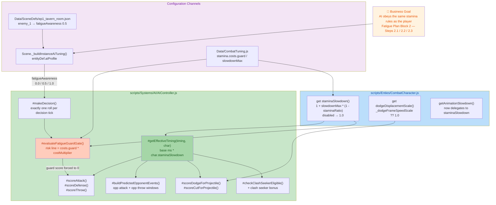
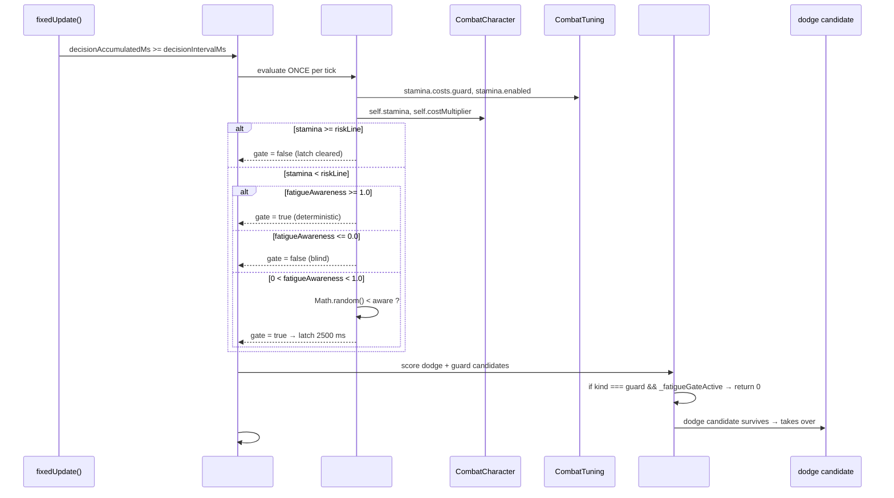
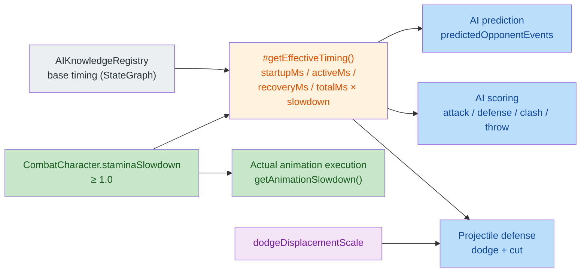

# BlindDuel — AI Fatigue/Stamina Awareness (Fatigue Plan Block 2)

## 1. High-Level Summary (TL;DR)

* **Impact:** **High** — Implements the core of the Stamina/Fatigue plan "Block 2" (Steps 2.1–2.3): the AI now reads the *same* fatigue-scaled attack timings the player experiences, and gains a configurable "fatigue awareness" knob that makes tired AI avoid raising weak guards (and let dodge take over instead).
* **Key Changes:**
  * ✨ **`AIController.#getEffectiveTiming()`** — new single source of truth: `base timing × char.staminaSlowdown`, rewired into **~15 absolute-millisecond consumption points** (attack scoring, defense timing, clash seeker, preemptive cut, predicted opponent events, projectile defense, throw scoring).
  * ✨ **`AIController.#evaluateFatigueGuardGate()`** — new per-tick guard eligibility gate; risk line derived from the same rule layer (`CombatTuning.stamina.costs.guard × costMultiplier`), with probabilistic roll + 2.5 s latch for the `fatigueAwareness = 0.5` tier.
  * ✨ **`CombatCharacter.staminaSlowdown`** / **`dodgeDisplacementScale`** — new public getters; `getAnimationSlowdown()` now delegates to the former (single-source unification).
  * ⚠️ **Debug flags flipped ON**: `ThrowComponent.DEBUG_INFINITE_AMMO = true` and `CombatSystem.debugTrace = true` — both must be reverted before acceptance.
  * ⚠️ **`plans/HandOff.MD` content destroyed** — a 171-line design doc was replaced by ~1,861 lines of pasted console log output.
  * 🗂️ A stale **2,529-line backup** `AIController - 副本.js` was committed alongside the live controller.

---

## 2. Visual Overview (Code & Logic Map)

### 2.1 Business Goal → Modules → Key Methods



### 2.2 Decision-Tick Sequence (Step 2.2 + 2.3)



### 2.3 Fatigue-Scaled Timing Flow (Step 2.1)



---

## 3. Detailed Change Analysis

### 3.1 ✨ `scripts/Systems/AI/AIController.js` — Fatigue-Aware Decision Making

**What Changed**

Three coordinated features were added to the Utility AI controller, all tied to the shared stamina resource.

**Step 2.1 — Effective Timing (single multiplier source)**

A new private helper multiplies every absolute millisecond field of a KB timing object by the acting character's fatigue factor:

```js
#getEffectiveTiming(timing, char) {
    if (!timing) return timing;
    const slow = char?.staminaSlowdown ?? 1.0;
    if (slow === 1.0) return timing;
    const scale = (v) => (typeof v === "number" ? v * slow : v);
    return {
        ...timing,
        startupMs: scale(timing.startupMs),
        activeMs:   scale(timing.activeMs),
        recoveryMs: scale(timing.recoveryMs),
        totalMs:    scale(timing.totalMs),
    };
}
```

Wiring sites (all previously read raw base timing):

| # | Consumption point | Method | Character timed |
|---|---|---|---|
| 1 | Preemptive-cut viability (`bestActiveEnd`) | `#makeDecision()` | self |
| 2 | Opponent attack active window | `#buildPredictedOpponentEvents()` | opponent |
| 3 | Opponent throw release / arrival | `#buildPredictedOpponentEvents()` | opponent |
| 4 | Attack utility score | `#scoreAttack()` | self |
| 5 | Clash seeker eligibility (interval overlap) | `#checkClashSeekerEligible()` | self |
| 6 | Clash seeker bonus | clash bonus block | self |
| 7 | `_timeUntilActiveEnd` | `#scoreDefense()` | opponent |
| 8 | Fallback `timeUntilActive` | `#scoreDefense()` | opponent |
| 9 | `escapeLatency` (dodge i-frame gate) | `#scoreDefense()` | self |
| 10 | `timeUntilHit` | `#scoreDefense()` | opponent |
| 11 | Preemptive cut diagnostic window | `#evaluateProjectileDefense()` | self |
| 12 | Retreat displacement prediction | `#scoreDodgeForProjectile()` | self (scale) |
| 13 | Slash `activeStart` in dodge scoring | `#scoreDodgeForProjectile()` | self |
| 14 | Slash `activeStart` / `activeEnd` | `#scoreCutForProjectile()` | self |
| 15 | Throw `startupMs` | `#scoreThrow()` | self |
| 16 | Fastest opponent slash startup (cut readiness) | `#scoreThrow()` | opponent |

> **Deliberately *not* rewired:** ratio-based consumers (`#computeStartupFactor`, `startupMs / totalMs` normalization) and dodge *animation* timing — ratios are scale-invariant, and per the D9 decision dodge animation does not slow down (only its displacement scales). This is documented in `plans/INDEX.md`.

**Step 2.2 — `fatigueAwareness` knob**

```js
this.fatigueAwareness = this.tuning.aiProfile?.fatigueAwareness ?? 1.0;
```

* Read from the **scene entityDef** `aiProfile` channel (via `Scene._buildInstanceAiTuning`), *not* from `StateGraphDef` — the docs were corrected accordingly.
* The `CombatTuning` import was added to `AIController.js` for the risk-line lookup.

**Step 2.3 — Guard eligibility gate + probabilistic latch**

```js
#evaluateFatigueGuardGate() {
    if (CombatTuning.stamina?.enabled === false) return false;
    const riskLine = (CombatTuning.stamina.costs?.guard ?? 10) * (self?.costMultiplier ?? 1.0);
    if ((self?.stamina ?? Infinity) >= riskLine) { this._fatigueGuardLatchUntil = 0; return false; }
    if (aware >= 1.0) return true;
    if (aware <= 0.0) return false;
    if (now < this._fatigueGuardLatchUntil) return true;   // latch still active
    if (Math.random() < aware) { this._fatigueGuardLatchUntil = now + 2500; return true; }
    return false;
}
```

* The gate is rolled **exactly once per decision tick** (inside `#makeDecision()`, before `#buildSituation()`), deliberately avoiding per-candidate rolls that would inflate the suppression probability (multiple guard candidates each rolling).
* When active, `#scoreDefense()` returns `0` for `kind === "guard"` — **dodge naturally takes over** because it remains in the same Utility pool.
* The latch (2.5 s ≈ 12 decision ticks) prevents 200 ms-tick flicker; it is **cleared automatically** once stamina recovers above the risk line.

**Awareness tiers**

| `fatigueAwareness` | Behaviour in risk zone | Intended archetype |
|---|---|---|
| `0.0` | Blind — always raises weak guard, eats the clash | Rabble / tutorial enemies |
| `0.5` |50 % roll, 2.5 s latch → intermittent suppression | Normal soldiers (`enemy_1` in the tavern room) |
| `1.0` (default) | Deterministic — zero guard while in risk zone | Elites / Bosses |

---

### 3.2 ✨ `scripts/Enties/CombatCharacter.js` — Public Fatigue API

| Member | Kind | Behaviour |
|---|---|---|
| `get staminaSlowdown()` | New getter | `1.0` when `CombatTuning.stamina.enabled === false`; otherwise `1 + st.slowdownMax * (1 - this.staminaRatio)`. Always ≥ 1.0. |
| `get dodgeDisplacementScale()` | New getter | `this._dodgeFrameSpeedScale ?? 1.0` — dodge animation does not slow, but its **displacement** is stamina-scaled. |
| `getAnimationSlowdown()` | Modified | Was `1 + st.slowdownMax * (1 - this.staminaRatio)` inline → now `base / this.staminaSlowdown`, so animation and AI prediction share **one** multiplier source. |

---

### 3.3 ⚙️ `Data/SceneDefs/ep1_tavern_room.json` — First `fatigueAwareness` Configuration

```json
"controller": "ai",
"aiProfile": { "fatigueAwareness": 0.5 }
```

Attached to `enemy_1` — the **first real-world carrier** of the mid tier, verified in playtest (0.5 → `SUPPRESS` triggered at `stamina=1 < line=10`, zero weak guards in the round).

---

### 3.4 🐛 Debug / Dev Toggles Left ON (must be reverted before acceptance)

| File | Flag | Old | New | Risk |
|---|---|---|---|---|
| `scripts/Components/ThrowComponent.js` | `ThrowComponent.DEBUG_INFINITE_AMMO` | `false` | **`true`** | ⚠️ Infinite ammo masks all throw/ammo gating; the file's own comment states *"正式验收必须为 false"* (must be false for formal acceptance). |
| `scripts/Game.js` | `new CombatSystem({ debugTrace })` | `false` | **`true`** | ⚠️ Verbose combat tracing every frame — perf hit + console spam. |

---

### 3.5 🌐 `scripts/WorldState.js` — Default Scene Switched

```diff
- this.currentSceneId = "prologue";
+ this.currentSceneId = "ep1_tavern_room";
```

The game now **boots into the tavern room** instead of the prologue. Convenient for AI-fatigue playtesting, but it changes the default startup path for everyone.

---

### 3.6 🧪 `Data/TestScripts/*.json` — Test Harness Trimmed

| File | Change | Effect |
|---|---|---|
| `manatarms_basic_sequence.json` | Removed the `moveIntent x=1` (1300 ms), `smash` (1800 ms) and `moveIntent x=0` (1500 ms) steps | Sequence reduced to `reverse_quart` only — isolates a single attack wind-up for fatigue timing measurement. |
| `rabble_stick_basic_sequence.json` | Removed the `dodge` step (3300 ms); `guard` `waitMs` `2300 → 1000` | Shorter exposure window; shorter guard hold so the stamina cost of guard is actually observable within the test window. |

---

### 3.7 📚 Documentation & Planning

| File | Change |
|---|---|
| `PROJECT_CONTEXT.md` | Added `fatigueAwareness` to the documented AI instance-level config injection chain (`0.0 全盲 / 0.5 掷骰锁存 / 1.0 永不`, default `1.0`, landed 26.11.9). |
| `plans/INDEX.md` | New **Update Log (2026-11-09)** section documenting Step 2.1~2.3, the three-tier playtest validation, the D9 decision, the leftover "fatigueTiming log removed / fatigueGuardGate log kept" decision, and the outstanding Step 2.5 comparative playtest. Also notes `AIController - 副本.js` is pending manual deletion. |
| `plans/26.11.6 BlindDuel_Stamina_Prototype_Plan.md` | **New 437-line proposal document** — the design source of truth for the whole stamina system: design principles (fatigue is a combat rule, not an AI rule; continuous & predictable curves), cost model (`base cost + outcome surcharge`), recovery rules, the **single-timing-source** requirement (§3), AI integration boundary (Phase 1 shared rules → Phase 2 Utility cost → Phase 3 opponent fatigue), out-of-scope list, A/B/C playtest matrix, 3-way control groups, and 6 open review questions (A–F) for the project AI. |
| `plans/HandOff.MD` | ⚠️ **Content destroyed.** The previous 171-line design doc ("单场景多战斗重构交接" — multi-battle-in-one-scene refactor) was replaced by ~1,861 lines of raw pasted console output (`[AI-Diag]`, `[Resolver-Diag]`, `[Phase0]` lines). This looks like an accidental paste-over of a debug log and should be restored from version control. |

The pasted log is, however, useful evidence — it captures the fatigue multiplier working end-to-end:

```
[AI-Diag] fatigueTiming slow=1.06 startup 420->445ms stamRatio=0.85
[AI-Diag] fatigueTiming slow=1.23 startup 420->515ms stamRatio=0.44
[AI-Diag] fatigueTiming slow=1.40 startup 220->308ms stamRatio=0.00
```

---

### 3.8 🧰 New Editor Skill — `.trae/skills/collider-occupancy-更新-skill/SKILL.md`

A new Trae skill that documents **two asset-extraction routes**:

| Route | Script | Applies to | Output |
|---|---|---|---|
| A — Collider | `scripts/tools/extract_collision_boxes.ps1` | Combat characters (`longswordman`, `rabble_stick`) | `.collider.json` |
| B — Occupancy | `scripts/tools/extract_rootmotion_occupancy.ps1` | NPCs (`traveller`, `merchant`, `merchant2`) | `.occupancy.json` |

Includes: per-action PowerShell command templates, a batch-iteration example, the collision-mask colour convention (`#FFFF00` hitbox, `#E37800` strong blade, `#FF0000` weak blade, `#7082C1` root anchor), and 5 FAQ entries (ExecutionPolicy bypass, same-frame connected-component merging, 6-pixel minimum, root fallback, legacy script path).

---

### 3.9 🗂️ Assets & Stray Files

| File | Change | Notes |
|---|---|---|
| `Art/RawAssets/Env/Tavern.ase`, `arrow.ase`, `floor.kra`, `treeline_pine.kra` | Binary updates | Aseprite / Krita environment art (tavern set, floor, pine treeline). No code impact. |
| `Audio/sfx/_raw/sliceinfo.txt` | Trailing newline added | Whitespace-only change; the 4 slice entries are unchanged. |
| `scripts/Systems/AI/AIController - 副本.js` | **New 2,529-line file** | Stale **pre-change** snapshot of `AIController.js` — verified to contain **none** of the new fatigue code (no `fatigueAwareness`, no `#getEffectiveTiming`, no `CombatTuning` import). It is dead weight in the repo and `plans/INDEX.md` explicitly flags it for manual deletion. Note the filename contains a space and non-ASCII characters, which is a hazard for tooling. |

---

## 4. Impact & Risk Assessment

### ⚠️ Breaking / Behavioural Changes

| Area | Change | Who is affected |
|---|---|---|
| **AI decision quality** | All absolute-ms AI reasoning is now fatigue-scaled → AI reacts later to tired opponents and scores its own attacks against slowed timelines | All AI-controlled combatants |
| **AI guard usage** | In the risk zone, weak guard may be suppressed entirely → dodge takes over → different defensive silhouette & clash outcomes | All AI with `fatigueAwareness > 0` |
| **Throw ammo** | `DEBUG_INFINITE_AMMO = true` → AI can throw without ammo limits | Any build shipping this state |
| **Startup scene** | `WorldState.currentSceneId` defaults to `ep1_tavern_room` | New game boot path |
| **Console output** | `debugTrace: true` on `CombatSystem` | Runtime performance & log noise |
| **Docs** | `plans/HandOff.MD` prior content is unrecoverable from the working tree | Any reader relying on that handoff doc |

### ❌ No public API breaks in the strict sense

* `AIController` gains **only** new members (`fatigueAwareness`, `_fatigueGateActive`, `_fatigueGuardLatchUntil`, `#getEffectiveTiming()`, `#evaluateFatigueGuardGate()`) — no existing signatures changed.
* `CombatCharacter` gains **only** new getters; `getAnimationSlowdown()` keeps its signature and semantics.
* `#getEffectiveTiming()` is a *private* (`#`) method — no external callers can break.

### 🧪 Testing Suggestions

**A. Fatigue timing (Step 2.1)**
1. Verify the multiplier math end-to-end: `staminaRatio = 0.0` ⇒ `slow = 1 + slowdownMax` ⇒ `startup 420 ms → 588 ms` at `slowdownMax = 0.4`.
2. Confirm **ratio consumers did not regress**: `#computeStartupFactor` and `startupMs / totalMs` normalisation must produce identical results with `staminaRatio = 0` vs `1`.
3. Confirm **dodge animation timing is unchanged** (D9) but **dodge displacement prediction** now scales — i.e. `retreatMs` grows with fatigue and `effectiveTotalMs` shrinks.
4. Confirm phase classification (`#getAttackPhase`) is unaffected — `startupMs / totalMs` ratios must be scale-invariant.

**B. Guard gate (Step 2.3)**
5. `fatigueAwareness = 1.0` → in risk zone, **zero** guard actions; dodge takes over.
6. `fatigueAwareness = 0.0` → in risk zone, guard still raised (expect `clash_lose`).
7. `fatigueAwareness = 0.5` → intermittent suppression; **one roll per tick**, not one per guard candidate (verify suppression probability ≈ 50 %, not 75 % for two guard candidates).
8. Latch behaviour: suppression persists ~2.5 s, then re-rolls; latch **clears** immediately once `stamina >= riskLine`.
9. Edge case: `stamina` exactly equal to `riskLine` → gate must be **off** (boundary uses `>=`).
10. Edge case: `CombatTuning.stamina.enabled = false` → gate must always return `false`.

**C. Config plumbing (Step 2.2)**
11. Confirm `entityDef.aiProfile.fatigueAwareness` reaches the controller via `Scene._buildInstanceAiTuning()` — **not** via `StateGraphDef`.
12. Confirm entities **without** an `aiProfile` fall back to `1.0` (full awareness).

**D. Regression / housekeeping**
13. ⚠️ **Revert `DEBUG_INFINITE_AMMO` to `false` and `debugTrace` to `false` before acceptance.**
14. ⚠️ **Restore `plans/HandOff.MD`** from git — the current content is a debug-log dump, not the handoff design doc.
15. 🗑️ **Delete `scripts/Systems/AI/AIController - 副本.js`** (tracked in `plans/INDEX.md` as a pending manual cleanup).
16. Run the two trimmed test scripts end-to-end to confirm the reduced sequences still exercise the intended attack/guard windows.
17. ⚠️ **Open issue (from `plans/INDEX.md` Step 2.4):** AI showed *zero attack convergence* while fatigued — 7 consecutive `self:hit` at `staminaRatio = 0.00`. This is the direct evidence that motivates the proposed **GPT Phase 2** (Utility-layer stamina cost scoring). Flag it to the reviewer: the current implementation reduces *defensive* mistakes but does **not** yet reduce *offensive* tunnel-vision.

---